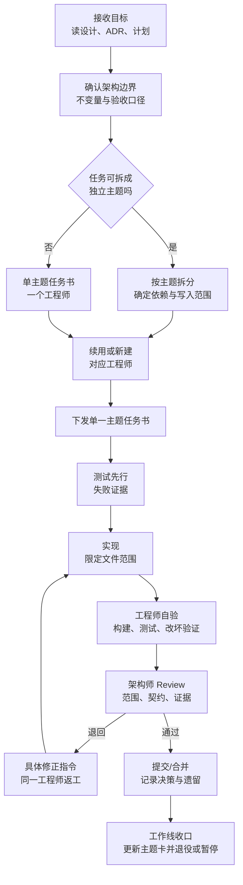
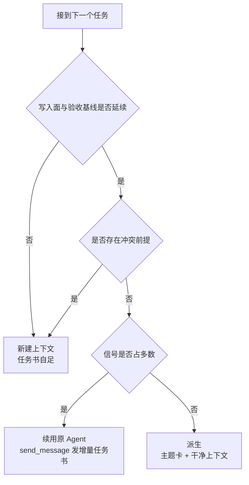

# 架构师—子 Agent 协作工作流

本技能定义一种多人协作的编码方式：主会话只承担架构师职责，代码由创建后可反复调用的子 Agent 完成；架构师不直接修改生产代码，而是守住设计目标、拆出单一主题任务、审核交付物并决定是否合并。它的核心不是“用很多 Agent”，而是**让每个 Agent 的上下文与下一个决策匹配**：该留的信号留住、该裁的噪音裁掉、发现冲突前提立即换人，从而减少跑偏、串题、重复解释与上下文稀释。新开一个 Agent 是代价最高的一档动作，不是默认动作。

## 1. 何时使用

适用于同时满足以下条件的任务：

- 任务需要连续修改生产代码，且跨越多个文件、项目或批次；
- 已有设计、ADR、计划或验收标准，架构边界需要有人持续守住；
- 工作可以拆成若干相对独立的主题，或需要测试工程师与实现工程师分工；
- 需要反复迭代、Review、返工，而不是一次问答就能结束；
- 上下文很大，单个会话同时装载全部设计、实现与测试细节会明显降低判断质量。

不适用于：

- 单文件、单函数的低风险小改动，直接做比组织 Agent 更便宜；
- 设计尚未定稿、关键取舍还在讨论的阶段，此时应先完成设计或 ADR；
- 需要大量探索、接口尚未成形的一次性原型，原型产物应丢弃而不是进入正式实现；
- 生产事故的紧急热修，先止血再补流程。

## 2. 核心原则

### 2.1 架构师不直接改代码

架构师负责：

- 维护整体设计目标、技术路线与不变量；
- 将工作拆成单一主题，写任务书；
- 创建、复用、暂停或退役子 Agent；
- Review 代码、测试、构建与交付证据；
- 决定接受、退回或重新分配；
- 在必要时修改设计文档、计划或任务书，但不直接编辑生产代码。

架构师直接改代码会破坏两层隔离：一是 Review 失去独立性，二是架构师自己的上下文被实现细节占满，后续任务拆分容易失去全局判断。即使改动只有一行，也应交给对应工程师完成，架构师只给最小修正指令。

### 2.2 代码工程师只做单一主题

每个子 Agent 的职责边界必须同时满足：

- 一个可命名的主题，例如“A2 契约与实现”或“A2 契约测试”；
- 一组明确允许修改的文件或项目；
- 一组明确禁止修改的文件、主题和行为；
- 一组可执行的验收判据；
- 一个明确的停止条件与上报格式。

“顺手重构”“顺便修个 bug”“把相关模块一起迁了”都不属于当前主题；发现这类问题时，工程师记录证据并上报，由架构师决定是否另开任务。

### 2.3 上下文匹配优先于 Agent 数量

员工可以是一个，也可以是多个，数量由任务结构与上下文边界决定，而不是由“多 Agent 看起来更强”决定。上下文的质量按三轴衡量，三者各自失效的方式不同，不能用其中一条代替全部：

| 轴 | 定义 | 失效后果 | 判据 |
| :--- | :--- | :--- | :--- |
| 信号 | 仍在支撑下一个决策的事实：写入面、不变量、被否决方案的理由、夹具与验收命令 | 复用它的价值就在这里 | 下一个判断是否会引用它 |
| 噪音 | 事实为真但下一个决策用不上：上一子主题的调试过程、无关模块结构、整份设计文档 | 稀释注意力、诱发“顺手”改动、挤占上下文预算 | 下一个判断是否与它无关 |
| 冲突 | 已经不成立的前提：旧任务书授权、被否决却仍挂着的方案、旧版接口当成现状 | 直接做错，且错误前提会自我强化 | 它现在是否仍然为真 |

因此“纯净”不是信息越少越好，而是**没有冲突前提、噪音占比低、信号覆盖下一个决策**；“相关”只说明可能有信号，既不说明信号占多数，也不说明该把整段历史塞进去。判断一个 Agent 该不该拆，问的是：

```text
一个 Agent 是否需要同时理解两个互不依赖的写入面，才能完成当前交付？
需要 → 拆成两个上下文
不需要 → 一个上下文即可，哪怕它跨了多个交付批次
```

### 2.4 按工作线复用，前提失效即换人

**工作线**是上下文的归属单位，指同一写入面（同一批文件或同一组接口）加同一套验收基线下连续推进的一串工作，可以包含多个交付批次。工作线不等于主题：一个主题可能被拆到两条工作线，一条工作线也可能跨几个主题，判断依据始终是写入面与验收基线是否延续，而不是主题名字是否相同。

上下文动作只有三种，按代价从低到高选：

| 动作 | 何时用 | 代价 |
| :--- | :--- | :--- |
| 续用（`send_message`） | 写入面有交集、无冲突前提、信号仍占多数 | 最低：目录约定、失败史与夹具知识都还在 |
| 派生（新上下文 + 主题卡） | 写入面有交集但噪音已过半，或轮次与日志接近上下文预算 | 中：需要把当前约束压成一页交接 |
| 新建（`subagent`） | 交集为空，或出现冲突前提 | 最高：约定全部重新交代，口径容易二次走样 |

默认动作是续用而不是新建，因为两种错误的代价不对称：新开过度的成本是持续且隐性的（重复解释、二次走样、同一个坑再踩一次，而且不会报错），续用过度的成本是偶发且显性的（串题会在改错文件或 Review 时暴露），因此默认值应偏向续用，再用硬条件把错误方向拉回。

硬条件优先于默认值，出现任一条即新建，不允许在原上下文里修补：

- 冲突前提已经出现：旧任务书的授权失效、被否决的方案仍被当成依据、旧版接口被当作现状；
- 工程师连续两次在同一处误解设计，说明前提已错，继续续用只会加深偏见；
- 工程师用“之前我们讨论过”当依据，而任务书没有记录该结论；
- 下一个工作与旧写入面没有交集，且需要新的验收基线；
- 需要并行写同一批文件，原上下文无法保证单一写作者。

角色决定同一份上下文对下一个任务是不是资产：实现工程师的上下文可复用，因为它记住的是文件布局、失败史与验收命令；契约测试工程师见过实现体就会按实现写断言；验证工程师的价值全在独立视角。因此**契约测试与验证一律新建，不留裁量空间**，实现工程师按上表判定，工作线的主题卡由架构师维护。

上下文决定必须写进任务书并留痕，写明动作与依据（写入面交集、残留子主题数、发现的冲突前提、轮次），使换人与续用都能复盘，而不是靠手感。

### 2.5 架构师不适用 ponytail 的省事原则

`ponytail` 是代码工程师的实现约束，用于避免过度实现、重复抽象和无谓改动；它不是架构师的取舍依据，架构师也不能用“最小改动”替自己省掉契约设计、兼容性论证或未来演进判断。架构师对以下事项负有长期责任：

- 公共契约是否向后兼容，旧调用方是否仍能工作；
- 新契约是否为已可见的下一步留下扩展点，而不是只为当前测试写死；
- 跨版本、跨项目、插件作者与宿主之间的语义是否一致；
- 设计是否与 ADR、DESIGN、PLAN 的既有决策冲突，冲突是否已经显式修订；
- 退化路径、迁移窗口、弃用节奏与验收基线是否清楚。

因此任务书里可以要求代码工程师加载 `ponytail`，但必须同时写明：

```text
ponytail 只约束实现的最小改动；
不得用最小改动为由修改公共契约、验收标准或设计边界；
实现层面的简化与契约层面的完整性冲突时，先停止并上报架构师。
```

架构师本人在做任务拆分、契约评审与合并判断时，不得以 `ponytail` 的“少做”倾向替代长期设计判断；如果需要缩小范围，理由必须是版本节奏、证据不足或风险隔离，而不是“省事”。

### 2.6 装配依赖与人工点验不能由单元测试替代

一次组件改造把工厂载荷从“返回界面元素”改成“返回视图模型 + 模板组”，组件测试与上百条单元测试全绿，真实窗口却仍显示“内容不可用”；根因有两层，一是组合根从未给默认服务的静态注入赋值，二是附件保留了 `RequiresParameter = true`，而旧行为在参数为空时渲染禁用态而不拒绝渲染。这两个问题都发生在“组件之外”的装配与降级路径上，单测各自只覆盖宿主内部逻辑，无法替代真实窗口验证。

因此把以下几条作为硬规则：

- 改变工厂载荷形态、模板来源、默认服务或参数契约时，任务书必须先列出组合根依赖清单，至少检查默认注入点、模块装配点、界面绑定与应用启动顺序；禁止只改组件就宣布完成。
- `RequiresParameter` 一类元数据不是装饰性标注，而是“参数为空时是否允许渲染”的行为契约；迁移必须同时验证空参数、类型不符、参数切换三条路径，不能只测参数正常的成功路径。
- 界面行为变更在单元测试之外必须安排人工点验，任务书要写明操作步骤、预期界面与截图要求；构建通过、测试全绿只能证明组件逻辑，不证明窗口真的装配成功。
- 占位文本必须能读出完整诊断码；如果界面宽度把诊断码截掉，该占位不能作为验收证据，应先让诊断可见再判断。
- 文件白名单用于保护上下文，不用于阻止架构师做依赖审计；若修复需要跨越白名单，架构师应重新拆任务或扩大范围，而不是让工程师在旧任务里盲改。

## 3. 角色与职责

| 角色 | 负责 | 不负责 | 典型产物 |
| :--- | :--- | :--- | :--- |
| 架构师 | 设计目标、任务拆分、任务书、Review、合并判断、升级决策 | 直接编辑生产代码、替工程师调试、绕过验收 | 任务书、Review 结论、风险清单 |
| 契约测试工程师 | 依据设计与契约写失败测试、边界用例、改坏验证 | 修改生产代码、改设计、改验收标准 | 失败输出、测试用例、覆盖说明 |
| 实现工程师 | 在限定文件内实现功能、让测试转绿、补必要注释 | 改测试期望、越界重构、改 ADR/PLAN | 代码 diff、构建与测试证据 |
| 验证工程师 | 独立跑验收、做对抗性检查、核对任务范围 | 修代码、改需求、替实现者解释失败 | 验证报告、复现步骤、结论 |
| 子 Agent 管理者 | 创建/复用/暂停 Agent、传递任务、收集结果 | 代替架构师做设计裁决 | Agent 清单、任务状态 |

小型任务可以只用一个实现工程师，把测试与验证合并到同一上下文；中大型任务至少拆成测试与实现两个上下文，避免实现者按自己的实现写测试。验证工程师是可选角色，只有在验收需要独立视角或高风险回归时才增加。各角色与上下文的复用关系见第 2.4 节：实现工程师按写入面续用，契约测试与验证不继承实现者的上下文。

## 4. 组织设计

### 4.1 一个还是多个

| 任务形态 | 建议 | 理由 |
| :--- | :--- | :--- |
| 单文件、单行为、低风险 | 一个实现工程师 | 拆分成本高于收益 |
| 一个主题、测试与实现紧耦合 | 一个实现工程师，内部按 TDD 推进 | 接口尚未稳定时，强行拆测试/实现会造成来回传话 |
| 一个主题、契约已稳定 | 测试工程师 + 实现工程师 | 测试独立于实现，能防止按实现写测试 |
| 两个以上互不依赖的模块 | 每个模块一个工程师，可并行 | 文件不重叠，上下文互不污染 |
| 高风险、需要对抗性验证 | 实现工程师 + 验证工程师 | 验证者不参与实现，避免自我确认 |
| 跨多个批次的大计划 | 同一工作线连续批次续用同一工程师，工作线之间新建 | 上下文边界是写入面与验收基线，不是批次 |

### 4.2 主题边界的判定

一个主题应当满足：

```text
可以用一句话说清交付物；
有独立的验收判据；
失败时能定位到该主题，而不是牵扯整个系统；
允许修改的文件集合可以被枚举；
不要求工程师同时理解另一个未完成主题的内部实现。
```

如果两个主题共享同一批核心文件、同一组接口还在变化，应合并为一个主题顺序推进，而不是并行拆给两个人；并行写同一批文件只会在合并阶段制造冲突，并让 Review 无法判断行为归属。

### 4.3 上下文清单

每个任务书只附带当前主题需要的最小上下文：

- 对应的 ADR、设计或计划章节，必要时摘录而不是丢整份文档；
- 允许修改的文件清单；
- 相关接口或数据结构的现状；
- 不变量与禁止事项；
- 验收命令与期望结果；
- 已知风险与停止条件。

不默认附带：完整仓库结构、其他主题的讨论记录、全部历史提交、与当前任务无关的模块实现、上一轮失败尝试的完整推理过程。需要历史时由架构师摘成事实，不让工程师自己在长历史里猜。

## 5. 工作流



### 5.1 架构师接单

架构师先读设计与计划，回答四个问题：

1. 这次要改变哪个契约或行为，验收判据是什么；
2. 哪些文件属于核心写入面，哪些只是只读参考；
3. 哪些主题可以独立交付，哪些必须顺序推进；
4. 哪些前置条件尚未满足，是否需要先派契约骨架或测试任务。

前置条件不满足时，不把“等接口定了再说”丢给工程师；架构师先决定接口骨架由谁完成，或把任务拆成“先定契约、再写测试、再实现”三个阶段。

### 5.2 任务拆分

拆分遵循“一个主题一张任务书”，而不是“一个文件一张任务书”。主题过大时按行为面拆，例如：

```text
契约定义
失败测试
核心实现
宿主集成
释放链
回归验证
```

同一批核心文件上的契约与实现可以放在同一主题，由同一个工程师用 TDD 顺序完成；测试与实现分属两个 Agent 时，测试任务必须先完成并留下失败证据，再交实现任务。

### 5.3 创建、复用与退役

先判断工作线归属，再决定上下文动作，顺序不可颠倒：写入面与验收基线是否延续 → 有无冲突前提 → 信号与噪音的比例 → 续用、派生或新建。



- 续用用 `send_message` 把新任务书发给原工程师：它的上下文里已有文件布局、失败史与验收命令，新任务书只写增量，不重复交代已确认的约束；一个 Agent 同时只接一个任务，不把第二个主题作为“顺便”追加；
- 派生时先更新主题卡（见第 8.4 节），新上下文只拿卡与任务书；只有新任务确实需要继承架构师的设计推理时才用 `subagent_fork`，且任务书仍要显式划边界，禁止让子 Agent 从整段对话里自行找重点；
- 新建时任务书必须自足：不依赖主会话未言明的记忆，也不假设工程师读过任何历史；
- 每个任务书记录上下文决定（续用某 agent-id、派生或新建）与依据；Agent 完成后记录 id、工作线、状态与产物，工作线结束即标记退役或暂停，不长期挂着万能工程师；
- 提前换人看异常信号：工程师开始复述已定稿的结论、反复询问已确认的问题、改到允许文件之外，或上下文里堆着大段与下一个决策无关的日志。先判断是噪音还是冲突，噪音用派生解决，冲突直接新建。

### 5.4 下发任务书

任务书是架构师与工程师之间的唯一契约。口头补充、聊天里的“顺便”、未写入任务书的隐含要求，都不算验收依据。

### 5.5 执行与上报

工程师按 TDD 推进：先给失败测试与失败输出，再实现到绿，再做改坏验证。实现过程中发现以下情况必须停止并上报：

- 需要的接口或设计在任务书中不存在；
- 允许修改的文件不足以完成任务；
- 验收判据互相矛盾；
- 发现相邻模块的真实缺陷；
- 测试本身写错，需要改变期望值；
- 构建或测试被环境阻塞，且无法在授权范围内解决。

停止不是失败，隐瞒范围扩张才是失败；工程师应在报告中给出证据、影响和建议，不自行改设计或改验收标准。

#### 5.5.1 中间迭代的构建与测试粒度

研发过程的中间迭代只验证当前任务，交付前才做全量：

- **中间构建只构建目标工程**：按任务书给出的目标 `.csproj` 执行 `dotnet build`，不跑解决方案级全量构建。全量构建只在批次交付前、合并前或改动跨工程契约时执行一次，并记录结果。
- **中间测试只跑目标类**：按任务书给出的测试类执行 `dotnet test <测试工程> --filter FullyQualifiedName~<目标类>`，不跑整个测试工程、不跑整个解决方案。全量测试只在批次交付前或合并前执行一次。
- **任务书必须写明目标工程与目标测试类**：例如“构建 `<目标>.csproj`；测试 `<测试工程>` 的 `<目标测试类>`”。没有写清的，架构师先补任务书，工程师不自行扩大构建/测试范围。
- **跨工程改动例外**：只有改动公共契约、项目引用、解决方案文件或跨工程装配时，才允许在中间迭代构建受影响的目标工程集合；仍不默认全量。
- **证据口径**：中间迭代报告目标工程的构建结果与目标类的过滤测试结果；交付报告再补全量构建与全量测试结果。不得用“全量通过”掩盖目标类没跑，也不得用“目标类通过”代替交付前的全量门禁。

### 5.6 架构师 Review

Review 不是“看一遍 diff”，而是逐项核对证据：

| 检查项 | 通过条件 |
| :--- | :--- |
| 范围 | 只改了任务书允许的文件，没有顺手重构或无关格式化 |
| 设计一致性 | 实现符合 ADR/设计的不变量，没有引入第二套语义 |
| 测试先行 | 有失败测试与失败输出，测试不是实现完成后补的 |
| 断言强度 | 关键行为有精确断言，改坏实现会让测试变红 |
| 构建 | 中间迭代目标工程构建通过；交付前全量解决方案构建通过，或失败可归因于环境 |
| 门禁 | 中间迭代目标类过滤测试通过；交付前全量测试与门禁脚本通过，跳过项有理由 |
| 边界 | 空值、权限、失败路径、释放与幂等有覆盖或明确说明 |
| 交付物 | 提交说明、变更文件、测试证据与任务书一致 |

Review 结论只有三种：

```text
APPROVE        接受，进入提交/合并
CHANGES        退回同一工程师，给出具体修正项
REASSIGN       当前上下文已污染或方向错误，换新 Agent 重做
```

`CHANGES` 必须列出文件、行为、证据与期望，不写“再看看”“优化一下”这类无法执行的评语。

### 5.7 提交与合并

一个批次一个提交，提交信息使用仓库约定的 scoped 前缀。工程师负责提交自己的改动；架构师核对提交内容与任务书范围一致后再合并或允许推送。若仓库只允许单写入者，架构师不并行开两个改同一工作树的 Agent；需要并行时使用独立 worktree 或独立分支，并在任务书中写明合并顺序。

### 5.8 工作线收口

一个工作线告一段落后：

- 记录验收结果、遗留问题与未覆盖理由；
- 更新计划状态与决策记录，不把过程流水塞进设计正文；
- 更新主题卡，把仍然有效的约束、命令与风险留下来；
- 该工作线的实现工程师上下文在无后续任务时退役或暂停，不留着承接无关主题；
- 如果工作线产出了新的架构事实，先更新 ADR 或设计，再开启依赖它的下一工作线。

## 6. 任务书模板

任务书必须包含以下字段，缺一项就退回架构师补齐，不直接开工。

```markdown
# 任务：<单一主题>

## 1. 目标
<一句话说清交付物与完成后可观察的行为>

## 2. 设计依据
- ADR：<路径 + 章节>
- DESIGN：<路径 + 章节>
- PLAN：<路径 + 批次>
- 只读参考：<文件/文档>

## 3. 当前状态与断点
<已经完成什么、缺什么、上一步留下了什么>

## 4. 上下文决定
- 动作：<续用某 agent-id / 派生 / 新建>
- 依据：<写入面交集、残留子主题、冲突前提、轮次>
- 主题卡：<路径，续用时作校对依据，派生与新建时作任务书底稿>

## 5. 允许修改
- <文件或项目 1>
- <文件或项目 2>

## 6. 禁止修改
- <设计/ADR/计划>
- <其他主题的文件>
- <测试期望，除非本任务明确授权>

## 7. 不变量
- <必须保持的行为/契约/性能/权限/线程约束>

## 8. 验收判据
- [ ] <目标工程路径与中间构建命令、期望输出>
- [ ] <目标测试工程 + `--filter FullyQualifiedName~目标类`、期望结果>
- [ ] <改坏验证：破坏点与预期变红用例>
- [ ] <交付前全量构建/全量测试/门禁结果>

## 9. 交付物
- 代码 diff（文件清单）
- 失败测试与失败输出
- 构建/测试/门禁证据
- 未决问题与风险
- 提交 hash（如任务要求提交）

## 10. 停止条件
- 需要修改未授权文件
- 设计冲突或验收矛盾
- 环境阻塞无法在授权范围解决
- 发现相邻模块缺陷

## 11. 上报格式
<工程师完成或阻塞时使用的固定结构>
```

### 6.1 任务书写作要求

- 目标必须是一个行为面，不是“把某模块改好”这类无法验收的表述；
- 上下文决定必须写明动作与依据，续用时给 agent-id，派生与新建时指明主题卡；
- 允许修改必须落到文件或项目，不能只写“相关文件”；
- 验收判据必须可执行，不能只写“功能正常”；必须写明目标工程、目标测试类与过滤命令，禁止把全量构建、全量测试当作中间迭代的默认动作；
- 设计依据给章节或摘录，不要求工程师通读整份历史；
- 不变量要写“不能改变什么”，因为工程师最容易在实现中顺手改变默认行为；
- 代码实现任务要写明“按需加载 ponytail，但它只约束实现层最小改动，不得用来修改公共契约、验收标准或设计边界”；
- 停止条件要具体，避免工程师在遇到冲突时硬写。

## 7. 工程师类型与提示词

### 7.1 契约测试工程师

职责提示词要点：

```text
你是契约测试工程师。只写测试与测试夹具，不修改生产代码。
依据任务书中的 ADR/设计章节推导期望值，不读实现体来设计断言。
先提交失败测试与真实失败输出；失败原因必须是功能缺失，不是编译错误。
覆盖正反用例、边界、失败路径、权限与释放时序。
发现契约矛盾时停止并上报，不自行改生产代码或改期望凑绿。
```

### 7.2 实现工程师

职责提示词要点：

```text
你是实现工程师。只修改任务书允许的生产文件，不修改 ADR/设计/计划。
开始实现前按需加载 ponytail skill；它只约束实现的最小改动，不得用于修改公共契约、验收标准或设计边界。
先让任务书中的失败测试转绿，再补必要的实现测试；不按自己的实现重写测试期望。
保持默认行为与不变量；不顺手重构、不迁移无关模块、不扩大文件范围。
完成后跑目标测试与目标工程构建；只有交付与合并前才跑全量构建、全量测试与门禁；报告改坏验证与未决问题。
```

### 7.3 验证工程师

职责提示词要点：

```text
你是独立验证工程师。只读代码与运行验证，不修改任何文件。
按任务书验收判据逐条执行，并补充对抗性检查：空值、权限撤销、重复释放、并发变化、模板缺失。
报告必须包含复现命令、实际结果与期望结果；不替实现者解释失败，不修改测试。
```

### 7.4 提示词的反模式

- 不要让工程师“先看看整个项目，再决定做什么”；
- 不要把多个主题塞进一个提示词；
- 不要用“尽量”“顺便”“优化一下”替代验收判据；
- 不要让实现工程师拥有修改测试期望的权力，除非任务书明确授权并说明理由；
- 不要让测试工程师阅读实现体来反推断言；
- 不要在任务书中泄露架构师尚未决定的方案，迫使工程师替架构师做设计。

## 8. 上下文匹配与交接

### 8.1 给什么

- 当前主题需要的设计章节与契约；
- 允许修改的文件与只读参考；
- 已有失败证据与当前断点；
- 验收命令、期望结果与停止条件；
- 与当前主题直接相关的风险。

### 8.2 不给什么

- 其他主题的完整讨论与失败尝试；
- 全量仓库结构与非相关模块实现；
- 架构师自己的犹豫过程与未定方案；
- 上一主题的临时补丁与“当时为什么没这么做”的长篇复盘；
- 未写入任务书的口头要求。

### 8.3 续用、派生与新建的触发条件

续用的条件是写入面延续、无冲突前提、信号占多数；三者同时成立时，另开上下文只是重复交代。以下情况应派生而不是续用：上一子主题的调试细节已经比当前约束更多、连续轮次使上下文接近预算、任务范围扩大但旧任务书仍然部分有效，此时用主题卡承接仍然有效的部分。

以下情况必须新建：出现冲突前提；工作线与下一个任务没有交集；需要独立视角的契约测试与验证；需要并行写同一批文件。

噪音与冲突的处理方式不同：噪音表现为“信息很多但不相关”，处理方式是派生并裁剪；冲突表现为“依据不再为真”，处理方式是新建并重写任务书，续用只会把错误前提传下去。

### 8.4 主题卡

主题卡是架构师维护的一页约束摘要，也是上下文的唯一真源；子 Agent 的上下文只是它的缓存，缓存可能过期，卡不会。

| 字段 | 内容 |
| :--- | :--- |
| 工作线 | 名称、写入面（文件或项目清单）、验收基线 |
| 已定结论 | 仍然有效的接口与行为约定，含被否决方案及理由 |
| 断点 | 已交付批次、未决问题、下一步 |
| 命令 | 目标工程构建、目标测试类过滤、交付前门禁 |
| 风险 | 环境限制、已知缺陷、临时补丁与其失效条件 |

续用时用卡校对工程师的记忆，发现偏差以卡为准并当场纠正；派生与新建时把卡作为任务书底稿，只摘当前任务需要的字段。

## 9. 并发与写入纪律

- 同一生产文件同一时刻只有一个写作者；
- 测试与实现可以在不同文件上并行，但接口未冻结时不并行；
- 多个 Agent 并行时必须使用独立 worktree 或独立分支，任务书写明合并顺序；
- 架构师在合并前检查提交是否只包含任务范围内的文件；
- 不允许两个 Agent 在同一工作树上“各自改一半”，因为构建与测试结果无法归因；
- 合并冲突由架构师裁决，工程师不擅自解决跨主题冲突。

## 10. 失败、返工与升级

### 10.1 工程师失败

工程师必须报告：

```text
阻塞点
已尝试的命令与结果
涉及的文件与设计条款
需要架构师决定的问题
建议的最小下一步
```

不允许：

- 为通过测试而放宽断言；
- 为绕开设计而修改 ADR/PLAN；
- 越界修改相邻模块；
- 把失败隐藏到“已完成”的报告里。

### 10.2 架构师返工

架构师按以下顺序处理：

1. 判断是任务书缺陷、实现缺陷还是设计缺陷；
2. 任务书缺陷由架构师补任务书，不责怪工程师；
3. 实现缺陷退回同一工程师，给出具体文件与行为；
4. 设计缺陷先停实现，更新设计或 ADR，再重派；
5. 出现冲突前提时 `REASSIGN`，不强行修复旧上下文。

### 10.3 升级给用户

只有以下情况升级：

- 设计方向存在真实冲突，需要产品/架构拍板；
- 远端分支或权限规则阻止合并；
- 验收判据互相矛盾，无法在现有约束内完成；
- 环境阻塞超出授权范围；
- 发现跨主题的高风险缺陷，必须改变计划。

升级时给出选项、影响与建议，不只报告“有问题”。

## 11. Review 清单

### 11.1 范围

- [ ] 只改了允许文件；
- [ ] 没有无关格式化、重命名或删除；
- [ ] 提交说明与实际改动一致；
- [ ] 没有把其他主题的改动混入；
- [ ] 上下文决定与工作线一致，主题卡已按本轮结果更新。

### 11.2 设计

- [ ] 符合 ADR/设计的不变量；
- [ ] 没有引入第二套参数、权限或生命周期语义；
- [ ] 默认行为保持不变，或变更已被任务书授权；
- [ ] 新增抽象有真实消费者，不为未来猜测造接口。

### 11.3 测试

- [ ] 有失败测试与真实失败输出；
- [ ] 测试断言具体值或完整对象，不是存在性弱断言；
- [ ] 正反用例、边界、失败路径、权限与释放时序有覆盖；
- [ ] 改坏验证确实让目标测试变红；
- [ ] 测试没有依赖实现细节、时间、随机或共享状态。

### 11.4 交付

- [ ] 中间迭代目标工程构建通过；
- [ ] 交付前全量构建通过，或失败可归因于环境；
- [ ] 中间迭代目标类过滤测试通过；交付前全量测试与门禁通过，跳过项有理由；
- [ ] 风险、未覆盖项与后续任务已记录；
- [ ] 提交 hash 与工作区状态可核对。

## 12. 反模式

| 反模式 | 后果 | 纠正 |
| :--- | :--- | :--- |
| 架构师直接改代码 | Review 失去独立性，上下文被实现占满 | 交给工程师，架构师只写任务书与 Review |
| 每个任务都新开 Agent | 重复解释、口径走样、同一个坑再踩 | 按工作线续用，只有冲突前提或交集为空才新建 |
| 把无关主题塞进同一上下文 | 噪音稀释判断，诱发顺手改动 | 用主题卡裁剪，噪音过半即派生 |
| 在冲突前提上继续续用 | 错误依据被强化，Review 才发现方向反了 | 冲突即新建，任务书重写 |
| 一个 Agent 承接互不相关的工作线 | 上下文污染，越改越偏 | 按工作线拆分，工作线结束退役 |
| 任务书只写“优化模块” | 工程师自由发挥，范围失控 | 写成行为面、文件清单与验收判据 |
| 测试与实现同一人且无失败证据 | 测试按实现写，无法证明行为 | 测试先行，保留失败输出；必要时拆分工程师 |
| 两个 Agent 同改一批文件 | 冲突、构建不可归因 | 单写作者，或独立 worktree/分支 |
| 实现者修改测试期望凑绿 | 测试失去守门作用 | 测试期望变更必须由架构师授权并说明契约依据 |
| 为了赶进度跳过全量构建 | 集成错误延后暴露 | 每批构建与门禁，失败先定性 |
| Review 只读 diff | 漏掉测试强度、边界与环境 | 按第 11 节清单逐项核对证据 |
| 把设计讨论塞进工程师上下文 | 工程师替架构师做决策 | 架构师先定契约，任务书只给结论与依据 |
| 失败后直接换人重写 | 丢失证据，重复踩坑 | 先判断任务书、实现或设计缺陷，再决定返工或重派 |

## 13. 示例：A2 契约与实现的拆分

```text
A2-1 契约测试工程师
  主题：为 A2 宿主插槽写失败测试
  上下文：新建（测试角色不继承实现者的上下文）
  允许：测试项目中的新增测试文件
  禁止：生产代码、ADR/设计/计划
  交付：失败测试与失败输出

A2-2 实现工程师
  主题：让 A2 契约测试转绿
  上下文：新建（本工作线第一个任务）
  允许：宿主契约相关文件
  禁止：其他模块迁移、ADR/设计/计划、测试期望
  交付：实现 diff、构建与测试证据、改坏验证

A2-3 验证工程师（可选）
  主题：独立验收 A2
  上下文：新建（验证角色必须独立）
  允许：只读
  禁止：任何修改
  交付：逐条验收结果与对抗性检查
```

A2 完成后，测试与验证两个上下文退役；A3 释放链与 A2 共用同一批文件与同一套宿主装配，信号仍占多数，因此**续用 A2-2 的实现工程师**并只下发增量任务书，而不是另建；只有 A3 需要独立验收时才新建验证工程师。A2 收口时更新主题卡，A3 的任务书从卡上摘取断点、命令与风险。

## 14. 架构师自检

- [ ] 我是否只改任务书与文档，没有直接改生产代码；
- [ ] 每个任务是否只有一个主题、一个可命名交付物；
- [ ] 是否先判断工作线（写入面与验收基线），再决定续用、派生或新建，并把决定与依据写进任务书；
- [ ] 是否把主题卡当作真源，用卡校对续用时的记忆偏差；
- [ ] 允许修改与禁止修改是否落到文件或项目；
- [ ] 验收判据是否可执行，失败时能否归因；
- [ ] 是否给了工程师匹配下一个决策的上下文：留下信号、裁掉噪音、清除冲突前提，而不是整段历史；
- [ ] 测试是否先于实现，失败证据是否真实；
- [ ] 契约测试与验证是否都用了新上下文，没有继承实现者的假设；
- [ ] 是否检查了范围、契约、测试强度、构建、门禁与遗留；
- [ ] 工作线结束是否退役或暂停对应 Agent，而不是挂着万能工程师；
- [ ] 是否把设计冲突升级给用户，而不是让工程师自行发挥；
- [ ] 是否明确 ponytail 只约束实现层，没有用它替代契约兼容性与未来演进判断；
- [ ] 是否记录了提交、验收与后续任务，避免下一会话从头猜。
