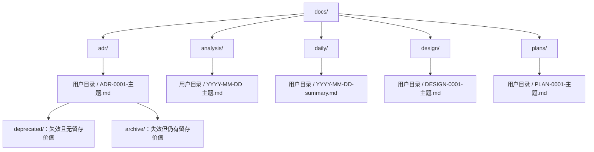

# DESIGN-0001：docs 文档体系的目录契约与命名设计

> 本文件同时充当 `docs/design/` 的格式示例与可复制模板，正式使用时请复制到本人用户目录、按 `DESIGN-<四位序号>-<主题-slug>.md` 改名，并替换正文内容。

## 版本

| 版本 | 日期 | 修订人 | 变更说明 |
| :--- | :--- | :--- | :--- |
| 1.0 | {{日期}} | {{用户名}} | 首次定型：目录契约、命名规则与边界情况 |
| 1.1 | {{日期}} | {{用户名}} | 补充退役去向：失效与存档文档在用户目录内部消化 |

## 约束

本设计受三条约束支配：其一，文档必须同时可按体裁与归属定位，因此目录层级固定为“类型目录 / 用户目录”两级，退役状态不提升为新的顶层维度而只作为用户目录内的三级子目录，以免顶层目录数量随状态变化而膨胀；其二，序号只需在单个用户目录内唯一，跨用户重号视为正常；其三，任何跨用户引用都必须携带完整路径，因为简写引用在重号前提下无法解析。

## 结构设计

## 目录契约

| 契约项 | 规定 |
| :--- | :--- |
| 路径格式 | `docs/<类型目录>/<用户名>/<文件名>` |
| 类型目录取值 | `adr`, `analysis`, `daily`, `design`, `plans` |
| 用户名来源 | 与 `git config user.name` 一致，同时也是分支前缀 |
| 写入者 | 仅该用户目录的所有者，他人只读 |
| 序号作用域 | 单个用户目录内唯一 |
| 引用方式 | 必须写含用户名的完整路径 |
| 退役去向 | 本用户目录内的 `deprecated/`（失效且无留存价值）或 `archive/`（失效但仍有留存价值） |
| 退役动作 | 保留原文件名与序号，文首补退役登记块，不删除、不重排、不跨用户搬运 |
| 生命周期 | 用户目录长期保留，退役文档在目录内留痕 |

## 边界情况

- 用户改名：保留原用户目录并在目录内放置一份说明文件，指明新目录位置，避免既有引用失效。
- 用户离职：其目录转为只读，后续由接手人新建本人目录承接，不直接续写原目录，其退役文档仍留在原目录内不动。
- 跨用户协作：由主责人在本人目录内维护正文，协作者以评审意见或独立分析文档参与，避免同一文件被两人同时改写。
- 同一主题跨体裁：设计、计划与分析分别落在各自类型目录的同名用户文件夹内，通过“关联文档”一节互相链接，不合并为单文件。
- 同时具备失效与存档属性：只要失效后仍存在任何被再次查阅的可能，即判为存档，因为把有价值的文档放进 `deprecated/` 会使其在检索时被默认忽略。
- 全局索引需求：若文档量增长到无法靠目录浏览定位，再评估是否生成汇总索引；该索引只作为视图，不作为文档的第二存放位置。
