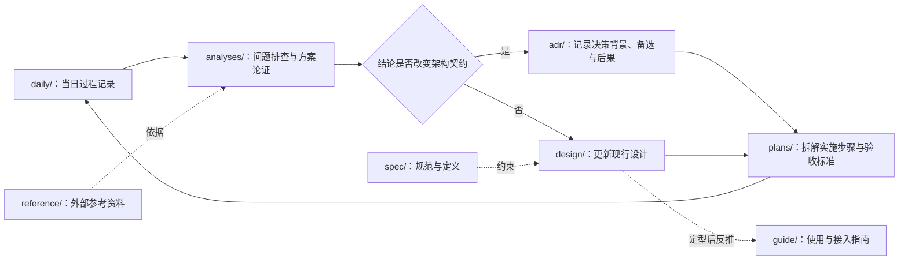
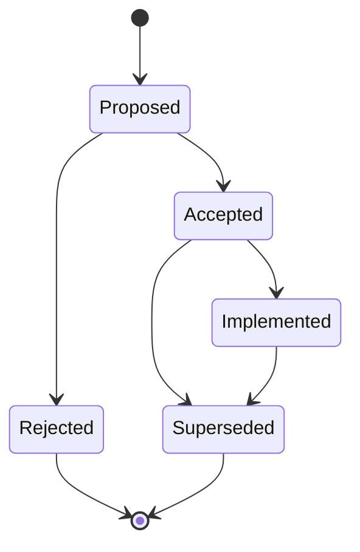
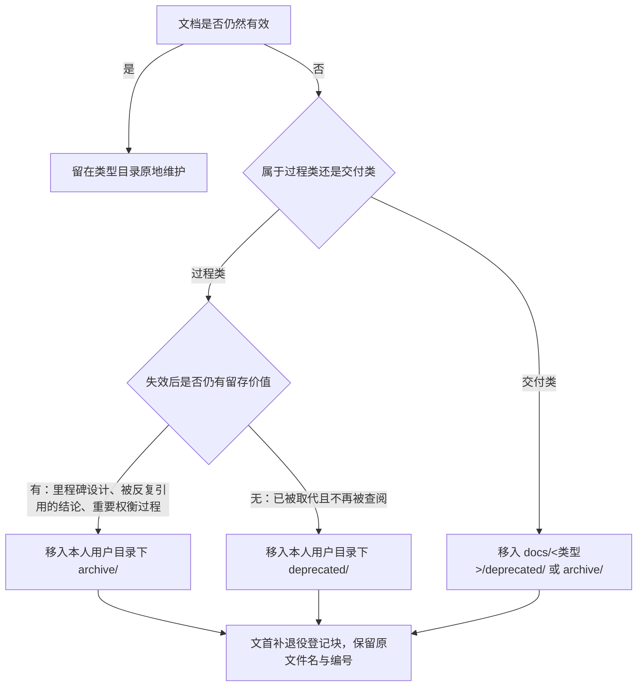

# ImageLyre文档体系

> 本文件是 `docs/` 目录的唯一入口，规定文档的归属边界、命名约定、流转路径与书写要求；任何文档在进入评审之前，都应先满足本文件的约束。

## 目录一览

`docs/` 下分两组类型目录：**过程类**承接团队自己的工作过程，按人归属；**交付类**承接对外可用的规范、指南与参考资料，属于项目共有、不按人分。判断一份文档该放哪里时，先问“它要回答什么问题”，再选目录，而不是按文件长短或写作时间随手存放。

### 过程类（按 `<用户名>/` 分目录）

| 目录 | 承载内容 | 不承载内容 | 文件命名约定 | 示例 |
| :--- | :--- | :--- | :--- | :--- |
| `adr/` | 已接受或已实现的架构决策记录，回答“为什么这样定”，定稿后不再修改正文 | 尚未拍板的候选方案、过程性讨论 | `ADR-<四位序号>-<主题-slug>.md` | `docs/adr/lukan/ADR-0001-docs-per-user-layout.md` |
| `analyses/` | 针对具体问题的排查、调研与方案取舍论证，回答“事实是什么、依据何在”（旧名 `analysis/` 仍受支持，并存时保留本目录） | 已经固化的决策结论（应升级为 ADR） | `<YYYY-MM-DD>_<主题-slug>.md` | `docs/analyses/lukan/2026-11-18_docs-layout-options.md` |
| `daily/` | 每日工作记录与阶段小结，回答“今天做了什么、卡在哪里” | 需要长期检索的正式结论 | `<YYYY-MM-DD>-summary.md`，或专题形式的 `<YYYY-MM-DD>_<主题>_<要点>.md` | `docs/daily/lukan/2026-11-18-summary.md` |
| `design/` | 当前有效的设计文档，回答“系统长什么样、边界在哪里” | 过期版本、已废弃设计、一次性实验记录 | `DESIGN-<四位序号>-<主题-slug>.md` | `docs/design/lukan/DESIGN-0001-docs-convention.md` |
| `plans/` | 任务拆解与实施排期，回答“接下来怎么做、怎样才算做完” | 已完成任务的执行流水（属于 `daily/`） | `PLAN-<四位序号>-<主题-slug>.md` | `docs/plans/lukan/PLAN-0001-docs-convention-rollout.md` |

在用户目录之下还可以出现一层主题子目录（如 `Workspace/`、`picoplugins-v2/`），用于把同一专题的多份文档收在一起；`deprecated/` 与 `archive/` 是这一层的两个保留名，只承接退役文档。以上都不改变路径中类型目录与用户名的取值，主题层只分一层、不再下钻；交付类目录下也有同名的二级退役子目录，判定与登记方式见「失效与存档」一节。

### 交付类（平铺，不按人分）

| 目录 | 承载内容 | 不承载内容 | 文件命名约定 |
| :--- | :--- | :--- | :--- |
| `spec/` | 对项目或某个领域生效的规范、规格与机器可读的定义文件，回答“什么才算合格、合法”，例如接口规范、数据字典、领域规格 | 具体实现的设计（属于 `design/`）、尚未定论的方案（属于 `analyses/`） | 人读文档 `<主题-slug>.md`；定义文件保留其既有扩展名（如 `hardware-profile.yaml`） |
| `guide/` | 面向使用者与接入者的指南，回答“怎么上手、按什么步骤做”，例如模块使用指南、接入步骤、迁移指引 | 系统内部的实现细节与边界（属于 `design/`） | `<两位序号>-<主题-slug>.md`，序号在同一批指南内连续 |
| `reference/` | 来自外部的参考资料与可查阅的事实清单，回答“原文怎么说的”，例如厂商手册、第三方协议文档、指令表 | 本团队自己的结论（那些属于 `adr/`、`analyses/`） | 外部资料**保留原文件名不改名**，项目自建清单用 `<主题-slug>.md` |

这三类不按用户名分目录，理由是它们的路径常被代码、脚本、其它文档与外部同事直接引用：规范类文档的路径必须稳定，外部资料的标识属于来源方，两者都不适合随个人目录变动；相应地，它们的正文由多人共同评审后修改，不归个人独占。

## 项目自有目录登记表

8 个类型目录之外的目录，由项目按自身需要增设（例如已发现但未承诺的问题池 `backlog/`、审计记录 `audit/`），增设时**必须在本表登记职责与命名约定**；登记之后它与其他类型目录同等看待——位置与命名按本表执行，引用同样写完整路径，文档体检也不再把它判为位置不合规。

| 目录 | 类别 | 承载内容 | 文件命名约定 |
| :--- | :--- | :--- | :--- |
| （暂无） | | | |

类别取「过程类」「交付类」「子系统」「附件」四者之一：过程类按 `<用户名>/` 分目录，其余三类平铺存放。

## 附件与二进制

docs 里出现的图片、PDF、表格与其它二进制文件按来源与用途分流，不与其对应的文档混放：

| 附件 | 存放位置 | 说明 |
| :--- | :--- | :--- |
| 个人文档的附件 | `docs/<过程类类型>/<用户名>/assets/` | 与文档同级，文件名按文档主题命名，便于看出归属 |
| 项目公共附件 | `docs/assets/` | 截图、示意图、公共模板；需在本文件上方登记表登记 `assets/` |
| 外部资料原件 | `docs/reference/` | 厂商手册、第三方标准等，保留原文件名 |

构建产物、模型文件、数据集、日志等由工具生成的大体积文件一律不进 docs，只收叙述性资料与其必要附件。

## 子系统文档目录登记

多子系统仓库允许子系统自带文档目录（如 `src/<模块>/docs/`、`src/<模块>/~doc/`），但必须在本文末登记，写明路径与范围，否则同一份内容在根 `docs/` 与子系统目录下各存一份、随后各自漂移，谁也说不清哪一份算数。

| 子系统文档目录 | 范围 | 与根 docs 的分工 |
| :--- | :--- | :--- |
| （暂无） | | |

分工原则：子系统文档只讲该子系统内部的实现细节与本子系统的使用方式；跨子系统、面向全仓的决策、规范、计划与日志一律收在根 `docs/`。

## 个人目录规则

每位同事在**过程类的 5 个类型目录**下都各自以本人的用户名创建独立文件夹，并把个人产出全部存放在其中，因此一份过程类文档的完整路径为 `docs/<类型目录>/<用户名>/<文件名>`；专题材料可在用户名之下再加一层主题子目录，得到 `docs/<类型目录>/<用户名>/<主题>/<文件名>`，主题层只分一层、不再下钻，主题内的文件名按专题习惯、不强制套用体裁命名。这一两级结构把「文档体裁」与「产出归属」拆成两个正交维度分别表达，使得同一主题同时存在设计、计划与分析时，三者各自落在类型目录下的同名用户文件夹内，既不会相互覆盖，也能一眼看出由谁维护。

用户名必须与 Git 账号严格一致，即取 `git config user.name` 的值，同时也是分支前缀的来源（例如分支 `lukan/dev/driver` 对应用户名 `lukan`），不得使用昵称、缩写或中文名，以免在合并、检索与引用时出现第二种写法。

### 协作约定

1. 只在本人的用户目录内新增、重命名与删除文档。
2. 需要修改他人文档时，以评审意见或新文档表达，不直接改动他人正文。
3. 在某类型目录下首次产出文档时，一并创建本人的用户目录。
4. 引用他人产出时必须写出含用户名的完整路径，例如 `docs/adr/lukan/ADR-0001-docs-per-user-layout.md`，禁止只写编号或只写文件名；引用交付类文档与子系统文档同样写完整路径，只是路径中不含用户名段。
5. 序号在每个用户目录内独立自增，因此跨用户的同号文档并存属于正常现象。
6. 用户目录一经建立即长期保留，即使某段时间没有新产出，也不得删除或合并。
7. 文档退役时移入本人用户目录内的 `deprecated/` 或 `archive/`，不得删除原文件，也不得集中搬运到公共目录。

### 编号冲突为何按“目录内唯一”处理

由于同一时间有多位同事并行推进不同子系统，若要求编号在整个 `docs/` 内全局唯一，则每次起号都要先确认他人进度，序号便从表达顺序的记号退化成需要争抢的资源；而若改为按用户目录内唯一，则冲突在路径层面被彻底消解，代价是“见 `ADR-0001`”这类简写会产生歧义，因此本体系以「引用必须写全路径」这一条硬性要求，换取起号时的零协调成本，两者的取舍在 `docs/adr/lukan/ADR-0001-docs-per-user-layout.md` 中有完整论证。

## 文档流转

一份内容通常会依次经过「当日记录、专题分析、定型决策、现行设计、实施计划」这几个阶段，但并非每份文档都要走完全程，只有当分析结论改变了架构契约时，才必须补一份 ADR。规范与指南则从两个方向与之相连：规范是设计与计划必须满足的前提，指南是设计与实现定型反推出的使用说明。

## 各类型文档的必备章节

| 类型 | 必备章节 | 完成判据 |
| :--- | :--- | :--- |
| `adr/` | 状态、背景与约束、决策、备选方案、后果 | 读者无需追问即可复现取舍过程 |
| `analyses/` | 问题陈述、证据、候选方案对比、结论与遗留问题 | 每条结论都能回溯到具体证据 |
| `daily/` | 完成事项、进行中、阻塞、次日计划、关联文档 | 次日可凭此文件直接接续工作 |
| `design/` | 版本表、约束、结构设计、接口契约、边界情况 | 实现者无需口头补充即可编码 |
| `plans/` | 目标、前置条件、步骤与依赖、验收标准、风险 | 验收标准逐条可检验 |
| `spec/` | 适用范围、条款、准入或判定清单、版本 | 逐条可判定，读者能据此判断一份产出是否合格 |
| `guide/` | 适用对象、前置条件、步骤、常见问题 | 读者照着做能完成目标，无需追问 |
| `reference/` | 来源与版本、适用范围、条目正文或索引 | 每条事实都能对回原始出处（手册页、协议章节） |

## ADR 状态流转

ADR 一旦进入 `Accepted` 或 `Implemented`，正文即冻结，后续变化只能以新 ADR 替代或补充，并在两份文件中互相登记，以免历史决策被静默改写。

## 失效与存档

文档失效后一律不删除，退役方式统一为「新建目录收存」：过程类移入 `docs/<类型>/<用户名>/deprecated/` 或 `archive/`，交付类移入 `docs/<类型>/deprecated/` 或 `archive/`，两者只差路径里有没有用户名段。之所以不留在原地，是因为同一序号段里旧文件与现行文件并排时，读者按序号取用几乎必然拿到旧版；交付类文档的路径常被代码、脚本与其他文档引用，移动的代价必须当场结清——在同一次提交里改完所有引用点，改不干净等于主动制造死链。

过程类的两个退役目录按留存价值分流：`deprecated/` 承接已经失效且不再具备参考价值的文档，`archive/` 只承接失效后仍有留存价值的文档（例如里程碑式设计、被反复引用的结论、记录了重要权衡过程的决策），因此存档目录不是“所有失效文档的兜底”，把它当作兜底会让真正有价值的存档淹没在噪音里，两者按下列判据分流。

移入退役目录时保留原文件名与原编号，不重新排序号，因为重排会让既有引用与历史讨论失去落点；只需在文首补一个退役登记块，登记原状态、退役日期、替代文档路径与留存或退役的理由。

| 退役登记 | 内容 |
| :--- | :--- |
| 原状态 | `Superseded`、`Deprecated` 或 `Archived` |
| 退役日期 | `YYYY-MM-DD` |
| 替代文档 | 完整路径，无替代时写“无” |
| 留存理由 | 说明为何进 `archive/`，或说明为何仅需进 `deprecated/` 留痕 |

## 书写规范

`docs/` 下的中文技术正文与 C# 注释统一遵循 `csharp-doc-style` 技能，其完整条款位于共享技能库**游刃**（`gitee.com/fangyu_fy/youren`，路径 `skills/csharp-doc-style/SKILL.md`）；本仓若存在 `.agents/skills/`、`.ai/skills/`、`.dsh/skills/` 之一下的同名技能，那只是下游拷贝，冲突时一律以游刃为准，写作与评审都以该文件为准，本文件不再二次转述细节，以免两处规则随时间漂移；其中对文档影响最大的是四条要求，即用复合长句承载含条件、因果与时序的完整逻辑链，中文正文使用全角标点而代码元素前后保留半角空格，流程与时序等结构化关系一律用 Mermaid 表达，以及 ADR、设计与计划的论证必须完整呈现背景约束、备选方案与取舍后果。

在技能条款之外，本体系另加两条目录内约定：标题层级从 `##` 起且每份文件只保留一个一级标题；设计文档与规范文档在正文首部保留版本表，版本号采用 `MAJOR.MINOR`，其中 `MAJOR` 对应不兼容变更、`MINOR` 对应增量变更。

## 示例索引

下列文件同时充当格式示例与可复制模板，正式使用时复制到本人用户目录并改名后替换正文；交付类的三个目录不随本体系附带示例，因为其内容依项目而定，命名约定见上方目录表。

| 示例文件 | 演示要点 |
| :--- | :--- |
| `docs/adr/lukan/ADR-0001-docs-per-user-layout.md` | 决策类文档如何完整呈现背景、备选与后果 |
| `docs/analyses/lukan/2026-11-18_docs-layout-options.md` | 分析类文档如何以证据支撑结论 |
| `docs/daily/lukan/2026-11-18-summary.md` | 日志类文档如何做到次日可接续 |
| `docs/design/lukan/DESIGN-0001-docs-convention.md` | 设计类文档如何定义契约与边界情况 |
| `docs/plans/lukan/PLAN-0001-docs-convention-rollout.md` | 计划类文档如何写可检验的验收标准 |
| `docs/adr/lukan/deprecated/ADR-0000-example-deprecated.md` | 失效文档如何写退役登记块 |
| `docs/adr/lukan/archive/ADR-0000-example-archived.md` | 存档文档如何写留存理由 |
