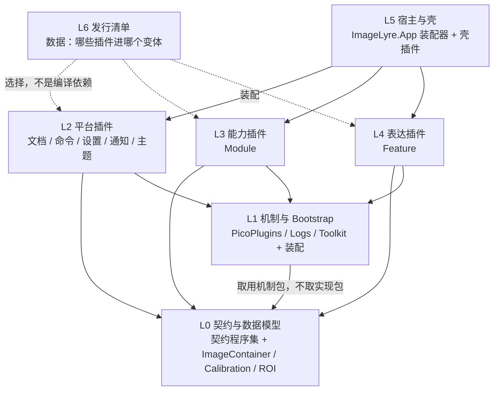

# ADR-0001：插件机制架构基线

| 项目 | 内容 |
| :--- | :--- |
| 文档类型 | adr |
| 状态 | Accepted（2026-11-22 起草，第一轮独立评审后修订；评审处置见 §9） |
| 决策范围 | “一切皆为插件”的判定原则、插件单元与契约归属、插件机制的分层、cangming 基座的使用边界、插件治理的分期与 M1 边界、能力域与槽位的术语划分 |
| 上游基准 | `docs/spec/baseline/startup-requirements.md` 1.7；cangming 仓 `docs/adr/lukan/ADR-0006`、`ADR-0007`、`ADR-0011`、`ADR-0012` |
| 版本 | 0.3（2026-11-22 作者口径修订：失败原因、命名空间、Bootstrap、官方必装插件） |

## 1 背景与约束

### 1.1 起点

2026-11-22 的仓库重置把 2022 年 WPF 实现与 2026-11 两轮重建的代码整体移出工作区，只保留需求、基线、目录骨架与技能配置（见 `AGENTS.md` §4）；因此本文不受任何既有实现约束，只受 `docs/spec/baseline/startup-requirements.md` 与 cangming 已发布契约约束。

### 1.2 上一轮的失败原因

上一轮表面上表现为应用层自建了一套与基座平行的壳——槽位、文档、菜单各自一套，基座的 `Cangming.Shell` 与 `Cangming.Platform` 从未被引用，最终整层弃用，清除前状态保存在标签 `archive/pre-reset-2026-11-22`。平行壳只是症状而非原因：归档标签同时显示该轮引用了 `Cangming.PicoPlugins`（43 个文件），插件机制本身并没有被自研替代。真正的原因有三条，本文的决策逐条对应。

其一，没有吃透 cangming `ADR-0012` §2.1 的三分法——插件是部署与故障单位、Module 是能力单位、Feature 是功能表达单位。三者被当成同一层的东西混写，于是出现“一个类既是能力、又是界面、又是部署项”的写法，边界一模糊，平行实现就有了生存空间。

其二，没有吃透 Module 与 Feature 内部上下文组织器的用法。`BaseModuleContext` 与 `BaseFeatureContext` 只回答“这个插件怎么找到周边”，不承担生命周期，也不该被当成服务定位器；上一轮把上下文当容器用、在构造函数里求值 `Lazy`、声明与取用不成对，导致失败点在启动期与运行期四处漂移。

其三，没有理解 bootstrap 项目的重要性。启动顺序、日志初始化、容器构建、插件系统 `Launch`、上下文注入与界面附着是一条有先后的链，没有独立项目承载，就会被塞进入口文件或散落到各个插件里，最后没人说得清第一行代码应该做什么。

### 1.3 cangming 已经划定的边界

cangming 的 `ADR-0012` §2.1 把插件定为部署与故障单位、Module 定为能力单位、Feature 定为功能表达单位；§2.2 把 OS 权限沙箱、collectible ALC 热卸载、跨进程 UI、多租户、AOT、扩展市场、包签名、热插拔列为非目标；§2.8 把内核职责限定为插件身份、发现与准入、依赖声明与注入、槽位与附件契约以及这些关系的诊断。本文以这些为硬约束，同时把与基线准入清单的正面冲突登记在 §4.4，不在本文内自行裁决安全模型。

### 1.4 cangming 的 Shell 尚不可作为应用内核

`AddCangmingShellDefaults` 与 `AddCangmingPlatformDefaults` 合计注册 30 个服务，全部为 `TryAddSingleton`；Shell 侧 15 项基本是 `InMemory` 实现，Platform 侧 15 项混合了内存实现与真实实现（互斥量单实例、文件监视、进程性能与资源监视、更新器）。文档、菜单、状态栏、主题、rail、布局、拖放、文件对话框、打印、查找替换这些消费型契约在 `src/Cangming.Shell` 与 `src/Cangming.Platform` 下没有实现；`IDocumentManager` 的实现类 `DefaultDocumentManager` 是 `internal`，`Cangming.Shell.Documents` 没有 `IServiceCollection` 扩展，插件从容器里取不到实例；`IMenuService` 只有契约没有实现；`INotificationCenter` 只有内存归档，`INotificationService` 没有实现。把这个壳当作应用内核，等于把产品的文档与菜单能力直接建在没有实现的契约上。

### 1.5 参考实现的教训

Mercury 有 396 个工程，`Mercury.App.csproj` 用 304 条 `ProjectReference` 把插件复制进输出目录，自建 `PluginSlotManager`、`SlotPanel` 与 WPF 附件层，`Cangming.PicoPlugins.WPF` 引了却零 `using`，`Cangming.Shell` 与 `Cangming.Platform` 零引用，菜单靠 49 份手写 `.plugindesc` 解析。它证明了两件事：其一，基座之外的平行实现一旦开闸就会持续增殖，因为每个新需求都会选择更近的那一套；其二，插件到达运行时的方式若交给工程引用，插件化就退化成编译期装配，新增一个能力要改 App 工程。

### 1.6 约束

1. 本文只谈机制，不谈业务：不定义图像、ROI、测量、分析等任何能力的内部实现，只定义能力如何成为插件、插件之间如何连接、宿主如何装配。
2. cangming 以只读子模块锁定 tag `v0.1.9.1122`（提交 `9cf90be`）接入，M1 只使用该版本的 v1 槽位契约，不修改其源码；版本升级须在同一提交里改本文的版本锚点。
3. 契约与调用方同批变更；契约只增不改，向既有接口加成员属于允许的“只增”，但所有实现方要同批重编译并在提交说明里登记；破坏性变更须另开 ADR 并在新旧文件中互相登记。
4. UI 路线固定为 AtomUI + AvaloniaUI + SkiaSharp（基线 §3.1）；Core 1.0 只发 Windows 正式版这一事实来自 `docs/spec/requirements/product-requirements.md` §5 与 `docs/spec/requirements/product-appearance.md` §2.1，不在基线之内，因此本文不处理多 UI 路线适配。

## 2 决策

### 2.1 cangming 是插件机制基座，不是应用内核

取 `Cangming.PicoPlugins` 的扫描、生命周期、依赖声明与校验、槽位机制、失败隔离与模块状态流，取 `Cangming.Logs` 做日志管道、取 `Cangming.Toolkit` 做排序与异步工具；`Cangming.Shell.Contracts`、`Cangming.Platform.Contracts`、`Cangming.Logs.Contracts` 只作为契约来源按需借用，其实现包（`Cangming.Shell`、`Cangming.Platform`）不接入，对应能力由 Lyre 自己的平台插件实现。

判据来自 cangming `ADR-0012` §2.8 的职责表——“Shell/应用”一行把命令标识与键位、文档与布局、权限、Ribbon 归给应用而不归内核——因此文档、命令、设置、通知、主题属于产品语义，不应指望基座提供可用实现。

由此推出一个容易忽略的结论：产品里“壳的能力”（文档管理器、命令注册表、设置服务、通知中心）必须是 ImageLyre 的平台插件，而不是宿主内建代码。它们若内建，就注定不可替换、不可禁用、不可按产品变体裁剪，“一切皆为插件”当场缩水成“业务皆插件”。

还有一条同类推论：完整产品由一组**官方必装插件**构成——编解码、算子、测量、视口与文档能力都随发行包安装并默认启用，但它们在机制上与第三方插件完全一样，可以禁用、替换、按变体裁剪。“必装”是发行策略而不是机制特权，因此内核不为它们开任何例外，它们也不因此获得引用壳或内核的特权；基线 2.0 把原先把“编解码层、图像处理层、内核层”当作层的写法改称为官方必装插件，理由就在这里。

### 2.2 “一切皆为插件”的三条判定

“一切皆为插件”是对外的快速表达，不是可验收的技术描述；可验收的是下面三条，任一条不成立即视为架构未落地。插件按职责分三类：平台插件（L2，壳的能力）、能力插件（L3，产品能力）、表达插件（L4，界面表达），壳模块（L5）是另一种插件形态；契约与机制不是插件。

| 原则 | 含义 | 检验方式 |
| :--- | :--- | :--- |
| 机制零领域名词 | 机制层（`ImageLyre.Bootstrap` 与从 cangming 取用的机制包）只出现插件、契约、槽位、贡献、诊断一类词，不出现图像、ROI、测量、分析 | 对机制层的源码做符号与字符串检索，词表见 §5.1 |
| 空壳即产品 | 移除全部能力插件与表达插件后，壳与平台插件仍能启动到一个可诊断的空工作台，并明确报告能力插件为 0 个 | 按 §5.2 的动作删除后启动，检查窗口与固定日志行 |
| 一能力包一改动 | 新增一个能力包只新增契约工程与插件工程，不改 `ImageLyre.App`、不改既有插件工程、不改既有契约 | 按 §5.3 新增最小能力包，检查改动文件清单 |

第三条里的“能力包”是一个目录，可以同时包含契约工程、Module 工程与 Feature 工程，因为 Feature 不得引用 Module 工程，一个既有界面又有后台的能力天然至少两个工程；把“只动一个工程”当成判据会与 §2.3 的单元划分矛盾，判据应当是“只动一个能力包目录”。

### 2.3 四种单元与所有权

| 单元 | 是什么 | 谁拥有 | 判据 |
| :--- | :--- | :--- | :--- |
| Plugin | 部署、启停、故障与诊断的单位：一个入口类型、一个显式 Id、一个插件目录 | 插件作者 | 能独立安装、移除、禁用、重启 |
| Module | 一个契约的实现，默认不构造界面；容器类 Module（壳）是唯一例外 | 插件作者 | 只回答“我提供什么能力” |
| Feature | 界面表达，只消费契约 | 插件作者 | 只依赖契约、机制包与 UI 路线包，不引用任何插件工程 |
| Contract | 接口、数据类型与状态流，插件之间唯一的公共面 | **架构，不属于任何插件** | 只增不改，破坏性变更须新 ADR |

四条执行规则同时成立：插件之间零 `ProjectReference`，需要协作时按契约解析而不是互相引用；Feature 只依赖契约、机制包与 UI 路线包，构造自己槽位内的内容是它的职责，不因此获得引用壳插件的权利；契约不为任何单个插件的方便而定制；插件的声明面只有三件事——`Require`（必须有提供方）、`Optional`（可缺席）、`After`（提供方先启动）， “我提供什么”由 `IPicoModule<T>` 的契约类型表达，不另写声明（cangming `ADR-0011` §2.1、§2.8）。

基线 §6.2 把插件分为 Module、Feature、Driver 三类，其中 Driver 是设备域特化——设备连接、初始化与释放有独立时序，压进 `StartServiceAsync` 会与插件生命周期错配。Lyre 的 Core 1.0 没有设备域，因此 Driver 保留在基线分类中但不实现；将来若出现设备类插件，按 cangming 的方式新增特殊化接口、基类与专属上下文，不扩充 `IPicoPlugin` 根契约。

### 2.4 插件机制的分层

| 层 | 内容 | 编译期依赖 | 变更成本 |
| :--- | :--- | :--- | :--- |
| L0 契约与数据模型 | 平台契约借用 cangming 的 `*.Contracts`；产品契约由 ImageLyre 定义；数据模型（`ImageContainer`、`Calibration`、`ROI`）随契约程序集交付，不随插件启停而消失；测量算法不放这里，见 L3 | cangming 契约程序集 | 只增不改，破坏性变更须 ADR |
| L1 机制与 Bootstrap | `Cangming.PicoPlugins`、`Cangming.Logs`、`Cangming.Toolkit`，以及承载启动链的 `ImageLyre.Bootstrap`（日志、容器、`Launch`、管理器、启停链）；Bootstrap 不引用任何 UI 框架 | L0 | 极高，等于改基线 |
| L2 平台插件 | 壳的能力，以 Module 形式提供；需要界面的部分以 Feature 形式（L4）实现 | L0、L1 | 中，随产品演进 |
| L3 能力插件 | 产品能力，全部是 Module；编解码、算子、测量等官方必装能力也在这里，与第三方插件同一机制 | L0、L1 | 低，独立发布 |
| L4 表达插件 | Feature，只依赖契约、机制包与 UI 路线包 | L0、L1、路线包 | 低，独立发布 |
| L5 宿主与壳 | `ImageLyre.App` 界面宿主与壳插件（窗口、槽位拓扑）；进程入口在 `ImageLyre.App`，装配逻辑在 `ImageLyre.Bootstrap` | L0、L1 | 中 |
| L6 发行清单 | 哪些插件构成社区版、专业版或客户定制版，含官方必装清单 | 无（数据） | 低，随发行策略 |

四条规则：插件只允许引用 L0、L1 与 UI 路线包，插件之间零引用；L0 不引用 L1 与任何插件，只依赖 cangming 的契约程序集；L6 是数据不是代码，不产生编译依赖；宿主装配插件不等于依赖插件，`ImageLyre.App` 编译期只引用契约、机制包与 Bootstrap，`ImageLyre.Bootstrap` 编译期只引用契约与机制包。

与基线 2.0 四类构件的关系：UI 表现层、契约层、插件层、沙箱调度层是外部模型，本节是插件层与契约层内部的细化；编解码、算子、测量、视口与文档都不是层，而是插件层里的官方必装插件，分别落在 IO、Operator、Measure、View 与 Platform 能力域，基线 2.0 已按此改写。

另有一条判据用以区分“数据模型”与“可替换能力”：**数据模型属于契约层，会失败、会被替换、会被禁用的能力都属于插件层。** 把数据模型做成插件会迫使所有消费者依赖一个可被禁用的提供方，把能力做成契约则会让每次能力扩展都变成基线变更；测量算法之所以是插件而不是契约，是因为它会被替换、会被禁用、会被第三方实现顶替，而 `ImageContainer` 与 `ROI` 一旦可替换，所有插件都要跟着重写。

### 2.5 插件治理是产品自有层

cangming 提供的是插件的基本能力，Lyre 对“装了什么、能不能禁、坏了怎么办”的要求高于基座，因此治理能力由 Lyre 自建，覆盖五件事：身份与清单（它是谁、版本、来源、依赖、能做什么）、准入与策略（谁必须装、谁可禁、版本门槛）、生命周期编排（启动顺序、失败隔离、受限模式、依赖树与分级）、安装与升级（装、升、降、回滚、卸载）、观测与诊断（哪些能力可用、偏差在哪）。这五件事的收敛模型是“期望状态与实际状态的对比”，期望状态来自发行清单、用户设置与策略约束，实际状态来自插件状态机、模块状态流与槽位状态，两者不一致时由一个可重放的收敛循环产出安装、启用、禁用、重启、降级等动作。

治理层受两条原则约束，它们不是风格偏好，而是防止系统被插件反向绑架：其一，**插件不得自我授权**，插件只能声明依赖与提供的能力，“我不可禁用、我是必需的、我该被信任”属于发行清单与策略；其二，**偏差必须可见**，期望与实际不一致时必须有诊断项与界面呈现，禁止静默降级。

治理能力分五个阶段落地，这五个阶段是插件机制的能力阶段，与基线里程碑 M1a、M1b、M2 不是同一编号体系，两者只在“沙箱与两类登记”一处相交：基线 §10.3 要求沙箱、两类登记与 broker 错误码在 M2 首次成立，该要求由产品侧插件设计与安全决策承接，本文的 G4 只负责“机制上允许插件进程外运行”，不改变基线的时间点。

| 阶段 | 目标 | 依赖 | 出口验收 |
| :--- | :--- | :--- | :--- |
| G1 机制（即 M1） | 骨架跑通、空壳成立 | 只用 cangming v1 能力 | `DESIGN-0001` §7 的 A–E |
| G2 只读治理 | 偏差可见 | 插件列表、模块状态流、状态事件、发行清单 | 面板列出每个能力的状态、提供方、依赖、依赖树与分级、失败原因；必需能力缺失时进受限模式并说明缺什么 |
| G3 运行期收敛 | 禁用即时生效 | 槽位撤销（依赖 cangming 落地 `ADR-0012` §2.7 的 v2）与单插件启停 | 禁用后槽位内容、命令、设置项全部消失，启用后恢复 |
| G4 安装升级 | 插件可独立交付 | 包安装器、版本信息、发行清单 | 装、升、降、回滚全程不改构建，上一版本可回退 |
| G5 信任隔离 | 插件可进程外运行 | 进程外宿主与来源登记 | 不可信插件崩溃不影响主进程；与基线 M2 的沙箱要求对齐 |

G1 与 G2 各登记临时约束，逐条写明现状、解除阶段与验证方式，这张表就是偏差登记载体，不另立文件；任何新增临时约束必须进本表，否则视为架构未定。

| 临时约束 | 现状 | 解除阶段 | 验证方式 |
| :--- | :--- | :--- | :--- |
| 禁用需重启才生效 | 只有启动期黑名单，运行期禁用不撤销已附着内容 | G3 | 禁用后面板与工具条项消失，无需重启 |
| 不做插件版本校验 | 只要求显式 Id，不比较版本区间 | G4 | 安装一个版本不满足区间的包被拒并给出原因 |
| 无依赖树与分级 | 只有启动日志里的依赖缺失原因 | G2 | 面板画出依赖树并标出 0/≤3/≤10/>10 分级 |
| 同一信任级、全部进程内 | 主目录扫描，主 ALC 加载 | G5 | 进程外插件崩溃后主进程存活 |
| 未实现双运行模式 | 只有 UI 宿主，CLI 宿主未建 | G2 | 同一 Module 插件在 CLI 宿主中可解析执行 |

其中双运行模式对应基线 §6.2.4 与 §10.1 的“同一插件可在 UI 与后台批处理两种模式下运行”，由 Module 承担，Feature 只负责 UI 表达，因此该约束的验证方式是“同一 Module 工程在两种宿主里都能被扫描并启动”，不要求 Feature 无头运行。

### 2.6 术语：能力域与槽位

基线 §6.3 原把 IO、View、Operator、Measure、Script、System 六个职责分类称为“六个固定槽位”，而 cangming 把界面装配位称为 Slot（槽位），同一个词指两件事会在设计与代码里持续歧义。本文的划分是：**能力域**专指职责分类（基线 1.7 起为七个，新增 Platform 域承载壳能力），**槽位**专指界面装配位，与 cangming 的 `ISlotManager` 与槽位条目同一语义。

需要说明当前实现的边界：cangming 工作区（tag `v0.1.9.1122`）的槽位契约只有 `ISlotManager`、`SlotInfo`、`SlotContentChanged`、`RefreshSlot`、`IAttachmentRegistry`，`SlotDescriptor` 与准入策略属于 `ADR-0012` §2.7 已接受但尚未落地的 v2；因此本文凡涉及撤销、准入策略、增量流的能力，一律标注依赖 v2，不在 v1 上假装可用。

判定依据是变更成本的不对称：cangming 的 Slot 是已发布的代码词汇，改名意味着破坏性变更；基线的“槽位”只是文档用词，改称“能力域”不改变分类边界，成本接近于零。基线 1.6 已完成 §6.3 的改称，1.7 补 Platform 域并把其余仍以“槽位”指能力域的表述一并清除。

### 2.7 与基线构件规则的解释与修订

基线 §4 规则 2 原文把“插件层”当作一个整体，要求它只依赖内核公开契约、不得直接操作 UI 控件、不得抢占全局画布；这条规则与基线自身的 §6.3 相矛盾——View 域明确承担“渲染、LUT、伪彩、标尺、ROI 编辑器”，Feature 也必然构造界面。基线 1.7 的修订把规则 2 拆成两段：算子类插件（IO、Operator、Measure、Script、System）只依赖内核公开契约与统一上下文，不得直接操作 UI 控件；View 域与 Feature 可以依赖 UI 路线包并在自己的槽位内构造内容，但同样不得操作宿主控件、不得抢占全局画布与输入上下文。

这条修订按基线 §11 登记，版本行为 1.7，属于适用范围澄清加第七能力域，不改变任何一条准入判定的判定方式；基线 2.0 把“内核”整体改为“契约层”之后，规则 1 与规则 4 的主语随之替换，规则 2 的语义不变。规则 4“UI 不得绕过契约层与插件层直接改写像素缓冲区”与本文无冲突，本文不涉及像素路径。

### 2.8 上下文组织器的纪律

cangming 的上下文不是契约、也不是生命周期，它只回答“这个插件怎么找到周边”；上一轮的失败原因之二正是把它当成容器用，因此 M1 起对 Module 与 Feature 各定四条纪律，违反任一条都视为实现缺陷而不是风格问题。

1. 每个插件一个具名上下文类型，继承 `BaseModuleContext` 或 `BaseFeatureContext`，在构造函数里用 `UseContext` 登记，访问点用 `ContextOf<T>` 取回；不得让两个插件共用一个上下文实例，也不得把上下文类型暴露到公开签名之外。
2. 声明与取用成对：`Require<T>` 对应 `Use<T>`，`Optional<T>` 对应 `UseOptional<T>`；未声明就取是编码错误，框架会在调用点抛异常，不允许用 `try/catch` 兜成降级。
3. 构造函数与注入阶段不求值：`InjectAsync` 只保存 `Lazy`，`.Value` 只出现在真正使用的那一行；在构造期求值会让 `Lazy` 永久缓存首次异常，重启后仍然坏。
4. 上下文不承担生命周期，也不当服务定位器：启动编排放 `OnStartAsync`，需要宿主服务时用 `ISupportUsingIoC` 显式声明，不在上下文里做 `IServiceProvider` 查找，也不把上下文交给别的插件使用。

第四条与“插件之间零引用”同源：上下文是插件私有的周边视图，一旦传出去就变成第二套服务定位入口，而服务定位一旦存在，依赖声明就会退化成注释。

## 3 备选方案

| 方案 | 内涵 | 优势 | 代价 | 评价 |
| :--- | :--- | :--- | :--- | :--- |
| A 以 `Cangming.Shell` 为应用内核 | 直接用 30 个服务，文档、菜单、通知内建 | 起步最快，少写一层 | 消费型契约无实现，文档管理器取不到；内建能力不可替换、不可禁用、不可裁剪 | 排除：把“一切皆为插件”降级为“业务皆插件” |
| B 自研插件机制 | 抛弃 cangming，自己写扫描、依赖、槽位 | 完全贴合产品 | 重复实现插件发现、依赖校验、失败隔离、状态流与沙箱；与基座行为分叉，升级时两套语义要同时对账 | 排除：与基座并行的第二套机制正是上一轮的病灶，且基线 §3 的“自研”指自研基座，cangming 即为该基座 |
| C 只用 cangming，不建治理层 | 插件管理停留在启动期黑名单与日志 | 成本最低 | 安装、升级、准入、依赖树、观测、偏差诊断全部缺失，达不到产品要求 | 排除：G2 起即无路可走 |
| D 机制基座 + 产品治理层 | cangming 提供机制，ImageLyre 建五块治理能力并分期落地 | 机制复用、治理自主、可分期 | 需要维护契约层、Bootstrap 与装配逻辑，治理层也是一条产品线 | 采纳 |

## 4 后果

### 4.1 正面

机制与治理分离之后，插件机制的每一处修复都能引到 cangming 的具体契约或 Lyre 治理层的具体阶段，而不是“上次重写没写清”；M1 不依赖 cangming 的任何改动，意味着开工条件只有仓库、基线与本文；三条判定各有可执行的检查动作，空壳、加插件、替换不再靠口号。

### 4.2 代价与风险

代价是必须自己写装配器与壳，不能指望基座提供现成的文档管理器与菜单服务；必须维护一层只增不改的契约，任何契约变更都要带着调用方同批改；必须接受 M1 的插件体验明显弱于最终形态——禁用要重启、没有安装器、没有插件面板。

风险有四处，各写明触发条件与最晚决断点：其一，若 cangming 的 Shell 实现补齐并达到产品级，§2.1 可重评，最晚决断点是 G2 启动前；其二，若产品目标从“可信第一方与伙伴插件”改为“开放第三方生态”，需要新 ADR 改动 cangming 的非目标（权限、签名、沙箱默认值、版本协商），§2.1 不受影响但 §2.5 分期要重排；其三，若“空壳即产品”在实践中不成立，必须逐条登记例外并给出最小化路径，例外进 §2.5 的表，数量不得扩大；其四，基线 §10.1 要求“操作系统隔离对越权文件与网络调用返回明确错误码”，而 cangming `ADR-0012` §2.2 把 OS 权限沙箱列为非目标，两者正面冲突，本文不裁决安全模型，最晚在基线 M2 启动前由专项安全 ADR 裁决 broker 与隔离边界。

### 4.3 什么条件下这条要改

出现下列任一情形时，本文应当被新 ADR 替代而不是就地修改：插件机制不再以 cangming 为基座；契约的所有权从架构转移给某个插件团队；治理层的五块能力被证明无法在基座之上实现；“一切皆为插件”的三条判定被产品验收证明不适用于交付形态。

## 5 验收与检验

### 5.1 机制零领域名词

检索范围为 `ImageLyre.Bootstrap` 与 `ImageLyre.App` 中属于装配逻辑的代码，即 L1 的启动链与宿主接线；cangming 取用包、壳插件与界面代码不在检索范围内。检索对象为源码标识符与字符串字面量，不含注释与第三方二进制。词表固定为图像、image、ROI、选区、测量、measure、分析、analysis、通道、通道名、像素、pixel、TIFF、标尺、校准。命中即判不合格，例外须进 §2.5 的表。

### 5.2 空壳

删除全部 L3 与 L4 插件后启动，界面显示“无能力”与“无图像”，日志出现固定行 `能力插件 0 个`（由 `ImageLyre.App` 输出，模板固定）；壳与 L2 平台插件保持运行。再把 L2 平台插件逐个移除，壳仍能启动但显示“平台服务缺失”，以此证明平台插件可替换。

### 5.3 一能力包一改动

新增最小能力包（模板见 `DESIGN-0001` §5.4）：一个契约工程加一个 Module 工程加一个 Feature 工程，放在同一目录；检查 `git status` 只出现新增文件与新增目录，`ImageLyre.App.csproj`、既有契约、既有插件工程零改动。替换检查另做：用另一实现顶替 `IClock`，断言 `FindModuleBuilder<IClock>()` 解析到新实现且既有 Feature 仍能附着。

### 5.4 契约归属

Feature 工程的项目引用里没有 `ImageLyre.Module.*` 与 `ImageLyre.Feature.*`；`ImageLyre.Contracts.*` 里没有 Avalonia、AtomUI、SkiaSharp 类型；`ImageLyre.Shell.Contracts` 允许引用 Avalonia，但不得引用任何插件工程。

## 6 关联文档

- `docs/spec/baseline/startup-requirements.md` 1.7：本文的上游基线，§4 四层模型与 §6 插件体系的前提，1.7 的修订由本文登记。
- `docs/design/lukan/DESIGN-0001-M1-插件骨架.md`：M1 的工程清单、装配时序、槽位表与验收。
- cangming 仓 `docs/adr/lukan/ADR-0012-PicoPlugins基座定位非目标与核心契约.md`：插件、Module、Feature 的定位、非目标与 v2 槽位方向。
- cangming 仓 `docs/adr/lukan/ADR-0006-附着物词汇归路线基座只留机制.md`：基座只留机制的判据。
- cangming 仓 `docs/adr/lukan/ADR-0007-应用词汇归应用的三层附着物边界.md`：基座、路线、应用的三层词汇边界。
- cangming 仓 `docs/adr/lukan/ADR-0011-插件依赖声明拆成可达性顺序与可选三件事.md`：`Require`、`Optional`、`After` 的语义来源。
- cangming 仓 `docs/adr/lukan/ADR-0004-插件进程外沙箱.md`：沙箱边界与外部来源，G5 的依据。

## 7 决策记录

| 事项 | 状态 | 依据 |
| :--- | :--- | :--- |
| cangming 作为插件机制基座，不作应用内核 | 采纳（2026-11-22） | Shell 消费型契约无实现，文档管理器 internal 未注册；cangming `ADR-0012` §2.8 的职责划分 |
| “一切皆为插件”以三条判定表达 | 采纳（2026-11-22） | 口号不可验收，三条判定各有检查动作 |
| Plugin、Module、Feature、Contract 四种单元，Driver 保留不实现 | 采纳（2026-11-22） | cangming `ADR-0012` §2.1 的三分法缺契约一维；基线 §6.2 的分类保留 |
| 分层 L0–L6，机制层与图像内核分离 | 采纳（2026-11-22） | 基线 §4 规则 1 要求内核不引 UI，装配器属宿主 |
| 数据模型归 L0，测量、编解码、算子等可替换能力归插件层 | 采纳（2026-11-22），基线 2.0 登记 | 数据模型不可替换；测量算法可被替换、可禁用 |
| 新增 Platform 能力域承载壳能力 | 采纳（2026-11-22），基线 1.7 登记 | 基线六域无法容纳文档、命令、设置、通知、主题 |
| 插件治理作为产品自有层，分 G1–G5 | 采纳（2026-11-22） | 基座只提供基本能力，产品要求更高 |
| 插件不得自我授权、偏差必须可见 | 采纳（2026-11-22） | 防止插件反向绑架发行策略与故障恢复 |
| 基线 §4 规则 2 按插件类别拆分 | 采纳（2026-11-22），基线 1.7 登记 | 原规则与 §6.3 的 View 域自相矛盾 |
| 基线 §3 的“自研插件层”指自研基座 cangming | 采纳（2026-11-22），基线 1.7 登记 | cangming 为自研基座，非第三方框架；沙箱传输以基座实现为准 |
| 基线 §6.3 的“槽位”改称“能力域” | 采纳（2026-11-22），基线 1.6 已登记 | 与界面槽位同名会造成持续歧义 |
| 命名空间以 `ImageLyre.` 为前缀，插件 Id 保留 `lyre.` 短名 | 采纳（2026-11-22） | 作者口径；Id 是持久身份，与命名空间解耦 |
| 启动链独立成 `ImageLyre.Bootstrap` 项目 | 采纳（2026-11-22） | 上一轮失败原因之三；顺序需要单点承载 |
| 编解码、算子、测量以官方必装插件提供 | 采纳（2026-11-22），基线 2.0 登记 | 作者口径；三者可替换、可禁用，不是层 |
| 上下文组织器四条纪律 | 采纳（2026-11-22） | 上一轮失败原因之二；上下文不是容器、不是生命周期 |
| 安全模型（OS 隔离与 broker 错误码）不在本文裁决 | 待决，最晚基线 M2 启动前 | 基线与 cangming 非目标正面冲突，须专项安全 ADR |

## 8 修订记录

| 版本 | 日期 | 说明 |
| :--- | :--- | :--- |
| 0.1 | 2026-11-22 | 起草：定位、三条判定、四种单元、L0–L6 分层、治理分期、术语与基线解释 |
| 0.2 | 2026-11-22 | 第一轮评审修订：修正 Shell 实现的事实陈述；拆分机制层与图像内核；测量算法归 L0；新增 Platform 域；判定改为“一能力包”；补 G 阶段与基线里程碑的映射；补可判定口径与偏差登记表；补安全模型待决项；钉 cangming 版本锚点 |
| 0.3 | 2026-11-22 | 作者口径修订：失败原因改为三分法、上下文与 bootstrap 三条；命名空间改 `ImageLyre.` 前缀；新增 `ImageLyre.Bootstrap`；编解码、算子、测量改称官方必装插件并迁出 L0（基线 2.0 登记）；新增上下文组织器四条纪律 |

## 9 评审处置

第一轮独立评审提出 6 条阻断、14 条应改、3 条存疑，逐条处置如下（“采纳”指已改入本文，“登记”指进入 §2.5 的表或 §4.4 的待决项，“不采纳”指判断不成立并给出理由）。

| 评审意见 | 处置 |
| :--- | :--- |
| 基线 §4 规则 2 与 Feature 建控件冲突，ADR 只解释了半条 | 采纳：§2.7 重写，基线 1.7 按 §11 修订规则 2 并按插件类别拆分 |
| 测量算法被迁出内核，与基线 §3.4、§4、§5.3 冲突；`ImageLyre.App` 被称内核 | 第一轮采纳“留在 L0”并按基线原文处理；2026-11-22 作者口径改为官方必装插件，基线 2.0 已把三者改称插件，见 §9.1 |
| 沙箱推迟到 G5 与基线 M2 要求冲突；OS 隔离与 cangming 非目标冲突未裁决 | 部分采纳：G 阶段说明与基线里程碑的映射；安全模型列为待决（§4.2 其四），不自行放宽基线 |
| L2 平台插件无法归入六域 | 采纳：新增 Platform 域，基线 1.7 登记 |
| 基线 §3“自研 Socket 沙箱”与 cangming 冲突；方案 B 排除理由不成立 | 采纳：基线 1.7 登记“自研基座”与传输以实现为准；§1.2、§3 的行文改为“失败在壳层” |
| 未钉 cangming 版本，`SlotDescriptor` 当前不存在 | 采纳：§1.6 钉 tag 与提交；§2.6 说明 v1 现状与 v2 依赖 |
| Module 无界面与壳 Module 矛盾 | 采纳：§2.3 写明容器类 Module 是唯一例外 |
| 依赖声明写成“我提供什么”，漏 `After` | 采纳：§2.3 改为三件声明 |
| §1.4 事实错误（全部内存、通知无实现） | 采纳：改为 Platform 侧混合实现，通知区分归档与弹窗 |
| §1.6 引注错误（Windows-only 不在基线 §3.1） | 采纳：改引 PRD §5 与外观 §2.1 |
| 基线修订状态已过时、其余“槽位”用词未清 | 采纳：§2.6 说明 1.6/1.7 的修订范围 |
| 分层图与表不自洽、L0 与 L1 成环、L6 当编译依赖 | 采纳：§2.4 重画依赖图，规则改为“插件只引 L0、L1 与路线包”，L6 标为数据 |
| “一个工程”与 Module+Feature 矛盾 | 采纳：§2.2 改为“一能力包”，§5.3 给最小能力包模板 |
| 空壳未定义“产品插件”，与平台插件冲突 | 采纳：§2.2 定义三类插件，空壳只移除 L3/L4，§5.2 另测平台插件可替换 |
| 验收条款不可判定 | 采纳：§5 给出词表、固定日志行、最小模板与替换断言 |
| 基线 §6.2.2 的依赖区间、分级、依赖树、独立启停未进分期 | 采纳：G2 出口补依赖树与分级；§2.5 表补“无依赖树与分级”“未实现双运行模式”两条 |
| 双运行模式无落点 | 采纳：§2.5 说明由 Module 承担，验证方式写入表 |
| L2 清单三处不一致、契约来源写错包 | 采纳：§2.1 固定契约包清单；L2 清单以 §2.4 表为准 |
| Driver 被四单元取代未登记 | 采纳：§2.3 保留基线分类，说明不实现 |
| 例外登记无载体 | 采纳：§2.5 的表即偏差登记载体，新增例外必须进表 |
| 存疑：三层词汇边界论证 L2 的判据层级 | 采纳：§2.1 改用 `ADR-0012` §2.8 的职责表作为主依据 |
| 存疑：M5 “不可信插件”是否改定位 | 部分采纳：G5 只做机制，安全模型另立 ADR；定位仍为可信第一方 |
| 存疑：M4 依赖未追认的清单约定 | 登记：G4 采用基座清单约定前须先追认 `ADR-0012` §2.6 的 D3–D7，写入 G4 前置 |

### 9.1 第二轮（作者反馈，2026-11-22）

| 意见 | 处置 |
| :--- | :--- |
| 命名空间以 `ImageLyre` 为前缀，类名可用 `Lyre` | 采纳：工程与命名空间统一改为 `ImageLyre.*`；插件 Id 与槽位名保留小写 `lyre.` 短名，因为 Id 是持久身份、与命名空间解耦，改名会让禁用名单与审计键漂移 |
| 缺少 bootstrap 项目 | 采纳：新增 `ImageLyre.Bootstrap`，承载日志初始化、容器构建、`Launch`、管理器与启停链；`ImageLyre.App` 只做界面宿主，见 §2.4 L1 与 L5 |
| 失败原因应是三条：三分法没吃透、上下文组织器没吃透、bootstrap 重要性没理解 | 采纳：§1.2 重写为这三条，平行壳降为症状；上下文纪律写入 §2.8 |
| 基线的编解码层、图像处理层、内核层不是层，应以 Module/Feature 体现，作为官方必装插件 | 采纳：基线 2.0 改写 §3、§4、§5，三者落到 IO、Operator、Measure 能力域的官方必装插件，数据模型留在契约层 |
