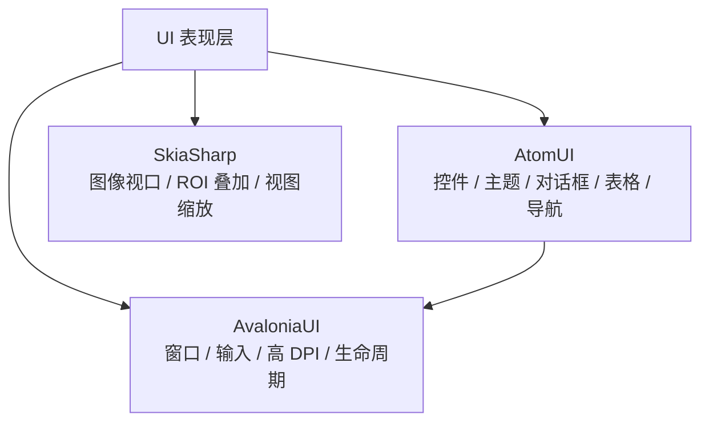

# ADR-0002：AtomUI 作为界面一等公民

| 项 | 值 |
| :--- | :--- |
| 状态 | Accepted |
| 日期 | 2026-11-18 |
| 作者 | lukan |
| 关联 | `docs/spec/baseline/startup-requirements.md` 1.0 §3、§3.1；本决策使该文件升为 1.1 |

## 状态

Accepted，2026-11-18 由项目负责人拍板，取代 1.0 版仅以 AvaloniaUI 与 SkiaSharp 组成 UI 层的表述。

## 背景与约束

1.0 基线的 UI 层只有 AvaloniaUI 与 SkiaSharp：AvaloniaUI 负责窗口、面板、输入与高 DPI，SkiaSharp 负责图像视口。该组合足以把图像画出来，但科研桌面软件的界面远不止视口，数据表格、属性编辑器、对话框、表单校验、导航、通知、主题与暗色模式都要自己搭，而 Avalonia 原生控件在这些面上偏薄；逐项自研会把早期预算耗在通用 UI 上，不同面板也容易长成不同风格。

AtomUI 是建立在 Avalonia 之上的企业级控件与主题体系（Ant Design 设计语言），提供表格、表单、导航、对话框、通知与主题令牌等能力，正好覆盖应用框架层；图像视口与 ROI 叠加属于高频自绘区域，AtomUI 不承担也不应承担。由此产生两条约束：其一，AtomUI 与 Avalonia 的版本必须锁成一组兼容组合，单独升级任一侧都要整体回归；其二，引入前必须复核 AtomUI 的许可证与依赖树，确保不违背项目「不引入 AGPL」的原则。

## 决策

UI 层由三部分组成，职责边界固定：

- AtomUI 为一等公民，承担应用框架、通用控件、主题、对话框、表单、导航、通知与数据表格；新界面的默认动作是从 AtomUI 选控件，而不是先写自定义控件。
- AvaloniaUI 作为平台底座，承担窗口、输入、DPI、生命周期与多平台适配；AtomUI 自身也运行在 Avalonia 之上。
- SkiaSharp 保留图像视口、画布变换、ROI 叠加与视图缩放的自绘职责，因为这一区域需要逐帧绘制与像素级控制，不适合套用通用控件。

「一等公民」的判据是三条：新界面默认使用 AtomUI 控件与主题令牌；AtomUI 缺失的能力先评估扩展或自定义控件能否落在同一体系内；确需绕过 AtomUI 自绘的界面，必须在设计文档中写明理由与边界，不得以「用着不顺手」为由另起一套。

运行时固定为 .NET 10，目标框架随新解决方案落地时写入各工程。

## 备选方案

- **仅用 Avalonia 原生控件与自研主题**：控件覆盖不足，表格、表单、对话框都要自建，交付周期与风格一致性都不可控，否决。
- **商业控件套件**：授权费用与分发条款会和开源发布冲突，且绑定具体厂商，否决。
- **Web 前端或 Blazor Hybrid**：引入浏览器运行时与额外内存开销，与桌面端离线、低延迟的定位不符，否决。

## 后果

正面后果是应用框架的交付从「造控件」转为「组装界面」，设计语言统一，主题、暗色模式与高 DPI 有现成实现，团队可以把精力放在图像视口与业务面板上。

负面后果是新增一层外部依赖：AtomUI 与 Avalonia 的版本耦合会限制升级节奏，控件的默认行为与样式定制有学习成本，上游缺陷也只能等待修复或本地覆盖。缓解办法是锁定版本组合并在升级时成对回归、把 AtomUI 用法收敛到少数适配层、视口保持独立自绘，以及为关键界面保留截图回归。

本决策落地后，`docs/spec/baseline/startup-requirements.md` 升为 1.1，UI 层条款与项目定义同步更新，README 的技术路线同步改口径。

## 补记（2026-11-18）

本 ADR 定稿当日，项目负责人确认已持有 AtomUI 商业授权，原「引入前必须复核许可证与依赖树」的前提随之改变，但决策本身不变，仍以 AtomUI 为界面一等公民，因此只在本节记录修正而不另开 ADR。

修正后的许可证约束是两条：其一，AtomUI 的使用与分发范围以商业授权条款为准，超出授权范围的组件不得启用，授权凭证与购买记录由项目负责人保管；其二，其余依赖仍须逐个复核许可证与依赖树，确保不违背无 AGPL 的原则，商业授权只覆盖 AtomUI 本身，不构成对其他依赖的授权豁免。

## 勘误（2026-11-19）

`docs/spec/` 在 PRD 4.0 收口时重组为分类子目录，本文「关联」与正文引用的启动需求路径已改为 `docs/spec/baseline/startup-requirements.md`；此处只更正引用位置，决策内容、状态与版本影响均不变，决策当时指向的 1.x 版本亦不作调整。
