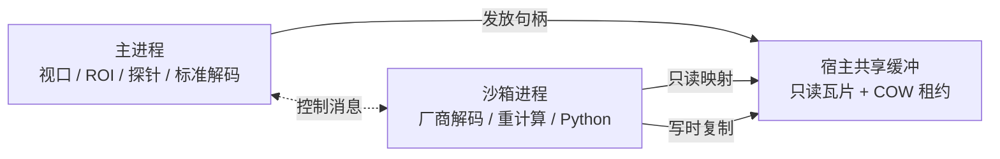

# ADR-0004：沙箱像素数据通路与插件进程拓扑

| 项 | 值 |
| :--- | :--- |
| 状态 | Accepted |
| 日期 | 2026-11-18 |
| 作者 | lukan |
| 关联 | `docs/spec/baseline/startup-requirements.md` 1.3 §3、§6.2、§10；本决策使基线升为 1.4 |

## 状态

Accepted，2026-11-18 由项目负责人拍板，修正基线 1.0 中「主进程与插件之间不存在共享内存」的绝对表述，并补足进程拓扑。

## 背景与约束

基线把重计算、IO 与批量任务放进独立 Socket 沙箱，同时要求 16k×16k 平面、100 GB 级文件、30 FPS 视口与 16 毫秒 ROI 响应。若插件像素只能按值经 Socket 拷贝，单张 16k×16k 的 16 位平面就是 512 MB、float32 是 1 GB，一次测量或一次滤波的往返开销就会吃掉全部性能预算；反之若允许插件共享可变缓冲区，崩溃隔离与结果可复现又不成立。与此同时，厂商格式解码面对的是不可信输入，放在主进程一旦越界就带走整个会话。

因此需要同时满足三条约束：交互热路径不得跨进程；插件访问像素不得整块拷贝；插件不得读写共享可变状态。

## 决策

**进程拓扑**按槽位与任务类型划分：

- 主进程：视口渲染、ROI 编辑、像素探针、同步缩放，以及标准 TIFF、BigTIFF、PNG、JPG 的解码。
- 沙箱进程：厂商格式解码（BioFormats.NET）、颗粒分析、栈投影、Python、AI 推理，以及声明为 heavy 的插件任务。
- 主进程或沙箱：小规模测量就地执行，大规模测量提交沙箱。

**像素数据通路**：宿主向插件发放只读平面/瓦片句柄，底层为只读内存映射或共享内存；写操作必须申请 copy-on-write 租约；Socket 只传控制消息、进度与结果摘要。插件之间、插件与主进程之间不存在共享可变状态。

**生命周期**：缓冲区由宿主持有并引用计数；句柄带租约期限，任务取消或插件崩溃后由宿主统一回收；插件不得跨任务缓存句柄，也不得自行释放宿主缓冲。

**权限执行**：能力声明只作提示，真正约束由宿主 broker 加操作系统隔离共同完成，Windows 使用受限令牌与作业对象，macOS 使用 sandbox profile，Linux 使用 seccomp 与命名空间；原生依赖插件必须显式声明并降级为「用户确认的完全信任」。

## 备选方案

- **保持纯 Socket 拷贝**：实现简单、隔离彻底，但大图与重计算的性能目标无法达成，否决。
- **插件在主进程内共享可变缓冲**：性能最好，但崩溃隔离、确定性与权限模型全部失效，否决。
- **全部解码进沙箱**：隔离最好，但标准 TIFF 的 5 秒首屏与瓦片懒加载会被跨进程调度拖垮，且主进程仍要持有视口缓冲，否决。

## 后果

正面后果是插件能以接近零拷贝的方式处理大图，交互路径不经过沙箱，厂商格式解码获得真正的崩溃隔离，安全边界也有明确的执行点。

负面后果是需要实现共享缓冲管理器与租约协议，调试复杂度上升；BioFormats 解码移入沙箱后，首屏需要额外回传瓦片；插件 API 必须区分「主进程内插件」与「沙箱插件」两类，文档与模板都要分别维护。

基线 §6.2 的「不存在共享内存」据此修正为「不存在共享可变状态」，其余隔离要求不变；PRD 中依赖该表述的条目随之改写。

## 勘误（2026-11-19）

`docs/spec/` 在 PRD 4.0 收口时重组为分类子目录，本文「关联」与正文引用的启动需求路径已改为 `docs/spec/baseline/startup-requirements.md`；此处只更正引用位置，决策内容、状态与版本影响均不变，决策当时指向的 1.x 版本亦不作调整。
