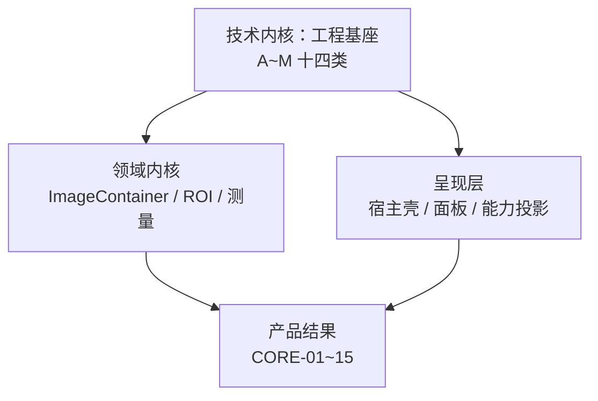
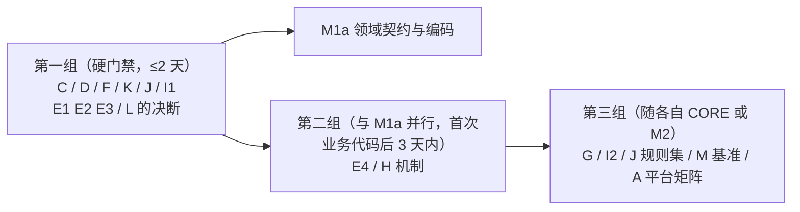

# ADR-0007：技术内核（工程基座）的范围、最小集与闸门

| 项 | 值 |
| :--- | :--- |
| 状态 | Accepted（2026-11-19，架构师拍板；两名独立 subagent 对抗评审，逐条处置见 §7） |
| 日期 | 2026-11-19 |
| 作者 | lukan |
| 关联 | `docs/spec/baseline/startup-requirements.md` §3、§4、§10、ADR-0002~0006、`docs/spec/requirements/product-requirements.md` §6.1、`docs/spec/plans/PM-PLAN-0002-m1-vertical-slice.md` |

## 1 背景

### 1.1 上一稿的误读

同日上一稿把技术内核理解为"跨模块能力"，收窄到共享契约、宿主壳与插件宿主三项，并把主题与语言降为 design 约定。这是范畴错误：共享契约（ImageContainer、Calibration、ROI、Results）属于领域内核，宿主壳属于呈现层，两者都离功能很近；而真正决定"所有功能怎么写"的内容——语言与运行时、依赖与许可证、命名空间与程序集边界、解决方案分层、调试、测试与单元测试——被整体排除在范围之外。后果直接落在计划上：下一步本应建立工程基座，却排成了先做图像与校准契约，而仓库此刻没有测试工程、没有持续集成、没有静态检查闸门、没有依赖治理、没有程序集引用规则。

### 1.2 仓库事实

| 面 | 现状 |
| :--- | :--- |
| 构建 | `dotnet build src/ImageLyre.slnx` 零警告零错误，`.NET SDK 10.0.404` |
| 工程 | 1 个桌面应用加 6 个类库；除 `App.cs`、`Program.cs` 外无任何类型；ADR-0006 已决新增 CLI 与 headless 会话层两个工程 |
| 测试 | `tests/` 只有说明文件，没有测试工程、没有测试框架、没有 fixture 目录 |
| 依赖 | `Directory.Packages.props` 中央管理 9 个包；无 `global.json`、无包锁、无许可证检查、无升级策略 |
| 静态检查 | `.editorconfig` 条目多为 suggestion 或 silent，其中大量 `resharper_*` 项 `dotnet format` 并不执行；无分析器包、无"警告即错误" |
| 交付 | 无持续集成、无打包脚本、无 `launchSettings.json`、无诊断配置、无基准工程 |

### 1.3 约束

其一，技术内核是研发自有判断，不能靠产品需求文档细化，因为产品经理不做编码判断。其二，产品经理、架构师与全栈工程师由同一人承担，基座不能依赖"以后有人补"，只能靠可执行闸门。其三，基座做过头会推迟第一个可演示切片，而 M1a 的两周窗口没有一天是空的（第 1–2 天 fixture、第 2–10 天编码、第 10–14 天 M1b），因此范围要全、门禁要窄。

## 2 决策

### 2.1 定义与判据

**技术内核指工程基座**：它约束"所有功能怎么写"，不回答"某个功能做什么"。一项内容进入技术内核，当且仅当同时满足三条：它约束的是跨功能复用面（全部工程，或全部界面），而不是某个功能的内部实现；它定错后返工面覆盖多个项目或多个模块，而不是一处实现；它的验收物是工程能力（能构建、能测、能调、能打包），而不是用户可感知的结果。

### 2.2 与相邻三层的分界

| 层 | 回答什么 | 例子 | 验收物 | 归属 |
| :--- | :--- | :--- | :--- | :--- |
| 技术内核 | 所有功能怎么写 | 语言与运行时、依赖、命名空间与程序集、分层强制、线程与取消、命令与撤销、测试、调试、工具链、静态检查、插件骨架、本地化与主题机制、性能诊断、交付 | 能构建、能测、能调、能打包 | 架构师 |
| 领域内核 | 数据怎么表示、怎么算 | ImageContainer、Calibration、ROI、Results、测量算法 | 与 ImageJ 可比对的数值结果 | 架构师出契约、全栈实现 |
| 呈现层 | 界面怎么组织 | 宿主壳、面板、菜单与能力投影、交互流程 | 交互验收 | 全栈 |
| 产品结果 | 用户得到什么 | CORE-01~15 | 产品需求文档的验收语言 | 产品经理 |

### 2.3 基座清单

十四类构成完整范围；"时点"一列区分决断与实现，避免把整类都压在 M1a 之前。

| # | 类别 | 现状 | 缺口 | 决断物 | 时点 |
| :--- | :--- | :--- | :--- | :--- | :--- |
| A | 语言与运行时（C#） | `net10.0`、`LangVersion latest`、`Nullable`、`ImplicitUsings` 已生效 | 目标平台矩阵、SDK 升级节奏、第三方库的 AOT 兼容清单 | 支持矩阵与升级规则 | 打包前 |
| B | 依赖与许可证 | 中央包管理 9 个包 | 无 AGPL 零容忍闸门、无传递依赖审计、无升级成对回归 | 许可证检查方式、升级策略 | 闸门 M1a 前手动跑一次；自动化随 I2 |
| C | 解决方案、程序集与命名空间 | 7 工程；ADR-0006 已决新增 CLI 与 headless 会话层 | 引用允许矩阵未成文、命名空间与目录映射未约定、测试工程命名与是否入 slnx 未定 | 9 工程的引用矩阵、命名空间规范、测试工程命名 | M1a 前 |
| D | 分层强制 | 只有基线 §4 与 §10 的条款文字 | 内核工程引用 Avalonia 或 UI 不报错 | 一条读 csproj 的测试断言（不用自研分析器） | M1a 前 |
| E1 | 线程模型 | 无 | UI 线程亲和、渲染线程、后台测量的结果追加顺序、共享缓冲的线程安全责任方 | 一页约定 | M1a 前 |
| E2 | 命令与撤销 | 无 | 可撤销边界（ROI、校准、结果是否同栈）、粒度与合并规则、命令对象归属 | 一页约定 | M1a 前 |
| E3 | 区域性契约 | 规范已冻结（小数点为 `.`、路径 NFC），基座无认领 | `CultureInfo` 使用边界、NFC 落点、AOT 与本地化共存的开关 | 一页约定 | M1a 前 |
| E4 | 容器、日志、配置、错误模型 | 无 | 依赖注入、日志抽象与落点、用户设置位置、错误码与异常的分界 | 选型与一页约定 | 首次业务代码后 3 天内 |
| F | 测试基座 | `tests/` 只有说明文件 | 框架、工程结构、fixture 目录、命名规则；断言库与替身策略待第二消费方出现 | xunit 工程与 `tests/fixtures` 目录 | M1a 前 |
| G | 插件骨架 | 六槽位与沙箱是概念加 ADR-0004、ADR-0006；代码空壳 | 清单格式、生命周期状态机、宿主 API、能力注册；能力投影属呈现层 | 结构与细节 | CORE-12 启动前；M1a 只约定"插件不进依赖图" |
| H | 多语言与本地化机制 | 只有依赖，无机制 | 文案键规范、资源文件结构、注入点、切换不重启的实现点 | 结构 | 机制决断随 L；语言包 CORE-11 前 |
| I1 | 本地循环与调试 | 能 build | 一条命令跑 build 与 test、`launchSettings.json`、诊断配置、平台的本机验证 | 本地脚本与配置 | M1a 前 |
| I2 | 持续集成与打包 | 无 | 流水线、许可证步骤、AOT 与 JIT 产物、体积预算 | 流水线与打包形态 | M2 起 |
| J | 静态检查与规范 | `.editorconfig` 多为建议级 | `AnalysisLevel`、警告即错、规则集、格式化闸门；注释规范由 `csharp-doc-style` 人工执行 | 严重度与规则集 | 警告即错 M1a 前；规则集与 format 闸门 M2 |
| K | 工具链与可复现构建 | 无 `global.json`、无包锁、无 `Directory.Build.targets` | SDK 版本与 rollForward、包源、`packages.lock.json`、确定性构建 | 版本与开关 | M1a 前 |
| L | 主题机制 | AtomUI 与 Avalonia 依赖已在 | 令牌分层、注入点、主题资源落在哪个工程、跟随系统的实现点 | 注入点与分层 | 决断 M1a 前；完整主题 CORE-10 前 |
| M | 性能与诊断 | 无 | 冷启动与打开耗时埋点、单图内存上限、崩溃转储落点、基准工程 | 埋点与预算 | 埋点 M1a 前；基准工程 M2 |

### 2.4 已定项

以下由基线与既有 ADR 锁定，不重复论证：运行时与语言（基线 §3）、UI 栈分工（ADR-0002）、插件进程拓扑与像素通路（ADR-0004）、BioFormats 内置（ADR-0005）、CLI 与 AOT 分工（ADR-0006）、中央包管理（`Directory.Packages.props`）、测试工程落点 `tests/`（`AGENTS.md`）。

### 2.5 M1a 硬门禁最小集

评审的共同结论是：十四类里只有少数在 M1a 真正卡住编码，其余可以推迟而不付结构代价。因此 M1a 的硬门禁不是整类，而是下面这八条，且**总工时上限两天**，安排在 M1a 第 1–2 天与 fixture 生成并行。

| # | 内容 | 级别 | 估时 |
| :--- | :--- | :--- | :--- |
| 1 | C：9 工程引用矩阵（含 CLI 不得引用 UI、headless 会话层被桌面与 CLI 双向依赖）与命名空间映射、测试工程命名 | 决断 | 半天 |
| 2 | D：一条读 csproj 的测试断言，禁止内核引用 Avalonia、SkiaSharp 与 UI | 落闸 | 半天 |
| 3 | F：一个 xunit 工程、`tests/fixtures/` 目录、命名规则 | 实现 | 半天 |
| 4 | K：`global.json` 固定 SDK 与 rollForward、`packages.lock.json` | 落闸 | 一小时 |
| 5 | J：`AnalysisLevel` 与 `TreatWarningsAsErrors` 打开，清掉现有警告 | 落闸 | 一小时 |
| 6 | I1：一条命令跑 build 与 test 的本地脚本、`launchSettings.json` | 实现 | 一小时 |
| 7 | E1、E2、E3：线程模型、命令与撤销边界、区域性契约，各一页约定 | 决断 | 两小时 |
| 8 | L：主题与语言资源落在哪个工程、注入点在哪 | 决断 | 十分钟 |

八条之外的一切基座内容都按 §2.3 的时点推进，不进入 M1a 门禁；E4、G、H 的完整机制、I2、J 的规则集、M 的基准工程在 M1a 之后随各自消费方出现时补齐。

### 2.6 决断次序

次序的理由是依赖关系而非重要性：第一组不完成则工程骨架与测试无处落地；第二组的横切设施在没有第二个消费方时提前实现只会空转；第三组的需求尚未出现，提前做就是作者自认的"抽象过早"。

### 2.7 闸门

没有闸门的约定不算基座，只算散文。每条基座决定必须落到四道闸门之一：编译期（分析器、禁用 API、引用断言）、构建期（警告即错误、格式化校验）、测试期（架构测试、契约测试、边界与区域性用例）、流水线（构建、测试、许可证检查合并）。M1a 阶段只有前两道与测试期可用，流水线闸门随 I2 启用；四道闸门全部由 `dotnet build`、`dotnet test`、`dotnet format` 与流水线承载，不依赖人的记性。

### 2.8 变更规则

基座决定的变更走 ADR，领域内核契约的变更走 design 版本，产品结果变更走产品需求文档，三者不越界。基座工时若超过 §2.5 的两天上限，按 §5 降级到硬门禁最小集，不得挤占第 3 天起的 Kernel 编码。

## 3 备选方案

- **边写边定基座**：最省事，但命名空间、程序集边界与测试工程会在第一周被既有代码定型，之后每次调整都要动全部工程，否决。
- **基座一次做到完备**：含 CI、打包、基准工程与平台矩阵，会推迟第一个可演示切片数周，且其中多项在 Core 1.0 用不到，否决。
- **只保留现有的一句话技术栈**：现状即此，已证明不足——仓库没有测试工程与闸门，规则只存在于文档，否决。
- **把基座写成 README 清单而非 ADR**：清单无法记录取舍、失效条件与变更规则，也无法被评审，否决。
- **把十四类拆成十四份 ADR**：跨类依赖（D 依赖 C、E4 依赖 C 与 F）会散落，读者无法一次看清次序，否决；改为本文定范围、最小集与闸门，逐类细节在需要时另开 ADR 或 design。

## 4 后果

正面后果是技术内核第一次有了完整范围、可执行的最小集与闸门：M1a 的前置从"能构建"扩到"能测、能查、能分层"，而新增工作量被压到两天以内，不会拖垮两周窗口。

负面后果有三条。其一，两天基座与 fixture 生成并行，第 1–2 天是双线作业，人力紧张时最可能被压缩的是契约决断，需要产品经理在排期上认账。其二，十四类决断分散在多个时点，单人节奏下容易只做不闭，因此每一类都有决断物与时点，不接受"持续完善"。其三，闸门会立刻暴露既有不一致（例如内核工程一旦引用 UI，构建即失败），这是设计意图而非意外。

## 5 什么情况下要改

三条可判定的修订条件：其一，基座工时超过两天的上限，按 §2.8 降级到硬门禁最小集，并把超出部分写进后续里程碑；其二，第二组在首次业务代码后三天内仍无法完成，说明该组应整体后移，而不是拖住编码；其三，Core 1.0 范围评审引入跨平台打包、插件市场或第二个人协作，第三组的时点需整体提前，本文件的次序要重排。

## 6 与 PRD §6.1 的关系

产品需求文档 §6.1 把技术内核写作"主题、语言、插件宿主、宿主壳、共享契约"五项，那是产品侧可见的研发前提清单，与本文的工程基座部分重叠但不重合：主题、语言、插件宿主、宿主壳的**机制**属本文范围，共享契约属领域内核，宿主壳的面板与能力投影属呈现层。本文不改动产品需求文档，也不改变任何产品结果；建议产品经理下次升版时在 §6.1 加一句括注，说明五项是产品可见的研发前提，工程基座另有决策记录。

## 7 对抗评审记录

两名独立 subagent 于 2026-11-19 评审，结论分别为"有保留通过"（可执行性）与"有保留通过"（完备性），共同指出门禁范围不一致与测试基座缺失是 M1a 的真实卡点，并补充五类漏项。逐条处置如下。

| # | 来源 | 意见 | 处置 |
| :--- | :--- | :--- | :--- |
| 1 | 可执行性 | §2.5 图与 §2.8 正文门禁范围不一致：图要求前两组七类，正文只卡第一组 | 采纳：§2.5 显式列出八条硬门禁并给估时，§2.6 图与正文对齐，第二组改为与 M1a 并行 |
| 2 | 可执行性 | M1a 九条里真正依赖基座的只有 F，`tests/` 为空会在第 2 天卡死 | 采纳：F 的最小集收缩为一个 xunit 工程、fixtures 目录与命名规则；断言库与替身策略移到第二消费方出现时 |
| 3 | 可执行性 | 两周窗口零缓冲，基座三到五天无处安放 | 采纳：§2.5 加上限两天并安排在 fixture 并行的第 1–2 天，§2.8 给出超限即降级的规则 |
| 4 | 可执行性 | G 要求结构在 M1a 前，与 M1 不做插件冲突，且属抽象过早 | 采纳：G 的结构时点移到 CORE-12 前，M1a 只留"插件不进依赖图"一句 |
| 5 | 可执行性 | E 把 DI、日志、配置、错误模型、异步取消捆成一道门，M1a 只有一个消费方 | 采纳：E 拆成 E1~E4，只有线程与撤销、区域性三则在 M1a 前，E4 移到第二组 |
| 6 | 可执行性 | "CI 于 M1a 演示前"收益撑不起维护成本 | 采纳：CI 归入 I2 并推至 M2，M1a 只留本地脚本与 `global.json`；许可证检查在 M1a 前手动跑一次 |
| 7 | 可执行性 | J 把分析器、格式化、注释检查捆在一起，且 `resharper_*` 项 `dotnet format` 不执行 | 采纳：J 只保留 `AnalysisLevel` 与警告即错在 M1a 前，规则集与格式化闸门进 M2，注释规范由技能人工执行 |
| 8 | 可执行性 | D 的决断物留着"分析器或架构测试"两个选项，把最贵的摆在桌上 | 采纳：直接指定读 csproj 的测试断言，删除自研分析器选项 |
| 9 | 完备性 | 缺工具链与可复现构建（无 `global.json`、无包锁、无 `Directory.Build.targets`） | 采纳：新增 K 类，并入硬门禁 |
| 10 | 完备性 | 缺全球化与区域性契约，而 `measurement-baseline.md` 已冻结小数点与 NFC | 采纳：新增 E3，并入硬门禁 |
| 11 | 完备性 | 缺命令与撤销模型，而最小撤销已排进 M1a | 采纳：新增 E2，并入硬门禁 |
| 12 | 完备性 | 缺线程模型，而 ADR-0004 的零拷贝与视口预算都压在它上面 | 采纳：新增 E1，并入硬门禁 |
| 13 | 完备性 | 缺性能与诊断的验收物，PRD 的三秒与十秒没有测量手段 | 采纳：新增 M 类；M1a 只埋计时，基准工程与第五道闸门留 M2 |
| 14 | 完备性 | H 与 G 含混层内容：导出不随语言变属领域，能力投影属呈现 | 采纳：导出边界留在领域与 `measurement-baseline.md`，能力投影移入 §2.2 的呈现层 |
| 15 | 完备性 | §2.2 的示例与 §2.3 的十类不同构，"语言"一词两义 | 采纳：A 改为"语言与运行时（C#）"、H 改为"多语言与本地化机制"，§2.2 示例与清单逐类对应 |
| 16 | 完备性 | §2.3 给 E 的时点与 §2.5 的"第二组在首行业务代码前"互斥 | 采纳：改为第二组与 M1a 并行、以"首次业务代码后三天"为界 |
| 17 | 完备性 | I 整类推后，但调试配置是 M1a 日常工具、CI 是许可证闸门的载体 | 采纳：I 拆成 I1（本地循环与调试，进硬门禁）与 I2（CI 与打包，M2） |
| 18 | 完备性 | C 按 7 工程画矩阵，与 ADR-0006 已决新增 CLI 与 headless 会话层冲突 | 采纳：矩阵按 9 工程一次画全，并同条定测试工程命名与是否入 slnx |
