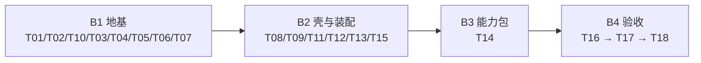

# 2026-11-23 工作小结

| 项目 | 内容 |
| :--- | :--- |
| 日期 | 2026-11-23 |
| 记录人 | lukan |
| 当日主线 | 从「架构大体确定、计划待评审」推进到 M1 插件骨架交付：18 个任务全部落地、A–G 七条验收通过、设计升到 0.30 |
| 基准 | 分支 `dev`，起点提交 `e998bc2`，业务提交终点 `5aeeaff`；build 0 警告 0 错误，test 五套共 44 项全部通过（本文件随其后的收尾快照提交入库） |

说明：`docs/spec/workgroup-binding.md` 在本仓仍不存在，分支与提交身份按实际发现值执行并在文末注明「发现值，未绑定」。

## 完成事项

### 1 设计与计划的收敛（0.10 → 0.30 / 0.2 → 0.9）

设计文档从 0.9 演进到 0.30，每次改动都由实现或实测倒逼，不是为改而改：

- 0.10–0.11：按第一轮独立评审订正契约骨架顺序、把附着物词汇移出壳契约、壳的槽位注入改为 `ISupportSlotManager` 加 `IAttachmentRegistry` 强转（依据是 cangming `v0.1.9.1122` 源码，不是文档转述）。
- 0.12–0.13：回写 Bootstrap 必须把 `ILoggerFactory` 登记进容器、App 必须 `partial` 且 `UseDesktopControls`、不要显式 `Show` 欢迎窗口。
- 0.14–0.16：App 对机制包依赖合法化、示范契约换成 `IPlatformCapabilities` 与 `IPerformanceMonitor`、插件工程改名落在 `Modules/` 与 `Features/`。
- 0.17：契约从「引用 cangming 包」改为「源码抄录」，并新开 `docs/adr/lukan/ADR-0002-平台契约抄录与本地演进.md` 记录所有权变化，ADR-0001 §6 互相登记。
- 0.19–0.21：线程口径、装配链门闩、目录重排（App / Infrastructure / Plugins）与「物理归置不改变层归属」的判据。
- 0.23–0.27：菜单项改由插件贡献、语言切换归「文件」菜单、状态栏变第四个槽位、壳窗口基类必须是 AtomUI `Window`。
- 0.28–0.30：记录 v1 附着物不可变导致的三处文案冻结、`lyre.test.` 前缀、三个冒烟钩子的登记表。

### 2 B1 地基（T01、T02、T10、T03、T04、T05、T06、T07）

- 版本组合按签字方案 B 落地：AtomUI 6.2.11 + Avalonia 12.1.4 + cangming 0.1.9.1122 + SkiaSharp 3.119.4，`.NET 10`、警告即错误、`global.json` 钉 SDK 与 MTP runner。
- cangming 子模块锁到 tag `v0.1.9.1122`（提交 `ae865a9`），编译只吃 NuGet 包；顺手勘误了 ADR-0001 §1.6 里写错的提交锚点。
- 契约与领域骨架、本地化基础设施（7 条单测）、Bootstrap（无界面启动 + 能力计数）、App 入口（欢迎窗口 / 桌面与无界面分派）、CLI 三条命令（退出码 0/1/2，16 条单测）、通配引用复制机制全部落地。
- 通配引用这条机制实测三件事：插件工程不进解决方案也会被拉进构建、`dotnet clean` 能清掉已复制的 dll、空工程只增加扫描候选不增加插件条目。

### 3 B2 壳与装配（T08、T09、T11、T12、T13、T15）

- `Shell.Contracts` 只留 `ShellSlots` 与 `IWorkbenchShell`，`DockPaneAttachment` 单独落在 `Infrastructure/ImageLyre.Shell.Attachments`，理由写进契约 README 与 XML 注释。
- 壳插件以 `ISupportSlotManager` 收注入、在 `Build()` 里构造窗口并贡献槽位；`MainWindowFactory` 在附着前断言槽位已贡献，顺序从文档变成了代码护栏。
- T13 收口：`CompositionGate` 三态门闩、单例 `SlotManager`、失败路径先停插件再显示原因、三条关停路径共用一段收口。
- T15 之后两次修订：菜单从八个顶层简化成一个「文件」，语言切换进「文件」菜单，状态栏变成第四个槽位 `lyre.shell.statusbar`。
- 目录两次重排（App/Infrastructure/Plugins，再收 `Infrastructure/Contracts/`），全部用 `git mv`，引用与 slnx 同步。

### 4 平台与诊断能力包（T14）

- `Module.Platform` 提供 `IPlatformCapabilities`（Windows 八项全支持，macOS/Linux 未实测一律 false）。
- `Module.Performance` 提供 `IPerformanceMonitor`，`Require`/`After` 到平台能力；CPU 为两次采样差值，首次为 0。
- `Feature.Diagnostics` 向工具条附刷新按钮、向辅助面板附五行读数、向状态栏附 OS 与内存两段；能力插件计数由 0 变 2，四个槽位全部有内容。
- 新增 `UnitTest.ImageLyre.Capabilities` 共 9 条，红阶段抓出「快照时间带本地 +8 偏移」与「Windows 矩阵全 false」两处真实缺陷。

### 5 验收与收口（T16、T17、T18）

- `ImageLyre.Module.Broken` 只随 Debug 输出，`scripts/qa/verify-m1.ps1` 覆盖六类检查；两次破坏验证（加壳插件引用、写 `pixel` 字符串）都让对应项变红并 `exit 1`。
- T17 七条验收按 C → D → B → A → E → F → G 全部通过，记录写入 `docs/plans/lukan/PLAN-0001-M1-插件骨架实施.md` §5.1，含命令、关键日志与结论。
- T18 回写 `AGENTS.md` §4/§5、重写 `src/README.md`、设计新增 §3.9 冒烟钩子表，计划状态置为「已完成」。

### 6 当日修掉的三个真缺陷

其一，**壳窗口点菜单就崩**：`Avalonia.Controls.Window` 在 AtomUI 主题下没有 `OverlayLayer`，子菜单 Popup 抛 `InvalidOperationException`；基类改为 `AtomUI.Desktop.Controls.Window`，并加 `LYRE_SMOKE_OPEN_MENU` 让冒烟覆盖这条路径——当天的冒烟原本只验窗口出现与自关，从未展开菜单。

其二，**App 被按名加上插件依赖**：壳插件缺运行时依赖时，临时做法是给 App.csproj 加 `Shell.Contracts`、`Shell.Attachments` 与 Avalonias 三条引用，这会推翻「新增插件不改 App」。改成 `src/Plugins/Directory.Build.props` 打开 `CopyLocalLockFileAssemblies` 加根 `PluginOutputMerge.targets` 归并，App 保持零插件引用。

其三，**故障样本被算进能力计数**：Broken 原本挂在 `lyre.capability.broken`，会让验收 A 的「能力插件 0 个」永远达不到；改用 `lyre.test.broken` 并在设计 §5.5 增设测试前缀。

## 进行中

无。M1 的 18 个任务全部完成，七条验收通过，工作树在收尾提交前干净。

## 阻塞

无。有一条**待拍板事项**不属于当日阻塞：基线 §10.1 要求「操作系统隔离对越权调用返回明确错误码」，而 cangming `ADR-0012` §2.2 把 OS 权限沙箱列为非目标，两者冲突需由专项安全 ADR 裁决，最晚在基线 M2 启动前。

## 次日计划

1. 决定 M1 之后的第一条主线：先做 G2 的只读治理（插件列表、模块状态流、依赖树、诊断面板），还是先接第一批真实能力包（IO / View）。
2. 把三个冒烟钩子替换或补强为真实 UI 测试的入口，至少在 G2 之前让「展开菜单 + 切换语言 + 关窗」三条有自动化证据，而不是靠环境变量。
3. AtomUI 商业授权的记录归档：当前只在基线 §3.1 有一句话，缺少授权文件、期限与可分发范围的落点。
4. 日志管线：WinExe 双击启动时 stderr 不可见，Bootstrap 与插件日志实际丢失，需要决定接 NLog 还是 Serilog（cangming 两个落地包都在）。
5. 把 `scripts/qa/verify-m1.ps1` 扩成一键验收：目前 C/A 需要临时摘除 `UnitTest.ImageLyre.Capabilities` 的 slnx 条目，这一步还靠人工。

## 关联文档

- `docs/adr/lukan/ADR-0001-插件机制架构基线.md`（Accepted，冻结；§1.6 有提交锚点勘误）
- `docs/adr/lukan/ADR-0002-平台契约抄录与本地演进.md`（Accepted）
- `docs/design/lukan/DESIGN-0001-M1-插件骨架.md`（0.30）
- `docs/plans/lukan/PLAN-0001-M1-插件骨架实施.md`（0.9，已完成；§5.1 为验收记录）
- `docs/spec/baseline/startup-requirements.md`（2.2）
- `docs/spec/m1/M1-interaction-spec.md`（§2 状态栏五段）
- `docs/daily/lukan/2026-11-22-summary.md`（前一日小结）
- `AGENTS.md`（§4 现状与约定、§5 目录速览）

## 遗留与说明

1. **v1 附着物不可变**：工具条标题、状态栏片段与面板页签在附着时定稿，语言切换只刷新面板内容；要等 G3 的槽位撤销才能跟随语言。
2. **冒烟钩子是脚手架**：`LYRE_SMOKE_CLOSE_MS`、`LYRE_SMOKE_OPEN_MENU`、`LYRE_SMOKE_LANGUAGE` 三个环境变量只为 M1 提供可判定证据，接入真实 UI 测试后应删除。
3. **验收 G 的菜单与读数证据来自仓外探针**：应用层证据只有两条标题行，严格说探针不是产物的一部分。
4. **本机运行限制**：沙箱里 `dotnet test` 的 MTP 命名管道会被拒，测试必须直接执行 `tests/<工程>/bin/Debug/net10.0/<工程>.dll`；cangming 的扫描缓存按路径、长度与最后写入时间失效，补依赖后若 dll 未变需要手动清缓存。
5. **`WelcomeWindow` 仍是 Avalonia 原生窗口**：当前无 Popup 所以安全，加下拉或对话框前必须换基类。
6. **分支与身份未绑定**：`docs/spec/workgroup-binding.md` 缺失，本日按发现值执行（分支 `dev`，身份 `lukan <lukan@xknife.net>`）；提交未推送，`origin/dev` 落后本日提交。
