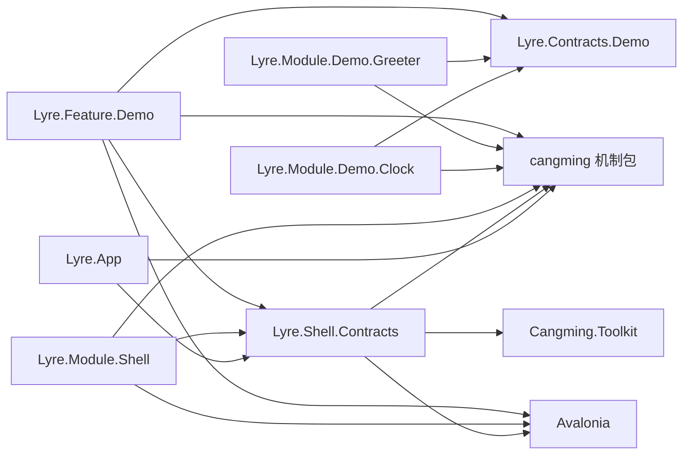
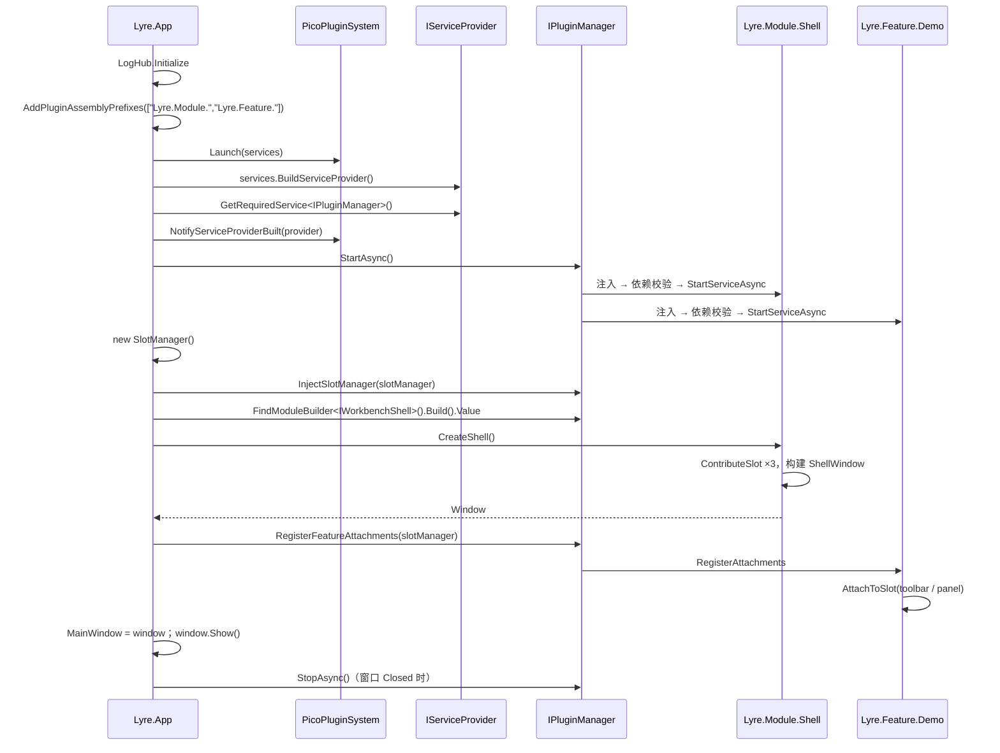

# DESIGN-0001：M1 插件骨架

| 版本 | 日期 | 状态 | 作者 | 说明 |
| :--- | :--- | :--- | :--- | :--- |
| 0.1 | 2026-11-22 | 草稿 | lukan | M1 的工程结构、装配时序、界面槽位、接口契约、边界情况与验收；范围限定为插件机制，不含任何产品能力 |
| 0.2 | 2026-11-22 | 草稿 | lukan | 第一轮评审修订：补管理器与槽位管理器的归属、壳窗口的获取方式、契约依赖、验收顺序与清理前置、插件 Id 策略、能力插件日志行、实施顺序与允许依赖集合 |

## 1 目标与范围

M1 的目标是让插件机制在真实宿主上跑通，并证明 ADR-0001 §2.2 的前两条判定：机制层没有产品词，空壳能启动；第三条“一能力包一改动”由新增插件的验收动作证明。M1 交付骨架、一个契约闭环与一个故障样本，不交付任何产品能力——图像、ROI、测量、分析、文档、设置都留到 M1 之后，由第一批真实能力包接入，那时才是对契约层的第一次真考试。

判定 M1 是否完成，只看第 7 节的 A–E 五条，不看功能数量；若某条为了“顺手做个功能”而被推迟，M1 视为未完成。

## 2 约束

### 2.1 长期约定

1. 只使用 cangming 已发布能力，不修改 cangming 源码；cangming 以只读子模块锁定 tag `v0.1.9.1122`，M1 第 1 步落地子模块。`Cangming.Shell` 与 `Cangming.Platform` 的实现包不接入，避免把产品能力建在没有实现的契约上。
2. 显式插件 Id：每个插件在 `[Plugin]` 上写死 Id，不使用由程序集名与类型全名派生的默认值。cangming 的载入器在扫描末尾执行 Id 唯一性策略，同 Id 按创建时间升序、再按类型全名保留一个，其余置未准入并记错误日志，因此显式 Id 是持久身份，不是临时约定。
3. `Lyre.Contracts.*`（产品契约）不得引用 Avalonia、AtomUI 或 SkiaSharp；`Lyre.Shell.Contracts`（壳契约）允许引用 Avalonia，因为它只被 UI 宿主与 Feature 引用，CLI 不引用它。
4. 插件之间零 `ProjectReference`；Feature 工程只依赖契约、cangming 机制包、cangming 的 Avalonia 路线包与 AtomUI。
5. 产物到达方式必须满足“新增插件不改 `Lyre.App.csproj`”，具体机制见 §3.5，M1 第 1 步先验证机制本身。
6. 壳的界面基线是 AtomUI：菜单、工具条、状态栏与面板容器用 AtomUI 控件；图像视口在 M1 只有占位容器，SkiaSharp 留到图像能力接入。

### 2.2 期限内约定（与 ADR-0001 §2.5 的表对应）

| 约定 | 现状 | 解除阶段 |
| :--- | :--- | :--- |
| 禁用需重启 | 只有 `PicoPluginSettings.DeniedPluginIds` 启动期黑名单，界面不提供启用/禁用开关 | G3 |
| 无安装器、无版本校验 | 插件随构建进入输出目录，不比较版本 | G4 |
| 单进程、主目录加载 | 插件与宿主同一 `AssemblyLoadContext` | G5 |
| 无插件面板 | 只有启动日志与 cangming 的状态事件 | G2 |

这四条与 ADR-0001 §2.5 的偏差登记表一一对应，不得在实现里悄悄延长。

## 3 结构设计

### 3.1 工程清单

| 工程 | 目录 | 类型 | 职责与依赖 |
| :--- | :--- | :--- | :--- |
| `Lyre.App` | `src/App/Lyre.App` | 应用（L5 宿主） | 装配器：初始化日志、追加扫描前缀、启动插件系统、建容器、解析管理器、注入槽位管理器、建壳、附着、关停；引用 `Lyre.Shell.Contracts`、cangming 机制包与 Avalonia |
| `Lyre.Shell.Contracts` | `src/Contracts/Lyre.Shell.Contracts` | 壳契约 | `ShellSlots`、`IWorkbenchShell`、`DockPaneAttachment`；引用 `Cangming.PicoPlugins`（`IFeatureAttachment`）、`Cangming.Toolkit`（`IOrderable`）、Avalonia |
| `Lyre.Contracts.Demo` | `src/Contracts/Lyre.Contracts.Demo` | 产品契约（M1 后删） | `IClock`、`IGreeter`；不引用任何 UI 框架 |
| `Lyre.Module.Shell` | `src/Plugins/Lyre.Module.Shell` | Module 插件（容器类 Module） | 实现 `IWorkbenchShell` 与 `ISupportSlotManager`，贡献三个一级槽位并构建主窗口；引用 `Lyre.Shell.Contracts`、cangming 机制包、cangming Avalonia 路线包、AtomUI、Avalonia |
| `Lyre.Module.Demo.Clock` | `src/Plugins/Lyre.Module.Demo.Clock` | Module 插件 | 提供 `IClock`；引用 `Lyre.Contracts.Demo` 与机制包 |
| `Lyre.Module.Demo.Greeter` | `src/Plugins/Lyre.Module.Demo.Greeter` | Module 插件 | 提供 `IGreeter`，声明 `Require<IClock>` 与 `After<IClock>` |
| `Lyre.Feature.Demo` | `src/Plugins/Lyre.Feature.Demo` | Feature 插件 | 消费 `IGreeter`，向工具条与辅助面板各附一项；引用 `Lyre.Shell.Contracts`、`Lyre.Contracts.Demo`、路线包与 AtomUI，不引用任何 Module 工程 |
| `Lyre.Module.Demo.Broken` | `src/Plugins/Lyre.Module.Demo.Broken` | Module 插件（测试） | 构造函数抛异常，验证构造失败隔离；不随产品发布 |

壳插件是容器类 Module，这是 cangming 明确允许的唯一例外：容器要构造控件，普通 Module 不得构造界面。

### 3.2 依赖方向



`Lyre.App` 不引用 `Lyre.Contracts.Demo`，它不消费示范契约；也不按名字引用任何插件工程，发行用的通配引用在 §3.5 单列。

### 3.3 装配时序



以下调用序列是唯一允许的写法，签名与 cangming `v0.1.9.1122` 一致：

```csharp
LogHub.Initialize(LoggerFactory.Create(builder => { }));
PicoPluginSettings.AddPluginAssemblyPrefixes(["Lyre.Module.", "Lyre.Feature."]);

var services = new ServiceCollection();
PicoPluginSystem.Launch(services);
var provider = services.BuildServiceProvider();
var pluginManager = provider.GetRequiredService<IPluginManager>();

PicoPluginSystem.NotifyServiceProviderBuilt(provider);
await pluginManager.StartAsync();

var slotManager = new SlotManager();
pluginManager.InjectSlotManager(slotManager);

var workbench = pluginManager.FindModuleBuilder<IWorkbenchShell>()
                            ?.Build().Value
                ?? throw new InvalidOperationException("壳插件未装载");
var window = workbench.CreateShell();

pluginManager.RegisterFeatureAttachments(slotManager);

window.Closed += (_, _) => pluginManager.StopAsync().GetAwaiter().GetResult();
window.Show();
```

`SlotManager` 是 `Cangming.PicoPlugins.Core.Features.SlotManager` 的具体类，同一实例必须同时交给 `InjectSlotManager`、每个 `SlotPanel.SlotManager` 与 `RegisterFeatureAttachments`；三处各 `new` 一个会得到“附着成功但界面永远为空”的假通过。

线程要求：从 `FindModuleBuilder` 到 `window.Show()` 的每一步都在 UI 线程执行，因为槽位附着会创建控件；`StartAsync` 也在 UI 线程同步等待。M1 因此附加一条约束：所有插件的 `StartServiceAsync` 必须同步完成，不得在启动动作里等待 UI 上下文的异步续体；将来若有插件需要真异步启动，必须先把 `StartAsync` 移到 UI 循环启动之前，再修改本节。

### 3.4 槽位先于附着

cangming v1 的 `AttachToSlot` 在槽位不存在时抛 `InvalidOperationException`，因此壳必须在 `RegisterFeatureAttachments` 之前完成 `ContributeSlot`，而槽位贡献发生在 `CreateShell()` 内，所以装配器必须严格按 §3.3 的顺序调用，不能把“建壳”和“附着”互换或并行。这条是 v1 的行为；cangming 落地 `ADR-0012` §2.7 的 v2 后，未贡献槽位的附着改为进入待解析桶、贡献时冲刷，本条的措辞与 §4.5 一并删除。

### 3.5 插件如何到达运行时

M1 用主目录扫描，在 cangming 默认前缀表上追加 `Lyre.Module.` 与 `Lyre.Feature.` 两条；默认表里已有 `LEIAO.`、`Jupiter.`、`RAY.`、`NKnife.`、`Cangming.`、`Mercury.` 等九条前缀，因此 `Cangming.*.dll` 仍会被扫到并按非插件跳过，`Lyre.Shell.Contracts`、`Lyre.Contracts.*`、`Lyre.App` 不匹配任何前缀，不进插件清单。

不使用 `Plugins/` 隔离根，原因是 cangming 的 `PluginLoadContext` 只把 `Cangming.Logs.Contracts` 与 `Microsoft.Extensions.Logging.Abstractions` 列为跨 ALC 共享程序集，`Lyre.Shell.Contracts` 与 `Lyre.Contracts.*` 会被每个插件的加载上下文各持一份，接口判定的类型身份随之不一致，`as`、`is` 与反射派发全部失效；隔离留到 G5 处理，届时需要先扩展共享程序集清单。主目录走 `Assembly.LoadFrom`，不需要 `deps.json`，但插件依赖的第三方 dll 必须落在输出目录。

产物到达输出目录的机制必须满足一条可检验的性质：新增一个插件工程后，应用输出目录里出现该插件程序集，而 `Lyre.App.csproj` 没有任何改动。做法是在 `Lyre.App.csproj` 写一条通配工程引用，把 `src/Plugins/**/*.csproj` 纳入构建顺序但不参与编译引用：

```xml
<ItemGroup>
  <ProjectReference Include="..\Plugins\**\*.csproj"
                    ReferenceOutputAssembly="false"
                    OutputItemType="Content"
                    CopyToOutputDirectory="PreserveNewest" />
</ItemGroup>
```

`ReferenceOutputAssembly="false"` 保证插件程序集不进编译输入，`OutputItemType="Content"` 把它变成可复制的内容项，工程引用同时给出正确的构建顺序。这条通配引用是插件工程进入 `Lyre.App.csproj` 的唯一形式，按名字的逐条引用数量必须为 0，验收 E 检查的就是这一点。

复制是增量的，`PreserveNewest` 不会清理已删除插件的旧 dll，因此所有“删除插件”的验收必须先 `dotnet clean` 或删除应用输出目录再构建，判据里要检查启动日志的候选程序集列表不含被删插件。

### 3.6 失败与降级

插件的构造失败、启动抛异常、启动返回 `false`、硬依赖缺失，四种情形在 M1 都只影响自己：管理器把该插件钉在 `Failed`，其余插件照常启动，应用进入可用状态，界面少一块内容而不是整体不可用。

构造失败与启动失败是两条不同的路径，可观察现象不同：构造函数抛异常时管理器不产出该插件实例，而是产出一个 `BrokenPlugin` 占位条目，清单里能看到它、状态为失败、错误消息写明构造异常，且它不像普通插件那样有契约；`OnStartAsync` 抛异常或返回 `false` 时插件实例存在、状态为 `Failed`，契约解析会跳过后继续找下一个提供方。验收 D 固定使用构造函数抛异常，覆盖 `BrokenPlugin` 路径；启动失败路径另在第 6 节列一行，不混在同一个判据里。

依赖提供方失败时，依赖方在启动回扫阶段被一并判 `Failed`，原因写明缺哪个契约；单插件手动启动（`StartPluginAsync`）不重新执行依赖排序，M1 不提供这条入口。

## 4 界面槽位

### 4.1 判据

固定语义的界面位做成“具名状态位 + 契约”，自由装配的区域才做成槽位。菜单栏、状态栏的五段读数、标题栏、通知中心、导出抽屉都属于固定语义：菜单是命令的呈现，状态栏段的含义由产品定义，标题栏是壳的 chrome，瞬时表面按事件弹出，它们若做成槽位，第一个后果就是有人往里加第六段状态栏或第二套菜单。

### 4.2 一级槽位

| 槽位名 | 区域 | 承载类型 | 容量 | 顺序 |
| :--- | :--- | :--- | :--- | :--- |
| `lyre.shell.toolbar` | 工具栏 | `ToolbarButtonAttachment` | 多 | 显式 `Order`，M1 要求每个附着物都写 `Order` |
| `lyre.shell.viewport` | 图像视口 | `ContentAttachment` | 单 | 无 |
| `lyre.shell.panel` | 辅助面板（Results 所在处） | `DockPaneAttachment` | 多 | 显式 `Order`，M1 要求每个附着物都写 `Order` |

M1 要求显式 `Order`，是因为渲染器的排序对 `NoPreference` 一律返回相等，底层用的是不稳定的就地排序，未声明顺序的相对次序没有保证；写死 `Order` 之后“按序呈现”才是可判定的承诺。

三个槽位由 `Lyre.Module.Shell` 贡献，名字常量放 `Lyre.Shell.Contracts` 的 `ShellSlots`，不放壳插件工程——否则 Feature 为了拿一个字符串就要引用壳插件，退化成 Feature 依赖 Module。

### 4.3 命名与归属

一级槽位名形如 `lyre.shell.<区域>`，按角色命名而不是按位置：没有 `left`、`right`、`bottom`，位置属于布局，不属于契约，Results 今天在右侧、明天挪到下方，槽位名与插件代码都不用改。层级最多两级，二级槽位由区域拥有者贡献，名字常量放在该区域的契约包里，仍然不进插件工程；命名一律小写点分，不使用缩写。

### 4.4 非槽位区域

| 区域 | 处理方式 | 理由 |
| :--- | :--- | :--- |
| 菜单栏八个顶层 | 壳静态定义 File、Edit、Image、Process、Analyze、Plugins、Window、Help，M1 只启用与骨架相关的项，其余置灰并标注阶段 | 菜单是命令的呈现，命令有 Id、键位、可用条件，槽位装不下这些语义 |
| 状态栏五段 | 壳固定五段占位显示，依次为坐标、像素值、位深、缩放、校准单位，最右留临时消息 | 段位是固定语义，M1 没有图像能力，没有生产者，不定义状态契约 |
| 标题栏 | 壳自绘文件名、脏标记与主题/语言入口 | 壳的 chrome，不是贡献点 |
| 通知中心、导出抽屉、画布内联错误条 | 壳按事件弹出，M1 只做内联错误条的最简版本 | 瞬时表面，不参与装配 |
| 辅助面板空态 | 壳在面板无附着物时渲染“尚无测量”空状态，宽度不小于 320px 由壳的布局保证 | 槽位空不等于界面空；空态是壳的静态内容，不由插件附着 |

### 4.5 容量与顺序的 M1 实现

cangming v1 没有准入策略，`viewport` 的“单”由宿主的渲染层取首项实现，第二个附着被忽略并记一条警告；`panel` 与 `toolbar` 的多项按 `IOrderable` 排序，M1 要求每个附着物写 `Order`，因此顺序可预测。这两条是约定加实现，不是契约保证，G3 随槽位撤销一起换成准入策略，届时本节的措辞同步删除。

### 4.6 与需求文档的布局冲突

`docs/spec/m1/M1-interaction-spec.md` §2 规定 Results 停靠右侧、宽度不小于 320px，`docs/spec/requirements/product-appearance.md` §4.2 与 §6.1 则说 Results 在下方、面板默认收起。两条都是布局策略，不是槽位语义，`lyre.shell.panel` 在两种布局下都成立。M1 按交互规格实现（右侧常驻、宽度不小于 320px，落在壳的布局代码里），外观文档的“下方 + 收起”作为后续布局选项保留；布局收口时只改壳的布局代码，不动槽位名与插件。

## 5 接口契约

### 5.1 槽位名

```csharp
namespace Lyre.Shell.Contracts;

/// <summary>壳贡献的一级界面槽位名。</summary>
/// <remarks>
/// <para>
/// 这些常量是 Feature 与壳之间唯一的字符串契约：Feature 引用本程序集取得槽位名，不引用壳插件，
/// 因此替换壳实现不影响任何 Feature。新增一级槽位属于设计变更，须先修订 <c>DESIGN-0001</c>。
/// </para>
/// </remarks>
public static class ShellSlots
{
    /// <summary>工具栏，承载 <c>ToolbarButtonAttachment</c>。</summary>
    public const string Toolbar = "lyre.shell.toolbar";

    /// <summary>图像视口，承载 <c>ContentAttachment</c>，M1 只允许一项。</summary>
    public const string Viewport = "lyre.shell.viewport";

    /// <summary>辅助面板，承载 <c>DockPaneAttachment</c>，M1 用于 Results。</summary>
    public const string Panel = "lyre.shell.panel";
}
```

### 5.2 工作台契约

```csharp
namespace Lyre.Shell.Contracts;

/// <summary>壳插件对外提供的窗口构建入口。</summary>
/// <remarks>
/// <para>
/// 实现方必须在返回窗口之前完成全部一级槽位的贡献，因为 cangming v1 的附着要求槽位已经存在；
/// 窗口返回时尚未显示，显示由宿主负责。
/// </para>
/// <para>
/// 生命周期：<see cref="CreateShell"/> 在进程内必须且只能调用一次。重复调用会因槽位重名而失败，
/// 因此实现方应当在第二次调用时抛出 <see cref="InvalidOperationException"/> 并说明原因，而不是
/// 让 cangming 的槽位异常冒出去。
/// </para>
/// <para>
/// 线程要求：只允许在 UI 线程调用，实现方在非 UI 线程应拒绝执行。
/// </para>
/// </remarks>
public interface IWorkbenchShell
{
    /// <summary>构建主窗口。</summary>
    /// <returns>尚未显示的主窗口。</returns>
    /// <exception cref="InvalidOperationException">重复调用或在非 UI 线程调用时抛出。</exception>
    Window CreateShell();
}
```

`Window` 为 `Avalonia.Controls.Window`，因此本契约所在程序集引用 Avalonia；产品契约包不得引用 UI 框架，这条边界由 §2.1 的第 3 条约束保证。

### 5.3 辅助面板附件

```csharp
namespace Lyre.Shell.Contracts;

/// <summary>辅助面板中的一页，标题显示页签，内容挂到面板容器里。</summary>
/// <param name="Title">页签标题，不可为空。</param>
/// <param name="Content">页内容控件，随窗口销毁回收。</param>
/// <remarks>
/// 本类型属于应用词汇而非基座词汇：它只在 Lyre 的壳里有意义，因此不进 cangming，也不进 UI 路线包。
/// M1 不提供运行期摘除，内容控件与窗口同生命周期，关窗时由控件树统一回收。
/// </remarks>
public sealed record DockPaneAttachment(string Title, Control Content)
    : IFeatureAttachment, IOrderable
{
    /// <inheritdoc />
    public OrderRule Order { get; set; } = new(OrderType.NoPreference);
}
```

`DockPaneAttachment` 不会被 cangming 的 `SlotPanel` 识别，宿主需要一个专用呈现器：继承 `SlotPanel`、覆写 `UpdateContent`，只处理 `DockPaneAttachment`，遇到其它类型跳过并记日志；该呈现器放在 `Lyre.Module.Shell` 工程里。这正是 cangming `ADR-0007` 规定的应用词汇扩展方式，不需要改动基座或路线包。

### 5.4 示范契约与最小能力包模板

```csharp
namespace Lyre.Contracts.Demo;

/// <summary>M1 的示范能力：读取当前时间，用于验证契约解析与启动顺序。</summary>
public interface IClock
{
    /// <summary>当前时间。</summary>
    DateTimeOffset Now { get; }
}

/// <summary>M1 的示范能力：按名字问候，用于验证 Feature 消费契约。</summary>
public interface IGreeter
{
    /// <summary>生成问候语。</summary>
    /// <param name="name">被问候者名字。</param>
    /// <returns>问候文本。</returns>
    string Greet(string name);
}
```

这两个契约在 M1 验收后删除，随第一个真实能力包一起替换。新增能力包的最小模板是同一目录下的三个工程：契约工程（接口与数据类型）、Module 工程（`BasePicoModule<T>`）、Feature 工程（`BasePicoFeatures`，向 `toolbar` 或 `panel` 附着一项），Feature 工程只引用契约工程、`Lyre.Shell.Contracts`、路线包与 AtomUI。

### 5.5 插件标识

| 工程 | 插件 Id | 契约 |
| :--- | :--- | :--- |
| `Lyre.Module.Shell` | `lyre.module.shell` | `IWorkbenchShell` |
| `Lyre.Module.Demo.Clock` | `lyre.module.demo.clock` | `IClock` |
| `Lyre.Module.Demo.Greeter` | `lyre.module.demo.greeter` | `IGreeter` |
| `Lyre.Feature.Demo` | `lyre.feature.demo` | 无（Feature 不提供契约） |
| `Lyre.Module.Demo.Broken` | `lyre.module.demo.broken` | 无 |

Id 一律显式写在 `[Plugin]` 上，程序集版本由根 `Directory.Build.props` 统一，插件不单独设版本，M1 不校验版本。

## 6 边界情况

| 情形 | 表现 | 处理 |
| :--- | :--- | :--- |
| 视口没有生产者 | 中央区域空白，显示“无图像”占位 | M1 的预期状态，不是错误；证明区域先于能力存在 |
| 面板没有生产者 | 面板显示“尚无测量”空状态 | 空态由壳渲染，不依赖任何插件 |
| 同一契约多个提供者 | 第一个命中项胜出，不报歧义 | 沿用 cangming v1 语义；M1 不诊断，登记为 G2 的偏差 |
| 硬依赖缺失 | 依赖方 `Failed`，原因写明缺哪个契约 | 应用继续启动，界面少一块 |
| 构造失败 | 出现 `BrokenPlugin` 占位条目，错误日志含构造异常 | 验收 D 的路径 |
| 启动抛异常或返回 `false` | 插件实例存在、状态 `Failed`，契约解析跳过它继续找 | 与构造失败分开观察，不混用判据 |
| 两个插件声明同一 Id | 载入器保留创建时间最早的一个，其余置未准入并记错误 | 不是“不校验”；M1 的判据是启动日志不出现 Id 重复的错误行 |
| 非插件程序集被扫到 | 默认前缀命中的 `Cangming.*` 会被扫到并按非插件跳过 | 不产生清单条目，不视为异常 |
| Feature 附着抛异常 | 该 Feature 的附着被吞掉，其余 Feature 继续 | cangming 的 `RegisterFeatureAttachments` 单个 `try`；M1 记日志，G2 进诊断 |
| 关停顺序 | 先关窗、退订槽位事件，再 `StopAsync` | 避免插件停止后控件仍被访问；停止超时取 cangming 默认 15 秒 |
| 输出目录残留旧插件 | 已删除插件仍在清单里 | 删除插件的验收先 `dotnet clean`，并检查候选程序集列表 |

## 7 验收

验收在完整树上按顺序执行，每条以前一步的恢复完成为前提；每一步都要先 `dotnet clean` 再构建，并在验收记录里留下提交号，避免顺序与残留互相污染。

| 步骤 | 动作 | 通过判据 | 恢复 |
| :--- | :--- | :--- | :--- |
| C 拔插件 | 删除 `Lyre.Module.Demo.Clock`（或移出目录）后重建启动 | Greeter 落 `Failed` 并写明缺少 `IClock`，Feature 不附着，应用可用 | 恢复工程 |
| D 隔离 | 保留 `Lyre.Module.Demo.Broken` 启动 | Broken 以 `BrokenPlugin` 形式出现、状态失败且错误消息为构造异常；其余插件 `Running`，窗口正常显示 | 无需恢复 |
| B 加插件 | 新增 `Lyre.Feature.Hello`：一个 Feature 工程，向 `toolbar` 附一个按钮、向 `panel` 附一页，只依赖契约与路线包 | 重启后工具条与面板各多一项；`git status` 只出现新增文件与目录，`Lyre.App.csproj` 无改动 | 保留，供 A 一起删除 |
| A 空壳 | 移除 `Lyre.Module.Demo.*`、`Lyre.Feature.Demo`、`Lyre.Feature.Hello` 与 `Lyre.Contracts.Demo` 后重建启动 | 应用启动到空窗口，视口“无图像”、面板“尚无测量”，日志出现 `能力插件 0 个`，壳与平台插件仍在运行 | 恢复全部工程 |
| E 纪律 | 对完整树执行检查脚本 | `Lyre.Feature.Demo` 与 `Lyre.Feature.Hello` 的项目引用里没有 `Lyre.Module.*` 与 `Lyre.Feature.*`；`Lyre.Contracts.*` 不引用 UI 框架；`Lyre.App.csproj` 的按名插件引用为 0、只有一条通配引用；`Lyre.App` 源码不命中 §5.1 词表 | 无需恢复 |

`能力插件 0 个` 这一行由 `Lyre.App` 输出，模板固定为“能力插件 {N} 个”，N 是 `Lyre.Module.Demo.*` 与后续 L3 插件的计数，不把壳与平台插件算进去；这条日志是 A 的判定依据，也是 G2 面板数据的起点。

替换检查不在 A–E 之内：用另一实现顶替 `IClock`，断言 `FindModuleBuilder<IClock>()` 解析到新实现且既有 Feature 仍能附着，作为 M1 的观察项记录在验收报告里。

## 8 不在 M1 范围

清单文件与 `plugin.json`；插件包安装、升级、回滚、卸载；运行期启用与禁用；插件面板与能力清单界面；主题、语言、设置、快捷键、命令注册表、文档模型；多提供者选择策略；独立 `AssemblyLoadContext` 与沙箱；权限与签名；插件间消息与事件总线；并行启动；CLI 宿主。

这份列表是 M1 的边界，越界即视为范围失控；每一项在后续阶段有明确的落点（ADR-0001 §2.5），因此不需要在 M1 预留接口。

## 9 实施顺序

| 步骤 | 产出 | 前置 | 完成判据 |
| :--- | :--- | :--- | :--- |
| 1 | 解决方案骨架、cangming 子模块、根 `Directory.Build.props`、空的 `Lyre.App`（Avalonia + AtomUI 空窗口）、通配引用的复制机制 | 无 | 一个空插件工程构建后，`Lyre.App` 输出目录出现其 dll，扫描日志的候选列表含该 dll，且 `Lyre.App.csproj` 无改动 |
| 2 | `Lyre.Shell.Contracts`、`Lyre.Contracts.Demo` | 步骤 1 | 两个契约工程构建通过；产品契约工程不引用 Avalonia、AtomUI、SkiaSharp |
| 3 | `Lyre.Module.Shell`：三个槽位、主窗口、静态菜单与状态栏占位、面板空态 | 步骤 2 | 启动到空窗口；`GetAllSlots` 返回三个槽位；面板显示“尚无测量” |
| 4 | `Lyre.App` 完整装配链：初始化、扫描、解析管理器、注入、建壳、附着、关停 | 步骤 3 | 窗口显示；关窗后进程正常退出；日志出现“能力插件 0 个” |
| 5 | `Lyre.Module.Demo.Clock`、`Lyre.Module.Demo.Greeter`、`Lyre.Feature.Demo` | 步骤 4 | 工具条与面板各出现一项；日志里能看到 `After` 决定的启动先后 |
| 6 | 检查脚本（引用方向、词表检索、通配引用计数）、`Lyre.Module.Demo.Broken` | 步骤 5 | 脚本可执行并通过；D 的判据可复现 |
| 7 | 验收 A–E 全跑、文档回写 | 步骤 6 | 五条验收通过并留下提交号与日志摘录；`AGENTS.md` 的现状段更新 |

步骤 3 与步骤 4 不得并行：壳的槽位贡献点与装配器的调用顺序是同一条时序的两端，分开写会各自猜对方的契约。步骤 4 的完成判据依赖步骤 3 的壳，但空窗口的“能启动”只作为步骤 4 的入口检查，不作为步骤 3 的判据。

## 10 关联文档

- `docs/adr/lukan/ADR-0001-插件机制架构基线.md`：本文的上游决策，三条判定、四种单元、分层与治理分期。
- `docs/spec/baseline/startup-requirements.md` §4、§6：四层架构与插件体系的基线条款。
- `docs/spec/m1/M1-interaction-spec.md` §2：窗口骨架与状态栏五段的具体规定。
- `docs/spec/requirements/product-appearance.md` §4.2、§6.1：布局与面板收起的视觉主张。
- cangming 仓 `src/Cangming.PicoPlugins/README.md`：Module 与 Feature 的写法、生命周期阶段与禁止事项。
- cangming 仓 `src/Cangming.PicoPlugins/Default/Internal/PluginLoadContext.cs`：跨 ALC 共享程序集清单，§3.5 不使用隔离根的依据。
- cangming 仓 `src/Cangming.PicoPlugins/Core/Features/SlotManagerExtensions.cs`、`FeatureAttachmentExtensions.cs`：§3.3 的调用签名与失败语义。
