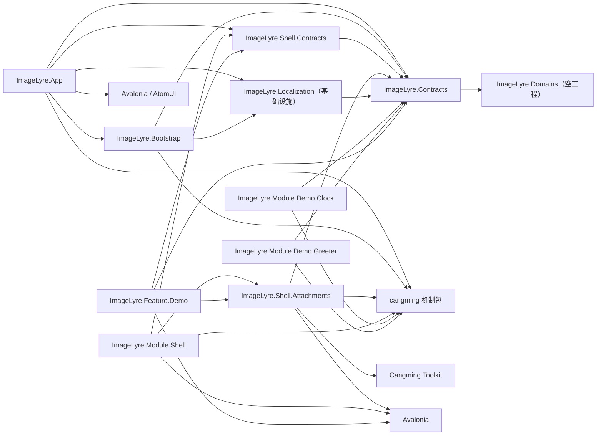
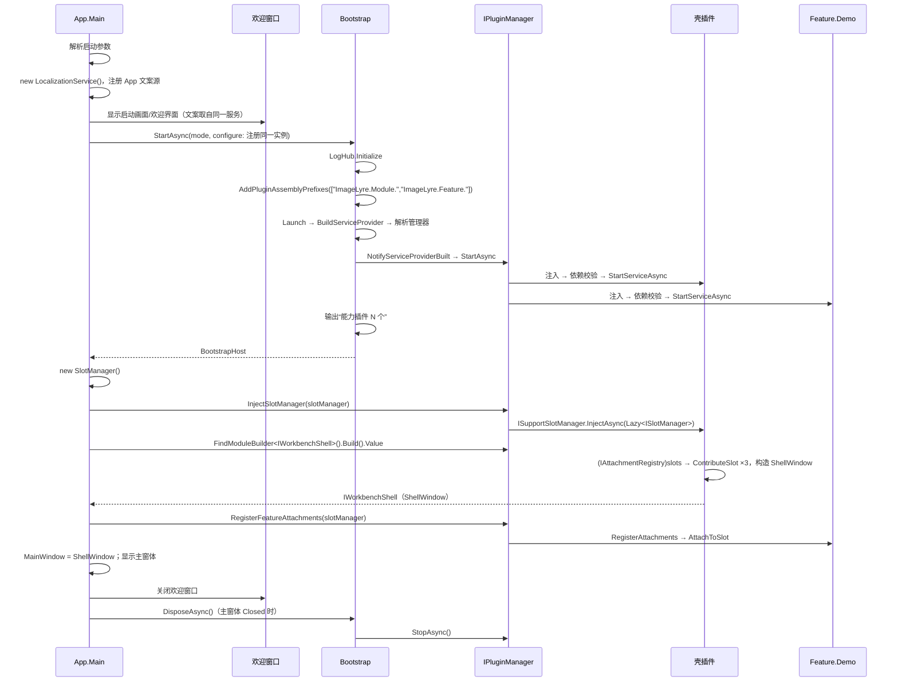

# DESIGN-0001：M1 插件骨架

| 版本 | 日期 | 状态 | 作者 | 说明 |
| :--- | :--- | :--- | :--- | :--- |
| 0.1 | 2026-11-22 | 草稿 | lukan | M1 的工程结构、装配时序、界面槽位、接口契约、边界情况与验收；范围限定为插件机制，不含任何产品能力 |
| 0.2 | 2026-11-22 | 草稿 | lukan | 第一轮评审修订：补管理器与槽位管理器的归属、壳窗口的获取方式、契约依赖、验收顺序与清理前置、插件 Id 策略、能力插件日志行、实施顺序与允许依赖集合 |
| 0.3 | 2026-11-22 | 草稿 | lukan | 作者口径修订：命名空间改 `ImageLyre.` 前缀；新增 `ImageLyre.Bootstrap` 承载启动链；补上下文组织器签名；插件 Id 按角色分前缀 |
| 0.4 | 2026-11-22 | 草稿 | lukan | 作者口径修订：契约拆成 `ImageLyre.Contracts` 与 `ImageLyre.Shell.Contracts`，示范契约放进产品契约的 `ImageLyre.Contracts.Demo` 命名空间 |
| 0.5 | 2026-11-22 | 草稿 | lukan | 作者口径修订：`ImageLyre.Domains` 在 M1 建成空工程并附 README；新增“每个工程必须带 README”的约定 |
| 0.6 | 2026-11-22 | 草稿 | lukan | 作者口径修订：按 Mercury 的 `MainWindowFactory` 与 `WorkbenchModule` 对齐——App 只负责启动、启动参数、启动画面与欢迎界面、编排；主窗体由壳插件在自己的 `Build()` 里产出 |
| 0.7 | 2026-11-23 | 草稿 | lukan | 作者口径补两项基础支持：单入口双宿主（桌面 + CLI，同一 Bootstrap 与插件集，Feature 扫描期过滤，M1 命令为 `--version`/`--plugins`/`--help`）；多语言运行期切换（`ILocalizationService` 契约、平台插件聚合资源、壳与 Feature 刷新文案） |
| 0.8 | 2026-11-23 | 草稿 | lukan | 修正多语言归属：本地化改成宿主基础设施 `ImageLyre.Localization`，App 创建、Bootstrap 注册同一实例，欢迎界面与主界面共用；删除 `ImageLyre.Module.Localization` 插件，壳与 Feature 只实现并注册资源源 |
| 0.9 | 2026-11-23 | 草稿 | lukan | 作者口径补三端同构约束：契约、领域与插件不写平台判断，不引注册表与 Win32，路径经统一目录服务；验收 E 增加平台相关符号检索 |
| 0.10 | 2026-11-23 | 草稿 | lukan | 架构判定订正实施顺序：`ImageLyre.Domains` 空工程与本地化契约随步骤 1 落地，构建入口定址 `src/ImageLyre.slnx`；理由是契约方向与 `ILocalizationService` 的宿主依赖都要求它们先于步骤 1 的宿主代码 |
| 0.11 | 2026-11-23 | 草稿 | lukan | 按独立评审与 cangming v1 源码订正三处：附着物词汇移出壳契约，新建 `ImageLyre.Shell.Attachments`，`ImageLyre.Shell.Contracts` 不再引用 Avalonia 与机制包；壳的槽位注入改为 `ISupportSlotManager` + `IAttachmentRegistry` 强转；§2.2 的期限约定表与 ADR-0001 §2.5 逐条对齐 |
| 0.12 | 2026-11-23 | 草稿 | lukan | 回写 T04 实现时核出的两处：`StartAsync` 必须把宿主的 `ILoggerFactory` 登记进容器（管理器构造依赖它，cangming 不注册日志服务），并输出 `HasUiRoute` 一行供判据取证；同时登记容器里没有 `ILogger<T>` 的边界 |
| 0.13 | 2026-11-23 | 草稿 | lukan | 回写 T05：App 引用 `ImageLyre.Contracts` 取本地化契约（§3.2 原写不引用，改为按用途说明）；§3.3 的编排骨架换成代码式 AtomUI 启动，并补三条硬要求——`Application` 必须 `partial`、必须 `UseDesktopControls`、不要显式 `Show` 欢迎窗口 |
| 0.14 | 2026-11-23 | 草稿 | lukan | 回写 T06：§3.2 补 App → 机制包这条边并说明理由（L5 依赖 L1，读 `IPluginManager` 与 `PluginInfo` 不可避免），§3.1 的 App 行同步；§3.3 的 CLI 调用换成带文本流的 `RunAsync`，并写明 stdout 只放结果、日志与错误走 stderr、输出不走本地化 |
| 0.15 | 2026-11-23 | 草稿 | lukan | 订正 §3.7 通配引用的相对路径（原写 `..\Plugins\**`，少一层，实际指向不存在的 `src/App/Plugins`），并记录实测行为：插件工程不进解决方案也会被拉进构建并复制、`dotnet clean` 能清掉已复制的 dll、空工程只增加扫描候选不增加插件条目 |

## 1 目标与范围

M1 的目标是让插件机制在真实宿主上跑通，并证明 ADR-0001 §2.2 的前两条判定：机制层没有产品词，空壳能启动；第三条“一能力包一改动”由新增插件的验收动作证明。M1 交付骨架、一个契约闭环与一个故障样本，不交付任何产品能力——图像、ROI、测量、分析、文档、设置都留到 M1 之后，由第一批真实能力包接入，那时才是对契约层的第一次真考试。

判定 M1 是否完成，只看第 7 节的 A–G 七条，不看功能数量；若某条为了“顺手做个功能”而被推迟，M1 视为未完成。

## 2 约束

### 2.1 长期约定

1. 命名空间与工程名一律以 `ImageLyre` 为前缀（`ImageLyre.App`、`ImageLyre.Bootstrap`、`ImageLyre.Domains`、`ImageLyre.Contracts`、`ImageLyre.Shell.Contracts`、`ImageLyre.Module.*`、`ImageLyre.Feature.*`）；类型名可以用 `Lyre` 短名。插件 Id 与槽位名保留小写 `lyre.` 短名，因为它们是持久身份与字符串契约，改名会让禁用名单、审计键与已附着配置漂移。
2. 只使用 cangming 已发布能力，不修改 cangming 源码；cangming 以只读子模块锁定 tag `v0.1.9.1122`，M1 第 1 步落地子模块。`Cangming.Shell` 与 `Cangming.Platform` 的实现包不接入。
3. 插件在 `[Plugin]` 上写死显式 Id，不使用派生值；cangming 的载入器在扫描末尾执行 Id 唯一性策略，同 Id 按创建时间升序、再按类型全名保留一个，其余置未准入并记错误日志。
4. `ImageLyre.Contracts` 与 `ImageLyre.Domains` 不得引用 Avalonia、AtomUI 或 SkiaSharp；`ImageLyre.Shell.Contracts` 允许引用 Avalonia；三者方向固定为 `ImageLyre.Shell.Contracts` → `ImageLyre.Contracts` → `ImageLyre.Domains`，反向引用一律禁止。
5. 插件之间零 `ProjectReference`；Feature 工程只依赖契约、cangming 机制包、cangming 的 Avalonia 路线包与 AtomUI。
6. 产物到达方式必须满足“新增插件不改 `ImageLyre.App.csproj`”，具体机制见 §3.7，M1 第 1 步先验证机制本身。
7. 壳的界面基线是 AtomUI：启动画面、欢迎界面、菜单、工具条、状态栏与面板容器用 AtomUI 控件；图像视口在 M1 只有占位容器，SkiaSharp 留到图像能力接入。
8. 每个工程旁边必须有 README.md，写明意义、边界（不放什么）、依赖方向与边界变化时该改哪份文档；新建工程先写 README 再写代码，空工程同样要有 README。
9. 三端同构：契约、领域与插件不写平台判断，不引用注册表、Win32 P/Invoke 或 `System.Windows.Forms`，路径一律经 `Path` 与统一目录服务，不拼接反斜杠；M1 只在 Windows 执行验收，但不得写只对 Windows 成立的捷径。
10. 构建入口是 `src/ImageLyre.slnx`，`Directory.Build.props`、`Directory.Packages.props` 与 `.editorconfig` 放仓库根，使 `src/` 与 `tests/` 共用同一套属性与版本；M1 不建第二个解决方案，测试工程进同一入口、按工程单独执行。

### 2.2 期限内约定（与 ADR-0001 §2.5 的表对应）

| 约定 | 现状 | 解除阶段 |
| :--- | :--- | :--- |
| 禁用需重启才生效 | 只有 `PicoPluginSettings.DeniedPluginIds` 启动期黑名单，运行期禁用不撤销已附着内容 | G3 |
| 不做插件版本校验 | 只要求显式 Id，不比较版本区间 | G4 |
| 无依赖树与分级 | 只有启动日志里的依赖缺失原因 | G2 |
| 同一信任级、全部进程内 | 主目录扫描，主 ALC 加载 | G5 |
| CLI 未接入业务命令 | M1 的 CLI 只有 `--version`、`--plugins`、`--help` | G2 |

这五行与 ADR-0001 §2.5 的表逐条对应，措辞只按设计口径细化、不增不减；新增临时约束必须先进 ADR 那张表再回写本节，否则视为架构未定。欢迎界面在 M1 只是占位（产品名、版本与状态文本），这是范围状态而不是机制偏差，登记在 §4.4，不进本表。

## 3 结构设计

### 3.1 工程清单

| 工程 | 目录 | 类型 | 职责与依赖 |
| :--- | :--- | :--- | :--- |
| `ImageLyre.App` | `src/App/ImageLyre.App` | 进程入口与编排（L5） | 解析启动参数并选择宿主模式：桌面模式显示启动画面与欢迎界面、驱动 Bootstrap、创建槽位管理器、注入、触发附着、取主窗体挂到桌面；CLI 模式无窗口、无槽位、无 Feature，驱动 Bootstrap 后执行命令并退出；不构建主窗体、不贡献槽位、不定义主界面布局；引用 Bootstrap、`ImageLyre.Contracts`（本地化契约）、`ImageLyre.Shell.Contracts`、cangming 机制包（只读管理器与插件清单，不引实现包）、Avalonia、AtomUI |
| `ImageLyre.Bootstrap` | `src/Bootstrap/ImageLyre.Bootstrap` | 启动链（L1，无 UI） | 日志初始化、扫描前缀、容器构建、`PicoPluginSystem.Launch`、管理器解析、`NotifyServiceProviderBuilt`、`StartAsync`、能力插件计数日志、关停；引用 cangming 机制包与契约，不引用 Avalonia、AtomUI 或任何插件 |
| `ImageLyre.Domains` | `src/Contracts/ImageLyre.Domains` | 领域对象与纯算法（M1 为空工程） | 只放跨插件共享且带不变量的数据与纯函数；不引用 `ImageLyre.Contracts`、不引用 UI、不引 DI 与日志；M1 只有 README 与空 csproj |
| `ImageLyre.Contracts` | `src/Contracts/ImageLyre.Contracts` | 产品契约（无 UI） | `ILocalizationService`、`ILocalizationSource`；M1 另放 `IClock`、`IGreeter`，命名空间为 `ImageLyre.Contracts.Demo`，M1 验收后删除；不引用 Avalonia、AtomUI、SkiaSharp |
| `ImageLyre.Shell.Contracts` | `src/Contracts/ImageLyre.Shell.Contracts` | 壳契约 | `ShellSlots`、`IWorkbenchShell` 两个类型；只引用 `ImageLyre.Contracts`，不引用 Avalonia、不引用机制包、不引用任何插件工程——槽位名与窗口标记都是纯标识，没有理由把 UI 与机制拖进契约 |
| `ImageLyre.Shell.Attachments` | `src/Shell/ImageLyre.Shell.Attachments` | 附着物词汇（非插件，非契约） | `DockPaneAttachment`：实现机制包的 `IFeatureAttachment` 与 `Cangming.Toolkit` 的 `IOrderable`，承载 Avalonia `Control`；引用 `Cangming.PicoPlugins`、`Cangming.Toolkit`、Avalonia、`ImageLyre.Contracts`。它放的是“壳怎样接住一个界面项”的应用词汇，与 cangming 路线包把 `ToolbarButtonAttachment`、`ContentAttachment` 放在 `Cangming.PicoPlugins.Avalonias` 同一位置；因此它不占 `src/Contracts/` 的名分，单独落在 `src/Shell/` 下，`ImageLyre.Shell.Contracts` 的纯度也不因它受损 |
| `ImageLyre.Localization` | `src/Infrastructure/ImageLyre.Localization` | 基础设施库（非插件） | `LocalizationService`：聚合资源源、维护当前语言、缺键回退 zh-CN 并记诊断、广播切换；引用 `ImageLyre.Contracts`，不引用 UI、不引用插件；由 App 创建、Bootstrap 注册同一实例 |
| `ImageLyre.Module.Shell` | `src/Plugins/ImageLyre.Module.Shell` | Module 插件（容器类 Module） | 实现 `ISupportSlotManager` 接收槽位管理器注入，在 `Build()` 里构造 `ShellWindow` 并通过 `IAttachmentRegistry` 贡献三个一级槽位；`IWorkbenchShell` 由 `ShellWindow` 实现；实现 `ILocalizationSource` 提供壳文案；持有 `ShellModuleContext`；引用 `ImageLyre.Shell.Contracts`、`ImageLyre.Shell.Attachments`、`ImageLyre.Contracts`、机制包、Avalonia 路线包、AtomUI |
| `ImageLyre.Module.Demo.Clock` | `src/Plugins/ImageLyre.Module.Demo.Clock` | Module 插件 | 提供 `IClock`，持有 `ClockModuleContext` |
| `ImageLyre.Module.Demo.Greeter` | `src/Plugins/ImageLyre.Module.Demo.Greeter` | Module 插件 | 提供 `IGreeter`，声明 `Require<IClock>` 与 `After<IClock>`，持有 `GreeterModuleContext` |
| `ImageLyre.Feature.Demo` | `src/Plugins/ImageLyre.Feature.Demo` | Feature 插件 | 消费 `IGreeter`，向工具条与辅助面板各附一项；持有 `DemoFeatureContext`；引用 `ImageLyre.Shell.Contracts`、`ImageLyre.Shell.Attachments`、`ImageLyre.Contracts`、路线包与 AtomUI，不引用任何 Module 工程 |
| `ImageLyre.Module.Demo.Broken` | `src/Plugins/ImageLyre.Module.Demo.Broken` | Module 插件（测试） | 构造函数抛异常，验证构造失败隔离；不随产品发布 |

`ImageLyre.App` 与 `ImageLyre.Bootstrap` 的分界只有一条：Bootstrap 处理“插件就绪之前”的机制启动，App 处理“插件就绪前后”的用户可见过程与编排——启动画面、欢迎界面、主窗体挂载、关停转发。App 是编排者，不是界面宿主：主窗体由壳插件产出，App 只把它挂到桌面。

每个工程旁边必须有 README.md，写四件事：意义、边界（不放什么）、依赖方向（引谁、被谁引）、边界变化时该改哪份文档。新建工程先写 README 再写代码，空工程同样要有 README，`ImageLyre.Domains` 是 M1 唯一的空工程，它的 README 就是“第一批领域对象出现前该不该往里放东西”的判据。没有 README 的工程视为未完成，验收 E 会逐工程检查。

### 3.2 依赖方向



`ImageLyre.Bootstrap` 与 `ImageLyre.App` 都不按名字引用插件工程；`ImageLyre.App` 引用 `ImageLyre.Contracts` 是为了本地化契约（`ILocalizationService`、`ILocalizationSource`），欢迎界面直接经它取文案，但它不消费示范契约，`IClock`、`IGreeter` 仍只被示范插件引用；发行用的通配引用在 §3.7 单列。

`ImageLyre.App` 另外直接引用机制包，这是 L5 的正当依赖而不是越界：CLI 的 `--plugins` 要类型化读取 `IPluginManager.Plugins`、`PluginInfo` 与 `IPicoFeatures`，桌面编排在 T12 还要用 `FindModuleBuilder` 取壳产物，而这两件事都发生在 Bootstrap 交出 `IPluginManager` 之后，宿主不可能不看见该类型。ADR-0001 §2.4 的 L5 行本就写明 App 编译期依赖 L0 与 L1，图里补这条边是把既有事实画出来；真正被禁止的是引用插件工程与机制实现包（`Cangming.Shell`、`Cangming.Platform`），这两条边界不变。

三个契约程序集的方向固定为 `ImageLyre.Shell.Contracts` → `ImageLyre.Contracts` → `ImageLyre.Domains`，由 ADR-0001 §2.4 规定；`ImageLyre.Shell.Contracts` 因此只依赖 `ImageLyre.Contracts`，Avalonia 与机制包一律不进这个程序集。

`ImageLyre.Shell.Attachments` 是 L0 之外的一层词汇：它要实现机制包的 `IFeatureAttachment` 与 `Cangming.Toolkit` 的 `IOrderable`，还要携带 Avalonia `Control`，这两件事都不能放进契约。把它单列而不是塞进 `ImageLyre.Shell.Contracts`，依据有三条：其一，ADR-0001 §2.4 的 L0 规则要求契约只依赖 cangming 的契约程序集，而 `Cangming.PicoPlugins` 与 `Cangming.Toolkit` 是机制包；其二，基线 §10.2 明列“契约层引用 Avalonia、SkiaSharp 或 UI 类型”为不得出现；其三，cangming 自己把 `ToolbarButtonAttachment`、`ContentAttachment` 放在路线包 `Cangming.PicoPlugins.Avalonias` 而不是内核，Lyre 照同一位置放 `DockPaneAttachment`，两边的词汇边界因此同构。代价是多一个工程与一份 README，换来的是契约层不必为一条界面词汇开口子。

### 3.3 启动与编排时序



以下三段是唯一允许的写法，签名与 cangming `v0.1.9.1122` 一致。

```csharp
// ImageLyre.Bootstrap
public sealed class BootstrapHost : IAsyncDisposable
{
    private readonly IPluginManager _pluginManager;

    private BootstrapHost(IServiceProvider services, IPluginManager pluginManager)
    {
        Services = services;
        _pluginManager = pluginManager;
    }

    public IServiceProvider Services { get; }

    public IPluginManager PluginManager => _pluginManager;

    public static async Task<BootstrapHost> StartAsync(
        ILoggerFactory loggerFactory,
        HostMode mode,
        Action<IServiceCollection>? configure,
        CancellationToken cancellationToken)
    {
        LogHub.Initialize(loggerFactory);

        // 必须先于 Launch：cangming 在扫描期依据该开关过滤全部 Feature。
        PicoPluginSettings.HasUiRoute = mode == HostMode.Desktop;
        PicoPluginSettings.AddPluginAssemblyPrefixes(["ImageLyre.Module.", "ImageLyre.Feature."]);

        // 判据要从日志确认扫描路线；cangming 只输出扫到的插件数，不输出该开关的值。
        LogHub.For(typeof(BootstrapHost)).LogInformation("HasUiRoute={HasUiRoute}", PicoPluginSettings.HasUiRoute);

        var services = new ServiceCollection();

        // 管理器构造依赖 ILoggerFactory，cangming 不注册日志服务，因此由宿主登记；放在 configure 之前便于覆盖。
        services.AddSingleton(loggerFactory);
        configure?.Invoke(services);
        PicoPluginSystem.Launch(services);

        var provider = services.BuildServiceProvider();
        var manager = provider.GetRequiredService<IPluginManager>();

        PicoPluginSystem.NotifyServiceProviderBuilt(provider);
        await manager.StartAsync().WaitAsync(cancellationToken);

        int capabilityCount = manager.Plugins.Count(
            plugin => manager.GetPluginInfo(plugin.GetType()).Id.StartsWith("lyre.capability.", StringComparison.Ordinal));
        LogHub.For(typeof(BootstrapHost)).LogInformation("能力插件 {Count} 个", capabilityCount);

        return new BootstrapHost(provider, manager);
    }

    public async ValueTask DisposeAsync() => await _pluginManager.StopAsync();
}
```

`services.AddSingleton(loggerFactory)` 一行不是示例省略：`DefaultPluginManager` 在 `v0.1.9.1122` 的构造签名要求 `ILoggerFactory`，而 `PluginsCore.ConfigureServices` 只登记管理器、载入器与已准入插件，从不调用 `AddLogging`，所以宿主不登记工厂时 `GetRequiredService<IPluginManager>()` 会直接失败。

与之配套的边界是容器里只有 `ILoggerFactory`、没有 `ILogger<T>`：M1 的插件按 cangming 惯例用 `LogHub` 静态取日志，将来若某插件要构造注入 `ILogger<T>`，先在宿主侧补 `AddLogging` 再改本节，不预留空注册。`HasUiRoute` 那行日志同理不是装饰，T04 的判据要靠它从日志确认扫描路线，而 cangming 只输出扫描到的插件数、不输出该开关的值。

```csharp
// ImageLyre.App/Startup/MainWindowFactory.cs，UI 线程
internal static class MainWindowFactory
{
    public static Window Compose(IPluginManager pluginManager, SlotManager slotManager)
    {
        pluginManager.InjectSlotManager(slotManager);

        var shell = pluginManager.FindModuleBuilder<IWorkbenchShell>()?.Build().Value
                    ?? throw new InvalidOperationException("壳插件未装载");

        // v1 的槽位必须先贡献再附着，因此先取壳（构造时贡献槽位），再附着 Feature；
        // Mercury 的顺序是“先附着再取壳”，因为它的槽位管理器支持待解析条目，cangming v1 不支持。
        pluginManager.RegisterFeatureAttachments(slotManager);

        return shell is Window window
                   ? window
                   : throw new InvalidOperationException("壳插件产物不是 Avalonia Window");
    }
}
```

```csharp
// ImageLyre.App/Program.cs 的编排骨架
public static int Main(string[] args)
{
    var options = StartupOptions.Parse(args);
    if (options.Headless)
        return CliHost.RunAsync(options, Console.Out, Console.Error, CancellationToken.None).GetAwaiter().GetResult();

    var localization = new LocalizationService();
    localization.AddSource(new AppStringSource());

    return AppBuilder.Configure<App>(() => new App(options, localization))
        .UseAtomUIPlatformDetect(AtomUIWindowingPlatform.Auto)
        .UseAtomUI(builder => builder.UseDesktopControls())
        .StartWithClassicDesktopLifetime(args);
}

// App.OnFrameworkInitializationCompleted 内
var welcome = new WelcomeWindow(_localization, _options);
desktop.MainWindow = welcome;                 // 不显式 Show：经典桌面生命周期会显示它
_ = ComposeAsync(desktop, _localization);     // 不阻塞 UI 循环

async Task ComposeAsync(IClassicDesktopStyleApplicationLifetime desktop, ILocalizationService localization)
{
    try
    {
        var bootstrap = await BootstrapHost.StartAsync(
            loggerFactory,
            HostMode.Desktop,
            services => services.AddSingleton(localization),
            CancellationToken.None);
        var slotManager = new SlotManager();
        var window = MainWindowFactory.Compose(bootstrap.PluginManager, slotManager);
        window.Closed += async (_, _) => await bootstrap.DisposeAsync();
        desktop.MainWindow = window;
        window.Show();
        welcome.Close();
    }
    catch (Exception ex)
    {
        welcome.ShowFailure(ex);           // 启动期异常必须在屏幕上可读，不能只进日志
    }
}
```

代码式启动有三条硬要求，照上面的骨架才能跑起来：`Application` 派生类必须是 `partial`，AtomUI 的源生成器要往它上面补本地化与启动图宿主，缺了报 `ATOMUILOC008`，补上之后 `ATOMUIREG015` 不再出现；`.UseAtomUIPlatformDetect` 之后必须再 `.UseAtomUI(builder => builder.UseDesktopControls())`，否则 AtomUI 6.2.11 在运行期抛 `Control package 'AtomUI.Desktop.Controls' is referenced but not enabled`；以及不要显式 `Show()` 欢迎窗口，经典桌面生命周期在启动时显示 `MainWindow`，重复显示会让欢迎窗口闪一次。

`SlotManager` 是 `Cangming.PicoPlugins.Core.Features.SlotManager` 的具体类，同一实例必须同时交给 `InjectSlotManager`、每个 `SlotPanel.SlotManager` 与 `RegisterFeatureAttachments`；三处各 `new` 一个会得到“附着成功但界面永远为空”的假通过。

同一入口的 CLI 分支在解析参数后与桌面分支分叉：不显示欢迎窗口、不创建槽位管理器、不取壳、不附着，只做 Bootstrap 与命令执行，退出码 0 成功、2 参数错误、1 运行失败。两条分支在 Bootstrap 之前分开、之后不再交汇，唯一差异是 `HostMode` 与 `HasUiRoute`。CLI 的输出是机器可读接口而不是界面文案，因此不经过 `ILocalizationService`、不随界面语言变化；stdout 只放命令结果，Bootstrap 日志与错误一律写 stderr，让脚本可以只解析结果那一半。

```csharp
// ImageLyre.App/Program.cs：入口先判定参数，再决定是否初始化 Avalonia
public static int Main(string[] args)
{
    var options = StartupOptions.Parse(args);
    var localization = new LocalizationService();
    localization.AddSource(new AppStringSource());

    if (options.Headless)
    {
        return CliHost.RunAsync(options, localization).GetAwaiter().GetResult();
    }

    return new App(options, localization).RunDesktop(args);
}

// 桌面分支：把同一实例注册进容器，插件通过构造注入取得它
var bootstrap = await BootstrapHost.StartAsync(
    loggerFactory,
    HostMode.Desktop,
    services => services.AddSingleton<ILocalizationService>(localization),
    CancellationToken.None);
```

CLI 骨架在 M1 只支持三条命令：`--version` 输出版本，`--plugins` 输出插件清单（Id、名称、状态、是否 Feature），`--help` 输出用法；三条都不创建窗口，也不初始化 Avalonia 应用。

线程要求：从 `FindModuleBuilder` 到 `window.Show()` 的每一步都在 UI 线程执行，因为槽位附着会创建控件；`StartAsync` 在 UI 线程同步等待。M1 因此附加一条约束：所有插件的 `StartServiceAsync` 必须同步完成，不得在启动动作里等待 UI 上下文的异步续体；将来若有插件需要真异步启动，必须先把 `StartAsync` 移到 UI 循环启动之前，再修改本节。

### 3.4 主窗体由壳插件承载

主窗体是壳插件在 `Build()` 里构造的产物：`ImageLyre.Module.Shell` 实现 `BasePicoModule<IWorkbenchShell>`，`Build()` 返回 `Lazy<IWorkbenchShell>`，其值是 `ShellWindow : Window, IWorkbenchShell`；槽位贡献发生在 `ShellWindow` 的构造过程中，因此“取到壳体”就等于“槽位已贡献”。`IWorkbenchShell` 是标记接口，这与 Mercury 的 `IWorkbench` 同构：App 取到产物后断言它是 `Window`，不做任何界面构造。

这条设计的判据是替换性：换掉壳插件（换布局、换 UI 路线）时，App 只改一行取窗代码的断言，不改启动链、不改 Bootstrap、不改任何 Feature。若某天 App 里出现“设置窗口尺寸、拼装面板、注册菜单”一类代码，说明壳的边界被破坏了。

### 3.5 槽位先于附着

cangming v1 的 `AttachToSlot` 在槽位不存在时抛 `InvalidOperationException`，因此壳必须在 `RegisterFeatureAttachments` 之前完成 `ContributeSlot`，而槽位贡献发生在壳插件的 `Build()` 内，所以 App 的顺序是“注入 → 取壳 → 附着”。Mercury 的 `MainWindowFactory` 顺序是“注入 → 附着 → 取壳”，因为它的 `PluginSlotManager` 支持未贡献槽位的待解析桶；cangming v1 没有这个能力，所以顺序必须反过来。

这条差异只影响顺序，不影响归属：两者都是 App 编排、模块产出窗口。cangming 落地 `ADR-0012` §2.7 的 v2 后，未贡献槽位的附着改为进入待解析桶、贡献时冲刷，本节的措辞与 §4.5 一并删除，顺序可以改回 Mercury 的写法。

### 3.6 上下文组织器

每个插件持有自己的上下文类型，且只在内部使用。M1 的四个示范上下文如下，签名即约定：

```csharp
// ImageLyre.Module.Demo.Clock
internal sealed class ClockModuleContext : BaseModuleContext
{
}

// ImageLyre.Module.Demo.Greeter
internal sealed class GreeterModuleContext : BaseModuleContext
{
    public Lazy<IClock> Clock => Use<IClock>();
}

// ImageLyre.Module.Shell
internal sealed class ShellModuleContext : BaseModuleContext
{
    private Lazy<ISlotManager>? _slots;

    /// <summary>由 ShellModule 的 ISupportSlotManager 注入点转发进来，此时还没到 Build。</summary>
    public void SetSlotManager(Lazy<ISlotManager> slots) => _slots = slots;

    /// <summary>贡献槽位用的注册面；实现不是 <see cref="IAttachmentRegistry"/> 时直接报错，不做降级。</summary>
    public IAttachmentRegistry Registry => _slots?.Value as IAttachmentRegistry
        ?? throw new InvalidOperationException("SlotManager 尚未注入或未实现 IAttachmentRegistry");
}

// ImageLyre.Feature.Demo
internal sealed class DemoFeatureContext : BaseFeatureContext
{
    public Lazy<IGreeter> Greeter => Use<IGreeter>();
}
```

四条纪律与 ADR-0001 §2.8 一致：每个插件一个上下文且不共用；`Require` 配 `Use`、`Optional` 配 `UseOptional`；构造函数与注入阶段不求值；上下文不外传、不当服务定位器。壳是唯一自己持有槽位管理器引用的插件，因为它要贡献槽位，而 `BaseModuleContext` 本身不提供槽位面。

壳拿槽位的路径必须照 cangming v1 的注入协议写，不能自造：`InjectSlotManager` 只遍历实现了 `ISupportSlotManager` 的插件，对它们调用 `InjectAsync(Lazy<ISlotManager>)`，`BasePicoModule` 并不实现该接口，`BaseModuleContext` 也没有 `SetSlotManager`；`SetSlotManager` 只存在于 `BaseFeatureContext`，服务的是 Feature。因此 `ShellModule` 的声明是 `BasePicoModule<IWorkbenchShell>, ISupportSlotManager`，注入只保存 `Lazy`，到 `Build()` 里再把 `ISlotManager` 转成 `IAttachmentRegistry` 调用 `ContributeSlot`——`ISlotManager` 本身没有 `ContributeSlot`，贡献面在 `SlotManager` 同时实现的 `IAttachmentRegistry` 上，直接写 `slots.ContributeSlot(...)` 编译不过。样本 `Sample.Module.Workbench.Avalonias/WorkbenchModule.cs` 用的就是这个写法。

### 3.7 插件如何到达运行时

M1 用主目录扫描，在 cangming 默认前缀表上追加 `ImageLyre.Module.` 与 `ImageLyre.Feature.` 两条；默认表里已有 `LEIAO.`、`Jupiter.`、`RAY.`、`NKnife.`、`Cangming.`、`Mercury.` 等九条前缀，因此 `Cangming.*.dll` 仍会被扫到并按非插件跳过，`ImageLyre.Shell.Contracts`、`ImageLyre.Contracts`、`ImageLyre.Domains`、`ImageLyre.Bootstrap`、`ImageLyre.App` 不匹配任何前缀，不进插件清单。

不使用 `Plugins/` 隔离根，原因是 cangming 的 `PluginLoadContext` 只把 `Cangming.Logs.Contracts` 与 `Microsoft.Extensions.Logging.Abstractions` 列为跨 ALC 共享程序集，`ImageLyre.Shell.Contracts`、`ImageLyre.Contracts` 与 `ImageLyre.Domains` 会被每个插件的加载上下文各持一份，接口判定的类型身份随之不一致，`as`、`is` 与反射派发全部失效；隔离留到 G5 处理，届时需要先扩展共享程序集清单。主目录走 `Assembly.LoadFrom`，不需要 `deps.json`，但插件依赖的第三方 dll 必须落在输出目录。

产物到达输出目录的机制必须满足一条可检验的性质：新增一个插件工程后，应用输出目录里出现该插件程序集，而 `ImageLyre.App.csproj` 没有任何改动。做法是在 `ImageLyre.App.csproj` 写一条通配工程引用，把 `src/Plugins/**/*.csproj` 纳入构建顺序但不参与编译引用：

```xml
<ItemGroup>
  <ProjectReference Include="..\..\Plugins\**\*.csproj"
                    ReferenceOutputAssembly="false"
                    OutputItemType="Content"
                    CopyToOutputDirectory="PreserveNewest" />
</ItemGroup>
```

相对路径从 `src/App/ImageLyre.App/` 算起，因此要两个 `..` 才回到 `src/` 再进 `Plugins`；少写一层会指向并不存在的 `src/App/Plugins`，通配安静地匹配零个工程，表现为“机制加了但 dll 一直不出现”。

`ReferenceOutputAssembly="false"` 保证插件程序集不进编译输入，`OutputItemType="Content"` 把它变成可复制的内容项，工程引用同时给出正确的构建顺序。这条通配引用是插件工程进入 `ImageLyre.App.csproj` 的唯一形式，按名字的逐条引用数量必须为 0，验收 E 检查的就是这一点。

复制是增量的，`PreserveNewest` 不会清理已删除插件的旧 dll，因此所有“删除插件”的验收必须先 `dotnet clean` 或删除应用输出目录再构建，判据里要检查启动日志的候选程序集列表不含被删插件。

M1 实测确认了三件事，后续验收依赖它们：插件工程不必进 `src/ImageLyre.slnx`，只要落在 `src/Plugins/**` 就会被这条通配引用拉进构建图并复制产物，这正说明机制不依赖解决方案条目；`dotnet clean` 会清掉已经复制进应用输出目录的 dll，所以删除插件后先 clean 再构建是有效的；空插件工程会被扫描成候选程序集但不产生插件条目，因为找不到 `[Plugin]` 类型，因此“扫描候选数增加、插件数不变”是机制生效的正常表现。

故障样本要一条显式排除，否则它随通配引用无条件进入产品输出：通配项加 `Exclude="..\Plugins\ImageLyre.Module.Demo.Broken\**"`，再在 `Condition="'$(Configuration)'=='Debug'"` 的内容项里单独复制它。这样 Release 输出不含 Broken，验收 D 只在 Debug 树上成立，判据写成“Debug 输出的候选清单含 Broken，Release 输出不含”。

示范工程与示范契约的生命周期同一条：`ImageLyre.Contracts.Demo` 命名空间、三个 Demo 插件在 M1 验收后一并移除，因此它们不是“常驻工程”，只是验收用的临时插件；移除时同步从 `src/ImageLyre.slnx` 摘除，避免解决方案引用不存在的工程。

### 3.8 失败与降级

插件的构造失败、启动抛异常、启动返回 `false`、硬依赖缺失，四种情形在 M1 都只影响自己：管理器把该插件钉在 `Failed`，其余插件照常启动，应用进入可用状态，界面少一块内容而不是整体不可用。

构造失败与启动失败是两条不同的路径。构造函数抛异常时管理器不产出该插件实例，而是产出一个 `BrokenPlugin` 占位条目，清单里能看到它、状态为失败、错误消息写明构造异常，且它不像普通插件那样有契约；`OnStartAsync` 抛异常或返回 `false` 时插件实例存在、状态为 `Failed`，契约解析会跳过后继续找下一个提供方。验收 D 固定使用构造函数抛异常，覆盖 `BrokenPlugin` 路径。

壳插件装载失败时，`MainWindowFactory.Compose` 抛出，`ComposeAsync` 捕获后在欢迎界面上显示失败原因并提供退出，这与 Mercury 回退到自检窗口的目标一致：启动期不能出现“没有窗口、只能看日志”的状态。

依赖提供方失败时，依赖方在启动回扫阶段被一并判 `Failed`，原因写明缺哪个契约；单插件手动启动（`StartPluginAsync`）不重新执行依赖排序，M1 不提供这条入口。

## 4 界面槽位

### 4.1 判据

固定语义的界面位做成“具名状态位 + 契约”，自由装配的区域才做成槽位。菜单栏、状态栏的五段读数、标题栏、通知中心、导出抽屉都属于固定语义：菜单是命令的呈现，状态栏段的含义由产品定义，标题栏是壳的 chrome，瞬时表面按事件弹出。启动画面与欢迎界面同样属于固定语义，而且早于插件系统就绪，因此由 App 直接构造，不进槽位。

### 4.2 一级槽位

| 槽位名 | 区域 | 承载类型 | 容量 | 顺序 |
| :--- | :--- | :--- | :--- | :--- |
| `lyre.shell.toolbar` | 工具栏 | `ToolbarButtonAttachment` | 多 | 显式 `Order`，M1 要求每个附着物都写 `Order` |
| `lyre.shell.viewport` | 图像视口 | `ContentAttachment` | 单 | 无 |
| `lyre.shell.panel` | 辅助面板（Results 所在处） | `DockPaneAttachment` | 多 | 显式 `Order`，M1 要求每个附着物都写 `Order` |

M1 要求显式 `Order`，是因为渲染器的排序对 `NoPreference` 一律返回相等，底层用的是不稳定的就地排序，未声明顺序的相对次序没有保证；写死 `Order` 之后“按序呈现”才是可判定的承诺。

三个槽位由 `ImageLyre.Module.Shell` 贡献，名字常量放 `ImageLyre.Shell.Contracts` 的 `ShellSlots`，不放壳插件工程——否则 Feature 为了拿一个字符串就要引用壳插件，退化成 Feature 依赖 Module。

### 4.3 命名与归属

一级槽位名形如 `lyre.shell.<区域>`，按角色命名而不是按位置：没有 `left`、`right`、`bottom`，位置属于布局，不属于契约，Results 今天在右侧、明天挪到下方，槽位名与插件代码都不用改。层级最多两级，二级槽位由区域拥有者贡献，名字常量放在该区域的契约包里，仍然不进插件工程；命名一律小写点分，不使用缩写。

### 4.4 非槽位区域

| 区域 | 处理方式 | 理由 |
| :--- | :--- | :--- |
| 启动画面与欢迎界面 | App 在 Bootstrap 之前显示，只有产品名、版本与状态文本；失败时显示原因并退出 | 早于插件系统就绪，窗口骨架不能依赖插件；内容区将来可由身份类 Feature 填充 |
| 菜单栏八个顶层 | 壳静态定义 File、Edit、Image、Process、Analyze、Plugins、Window、Help，M1 只启用与骨架相关的项，其余置灰并标注阶段 | 菜单是命令的呈现，命令有 Id、键位、可用条件，槽位装不下这些语义 |
| 状态栏五段 | 壳固定五段占位显示，依次为坐标、像素值、位深、缩放、校准单位，最右留临时消息 | 段位是固定语义，M1 没有图像能力，没有生产者，不定义状态契约 |
| 标题栏 | 壳自绘文件名、脏标记与主题/语言入口 | 壳的 chrome，不是贡献点 |
| 通知中心、导出抽屉、画布内联错误条 | 壳按事件弹出，M1 只做内联错误条的最简版本 | 瞬时表面，不参与装配 |
| 辅助面板空态 | 壳在面板无附着物时渲染“尚无测量”空状态，宽度不小于 320px 由壳的布局保证 | 槽位空不等于界面空；空态是壳的静态内容，不由插件附着 |

### 4.5 容量与顺序的 M1 实现

cangming v1 没有准入策略，`viewport` 的“单”由宿主的渲染层取首项实现，第二个附着被忽略并记一条警告；`panel` 与 `toolbar` 的多项按 `IOrderable` 排序，M1 要求每个附着物写 `Order`，因此顺序可预测。这两条是约定加实现，不是契约保证，G3 随槽位撤销一起换成准入策略，届时本节的措辞同步删除。

### 4.6 与需求文档的布局冲突

`docs/spec/m1/M1-interaction-spec.md` §2 规定 Results 停靠右侧、宽度不小于 320px，`docs/spec/requirements/product-appearance.md` §4.2 与 §6.1 则说 Results 在下方、面板默认收起。两条都是布局策略，不是槽位语义，`lyre.shell.panel` 在两种布局下都成立。M1 按交互规格实现（右侧常驻、宽度不小于 320px，落在壳的布局代码里），外观文档的“下方 + 收起”作为后续布局选项保留；布局收口时只改壳的布局代码，不动槽位名与插件。

## 5 接口契约

### 5.1 槽位名

```csharp
namespace ImageLyre.Shell.Contracts;

/// <summary>壳贡献的一级界面槽位名。</summary>
/// <remarks>
/// <para>
/// 这些常量是 Feature 与壳之间唯一的字符串契约：Feature 引用本程序集取得槽位名，不引用壳插件，
/// 因此替换壳实现不影响任何 Feature。新增一级槽位属于设计变更，须先修订 <c>DESIGN-0001</c>。
/// </para>
/// </remarks>
public static class ShellSlots
{
    /// <summary>工具栏，承载 <c>ToolbarButtonAttachment</c>。</summary>
    public const string Toolbar = "lyre.shell.toolbar";

    /// <summary>图像视口，承载 <c>ContentAttachment</c>，M1 只允许一项。</summary>
    public const string Viewport = "lyre.shell.viewport";

    /// <summary>辅助面板，承载 <c>DockPaneAttachment</c>，M1 用于 Results。</summary>
    public const string Panel = "lyre.shell.panel";
}
```

### 5.2 主窗体契约

```csharp
namespace ImageLyre.Shell.Contracts;

/// <summary>主窗体契约：实现类型必须是 <c>Avalonia.Controls.Window</c>。</summary>
/// <remarks>
/// <para>
/// 本接口是标记，与 Mercury 的 <c>IWorkbench</c> 同构：壳插件在 <c>Build()</c> 里构造窗口并返回它，
/// 宿主取到产物后断言其类型为 <c>Window</c> 再挂到桌面，不通过接口方法创建窗口。
/// </para>
/// <para>
/// 槽位贡献必须发生在窗口构造期间，因此“取到壳体”就等于“槽位已贡献”，宿主随后可以安全附着。
/// </para>
/// <para>
/// 生命周期：窗口关闭即释放；<see cref="IDisposable.Dispose"/> 由窗口自己的关闭流程调用，
/// 宿主不直接释放壳体。
/// </para>
/// </remarks>
public interface IWorkbenchShell : IDisposable
{
}
```

`IWorkbenchShell` 本身不引用 Avalonia 类型，但实现约束必须写成注释：产物不是 `Window` 时宿主直接抛异常，不接受“看起来是窗口”的替代物。本程序集因此没有任何 UI 与机制依赖，实现约束只写在注释里。

### 5.3 辅助面板附件

```csharp
namespace ImageLyre.Shell.Attachments;

/// <summary>辅助面板中的一页，标题显示页签，内容挂到面板容器里。</summary>
/// <param name="Title">页签标题，不可为空。</param>
/// <param name="Content">页内容控件，随窗口销毁回收。</param>
/// <remarks>
/// 本类型属于应用词汇而非基座词汇：它只在 ImageLyre 的壳里有意义，因此不进 cangming，
/// 放在 Lyre 自己的附着物程序集里；它承载 Avalonia 控件，因此也不能进 <c>ImageLyre.Shell.Contracts</c>。
/// M1 不提供运行期摘除，内容控件与窗口同生命周期，关窗时由控件树统一回收。
/// </remarks>
public sealed record DockPaneAttachment(string Title, Control Content)
    : IFeatureAttachment, IOrderable
{
    /// <inheritdoc />
    public OrderRule Order { get; set; } = new(OrderType.NoPreference);
}
```

`DockPaneAttachment` 不会被 cangming 的 `SlotPanel` 识别，宿主需要一个专用呈现器：继承 `SlotPanel`、覆写 `UpdateContent`，只处理 `DockPaneAttachment`，遇到其它类型跳过并记日志；该呈现器放在 `ImageLyre.Module.Shell` 工程里。这正是 cangming `ADR-0007` 规定的应用词汇扩展方式，不需要改动基座或路线包。

### 5.4 示范契约与最小能力包模板

两个示范契约放在 `ImageLyre.Contracts` 程序集里，命名空间用 `ImageLyre.Contracts.Demo`，这样 M1 结束时按命名空间整体删除，不会误伤正式契约。

```csharp
namespace ImageLyre.Contracts.Demo;

/// <summary>M1 的示范能力：读取当前时间，用于验证契约解析与启动顺序。</summary>
public interface IClock
{
    /// <summary>当前时间。</summary>
    DateTimeOffset Now { get; }
}

/// <summary>M1 的示范能力：按名字问候，用于验证 Feature 消费契约。</summary>
public interface IGreeter
{
    /// <summary>生成问候语。</summary>
    /// <param name="name">被问候者名字。</param>
    /// <returns>问候文本。</returns>
    string Greet(string name);
}
```

这两个契约在 M1 验收后删除，随第一个真实能力包一起替换。新增能力包的最小模板是同一目录下的三个工程：契约工程（接口与数据类型）、Module 工程（`BasePicoModule<T>`）、Feature 工程（`BasePicoFeatures`，向 `toolbar` 或 `panel` 附着一项），Feature 工程只引用契约工程、`ImageLyre.Shell.Contracts`、`ImageLyre.Shell.Attachments`、路线包与 AtomUI。

### 5.5 插件标识

插件 Id 用角色的前缀表达插件类别，既是命名约定，也是启动日志与将来插件面板的统计口径：`lyre.shell.` 是壳，`lyre.platform.` 是平台插件，`lyre.capability.` 是能力插件，`lyre.feature.` 是表达插件；Bootstrap 的“能力插件 N 个”只统计 `lyre.capability.` 前缀。

| 工程 | 插件 Id | 契约 |
| :--- | :--- | :--- |
| `ImageLyre.Module.Shell` | `lyre.shell.workbench` | `IWorkbenchShell` |
| `ImageLyre.Module.Demo.Clock` | `lyre.capability.clock` | `IClock` |
| `ImageLyre.Module.Demo.Greeter` | `lyre.capability.greeter` | `IGreeter` |
| `ImageLyre.Feature.Demo` | `lyre.feature.demo` | 无（Feature 不提供契约） |
| `ImageLyre.Module.Demo.Broken` | `lyre.capability.broken` | 无 |

工程名与 Id 不同构是有意的：工程名按代码形态（Module 与 Feature）分组，Id 按运行角色分组，两者不互相推导，避免“改工程名就改身份”。

### 5.6 多语言契约

```csharp
namespace ImageLyre.Contracts;

/// <summary>界面文案的本地化入口：聚合各插件的资源源，广播语言切换。</summary>
/// <remarks>
/// <para>
/// 资源键按所有者命名空间：壳用 <c>lyre.shell.*</c>，插件用自身 Id 前缀；插件自带卫星程序集，
/// 翻译随插件分发。缺键时回退 zh-CN 并记一条诊断，不把键名显示给用户。
/// </para>
/// <para>
/// 切换语言只广播 <see cref="LanguageChanged"/>，订阅方刷新自己的文案，不重建窗口；
/// 数字、单位与结果导出格式不随语言变化。
/// </para>
/// </remarks>
public interface ILocalizationService
{
    /// <summary>当前界面语言。</summary>
    CultureInfo Current { get; }

    /// <summary>按资源键取文案；缺键时回退 zh-CN。</summary>
    /// <param name="key">资源键。</param>
    /// <returns>文案；回退失败时返回键名并记诊断。</returns>
    string Get(string key);

    /// <summary>语言切换后触发，订阅方在 UI 线程刷新自身文案。</summary>
    event EventHandler? LanguageChanged;

    /// <summary>注册一个资源源；同一源重复注册幂等。</summary>
    /// <param name="source">资源源。</param>
    void AddSource(ILocalizationSource source);

    /// <summary>切换界面语言，完成后触发一次 <see cref="LanguageChanged"/>。</summary>
    /// <param name="cultureName">目标语言，例如 <c>zh-CN</c> 或 <c>en-US</c>。</param>
    Task SetLanguageAsync(string cultureName);
}

/// <summary>一个插件或壳提供的文案源。</summary>
public interface ILocalizationSource
{
    /// <summary>按键取指定语言的文案。</summary>
    /// <param name="key">资源键。</param>
    /// <param name="culture">目标语言。</param>
    /// <param name="value">命中文案。</param>
    /// <returns>命中时为 <see langword="true"/>。</returns>
    bool TryGet(string key, CultureInfo culture, out string value);
}
```

M1 的落地范围：`ImageLyre.Localization` 提供聚合服务与回退规则；App 在创建欢迎界面前先构造该服务并注册 App 自己的文案源，随后把它作为同一实例交给 Bootstrap 的容器；壳插件与 `ImageLyre.Feature.Demo` 各自实现 `ILocalizationSource` 并在 `OnStartAsync` 里注册；壳在标题栏放一个语言切换入口，切换后菜单、状态栏占位与示范面板文案刷新。`ImageLyre.Localization` 不是插件，因此不参与插件扫描、不能被禁用，也不出现在插件清单里。

## 6 边界情况

| 情形 | 表现 | 处理 |
| :--- | :--- | :--- |
| 视口没有生产者 | 中央区域空白，显示“无图像”占位 | M1 的预期状态，不是错误；证明区域先于能力存在 |
| 面板没有生产者 | 面板显示“尚无测量”空状态 | 空态由壳渲染，不依赖任何插件 |
| 壳插件装载失败 | `Compose` 抛异常，欢迎界面显示原因 | 启动期不能只有日志；与 Mercury 的自检窗口目标一致 |
| 同一契约多个提供者 | 第一个命中项胜出，不报歧义 | 沿用 cangming v1 语义；M1 不诊断，登记为 G2 的偏差 |
| 硬依赖缺失 | 依赖方 `Failed`，原因写明缺哪个契约 | 应用继续启动，界面少一块 |
| 构造失败 | 出现 `BrokenPlugin` 占位条目，错误日志含构造异常 | 验收 D 的路径 |
| 启动抛异常或返回 `false` | 插件实例存在、状态 `Failed`，契约解析跳过它继续找 | 与构造失败分开观察，不混用判据 |
| 两个插件声明同一 Id | 载入器保留创建时间最早的一个，其余置未准入并记错误 | 不是“不校验”；M1 的判据是启动日志不出现 Id 重复的错误行 |
| 非插件程序集被扫到 | 默认前缀命中的 `Cangming.*` 会被扫到并按非插件跳过 | 不产生清单条目，不视为异常 |
| Feature 附着抛异常 | 该 Feature 的附着被吞掉，其余 Feature 继续 | cangming 的 `RegisterFeatureAttachments` 单个 `try`；M1 记日志，G2 进诊断 |
| 关停顺序 | 先关主窗体、退订槽位事件，再 `StopAsync` | 避免插件停止后控件仍被访问；停止超时取 cangming 默认 15 秒 |
| 输出目录残留旧插件 | 已删除插件仍在清单里 | 删除插件的验收先 `dotnet clean`，并检查候选程序集列表 |

## 7 验收

验收在完整树上按顺序执行，每条以前一步的恢复完成为前提；每一步都要先 `dotnet clean` 再构建，并在验收记录里留下提交号，避免顺序与残留互相污染。

| 步骤 | 动作 | 通过判据 | 恢复 |
| :--- | :--- | :--- | :--- |
| C 拔插件 | 删除 `ImageLyre.Module.Demo.Clock`（或移出目录）后重建启动 | Greeter 落 `Failed` 并写明缺少 `IClock`，Feature 不附着，应用可用 | 恢复工程 |
| D 隔离 | 保留 `ImageLyre.Module.Demo.Broken` 启动 | Broken 以 `BrokenPlugin` 形式出现、状态失败且错误消息为构造异常；其余插件 `Running`，窗口正常显示 | 无需恢复 |
| B 加插件 | 新增 `ImageLyre.Feature.Hello`：一个 Feature 工程，向 `toolbar` 附一个按钮、向 `panel` 附一页，只依赖契约与路线包 | 重启后工具条与面板各多一项；`git status` 只出现新增文件与目录，`ImageLyre.App.csproj` 无改动 | 保留，供 A 一起删除 |
| A 空壳 | 移除 `ImageLyre.Module.Demo.*`、`ImageLyre.Feature.Demo`、`ImageLyre.Feature.Hello`，并删除 `ImageLyre.Contracts` 中 `ImageLyre.Contracts.Demo` 命名空间后重建启动 | 启动画面出现、主窗体显示空窗口（视口“无图像”、面板“尚无测量”），Bootstrap 日志出现 `能力插件 0 个`，壳仍在运行 | 恢复全部工程与命名空间 |
| E 纪律 | 对完整树执行检查脚本 | `ImageLyre.Feature.Demo` 与 `ImageLyre.Feature.Hello` 的项目引用里没有 `ImageLyre.Module.*` 与 `ImageLyre.Feature.*`；`ImageLyre.Contracts`、`ImageLyre.Domains` 与 `ImageLyre.Shell.Contracts` 不引用 Avalonia、AtomUI、SkiaSharp 或 cangming 机制包，`ImageLyre.Shell.Contracts` 另不引用任何插件工程；`ImageLyre.Shell.Attachments` 不引用任何插件工程；`ImageLyre.App.csproj` 的按名插件引用为 0、只有一条通配引用；每个工程目录都有 README.md；契约、领域与插件不命中 `Registry`、`DllImport`、`System.Windows.Forms`、盘符字面量与反斜杠拼接；`ImageLyre.Bootstrap` 与 `ImageLyre.App` 的装配代码不命中 ADR-0001 §5.1 的词表 | 无需恢复 |
| F 双宿主 | 用同一份构建产物执行 `ImageLyre.App --plugins`（无界面环境） | 输出插件清单，Feature 数量为 0，退出码 0；未创建任何窗口；同一份产物的桌面模式仍能启动并显示主窗体 | 无需恢复 |
| G 多语言 | 桌面模式切到 `en-US`，再切回 `zh-CN` | 菜单、状态栏占位与示范面板文案随切换变化，窗口不重建；数字与单位不变；缺键时回退中文并记一条缺翻译诊断 | 无需恢复 |

“能力插件 N 个”由 `ImageLyre.Bootstrap` 输出，模板固定，只统计 `lyre.capability.` 前缀的插件，不把壳、平台插件与表达插件算进去；这条日志是 A 的判定依据，也是 G2 面板数据的起点。

替换检查不在 A–G 之内：用另一实现顶替 `IClock`，断言 `FindModuleBuilder<IClock>()` 解析到新实现且既有 Feature 仍能附着，作为 M1 的观察项记录在验收报告里。

## 8 不在 M1 范围

清单文件与 `plugin.json`；插件包安装、升级、回滚、卸载；运行期启用与禁用；插件面板与能力清单界面；主题、设置、快捷键、命令注册表、文档模型；多提供者选择策略；独立 `AssemblyLoadContext` 与沙箱；权限与签名；插件间消息与事件总线；并行启动；登录与账号体系；CLI 的业务命令（M1 只有 `--version`、`--plugins`、`--help`）。

这份列表是 M1 的边界，越界即视为范围失控；每一项在后续阶段有明确的落点（ADR-0001 §2.5），因此不需要在 M1 预留接口。

## 9 实施顺序

| 步骤 | 产出 | 前置 | 完成判据 |
| :--- | :--- | :--- | :--- |
| 1 | 解决方案 `src/ImageLyre.slnx` 与根配置、cangming 子模块、`ImageLyre.Domains` 空工程、`ImageLyre.Contracts` 骨架（仅 `ILocalizationService`、`ILocalizationSource`）、`ImageLyre.Localization` 基础设施与 App 文案源、`ImageLyre.Bootstrap` 骨架、`ImageLyre.App` 入口（桌面分支 + 无界面分支）、欢迎占位窗口、通配引用的复制机制；各工程带 README | 无 | 一个空插件工程构建后，应用输出目录出现其 dll，扫描日志的候选列表含该 dll；欢迎窗口出现且文案来自 LocalizationService，Bootstrap 输出 `能力插件 0 个`；`--plugins` 在无界面环境返回 0 且 Feature 数为 0；`ImageLyre.App.csproj` 无改动 |
| 2 | `ImageLyre.Contracts` 的 `ImageLyre.Contracts.Demo` 命名空间、`ImageLyre.Shell.Contracts`（`ShellSlots`、`IWorkbenchShell`）、`ImageLyre.Shell.Attachments`（`DockPaneAttachment`） | 步骤 1 | 三个工程构建通过且各自带 README；产品契约不引用 UI 框架；壳契约单向依赖产品契约且不引用 Avalonia、不引用机制包；附着物程序集引用机制包与 Avalonia 但不引用任何插件工程；产品契约依赖步骤 1 已落地的 Domains，方向不倒置 |
| 3 | `ImageLyre.Module.Shell`：`ISupportSlotManager` 注入、三个槽位、`ShellWindow`、静态菜单与状态栏占位、面板空态；App 的 `MainWindowFactory.Compose` | 步骤 2 | 壳收到槽位管理器注入（日志一行）；`GetAllSlots` 返回三个槽位；主窗体由壳插件的 `Build()` 产出并显示；面板显示“尚无测量”；App 里没有窗口布局代码 |
| 4 | 装配链收口：槽位管理器单例、注入顺序、附着、关停、欢迎窗口切换 | 步骤 3 | 主窗体显示后欢迎窗口关闭；关窗后进程正常退出；重复启动不残留槽位重复异常 |
| 5 | 壳文案资源化：壳实现 `ILocalizationSource`、菜单与状态栏占位走资源键、标题栏语言切换入口 | 步骤 4 | 切换中英后菜单与状态栏占位文案变化，窗口不重建；缺键回退中文并记诊断 |
| 6 | `ImageLyre.Module.Demo.Clock`、`ImageLyre.Module.Demo.Greeter`、`ImageLyre.Feature.Demo` 及四个上下文；Feature 自带文案源 | 步骤 5 | 工具条与面板各出现一项；日志里能看到 `After` 决定的启动先后；切换语言后面板文案同步变化 |
| 7 | 检查脚本（引用方向、词表检索、通配引用计数、README 检查）、`ImageLyre.Module.Demo.Broken` | 步骤 6 | 脚本可执行并通过；D 的判据可复现 |
| 8 | 验收 A–G 全跑、文档回写 | 步骤 7 | 七条验收通过并留下提交号与日志摘录；`AGENTS.md` 的现状段更新 |

步骤 3 与步骤 4 不得并行：壳的槽位贡献点与 App 的编排顺序是同一条时序的两端，分开写会各自猜对方的契约。

## 10 关联文档

- `docs/adr/lukan/ADR-0001-插件机制架构基线.md`：本文的上游决策，三条判定、四种单元、分层与治理分期。
- `docs/spec/baseline/startup-requirements.md` §4、§6：四类构件与插件体系的基线条款。
- `docs/spec/m1/M1-interaction-spec.md` §2：窗口骨架与状态栏五段的具体规定。
- `docs/spec/requirements/product-appearance.md` §4.2、§6.1：布局与面板收起的视觉主张。
- Mercury 仓 `src/Apps/Mercury/Mercury.App/Startup/MainWindowFactory.cs`：App 编排与取窗方式的对齐对象。
- Mercury 仓 `src/Modules/Rays/Rays.Module.Workbench/WorkbenchModule.cs`：壳插件在 `Build()` 里产出窗口并贡献槽位的对齐对象。
- cangming 仓 `src/Cangming.PicoPlugins/README.md`：Module 与 Feature 的写法、生命周期阶段与禁止事项。
- cangming 仓 `src/Cangming.PicoPlugins/README-PLUGIN-CONTEXT.md`：上下文组织器的用法，§3.6 的依据。
- cangming 仓 `src/Cangming.PicoPlugins/Default/Internal/PluginLoadContext.cs`：跨 ALC 共享程序集清单，§3.7 不使用隔离根的依据。
- cangming 仓 `src/Cangming.PicoPlugins/Core/Features/SlotManagerExtensions.cs`、`FeatureAttachmentExtensions.cs`：§3.3 的调用签名与失败语义。
