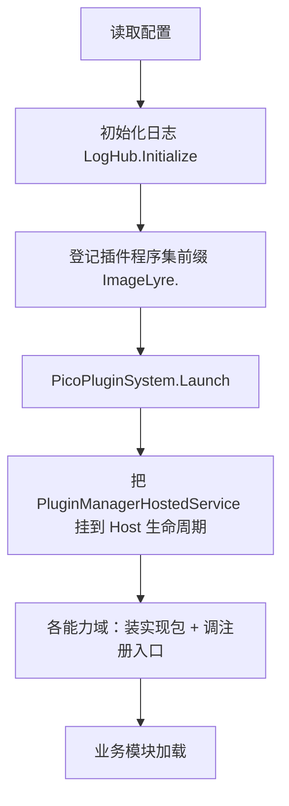

# DESIGN-0002：工程基座（沧溟采用）

| 版本 | 日期 | 状态 | 作者 | 说明 |
| :--- | :--- | :--- | :--- | :--- |
| 0.1 | 2026-11-19 | 草案 | lukan | 由 ADR-0007 草稿转入：定义基座形态、引用清单、版本策略、装配顺序与边界情况；随沧溟演进持续修改，暂不定稿 |

> 本文是设计文档，不是决策记录：它描述"基座现在长什么样、装配怎么接"，可以随上游演进持续修改。而"为什么采用沧溟、放弃自建"这类不可逆取舍，将来单独落一份 ADR；此前那份 ADR 草稿因格式错位（把仍在演进的设计当成已冻结的决策）已转入本文，ADR 编号 0007 空置。

## 1 约束

本次设计的约束按优先级排列，任何一条被违反时，先改本文再改实现。

1. **基座与业务无关**：判定标准是换一个产品也能直接用，因此基座不登记任何业务工程、不定义领域模型、不规定槽位清单与性能数值。
2. **不自建能力域**：插件内核、平台、外壳、日志、工作区、数据访问与工具库一律来自沧溟（Cangming），本仓只保留极薄装配层与业务。
3. **追新**：沧溟会持续演进，本仓取 nuget.org 最新稳定版并跟随上游发版，不为对齐其他产品而回退版本。
4. **仅 AtomUI**：界面栈只有 AtomUI（含 Avalonia 底座），不引入 Sukis 或其他第二套主题体系。
5. **沙箱用沧溟的**：进程外托管采用沧溟的 Sandbox 三件套，不自建临时宿主。
6. **许可证**：沧溟为 MIT，与本仓木兰宽松 v2 兼容；新增依赖仍按 AGPL、SSPL 零容忍复核。

## 2 结构设计

### 2.1 三层分工

| 层 | 归属 | 内容 |
| :--- | :--- | :--- |
| 基座 | 沧溟（外部，nuget.org） | 插件内核、平台能力、外壳与命令撤销、日志、工作区、数据访问、工具库、UI 适配 |
| 装配层 | 本仓，极薄 | 选型与版本对齐、启动顺序、能力域注册、插件扫描前缀、日志初始化、平台适配 |
| 业务 | 本仓 | 成像、编解码、ROI、校准、测量、结果与导出 |

装配层的判定标准是**薄**：它只做"把谁在什么时候以什么顺序接起来"。一旦发现自己实现了某个能力域的功能，就说明应该回上游补齐，而不是在本仓另造一套。

### 2.2 引用清单

| 用途 | 包 |
| :--- | :--- |
| 原语 | `Cangming.Primitive` |
| 工具 | `Cangming.Toolkit`、`Cangming.Toolkit.Avalonias`、`Cangming.Toolkit.Avalonias.AtomUI` |
| 日志 | `Cangming.Logs.Contracts`、`Cangming.Logs`、`Cangming.Logs.NLog`；测试用 `Cangming.Logs.xUnit` |
| 插件 | `Cangming.PicoPlugins`、`Cangming.PicoPlugins.Avalonias` |
| 沙箱 | `Cangming.PicoPlugins.Sandbox.Contracts`、`Cangming.PicoPlugins.Sandbox`、`Cangming.PicoPlugins.SandboxHost` |
| 外壳 | `Cangming.Shell.Contracts`、`Cangming.Shell`、`Cangming.Shell.Documents` |
| 平台 | `Cangming.Platform.Contracts`、`Cangming.Platform` |
| 工作区 | `Cangming.Workspace.Contracts`、`Cangming.Workspace` |
| 数据 | `Cangming.Data.Contracts`、`Cangming.Data.Sqlite` |

**不引入**：`Cangming.PicoPlugins.WPF`、`.WinForms`、`.Blazor`、`.HttpApi`（界面与宿主路线不匹配）；`Cangming.Toolkit.Avalonias.Sukis`（第二套主题体系）；`Cangming.PicoPlugins.Analyzers`（源码分析器，不在发布清单内）。

### 2.3 版本策略

版本号写在中央包管理里，取 nuget.org 最新稳定版；升级跟随上游发版，每次升级重新生成包锁并跑全量闸门。Avalonia、AtomUI 与沧溟构成一组受控组合：升级时三者一起动，不允许只升其中一侧。沧溟当前声明 Avalonia 12.1.4 与 AtomUI 6.2.11，本仓钉的是 12.1.6 与 6.2.15，NuGet 解析取高版本，这套组合每次升级都要回归一次。

追新的理由是基座仍在快速演进期，锁旧版等于把上游的修复关在门外，而包锁已保证单次构建可复现；受控组合是因为界面框架与其适配包之间存在二进制耦合。

### 2.4 启动装配顺序

日志必须早于任何插件的静态初始化：插件的静态构造函数可能写日志，日志未就绪会静默丢失早期诊断，而这类丢失在运行时只表现为"日志缺了几行"，很难被发现。

### 2.5 业务侧分层与命名

业务包沿用沧溟的四层模型：`ImageLyre.{Domain}.Contracts`（契约）、`ImageLyre.{Domain}`（默认实现）、`ImageLyre.{Domain}.Extensions`（扩展）、`ImageLyre.Primitive`（无领域概念原语）。领域段集中登记，架构测试由注册表驱动生成。装配工程单独成包（`ImageLyre.Bootstrap`，与启动工程同放 `src/Apps/`），只做 §2.4 的接线，不含业务判断。

### 2.6 工程落点

保留五类落点：`src/Apps/`（启动工程与装配工程）、`src/Libs/`（契约与业务类库）、`src/Modules/`（插件容器模块，如工作台）、`src/Features/`（界面功能插件，如关于与版本号）、`tests/`（测试，名称以 `.Tests` 结尾）。启动工程命名 `ImageLyre.App`，装配工程命名 `ImageLyre.Bootstrap`，两者都放在 `src/Apps/` 下；可执行入口不得引用另一个可执行入口，共用能力下沉到类库型装配工程。不使用 Mercury 的 `Modules/Features/Drivers/Sidecars/Projects` 五段式，因为那是多产品、多驱动、多定制项目的规模产物；目录结构是规模的函数。

## 3 接口契约

### 3.1 装配层契约

| 契约 | 内容 | 违反后果 |
| :--- | :--- | :--- |
| 初始化顺序 | 日志先于插件静态初始化，前缀登记先于 `Launch` | 早期日志丢失、插件扫不到 |
| 前缀登记 | `PicoPluginSettings.AddPluginAssemblyPrefixes(["ImageLyre."])`，新增业务程序集前缀时必须补 | 新插件不加载，且无报错 |
| 生命周期 | `PluginManagerHostedService` 挂 Host，进程启动即扫描、退出即停止 | 插件启停与进程生命周期脱节 |
| 能力域注册 | 每个实现包调用自身注册入口，不在装配层手写服务描述 | 装配层膨胀，升级上游时逐处改 |
| 装配薄度 | 装配层不得包含业务判断与状态 | 基座退化为第二套框架 |

### 3.2 插件与沙箱契约

插件内核只用 PicoPlugins：ALC 隔离、同名依赖多版本并存、单插件启停、启动失败进 `Failed` 不影响其余插件。插件按 Module / Feature / Driver 三层组织，沿用 Mercury 已成型的分类。厂商格式解码与重计算走 `PicoPlugins.Sandbox` + `SandboxHost`，协议由 `Sandbox.Contracts` 定义；ADR-0004 的像素通路与进程拓扑在这套机制之上实现，不替换其装载与隔离。

### 3.3 菜单模型

**结论**：Feature 向菜单槽位附着的是**菜单数据附件**，不是控件：`MenuCategoryAttachment`（分类）→ `MenuGroupAttachment`（分组）→ `MenuCommandAttachment`（菜单项 + 命令）。工作台持有唯一的菜单槽位 `ImageLyre.Menu`，由 `MenuProjection` 按标题合并后渲染成 AtomUI 菜单。

依据是 Mercury 与沧溟 Studio 的既有做法：附件是数据真源，渲染层只是投影，因此同名分类、同名分组自动归并——两个功能都往「帮助」里加项，最终只有一个「帮助」菜单；Feature 被禁用时它那一项直接消失，壳不需要写任何特判。基准分类「文件」「帮助」由壳自己提供，没有功能贡献时菜单仍在、只是为空。

代价是每次槽位变化整棵菜单重建；首版菜单项很少，重建成本可忽略，等菜单项上百时再改成按容器增量维护。这一条与 Mercury 的差异要记住：Mercury 的投影维护稳定容器以支持 Ribbon 的增量渲染，本项目尚未需要。

**不做权限层**：本产品是单人本地软件，没有账号、角色与审批流，因此不引入权限门禁与可见性聚合；菜单项的可用性只来自命令自身的 `CanExecute` 与应用状态（未打开图像时「测量」不可用）。插件能读写哪些文件、能不能联网属于沙箱能力声明，企业插件是否已授权属于商业授权，两者都不是用户权限，分别在安全与授权文档里处理。

### 3.4 插件模型

**结论**：一个插件由三部分组成——`[Plugin]` 特性（标识、名称与生命周期，交给沧溟 PicoPlugins 扫描）、内嵌的 `.plugindesc`（菜单结构的唯一真源）、命令字典（命令名 → `ICommand`）。三者由基类 `ImageLyreMenuFeature` 收口：读程序集内嵌资源、解析成菜单分类、按名绑定命令、附着到菜单槽位。

| 约定 | 内容 |
| :--- | :--- |
| 资源命名 | 程序集同名加 `.plugindesc` 后缀，以嵌入资源编译 |
| 命令绑定 | 描述文件里的 `Command` 与命令字典的键逐字一致，区分大小写 |
| 缺少描述 | 按"无菜单插件"处理，不报错 |
| 解析失败 | 按无菜单处理并记警告，不让插件启动失败 |
| 命令缺失 | 菜单项仍然出现但不可点，并记一条警告，暴露描述与实现的脱节 |
| 菜单状态 | `Enable="false"` 的项灰显不可点；`Visibility="Hidden"` 或 `"Collapsed"` 的项不进菜单 |

依据是菜单结构改一次只动一处描述文件，而不是改代码；插件停用时菜单自然消失；描述与实现对不上时在启动日志里可见。代价是描述文件与命令字典之间没有编译期约束，只能靠启动期告警与评审发现。

装配层另有两条来自 Mercury 的必要机制：其一，**按前缀预加载程序集**——沧溟只扫描已加载的程序集，宿主没有引用的插件 dll 不会被发现，因此启动时必须按前缀把主目录与 `Plugins/` 目录下的插件程序集装进来；其二，**禁用名单**——用户级 `plugins.json` 里列出的插件 Id 在扫描之前回退，命中项直接不参与构建与启动。两条都已落地在 `ImageLyre.Bootstrap`。

尚未落地的有四项，按优先级：① 按所有者摘除——沧溟自带的 `SlotManager` 只有贡献与读取、没有移除，Mercury 为此自写 `PluginSlotManager`；本仓要支持"停用插件后菜单项立即消失"就得补这一层。② 依赖与启动顺序——沧溟支持 `Require<T>()` 与 `IPluginStartupOrderProvider`，本仓目前只用 `Optional`。③ 插件日志分区——沧溟的日志分区与准入谓词还没接。④ 插件开发指南——`docs/guide/` 下还没有"怎么写一个 ImageLyre 插件"。

**两条装配路径**：本仓官方插件用 `ImageLyreCodeMenuFeature` 在代码里声明菜单，结构与命令同处一文件，命令名写错在编译期暴露；`plugindesc` 保留给第三方与外部插件，好处是不改代码就能调整菜单。两条路径产出同一种数据附件（分类 → 分组 → 菜单项），投影层不区分来源。

**不做**：权限声明、可见性聚合、插件市场、签名校验与自动更新，这些要么不属于本产品，要么在后续里程碑单独定。

### 3.5 启动与日志

**结论**：启动链固定为「日志初始化 → 禁用名单 → 前缀 → 预加载 → Launch → 插件托管 → 界面」，日志经 NLog 落到用户文档目录下的 `ImageLyre-Logs/<年月>/`，控制台只保留开发期输出；进程级未处理异常由 `UnhandledExceptionProcessor` 统一记录；收尾切到线程池执行，避免 Avalonia 派发器停摆导致进程不退；窗口装配完成后把各区域的附着数量写进日志。

**不做单实例**：Mercury 锁单实例是因为一台设备只能被一个进程占用，而本产品是多开也合理的分析工具——用户可能同时开两个窗口对比两批数据，因此不引入互斥体与身份转发。

### 3.6 界面栈约束

**结论**：窗口、菜单与菜单项一律使用 AtomUI 的 `Window` / `Menu` / `MenuItem`，不使用 Avalonia 原生控件替代。

依据是一次实测事故：裸 `Avalonia.Controls.Window` 在本仓没有注册任何主题，因此窗口模板里没有 OverlayLayer，菜单弹出时抛 `Unable to create IPopupImpl and no overlay layer is found`——表现是菜单栏能看见、点击却毫无反应，日志里也看不出异常。换成 AtomUI 的窗口后，菜单与关于窗都正常。

代价是 AtomUI 的控件 API 与 Avalonia 原生有差异（`Menu`/`MenuItem` 是原生类型的子类，但行为由 AtomUI 的主题与树模型驱动），写界面前要先确认类型来源；好处是界面栈只有一套主题，不会出现半套样式。

### 3.7 命令行引用集

CLI 只引 `Primitive`、`Toolkit`、`Logs`、`PicoPlugins` 与业务契约包，不引 `Shell`、`Platform` 与任何界面落地包。是否满足 NativeAOT 需实测：`Shell` 与 `Platform` 大量使用反射与平台 P/Invoke，这两类在 AOT 下最容易被裁剪出问题。

## 4 边界情况

| 情况 | 处置 |
| :--- | :--- |
| 沙箱预览态出现上游修不了的阻塞缺陷 | 临时回落主进程执行，把回落登记为缺陷与临时方案，写明恢复条件与最晚复核点；不可长期停留 |
| 追新引入的破坏性变更一个里程碑内消化不掉 | 临时锁回上一个版本并在本文登记最晚复核点，不得长期停在旧版 |
| Avalonia 或 AtomUI 被迫大幅领先沧溟声明版本且二进制不兼容 | 在沧溟内提 PR 升版，不在本仓分叉 |
| 沧溟某个能力域连续两个里程碑没有可用版本 | 该域回到本仓自建，并另开 ADR 记录取舍 |
| CLI 实测无法引用某包 | 从 CLI 引用集移除并回写 ADR-0006 |
| 首版工程数超过 30 个 | 三类落点不足以表达结构，重新评估是否引入分段式目录 |
| 装配层出现业务判断 | 视为设计失效，回查 §2.1 的薄层判据 |

## 5 与产品文档的关系

本文不改写产品需求文档与架构基线的任何结论：15 个产品结果、四层架构与六槽位仍由产品文档与基线规定。分工是：产品文档回答"这个产品有哪些层、哪些工程、哪些数值"，本文回答"这些工程站在什么底座上、怎么装配"。两者冲突时以产品文档为准并回改本文。

## 6 变更记录

| 版本 | 变更 |
| :--- | :--- |
| 0.1 | 由 ADR-0007 草稿转入。转入前的演进：初稿把技术内核理解为跨模块能力；二稿改为与业务无关的工程基座但把六个业务类库写进矩阵；三稿在自建容器、日志、插件清单格式上给定论；业主提供沧溟与 Mercury 后，全部自建条款作废，改为采用基座并明确追新、仅 AtomUI、沙箱用沧溟。 |
| 0.2 | 代码骨架落地：删除六个占位业务类库，新增 `ImageLyre.Bootstrap` 装配层与 `ImageLyre.Desktop` AtomUI 宿主，架构测试改为角色驱动；日志暂用控制台与调试两条通道，NLog 落盘待接入；主窗口为占位，待工作区模块接管。 |
| 0.3 | 按业主习惯调整命名与落点：启动工程由 `ImageLyre.Desktop` 改为 `ImageLyre.App`，装配工程 `ImageLyre.Bootstrap` 移入 `src/Apps`；可执行入口互引规则改为只约束同为可执行的入口，允许入口引用类库型装配工程。 |
| 0.4 | 工作台落地：新增 `ImageLyre.Shell.Contracts` 契约、`ImageLyre.Module.Workbench` 容器模块与 `ImageLyre.Feature.About`、`ImageLyre.Feature.Version` 两个功能；落点扩为五类，新增 Modules 与 Features。壳负责菜单结构与状态栏区域，菜单项与状态文本全部由功能经区域附着。 |
| 0.5 | 修正界面栈：工作台与关于窗改用 AtomUI 的 Window/Menu/MenuItem。此前用原生 Avalonia 窗口，因无主题模板而缺少 OverlayLayer，菜单点击无反应；换成 AtomUI 窗口后菜单可展开、关于窗可显示。 |
| 0.6 | 菜单模型重做：Feature 改为附着菜单数据附件（分类→分组→命令），由工作台投影按标题合并后渲染；壳不再接收菜单控件，也不再写死文件/帮助两个菜单的内容。 |
| 0.7 | 插件模型落地：菜单结构移入内嵌 `.plugindesc`，新增 `ImageLyre.Plugins` 基类收口解析、命令绑定与槽位附着；明确不做权限层，菜单可用性只来自命令状态。 |
| 0.8 | 插件装配补两条：按前缀预加载程序集（沧溟只扫已加载程序集），以及用户级 plugins.json 禁用名单在扫描前生效；同时记录四项未落地（按所有者摘除、依赖与顺序、日志分区、开发指南）。 |
| 0.9 | 从 Mercury 的 App 与 Bootstrap 迁入启动链：NLog 落盘与控制台双通道、未处理异常记录、线程池收尾、区域附着诊断；明确不做单实例。 |

## 7 待办

1. 形态稳定后另立 ADR 记录"采用沧溟、放弃自建"的不可逆取舍；ADR 编号 0007 保持空置，下次从 0008 起。
2. CLI 的 AOT 兼容性实测，结论回写 ADR-0006。
3. 跟踪沧溟 Sandbox 从预览态转正式的时间点，届时删除 §4 的回落条款。
