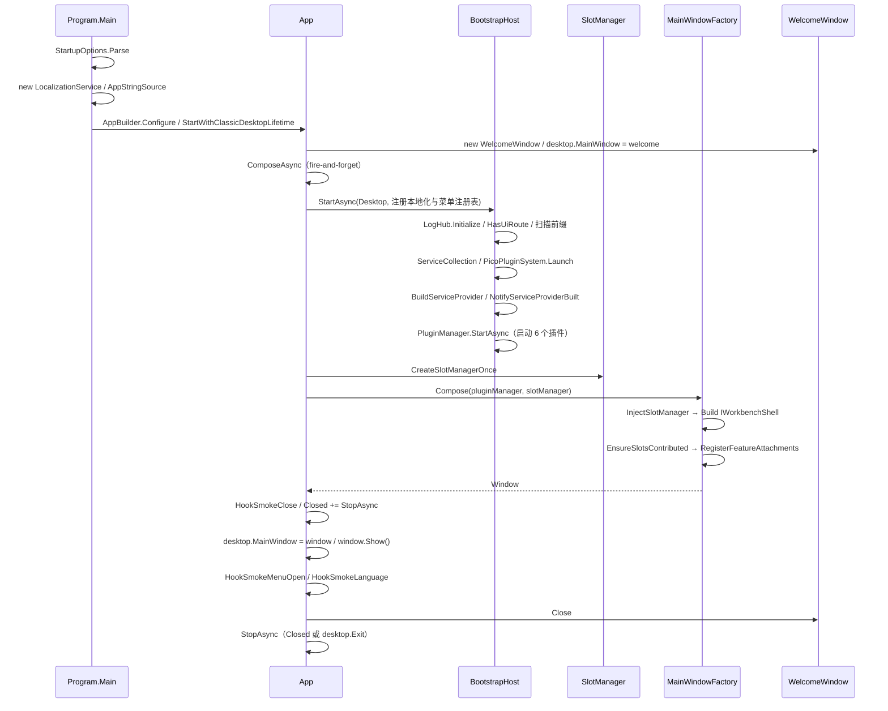

# DESIGN-0002 启动宿主与编排模式

| 版本 | 日期 | 状态 | 作者 | 说明 |
| :--- | :--- | :--- | :--- | :--- |
| 0.1 | 2026-11-24 | 草稿（待专家辩论） | lukan | 记录 App、Bootstrap 与启动编排的现状、问题、约束、候选模式与评估维度；本文不替代 `DESIGN-0001`，只讨论启动与宿主编排，定稿后由 `DESIGN-0001` 引用或吸收 |
| 0.2 | 2026-11-24 | 草稿（增长前提专项复核中） | lukan | 作者补充增长前提：启动项当前不多但会随研发深入持续增加，不能以“现在只有十个”为过程式编排辩护；新增 C10、D9、H6 与 Plan 分组要求，待五席专家专项复核后定稿 |
| 1.0 | 2026-11-24 | 已拍板（D） | lukan | 完成五席专家三轮辩论与增长前提专项复核；作者拍板采用 D（Generic Host + Host/Presentation 两阶段泛型 Step Pipeline + 嵌套 Plan + `ImageLyre.Presentation.Desktop`），保留 C 作退路，B 仅用于机制服务；实施见 `PLAN-0002` |

## 1 结论与目标

现状的问题不是 `ImageLyre.App` 的行数，而是**编排逻辑长在 App 里**：`App.ComposeAsync` 就是一条没有名字、没有类型、没有回滚的启动链，而 `ImageLyre.Bootstrap` 只做了插件宿主，没有承担“管理启动项”的职责。

本文要回答三件事：

1. 启动项应该以什么单位存在，谁负责排序、失败处理与回滚；
2. Generic Host 应放在哪一层，`App`、`Bootstrap`、宿主工程各自剩下什么；
3. 在“App 只做入口、Bootstrap 编排启动项”的目标下，哪种模式最合适，哪些模式只是看起来合适。

本文的立场是**先建模、后选型**：候选模式并列呈现，由五个不同领域的专家独立评审、交叉质询、收敛推荐，最后由作者拍板。

作者在辩论开始后补充了一条前提（2026-11-24）：当前启动项只有约十个，但随着软件研发深入会持续增加，不能用“现在只有十个”为过程式编排辩护。本文因此把增长适应性作为独立维度 D9，并要求最终方案在 50 个启动项、分阶段、多次失败回滚的压力下仍保持可读与可测；这条前提不改变已有事实，但改变了复杂度的权重——一次性多一个工程、两个 Plan 的成本会随启动项数量增长被摊薄，而每新增一项都要改 App 的成本会线性累积。

## 2 术语

为避免同一件事出现多个称呼，本文先固定五个词，后文不再换用近义词。

| 术语 | 定义 |
| :--- | :--- |
| 启动项 | 一次启动中独立命名、独立成功或失败的工作单元，例如“启动插件”“创建槽位管理器”“取壳并显示主窗体”；本文不把启动项称作任务，任务留给工作项管理 |
| 编排 | 对启动项的顺序、上下文传递、失败处理、回滚与生命周期归属作出决定，不包含启动项内部实现 |
| 宿主 | 承载进程生命周期的对象，本文特指 .NET Generic Host 的 `IHost`，不泛指窗口或插件容器 |
| 入口 | 进程启动后只做参数解析、宿主模式选择与宿主转交的代码，即 `ImageLyre.App` 的 `Program` 与 Avalonia `Application` 子类 |
| 阶段 | 启动项按执行环境划分的大段，本文固定两个：Host 阶段在任意线程、不构造 UI；Presentation 阶段在 UI 线程、构造并显示界面 |

“宿主工程”指承载某一类 Presentation 阶段的项目，例如桌面宿主工程；它不是 `ImageLyre.Bootstrap` 的同义词。

## 3 现状

### 3.1 工程与代码规模

截至 2026-11-24，与启动直接相关的工程和文件如下。

| 工程或文件 | 规模 | 当前职责 |
| :--- | :--- | :--- |
| `ImageLyre.App/Program.cs` | 100 行 | 解析参数、固定 UTF-8、桌面分支创建本地化服务并启动 Avalonia、CLI 分支调用 `CliHost` |
| `ImageLyre.App/App.cs` | 316 行 | Avalonia `Application` 子类；显示欢迎窗、执行 `ComposeAsync`、创建槽位管理器、取壳、附着、显示主窗体、关停、三个冒烟钩子 |
| `ImageLyre.App/Startup/MainWindowFactory.cs` | 66 行 | 注入槽位管理器、取 `IWorkbenchShell`、断言四个槽位、附着 Feature、返回 `Window` |
| `ImageLyre.App/Startup/CompositionGate.cs` | 61 行 | 用 `Idle/Begun/Stopped` 三态门闩保证编排与关停各执行一次 |
| `ImageLyre.App/Startup/StartupOptions.cs` | 约 100 行 | 命令行解析与 `StartupCommand` 判定 |
| `ImageLyre.App/Cli/CliHost.cs` | 220 行 | 无界面命令执行与插件清单输出 |
| `ImageLyre.App/WelcomeWindow.cs` | 约 110 行 | 启动期欢迎窗 |
| `ImageLyre.Bootstrap/BootstrapHost.cs` | 125 行 | 初始化日志、设置扫描开关与前缀、构建 `ServiceCollection`、`PicoPluginSystem.Launch`、启动插件、统计能力插件、停止插件 |

App 工程还有 `AppStringSource`、`StderrLoggerFactory`、`WelcomeWindow` 等文件，`ImageLyre.App` 同时承担入口、UI 宿主、启动编排、生命周期与测试脚手架五种职责。

### 3.2 桌面启动链的现状



CLI 分支则是另一条手动链：`Program.Main` 把 `StartupOptions` 交给 `CliHost.RunAsync`；`--plugins` 分支自己构造 `LocalizationService`、调用 `BootstrapHost.StartAsync(Headless, ...)`、遍历插件、输出清单并等待释放。两条链共享 `BootstrapHost`，但没有任何共享的宿主构建器、生命周期或启动项描述。

### 3.3 现状中的具体问题

| 编号 | 问题 | 证据 | 后果 |
| :--- | :--- | :--- | :--- |
| P1 | App 承担编排，启动顺序写在方法体里 | `ComposeAsync` 连续执行 9 个动作，顺序只由语句位置保证 | 新增一个启动项必须改 App，顺序无法被独立测试 |
| P2 | Bootstrap 名不副实 | `BootstrapHost` 只启动插件，槽位、壳、窗口、关停顺序都在 App | “启动项管理”没有单一归属，App 继续膨胀 |
| P3 | 失败处理与回滚是手写的 | `ComposeAsync` 的 `catch` 调 `StopAsync`，再显示欢迎窗失败；没有步骤级失败归属；插件启动的 `Failed`/`Degraded` 状态也没有汇总进启动报告 | 取壳、附着、容器构建失败只能从堆栈猜；插件软失败在报告里不可见 |
| P4 | 关停顺序由 App 与门闩共同保证 | `StopAsync` 先释放壳再停插件；`CompositionGate` 的 `IsStopped` 在多个位置重复检查 | 关停逻辑与启动逻辑分居两处，新增步骤容易漏掉回滚 |
| P5 | 测试脚手架混在产品代码里 | 三个 `HookSmoke*` 方法约 100 行位于 `App`，用环境变量驱动 | 产品启动路径被测试逻辑污染，接真实 UI 测试时难以删除 |
| P6 | UI 线程约束以“在 UI 线程调用”注释表达 | `ComposeAsync` 要求从 UI 线程进入，`MainWindowFactory` 注释要求 UI 线程 | 约束没有类型承载，新增步骤无法声明“必须在 UI 线程执行” |
| P7 | 双宿主没有共享宿主构建器 | 桌面与 CLI 各自调用 `BootstrapHost.StartAsync`，各自注册本地化 | 新增宿主服务要改两处，宿主模式差异靠调用参数散落 |
| P8 | 没有 Generic Host 生命周期 | `BootstrapHost` 自建 `ServiceCollection`，自行等待插件；没有 `IHostApplicationLifetime`、配置、HostedService | 宿主无法承载更多后台服务，生命周期与 Avalonia 生命周期各管一段 |
| P9 | 启动项不可列举、不可诊断 | 没有启动项清单、耗时、状态与结果类型 | 启动慢或失败时只能读日志与堆栈，无法生成启动报告 |
| P10 | 名称与职责错位 | `BootstrapHost` 实际是“插件宿主”，`App` 实际是“启动宿主” | 后续接手者会先改错文件，职责边界继续漂移 |
| P11 | 关停可能被进程退出截断 | `desktop.Exit += (_, _) => _ = StopAsync()` 丢弃任务；`window.Closed` 的 `async void` 同样不保证完成；`BootstrapHost.StartAsync` 的 `WaitAsync` 只放弃等待，后台插件启动不会被取消 | 插件尚未停止进程就退出，留下半启动/未刷盘状态，C6 与 C11 都不成立 |
| P12 | 取消没有进入启动项模型 | 桌面把 `CancellationToken.None` 传给 `BootstrapHost`；CLI 的令牌只影响等待；现有代码没有“取消后回滚”的契约 | 新增启动项无法统一响应退出或取消，取消语义只能各写各的 |

### 3.4 现状不是完全错误

必须承认三点，避免为了重构而重构：

1. 现有启动链的顺序是能跑的，M1 的 A–G 验收、61 项测试与两份冒烟脚本都通过；
2. `CompositionGate` 解决的退出竞态是真实问题，任何新方案必须保留同等强度的保护；
3. `MainWindowFactory` 已经把“注入槽位 → 取壳 → 附着”的 cangming v1 硬顺序收在一个方法里，这部分只需迁移，不应重写语义。

本文的目标是**把顺序与失败处理从方法体提升为模型**，不是改变顺序本身。

## 4 目标与约束

### 4.1 必须满足

| 编号 | 约束 | 来源 |
| :--- | :--- | :--- |
| C1 | 单入口：桌面与 CLI 仍是同一个可执行文件 | `ADR-0001` §2.10 与 CLI 契约 |
| C2 | App 只做入口：参数解析、宿主模式选择、宿主转交；不写启动项顺序 | 作者本轮口径 |
| C3 | Bootstrap 负责编排启动项 | 作者本轮口径 |
| C4 | 插件启动完成前不得构造依赖插件产物的 UI 控件；欢迎窗只依赖本地化与启动参数，可在 Host 阶段开始前显示 | cangming 的插件启动约束；专家复核修正了“任何 UI 控件都不能构造”的过宽表述 |
| C5 | 所有控件构造与显示在 Avalonia UI 线程执行 | Avalonia 线程模型 |
| C6 | 启动失败必须留下可诊断的原因，且不得留下半启动进程 | M1 的 T13 与现有失败路径 |
| C7 | 退出时先释放壳，再停止插件；重复关停不重复执行 | 现有 `StopAsync` 与 `CompositionGate` 的语义 |
| C8 | 三个操作系统同构，不引入仅 Windows 的启动机制 | `ADR-0001` §2.12 |
| C9 | 不改变 M1 的插件模型、槽位契约与 Feature 附着顺序 | `DESIGN-0001` 现行边界 |
| C10 | 启动项从当前规模增长到数十个时，新增启动项不需要修改入口，不要求重写编排模型；Plan 必须支持分组或组合，避免单一扁平清单退化为新的过程式文件 | 作者 2026-11-24 补充前提 |
| C11 | 关停必须可等待完成：窗口关闭或 `desktop.Exit` 只能发起关停，进程退出前必须等待插件停止完成；重复关停幂等 | 专家复核 E2/E4 对现有 `_ = StopAsync()` 的取证 |
| C12 | 失败必须归属到启动项并写入启动报告；桌面停在失败界面，CLI 非零退出；插件级软失败记 `Degraded`，不回滚已完成步骤 | 专家复核 E3/E4；插件失败不是异常 |

### 4.2 应该满足

| 编号 | 期望 | 理由 |
| :--- | :--- | :--- |
| S1 | 启动项可列举、可排序、可计时、可断言 | 启动报告、诊断面板与回归测试都需要 |
| S2 | 启动项失败能定位到具体步骤，并可逆序回滚 | 失败原因与半启动清理不能靠堆栈猜 |
| S3 | 桌面与 CLI 共享同一宿主构建入口，差异只在 Plan | 双宿主不复制日志、插件、DI 配置 |
| S4 | 新增启动项不需要修改 App | App 的体量由“入口”决定，而不是由“步骤数”决定 |
| S5 | 可以与 Generic Host 的 DI、配置、日志、HostedService 生命周期自然衔接 | 作者明确偏好 Generic Host |
| S6 | 宿主工程可以替换 Presentation 实现，而不重写 Host 阶段 | 为未来不同前端留边界，但不以 Web 复用为目标 |

### 4.3 非目标

- **Web 引擎复用不是目标。** Generic Host 可以降低将来接入其他宿主的成本，但不作为本轮设计验收条件；任何“为 Web 预留”的抽象若无当前消费者，一律不引入。
- **不替换 cangming 插件机制。** 插件发现、依赖注入、Module/Feature 生命周期仍按 `ADR-0001`。
- **不重写壳与 Feature。** `MainWindowFactory` 的槽位注入与附着顺序原样迁移。
- **不追求一次到位。** 允许分阶段迁移，每一阶段都可构建、可测试、可回滚。

## 5 评估维度

五个专家按同一组维度打分，分值为 1 到 5，5 表示最符合；权重由作者在辩论后确认，本文先列维度不预设权重。

| 编号 | 维度 | 判定问题 |
| :--- | :--- | :--- |
| D1 | 入口纯度 | App 是否只剩参数解析、宿主选择与转交，新增启动项是否完全不需要改 App |
| D2 | 顺序显式性 | 启动顺序是否以数据或类型清单表达，能否不启动真实 UI 就断言顺序 |
| D3 | 失败与回滚 | 单步失败能否定位步骤、逆序回滚、保留原始异常，且不产生半启动进程 |
| D4 | 线程正确性 | UI 线程约束是否由模型承载，是否避免 Host 线程与 UI 调度器互等 |
| D5 | 宿主契合度 | 是否自然使用 Generic Host 的生命周期、DI、配置与 HostedService，而不是另造一套 |
| D6 | 扩展成本 | 新增启动项、宿主模式或阶段时，修改面有多大，是否要改多个调用点 |
| D7 | 复杂度 | 新概念数量、工程数量、代码量、调试与上手成本，是否与当前规模相称 |
| D8 | 分层纯度 | Bootstrap 是否保持 UI-free，桌面依赖是否只出现在宿主工程，契约是否不被 UI 污染 |
| D9 | 增长适应性 | 启动项增至 50 个、分多个阶段时，新增项是否有明确归属，Plan 是否仍可读可测，是否出现中心化巨型清单 |

首轮专家评分只覆盖 D1–D8；作者补充增长前提后，D9 单独做一轮专项复核，复核结论与前一轮评分一并记入分析文档。

## 6 候选模式

候选模式不是互斥的产品，而是可以组合的机制；第 7 节给出组合方案。

| 编号 | 模式 | 核心机制 | 主要优点 | 主要代价 |
| :--- | :--- | :--- | :--- | :--- |
| M0 | 现状：过程式编排 | App 方法体按语句顺序调用 | 无新增概念，改动最小 | P1–P10 全部保留 |
| M1 | 方法抽取 + 模板方法 | 把 `ComposeAsync` 拆成 `DesktopStartup` 的私有方法，`App` 只调用一次 | 成本极低，App 行数下降 | 顺序仍藏在方法体，失败与回滚仍手写 |
| M2 | Generic Host + 每步一个 `IHostedService` | 每个启动项注册为 HostedService，按注册顺序执行 | 直接用 Host 生命周期，步骤类独立 | 顺序由注册顺序暗定；单个服务失败会终止 Host；UI 步骤无法在 Host 线程构造控件 |
| M3 | Generic Host + 责任链 Handler | 一个 `AppBootstrapService` 持有 `IBootstrapHandler` 链，`Next` 串联，`RequestAbort` 中止 | 顺序显式、可中止、可单独测试；Mercury 已验证 | Handler 之间靠基类与 `Next` 传递，上下文弱类型；链的组装仍可能散落 |
| M4 | Generic Host + 类型化 Step Pipeline | `IBootstrapStep` + `BootstrapContext` + `StepResult` + 显式 Plan，Pipeline 负责顺序、回滚、计时 | 顺序与上下文强类型；失败可定位；可断言 Plan；扩展只加 Step | 新概念最多；需要设计 Result、Rollback 与线程归属 |
| M5 | Generic Host + Middleware | `Func<BootstrapContext, Func<Task>, Task>` 洋葱模型 | 组合灵活，横切逻辑（日志、计时）自然 | 顺序阅读不直观；UI 阶段与回滚语义不自然；调试栈深 |
| M6 | Generic Host + DAG / 拓扑排序 | 启动项声明依赖，按拓扑序执行，可并行 | 表达依赖关系，适合可并行任务 | 当前启动链基本线性；DAG 引入调度器与并发控制，复杂度明显过高 |
| M7 | Saga / 状态机 + 补偿 | 显式状态与补偿动作，失败按反向事务回滚 | 失败语义最强，适合长事务 | 对“窗口启动”过重；补偿与正常关停容易变成两套逻辑 |
| M8 | Mediator / 命令总线 | 启动项是命令，编排器逐条 `Send` | 命令可独立测试，易加中间件 | 需要消息总线与命令契约；顺序仍由编排器代码决定，收益接近 M4 但多一层间接 |
| M9 | 启动项注册表 / 插件贡献 | 启动项通过 DI 或插件注册，带 Order/Phase 元数据 | 扩展性最好，第三方可插入 | 顺序变成运行期数据，难以静态断言；与“启动顺序是产品语义”冲突 |
| M10 | 混合：Generic Host + 两阶段 + Step Pipeline | Host 阶段使用 Pipeline 跑机制步骤；Presentation 阶段由宿主工程用同一 Pipeline 跑 UI 步骤 | 同时满足 Generic Host、UI 线程、回滚、可测试与 App 薄 | 需要两个 Plan 与一个宿主工程；概念比 M3 多 |

### 6.1 M2 的关键缺陷

`IHostedService` 的执行顺序由注册顺序决定，且一个服务启动失败会让 Host 启动失败；这两点对**机制服务**是合理的，对**产品启动项**不够：

- 启动项需要“第 3 步失败时只回滚第 2、1 步”，HostedService 没有回滚契约；
- 启动项需要按阶段分组（Host 阶段与 Presentation 阶段），HostedService 没有阶段概念；
- 桌面 UI 步骤不能直接在 `Host.StartAsync` 的线程上构造控件，HostedService 需要额外调度，反而把线程问题藏进每个服务。

因此 M2 可以作为**机制服务的承载方式**（日志、插件、健康检查），不适合作为全部启动项的唯一模型。

### 6.2 M3、M4、M10 的差异

三者的共同点是“显式顺序 + 独立步骤 + 可中止”，差异在类型强度与阶段划分：

- M3 用 `BaseBootstrapHandler` 的 `Next` 与虚方法，上下文靠派生类字段或参数；实现最少，但新增上下文要改基类或构造链；
- M4 用 `BootstrapContext` 显式传参，`StepResult` 表达继续、中止、失败，Plan 是数据；类型最多，但测试与扩展最直接；
- M10 在 M4 上增加“Host 阶段 / Presentation 阶段”与宿主工程边界；它不改变 M4 的机制，只规定两个 Plan 与 UI 线程归属。

### 6.3 M6、M7、M9 暂不适用的理由

- 当前启动链是线性的，唯一的并发点是插件启动内部；引入 DAG 调度器不会带来可测收益，反而要处理并发失败与线程亲和。
- 启动不是长事务，回滚动作只有“释放壳、停插件、关日志”三类；Saga 的持久化、重试、补偿日志在这里没有消费者。
- 启动顺序是产品语义，`Order` 元数据让顺序在运行期才可见，测试与代码评审都失去静态依据；M9 更适合“插件贡献菜单/面板”，不适合“决定应用如何启动”。

## 7 组合架构方案

模式需要落成工程边界，下面四个组合方案按侵入度从低到高排列。

### 7.1 方案 A：最小抽取（M1）

- `App.ComposeAsync` 拆成 `DesktopStartup` 类的私有方法，`App` 只调用 `DesktopStartup.RunAsync`；
- 保留 `BootstrapHost`、`CompositionGate`、三个冒烟钩子；
- 不引入 Generic Host。

**结论**：解决 P1 的表面症状，P2–P10 仍在；只适合作为过渡。

### 7.2 方案 B：Generic Host + HostedService 顺序（M2）

- `BootstrapHost` 改为 `IHostBuilder`/`IHost`；
- 每个启动项一个 HostedService，注册顺序即启动顺序；
- 桌面 UI 步骤在 Avalonia 启动后由宿主工程执行，不进入 Host 阶段。

**结论**：宿主契合度最高、概念最少；但启动项顺序不可断言、失败不可回滚、步骤间无上下文，容易把编排重新写回 `Program`。

### 7.3 方案 C：Generic Host + 责任链（M3）

- `Bootstrap` 提供 `IHostBuilder` 扩展与 `AppBootstrapService`；
- Mercury 式 Handler 链，`Next` 串联，`RequestAbort` 中止；
- 桌面 Plan 与 CLI Plan 由各自的宿主工程或 App 组装。

**结论**：顺序显式、实现成熟、迁移风险低；但 Handler 上下文弱类型，UI 阶段仍需要一个宿主工程承载，且链的组装位置需要严格约定。

### 7.4 方案 D：Generic Host + 两阶段 Step Pipeline + 桌面 Presentation 工程（M10）

- `ImageLyre.Bootstrap`：Generic Host 构建器、插件复合 Step、`IBootstrapStep<TContext>`/`BootstrapPipeline<TContext>`/`StepResult`/`StartupReport`、Host 阶段 Plan；
- `ImageLyre.Presentation.Desktop`：L5 桌面 Presentation 工程，拥有 Presentation 阶段 Plan、欢迎窗、主题/本地化/菜单装配、槽位、取壳、显示主窗体、冒烟钩子；
- `ImageLyre.App`：只保留 `Program` 与 Avalonia `Application`，构造宿主并转交，不写步骤；
- CLI 保留在 App 内（单入口），使用 Host 阶段 Plan + 命令步骤，不引用 Presentation.Desktop 工程。

**结论**：同时满足 C1–C9 与 S1–S6 的程度最高；代价是多一个宿主工程、两个 Plan 和一组 Step 类型。

Plan 的形态必须按增长设计，不能把数十个启动项平铺成一个巨型清单：建议拆成 `HostPlan` 与 `PresentationPlan` 两个组合，各自再按阶段分组，例如 Host 组内分“基础设施 / 插件 / 宿主服务”，Presentation 组内分“欢迎 / 装配 / 显示 / 收尾”；组内是显式有序清单，组间顺序由组合根固定，禁止用一个全局 `Order` 属性或 DI 扫描隐式排序。每个启动项要有稳定 Id、所属组、是否可回滚与诊断名，启动报告按组聚合，这样启动项从十个增至五十个时，新增项落到对应组，App 与其它组不受影响。

### 7.5 推荐方案的形状

以下是 P1 要实现的设计目标，不是已冻结的 API；类型名与签名可在实现评审中微调，但六项语义不得丢。

```csharp
public interface IBootstrapStep<in TContext>
{
    string Id { get; }                  // {plan}.{group}.{step}，发布后不复用
    string Group { get; }
    StepPhase Phase { get; }
    bool CanRollback { get; }
    ValueTask<StepResult> ExecuteAsync(TContext context, CancellationToken cancellationToken);
    ValueTask RollbackAsync(TContext context, CancellationToken cancellationToken);
}

public enum StepOutcome { Completed, Aborted, Failed, Degraded }

public sealed record StepResult(
    StepOutcome Outcome,
    Exception? Error = null,
    IReadOnlyList<StepDiagnostic>? Diagnostics = null);

public sealed record StepRecord(
    string Id, string Group, StepPhase Phase, StepOutcome Outcome,
    TimeSpan Elapsed, string? ErrorType, bool RolledBack);

public sealed class BootstrapPlan<TContext>
{
    public IReadOnlyList<BootstrapGroup<TContext>> Groups { get; }
    public IReadOnlyList<IBootstrapStep<TContext>> Flatten(); // 执行与断言共用
}
```

`HostPlan` 的组固定为 `infrastructure`、`plugins`、`host-services`；`PresentationPlan` 的组固定为 `welcome`、`composition`、`show`；`StopPlan` 的组固定为 `ui`、`plugins`、`logging`。组内 5–9 项，组间顺序在组合根写死；执行前扁平化为唯一序列，报告按组聚合。`HostBootstrapContext` 只含 `IHost`、`IServiceProvider`、`IPluginManager`、日志与取消；`DesktopBootstrapContext` 在 `Presentation.Desktop` 内定义，额外携带 `IClassicDesktopStyleApplicationLifetime`、欢迎窗、槽位管理器与窗口引用，Bootstrap 不引用它。

## 8 专家辩论议题

五个专家不需要重复陈述偏好，而是逐条回答下列问题，并在第二轮互相质询。

| 编号 | 议题 | 期望产出 |
| :--- | :--- | :--- |
| Q1 | Generic Host 是否应作为宿主骨架，还是自建 `BootstrapHost` 足够 | 明确结论、前提与反例 |
| Q2 | 启动项的单位应是 HostedService、Handler、Step 还是 Command | 推荐单位与理由，指出其它单位的失效场景 |
| Q3 | Bootstrap 是否必须保持 UI-free；若必须，桌面步骤放在哪里 | 分层结论与工程边界 |
| Q4 | 启动链应是一条还是两条（Host / Presentation） | 阶段划分与线程归属 |
| Q5 | 失败应快速退出还是逆序回滚；回滚到什么粒度 | 失败语义与最小回滚集 |
| Q6 | 顺序应由代码、数据 Plan、DI 注册还是依赖图决定 | 可测试性与扩展性的取舍 |
| Q7 | `App` 的最终形态应包含哪些类型、多少职责 | App 边界清单 |
| Q8 | 是否为桌面宿主新建工程，名称与依赖方向 | 工程清单与引用方向 |
| Q9 | 现有 `CompositionGate`、冒烟钩子、`MainWindowFactory` 如何迁移 | 迁移映射与删除时机 |
| Q10 | 哪一方案在 6 个月后最不容易退化为过程式代码 | 长期维护判断 |

## 9 评审协议

### 9.1 专家席位

| 席位 | 专长 | 关注点 |
| :--- | :--- | :--- |
| E1 | 应用架构与分层 | 依赖方向、组合根、工程边界、长期可维护性 |
| E2 | .NET Generic Host 与生命周期 | `IHost`、DI、HostedService 顺序、取消、优雅关停、线程模型 |
| E3 | 插件系统与扩展性 | cangming 插件生命周期、Module/Feature 边界、启动顺序与失败隔离 |
| E4 | 桌面 UI 与可靠性 | Avalonia UI 线程、窗口生命周期、启动失败体验、回滚与竞态 |
| E5 | 测试与可运维性 | 顺序断言、启动报告、故障定位、复杂度与迁移风险 |

### 9.2 轮次


- 第一轮：每位专家独立阅读本文，给出问题补充、方案评分、首选与反对项；
- 第二轮：主持人把五份立场压缩成一份对照材料，每位专家只针对分歧点质询与修正，不重复首轮全文；
- 第三轮：每位专家给出最终排序、不可接受的方案与保留意见；若仍无共识，记录分歧而不是强行统一；
- 汇总：作者根据评分、共识与分歧拍板，形成推荐列表与迁移顺序。

### 9.3 评分口径

每位专家对第 7 节的 A–D 四个组合方案按 D1–D8 打分，并给出 1 到 2 句理由；允许出现“某方案在某维度不可接受”的一票否决式判断，但必须说明触发条件。

### 9.4 复核结论

五席完成三轮辩论；作者补充增长前提后，又做了一轮 D9 专项复核。三轮中 D 始终排名第一，但没有任何一席给出无条件支持：D 的分数区间为 30–35，A 为 14–23，B 为 21–26，C 为 24–29。增长复核的 D9 分数为 A 1–2、B 1–2、C 3、D 4–5，五席全部选择 D，并全部选择“嵌套 Plan”而不是单一扁平清单或运行期注册表。

共识有五条：Bootstrap 必须 UI-free；启动拆成 Host 与 Presentation 两个阶段；插件失败是 `Degraded` 状态而不是异常；Plan 与报告必须可枚举、可断言；`CompositionGate` 的幂等关停语义不能由 Pipeline 状态直接替代。分歧集中在三处：第二工程是否必要、Gate 是否删除、P1/P2 的迁移顺序。第 10.2 节给出架构师裁决。

## 10 待验证假设

本文不预设结论，但把作者的初始假设写出来，供专家证伪。

| 编号 | 假设 | 可被证伪的点 |
| :--- | :--- | :--- |
| H1 | Generic Host 应成为宿主骨架 | 若 Host 生命周期与 Avalonia 生命周期无法稳定衔接，或引入的复杂度超过收益 |
| H2 | 启动项应是类型化 Step，而非裸 HostedService | 若 Step 的 Result/Rollback 在真实失败场景中无用，或团队无法维护 |
| H3 | 启动应分 Host 与 Presentation 两个阶段 | 若 UI 步骤可以在 Host 阶段安全执行，或两阶段导致重复状态 |
| H4 | Bootstrap 应保持 UI-free，桌面步骤放 `ImageLyre.Host.Desktop` | 若宿主工程边界造成循环依赖，或桌面步骤无法在不引用 Bootstrap 的情况下注册 |
| H5 | App 最终只保留入口与 Avalonia `Application` | 若 Avalonia 生命周期要求 App 持有编排状态，无法完全转交 |
| H6 | 扁平单一 Plan 不能支撑数十个启动项，需要分组或组合 Plan | 若 50 个步骤仍可在一个清单中保持可读、顺序测试与失败定位，则分组属于过度设计 |

### 10.1 假设裁决

| 假设 | 裁决 | 条件 |
| :--- | :--- | :--- |
| H1 Generic Host 应成为宿主骨架 | 接受 | 一个 `IHost`；Host 阶段不构造依赖插件产物的控件；App/宿主工程不得在 UI 线程同步等待 Host |
| H2 启动项应是类型化 Step | 接受 | `IBootstrapStep<TContext>` 与 `StepResult`；`StepOutcome` 至少含 `Completed`、`Aborted`、`Failed`、`Degraded` |
| H3 启动应分 Host 与 Presentation 两个阶段 | 接受 | 欢迎窗是 Host 阶段前的宿主入口例外；Presentation 阶段必须在 Avalonia 消息循环启动后执行 |
| H4 Bootstrap UI-free，桌面步骤放 L5 | 接受 | 新建 `ImageLyre.Presentation.Desktop` 并完成 ADR、DESIGN、slnx、README、verify 脚本五处登记；未登记不得合并 |
| H5 App 只保留入口与 Avalonia Application | 接受 | App 只转交宿主；关停等待由 `ExitArbiter` 承担，不由 App 的方法体承担 |
| H6 需要分组或组合 Plan | 接受 | 采用固定两层的嵌套 Plan，组内 5–9 项，组是回滚与报告单位；禁止递归、运行期注册和全局 `Order` |

### 10.2 推荐列表

下面的列表是架构师在五席意见基础上的裁决，作者已拍板采用 D，本表作为实施与评审的判据。

| 排名 | 模式或做法 | 结论 | 适用条件 |
| :--- | :--- | :--- | :--- |
| 1 | **D / M10：Generic Host + Host/Presentation 两阶段 + 泛型 Step Pipeline + 嵌套 Plan** | **主方案** | 完成 H4 的五处登记；接受 Step/Plan/Report 的概念成本；按 P1–P4 迁移 |
| 2 | C / M3：Generic Host + 责任链 Handler | 退路 | 团队拒绝维护泛型 Step 与 `StepResult`，且启动项长期不超过约 15 个；仍必须建 Presentation 宿主工程 |
| 3 | B / M2：Generic Host + 每步 HostedService | 仅限机制服务 | 只承载日志、插件、健康检查等无回滚需求的服务，不作为产品启动项的唯一模型 |
| 4 | A / M1：方法抽取 + 模板方法 | 仅过渡，不作终态 | 仅用于 P1 前的行为冻结；不得以“App 变短”作为完成判据 |
| 5 | M5 中间件、M6 DAG、M7 Saga、M8 Mediator、M9 运行期注册表 | 不推荐为主模型 | 当前线性顺序、回滚集与规模不支持其复杂度；M9 只能在固定组内作可选声明，不能决定顺序 |

主方案必须同时具备下列十项，缺一项即视为 D 未落地：

1. 一个 `IHost` 由桌面入口持有，`Host.StartAsync` 与 `Host.StopAsync` 各只有一个等待点。
2. `HostPlan` 与 `PresentationPlan` 两份组合，外加一份显式的 `StopPlan`；`StopPlan` 不是启动链的机械逆序。
3. `IBootstrapStep<TContext>` 的 `Id`、`Group`、`Phase`、`CanRollback`、`ExecuteAsync`、`RollbackAsync` 六项齐全。
4. `StepOutcome` 含 `Completed`、`Aborted`、`Failed`、`Degraded`；`Degraded` 带失败模块与原因，且不回滚已完成步骤。
5. `StartupReport` 按组记录 `Id`、结果、耗时、异常类型与回滚轨迹，测试与日志共用同一份报告。
6. 嵌套 Plan 固定两层：Plan → 组 → Step；叶组 5–9 项，组间顺序由组合根显式列出，执行前扁平化为唯一序列。
7. 插件启动是一个复合 Step，内部保留 `LogHub.Initialize` → `HasUiRoute`/前缀 → `Launch` → `BuildServiceProvider` → `NotifyServiceProviderBuilt` → `StartAsync` 的固定顺序，不拆成可重排步骤。
8. `ExitArbiter` 保留 `TryStop` 先于 `TryBegin` 与 64 并发测试，提供唯一的 `TryStopAsync`、完整 await 与超时；`CompositionGate` 的语义不因引入 Pipeline 而删除。
9. Bootstrap 保持 UI-free：引用闭包不含 Avalonia/AtomUI，公开签名无 Avalonia 类型；桌面步骤只在 `ImageLyre.Presentation.Desktop`。
10. App 只剩入口：参数解析、UTF-8、桌面/CLI 分派、把宿主与 Avalonia 生命周期交给 Presentation 宿主；App 内不出现启动项名称或顺序。

### 10.3 分歧与保留意见

- **E1（M4）**：若没有第二个真实 Presentation 宿主，M4 加单工程即可满足需求；架构师接受其成本判断，但为满足 H4 的 UI-free，仍采用独立 L5 工程，名称用 `ImageLyre.Presentation.Desktop`，不用 `Host.Desktop`，避免与 `IHost` 混淆。
- **E2/E4（Gate）**：反对用 Pipeline 状态替代 `CompositionGate`；本方案保留 `ExitArbiter`，`CompositionGate` 的并发测试与“停止先于开始”语义原样保留，P3 只删除重复的状态读取。
- **E3（插件失败与固定序）**：插件失败是 `Degraded`，不进入异常回滚；七个机制动作必须整体封存为一个插件 Step，不拆成可重排步骤。这两条写入主方案第 4、7 项，作为不采纳 E3 否决的条件。
- **E5（报告与登记）**：`StartupReport` 必须是契约而不是调试输出；新工程必须改 `verify-m1.ps1` 的 roots 并新增第 8 套测试工程，文档表格不算登记。这两条写入第 5 项与 P0 退出条件。
- **未决事项**：`ImageLyre.Themes` 的归属（Presentation.Desktop 还是独立主题库）不在本文范围内；ADR-0001 的 L5 行需要新增 `Presentation.Desktop` 还是另开 ADR，由 P0 决策。

完整评分、质询与增长复核记录见 [`docs/reviews/lukan/2026-11-24_启动编排模式专家辩论.md`](../../reviews/lukan/2026-11-24_启动编排模式专家辩论.md)；实施任务与验收见 [`PLAN-0002`](../../plans/lukan/PLAN-0002-启动宿主与编排模式实施.md)。

## 11 迁移路线（已拍板，待执行）

| 阶段 | 内容 | 退出条件 |
| :--- | :--- | :--- |
| P0 | 决策与登记先行：ADR 记录 Generic Host、L5 `ImageLyre.Presentation.Desktop` 与 App 入口边界；更新 `DESIGN-0001` 工程表与依赖图；slnx、README、`verify-m1.ps1` roots 与第 8 套测试工程一并登记 | 五处登记完成，未写业务代码；`dotnet build src/ImageLyre.slnx` 与 `verify-m1.ps1` 全绿 |
| P1 | `Bootstrap` 改为 Generic Host 构建器与 `HostPlan`；落 `IBootstrapStep<TContext>`、`StepResult`、`StepOutcome`、`StartupReport`；插件启动封成一个复合 Step；**不**采用“每步一个 HostedService”的过渡实现 | HostPlan 顺序快照、插件失败 `Degraded`、单次 `IHost` 启停；桌面与 CLI 行为不变 |
| P2 | 新建 `ImageLyre.Presentation.Desktop`，迁移 `WelcomeWindow`、`App`、`MainWindowFactory`、PresentationPlan 与冒烟钩子；App 只保留 `Program` 与 CLI 分派 | App 内不再出现启动项顺序；桌面冒烟六项通过；`App.cs` 体量降到入口级 |
| P3 | 补失败回滚、`ExitArbiter` 的完整 await 与超时、取消传播；删除 `CompositionGate` 的重复状态读取但保留其幂等语义与并发测试；加入 50 个假启动项的嵌套 Plan 压测 | 顺序、回滚、并发关停、50 项增长测试通过；失败报告含 StepId |
| P4 | 清理旧 `BootstrapHost` 名称与死代码，更新设计、README 与验收脚本 | `verify-m1.ps1` 六项、`smoke-m1.ps1` 六项、61 项既有测试全绿 |

## 12 验证与风险

### 12.1 验证

- 行为基线：迁移前后桌面与 CLI 的启动日志、退出码、插件数量、窗口标题、菜单与语言切换一致；
- 测试基线：61 项测试全绿，新增启动项顺序、失败回滚、取消、重复关停的单元测试；
- 冒烟基线：`smoke-m1.ps1` 六项通过，包含菜单展开、语言切换、关于功能注册；
- 体量基线：`App.cs` 行数与职责清单作为验收指标，不以“感觉变薄”作为完成判据。

### 12.2 风险

| 风险 | 触发条件 | 缓解 |
| :--- | :--- | :--- |
| 双生命周期互等 | Host 阶段等待 UI 线程，UI 线程等待 Host | Host 阶段禁止构造控件；Presentation 阶段在 Avalonia 启动后执行 |
| 插件启动早于 UI 但晚于宿主 | 插件在 Host 阶段启动，UI 在 Presentation 阶段构造 | 保持 cangming 约束：插件启动期不创建控件 |
| 引入过多概念 | Step、Plan、Context、Result、Pipeline、Host、Presenter 同时出现 | 先做 P1/P2 行为迁移，再引入 P3 的 Step；概念数量作为评审项 |
| 工程边界循环 | Desktop 引用 Bootstrap，Bootstrap 又引用 Desktop | Bootstrap 只定义 Step 接口与 Host 构建器，不引用任何宿主工程 |
| 顺序退化为注册顺序 | HostedService 或 DI 扫描决定启动顺序 | 顺序只允许出现在显式 Plan，评审时检查 |
| 冒烟钩子迁移遗漏 | 删除 `HookSmoke*` 时没有替代证据 | 先迁移到桌面宿主工程的测试步骤，保留环境变量入口，再接真实 UI 测试 |

## 13 附录

### 13.1 当前职责映射

| 当前代码 | 现状职责 | 目标归属（待辩论） |
| :--- | :--- | :--- |
| `Program.Main` | 参数解析、UTF-8、桌面/CLI 分派 | App 入口（保留） |
| `Program.RunDesktop` | 创建本地化、配置 Avalonia/AtomUI | 桌面宿主工程 |
| `App.OnFrameworkInitializationCompleted` | 创建欢迎窗、启动 `ComposeAsync` | `Presentation.Desktop` 的宿主入口；App 只转交 |
| `App.ComposeAsync` | 启动 Bootstrap、建槽位、取壳、附着、显示、关欢迎 | 拆成 PresentationPlan 的多个启动项 |
| `App.CreateSlotManagerOnce` | 单例槽位管理器 | PresentationPlan 的上下文持有 |
| `App.StopAsync` | 释放壳、停插件 | 显式 StopPlan + `ExitArbiter` 完整 await |
| `App.DisposeBootstrapAsync` | 异常收敛 | StopPlan 的错误策略 |
| `App.HookSmoke*` | 冒烟脚手架 | `Presentation.Desktop` 的宿主级测试回调，挂在 Plan 之外 |
| `MainWindowFactory` | 槽位注入、取壳、附着 | `Presentation.Desktop` 的一个复合启动项 |
| `CompositionGate` | 启动/关停门闩 | `ExitArbiter` 保留 `TryStop` 先于 `TryBegin` 的语义与 64 并发测试，不删除 |
| `BootstrapHost.StartAsync` | 插件宿主启动 | Generic Host 构建器 + 插件复合 Step |
| `CliHost` | CLI 命令执行 | App 内 CLI 分派，使用 HostPlan，不引用 Presentation.Desktop |

### 13.2 外部参照

- Mercury：`Mercury.Bootstrap` 的 `BootstrapHostBuilder`、`AppBootstrapService`、`BaseBootstrapHandler`、`BootstrapChainFactory` 展示了“Generic Host + 显式责任链 + 可描述顺序”的组合；其 `Mercury.App.Program` 仍保留阶段衔接，`App/Startup` 按关注点拆分窗口、登录、消息泵与关停。
- Orbit：`Orbit.Bootstrap` 把日志、Autofac、插件、健康检查封装为 `IHostBuilder` 扩展；`Orbit.Host.WinApp` 只负责构建/启动 Host、启动 Avalonia、退出时停止 Host；`PluginManagerHostedService` 把插件生命周期挂到 Host。
- 两者共同的启示是“宿主与界面分离、启动项独立命名”，共同的教训是“顺序若写死在服务或 Program 里，宿主再标准也挡不住编排退化”。

### 13.3 代码规模基线

迁移前的可核对基线：`App.cs` 316 行、`BootstrapHost.cs` 125 行、`Program.cs` 100 行、`CliHost.cs` 220 行；7 套测试共 61 项；`verify-m1.ps1` 六项、`smoke-m1.ps1` 六项。迁移后必须重新测量，不得用“看起来更清楚”替代数字。
