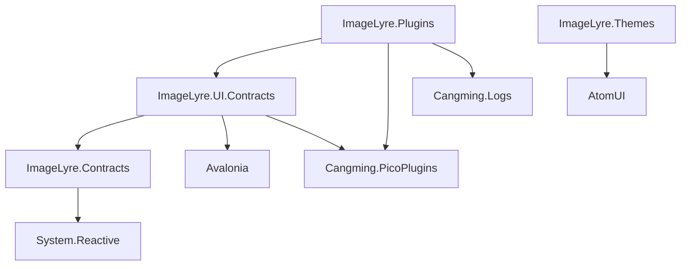

# DESIGN-0003：Libs 分层与契约清单

> **退役登记**（保留原路径以免既有日志与评审记录断链）
>
> | 项 | 内容 |
> | :--- | :--- |
> | 原状态 | Deprecated |
> | 退役日期 | 2026-11-21 |
> | 替代文档 | `docs/design/lukan/DESIGN-0006-rebuild-blueprint.md` |
> | 留存理由 | 记录了按沧溟分区逐项对照 Libs 的方法与 R1 至 R4 红线；四工程规划已不适用，红线中"契约不得反引实现"一条被 DESIGN-0006 §2.2 的 R1 至 R7 吸收 |

| 版本 | 日期 | 状态 | 作者 | 说明 |
| :--- | :--- | :--- | :--- | :--- |
| 0.1 | 2026-11-19 | 草案 | lukan | 首次定义四个类库的边界与依赖方向、契约分区、取用与自建清单，取代 DESIGN-0002 §2.7 的类库表格 |

> 本文是设计文档，不是决策记录：它回答"Libs 里放什么、谁依赖谁、哪些契约先借后改"，随上游演进与实现反馈持续修改；"基座自建、不直接依赖沧溟 Shell 与 Platform"这一不可逆取舍已由 `docs/adr/lukan/ADR-0008-self-built-base.md` 冻结，本文只在那个边界之内展开，不重复论证它。

## 1 约束

以下七条按优先级排列，任何一条被违反时先改本文再改实现，不允许实现先行倒逼条款。

1. **基座与业务无关**：判据是把这套类库换到一个与显微成像毫无关系的桌面软件里仍然成立，因此 Libs 不出现图像、ROI、测量、结果与导出的任何概念，也不登记具体槽位清单。
2. **Libs 恒为四个工程**：契约为两份（不碰界面框架的一份、碰 Avalonia 的一份）、插件 SDK 一份、主题一份；工程数不随能力增长而膨胀，新增能力只在既有分区里加契约，因为每多一个工程就多一套版本与打包边界。
3. **实现不住在 Libs**：任何接口的实现只能落在 `src/Modules` 或 `src/Features`，Libs 内除 record 工厂方法与常量声明外不出现方法体。
4. **借沧溟骨架、按我们的边界裁剪**：命令、快捷键、上下文键、通知、输出、忙状态、偏好、用户习惯、最近文件、文档会话、诊断这十一项以沧溟 `Shell.Contracts`（74 份契约文件）与 `Platform.Contracts`（16 份）为蓝本，取其形状而不取其全部，凡本产品没有对应需求的一律不进 Libs。
5. **成熟后回提上游**：本项目是这批契约的第一个真实用户，裁剪与加严的结论要能反向提回沧溟，因此不引入与沧溟相斥的框架级选择，代价是本文 §3.2 接受了 Rx 依赖。
6. **界面栈唯一**：只有 Avalonia 与 AtomUI，不存在第二个宿主，因此不为"跨 UI 框架共享契约"付出拆分代价，因为那笔代价的前提在本仓不成立。
7. **不做权限、单实例与自动更新**：三项已在 DESIGN-0002 定案，本文不为它们保留任何契约位，也不预留"以后可能要"的扩展点。

## 2 结构设计

### 2.1 四个类库的职责

| 工程 | 是什么 | 不做什么 |
| :--- | :--- | :--- |
| `ImageLyre.Contracts` | 离开界面仍然成立的服务契约，纯服务模块与命令行都消费 | 不含实现、不引 Avalonia、不引 AtomUI、不引插件内核 |
| `ImageLyre.UI.Contracts` | 为界面交互而存在的契约：宿主壳、区域、附件、命令、快捷键、通知、输出、忙状态、主题、语言、用户习惯、对话框与文档页 | 不含布局算法与渲染逻辑，那些属于壳的实现 |
| `ImageLyre.Plugins` | 官方插件作者写代码时用的基座类与工具：模块与 Feature 封装、code-first 菜单、`plugindesc` 读取 | 不实现任何宿主服务，不做槽位注册、不做菜单投影 |
| `ImageLyre.Themes` | AtomUI 主题资源、设计令牌与主题清单 | 不含 C# 逻辑，只有资源与常量 |

### 2.2 依赖方向

依赖只有一条向下的链：`Plugins → UI.Contracts → Contracts`，`Themes` 不在这条链上，它是纯资源包。`Contracts` 与界面框架没有任何交集，它唯一的外部包依赖是 `System.Reactive`（理由见 §3.2），而那个包自身不引 Avalonia。

在此之上，`src/Modules` 只依赖 `Contracts`，需要自己绘制区域的模块（工作台壳）才加 `UI.Contracts`；`src/Features` 依赖 `Plugins`；`src/Apps` 依赖全部。反向引用一律禁止，包括"契约引用实现以便拿到默认实例"这种常见偷懒。

### 2.3 `ImageLyre.Contracts` 的分区

分区即变更耦合单元：一个分区只对应一个实现模块，一个模块可以承担多个分区，但一个分区不允许被拆到两个模块里，否则同一处改动要跨两个工程同步。

收进本工程的标准不是"类型面上有没有控件"，而是**这个契约离开界面还有没有意义**：命令注册、快捷键、状态栏、通知、输出面板、忙状态、文件对话框、主题切换与文档页的打开，全部是为界面交互而存在的，因此一律归 `UI.Contracts`；只有不依赖任何人看屏幕也能工作的服务留在本工程，判据是命令行或无头进程能把它用起来。

| 分区 | 内容 | 来源 | 处置 |
| :--- | :--- | :--- | :--- |
| `.Documents` | 脏标记与关闭结果、只读感知、选中感知、会话持久化、最近文件、内容标识 | 沧溟 `Shell.Contracts.Documents` 23 份 | 取 6 条数据面，界面面另归 `UI.Contracts` |
| `.Diagnostics` | 诊断服务、崩溃上报 | 沧溟 `Platform.Contracts.Diagnostics` | 照搬，不取性能与资源监视；聚合器归 `UI.Contracts` |
| `.Files` | 外部变更通知 | 沧溟 `Shell.Contracts.IO` | 只取变更通知，文件对话框归 `UI.Contracts` |
| `.Hosting` | 关闭清理参与者、插件管理面 | 沧溟 `Shell.Contracts` 加自建 | 清理参与者照搬，插件管理面与关闭守卫自建 |
| `.Messaging` | 跨插件事件总线、全局异常处理 | 沧溟 `Platform.Contracts.Messaging` | 照搬，补发布顺序与回收条款 |
| `.Preferences` | 偏好读写、设置项定义与类型 | 沧溟 `Platform.Contracts.Configuration` 加 `Shell.Contracts.Settings` | 两处合并，明确"存值"与"声明项"分工 |
| `.Tasks` | 后台任务管理 | 沧溟 `Platform.Contracts.Tasks` | 照搬 |
| `.Undo` | 撤销栈与可撤销动作 | 无 | 自建，见 §3.4 |

### 2.4 `ImageLyre.UI.Contracts` 的分区

| 分区 | 内容 | 来源 |
| :--- | :--- | :--- |
| `.Workbench` | 宿主壳、区域名总表 | 自建，区域名总表形态借 Mercury |
| `.Slots` | 槽位注册表、描述符、变更源、问题与快照、附件接口 | Mercury `UI.Plugins`，从实现中提为契约 |
| `.Attachments` | 菜单三类附件、状态栏、内容、文档、工具面板附件 | Mercury `UI.Contracts` 与 `UI.Plugins` |
| `.Icons` | 图标描述 | Mercury `UI.Contracts` |
| `.Dialogs` | 对话框宿主 | 自建，缺口 |
| `.Commands` | 命令注册、命令描述符、上下文键、内置命令名 | 沧溟 `Shell.Contracts.Commands` |
| `.Keybinding` | 键位映射、键组合、键弦、快捷键管理器 | 沧溟 `Shell.Contracts.Keybinding` |
| `.Busy` | 忙状态管理器与忙记录 | 沧溟 `Shell.Contracts.Busy` |
| `.Notifications` | 通知中心、通知与通知动作记录 | 沧溟 `Shell.Contracts.Notifications` |
| `.Output` | 输出通道管理器与通道 | 沧溟 `Shell.Contracts.Output` |
| `.Theming` | 主题管理器与主题标识 | 沧溟 `Shell.Contracts.Theming` |
| `.Localization` | 本地化服务 | 沧溟 `Shell.Contracts.Localization` |
| `.UserState` | 用户习惯记忆 | 沧溟 `Shell.Contracts.Platform` |
| `.Documents` | 文档管理器、文档视图模型、文档选项 | 沧溟 `Shell.Contracts.Documents` |
| `.Files` | 文件对话框与筛选器 | 沧溟 `Shell.Contracts.IO` |
| `.Diagnostics` | 诊断聚合器，即问题面板的数据源 | 沧溟 `Shell.Contracts.Diagnostics` |

Mercury 把 `ISlotRegistry` 与它的实现放在同一个程序集（`Mercury.UI.Plugins`）里，这是它的分层失误：契约与实现同包导致任何插件想用槽位都必须同时拿到宿主实现。本仓把槽位契约放在 `UI.Contracts`，实现落在工作台模块。

（0.1 落地时的改动：`ISlotChangeStream` 更名 `ISlotChangeSource`、`SlotChangedEventArgs` 更名 `SlotChange`、`SlotCapacity.Single` 更名 `Exclusive`，三处都是分析器不允许的命名；迁入时删去了权限点字段、`IPermissionScopedAttachment` 与 ViewModel 模板分组，因为本仓没有权限系统，也没有 WPF 那套 ViewModel 模板配对，这些形状在这里没有落地场景。命令、快捷键、通知、输出、忙状态、主题、本地化、用户习惯、文件对话框与文档界面契约最初按"类型面是否出现控件"抄进了 `Contracts`，按业主口径改为"面向界面交互即归 `UI.Contracts`"后全部迁出，`Contracts` 因此从 43 份缩到 16 份。）

### 2.5 `ImageLyre.Plugins` 的内容

本工程只做三件事，任何第四件事都要先问"它是不是宿主服务"：

1. 基座模块与 Feature 的薄封装：在沧溟 `BasePicoModule` 之上补所有者上下文与契约解析入口，使官方插件不必直接面对内核的注入协议。
2. code-first 菜单附着：`ImageLyreCodeMenuFeature` 提供"声明分类与菜单项即完成附着"的写法，命令名写错在编译期暴露。
3. `plugindesc` 解析与绑定：`ImageLyreMenuFeature` 读程序集内嵌资源、解析成菜单分类、按名绑定命令，缺描述按无菜单处理，描述解析失败按无菜单处理并记警告，命令缺失则菜单项保留但不可点并记警告。

官方插件用 code-first，`plugindesc` 只给第三方与外部插件，这条分工来自 DESIGN-0002 §3.4，本文不改它。

### 2.6 `ImageLyre.Themes` 的内容

只有三样：AtomUI 主题资源（浅色与深色两套）、设计令牌（品牌色与语义色、四档字号与字距、六级间距、两级线宽；圆角固定 0、不做阴影）、主题清单（主题标识到资源字典的映射）。切换逻辑属主题模块，因为"当前是哪个主题"是运行期状态，不是资源。

### 2.7 分区到实现的对应

| 分区 | 计划落点 |
| :--- | :--- |
| `.Documents` 的数据面、`.Undo` | `ImageLyre.Module.Documents` |
| `.Diagnostics` 的服务面 | `ImageLyre.Module.Diagnostics` |
| `.Files` 的外部变更通知 | `ImageLyre.Module.Files` |
| `.Messaging`、`.Tasks`、关闭流程 | `ImageLyre.Module.Hosting` |
| `.Preferences` | `ImageLyre.Module.Preferences` |
| `.Hosting` 的插件管理面 | `ImageLyre.Module.PluginCenter` |
| UI 的 `.Commands`、`.Keybinding`、`.ContextKeys` | `ImageLyre.Module.Commands` |
| UI 的 `.Busy`、`.Workbench`、`.Slots`、`.Attachments`、`.Dialogs`、`.Icons` | `ImageLyre.Module.Workbench` |
| UI 的 `.Notifications`、`.Output` | `ImageLyre.Module.Notifications` |
| UI 的 `.Theming`、`.Localization`、`.UserState` | `ImageLyre.Module.Appearance` |
| UI 的 `.Documents`、`.Files`、`.Diagnostics` | 跟随各自模块，界面部分由 Feature 承担 |

模块分三类，这条区分必须写清，否则"模块不许碰 UI"会被机械执行成"壳也不许画界面"：**纯服务模块**只引 `Contracts`，不引任何界面类型；**呈现模块**引 `Contracts` 与 `UI.Contracts`，负责自己那块面板的状态与投影，但不引具体控件库；**壳模块**只有工作台，另引 AtomUI 与具体控件，是唯一能决定像素长什么样的地方。

按这个划分，文档、通知、输出、主题、命令这些模块属于呈现模块，因为它们的存在意义就是让用户看见或操作；而偏好、事件总线、后台任务、关停流程属纯服务模块，删掉界面之后它们仍然能工作。

### 2.8 规模账

沧溟两份契约共 90 份契约文件，迁入后 `Contracts` 16 份、`UI.Contracts` 40 份（含 Mercury 迁入的槽位与附件 10 份）。需要改写形状的有五处，逐条可查：命令的可用性判定由 `When` 字符串改为委托谓词、通知三个接口合并为一个、偏好与设置项定义两处合并为一处、文档 23 份裁到 6 份数据面加 3 份界面面、槽位从实现程序集提为契约。另有七处属于沧溟没有的自建项，见 §3.4。

两个工程加起来 56 份，全是接口、record 与枚举，编译产物各一个程序集，插件引用它们不带来运行时成本；而拆成更多契约程序集只会让插件作者的引用清单变长，换不来任何加载期收益。

## 3 接口契约

### 3.1 六条硬规则

| 规则 | 判据 | 违反后果 |
| :--- | :--- | :--- |
| R1 依赖单向向下 | `Plugins`、`UI.Contracts`、`Contracts` 三者的引用集合只能指向下方与第三方包 | 出现循环依赖或实现被契约反向引用，升级时连锁改动 |
| R2 `Contracts` 三不引 | 不引 Avalonia、不引 AtomUI、不引 PicoPlugins | 纯模块被迫拖着界面框架启动，命令行与无头场景不可用 |
| R3 `UI.Contracts` 只放声明 | 除 record 工厂方法与常量外不出现方法体 | 契约里长出实现，同一逻辑出现两份真源 |
| R4 Libs 无实现 | `src/Libs` 下任一工程可单独编译，删掉 `src/Modules` 不影响其编译 | 基座能力被锁死在类库里，无法作为插件启停 |
| R5 流有三要素 | 每条流的注释写清触发线程、回放语义与是否热流 | 订阅方各自猜线程，界面偶发跨线程异常 |
| R6 分区即耦合单元 | 一个分区只对应一个模块 | 同一处改动跨两个工程同步，提交无法独立回退 |

### 3.2 通知与订阅的风格

**结论**：契约中的状态变化一律用 `IObservable<T>` 表达，配合快照查询与 `IDisposable` 令牌，并在每条流的注释中写清触发线程、回放语义与是否热流三项。

备选是改用 `event`：Mercury 的槽位变更流就是事件加增量参数，且它把线程、失败隔离与生命周期写成了详尽条款，说明事件方案可行。代价差别在于规模：沧溟 74 份 `Shell.Contracts` 里大半暴露 `IObservable`，换成事件等于重写这些签名，而将来回提沧溟时还要再翻译一遍，两次成本都落在同一批契约上。

真正决定的是另一件事：**"停用插件后不残留幽灵行为"不取决于用 Rx 还是事件**。事件订阅与 Rx 订阅同样会在插件停止后继续收到通知，唯一的解法是注册与订阅一律返回令牌、宿主按所有者作用域整体撤销。既然泄漏风险由令牌解决，两种风格在这一项上打平，那么选成本低、与上游同构的那一种。

代价要写明：每个插件因此多一个 `System.Reactive` 包依赖，第三方作者必须懂订阅与释放；加严条款（三要素加令牌）写不进类型系统，只能靠评审与契约测试守。

失效条件：若第三方插件作者普遍反馈 Rx 门槛过高，或 `System.Reactive` 出现破坏性变更，则在 `ImageLyre.Plugins` 层加事件适配层，不改 `Contracts` 的签名——因为改契约要动全部实现与全部插件。

### 3.3 明确不取的清单

| 条目 | 来源 | 理由 |
| :--- | :--- | :--- |
| 授权上下文、凭据存储、以及 Mercury 整套权限装饰器 | `Platform.Security`、Mercury `UI.Plugins.Permissions` | 单人本地软件，没有账号、角色与审批流，不做权限系统 |
| 应用更新、单实例、协议激活 | `Platform.Updates`、`Platform.App` | 三项已明确不做 |
| 侧栏、托盘、欢迎页、窗口状态、外观管理 | `Shell.Contracts.Rails`、`Workbench` | 没有对应需求，此时抽象即过早 |
| 文档分组、编辑器分组、搜索、差异、模板、层级、语义导航、元数据、引用、上下文感知、生命周期钩子 | `Shell.Contracts.Documents` 其余 15 份 | 未经验证的需求，先取最小文档集，缺什么补什么 |
| 查找替换、打印预览、打印命令、DPI 适配、无障碍 | `Shell.Contracts.Platform`、`Commands` | 产品或平台适配职责，不属于基座 |
| 状态栏管理器、系统通知 | `Shell.Contracts.Notifications` | 状态栏统一由附件机制承担，系统通知无需求 |
| 布局方案持久化、书签、全局热键 | `Shell.Contracts.Platform`、`Configuration`、`Keybinding` | 没有需求，且与用户习惯记忆职能重叠 |
| 性能监视与资源监视 | `Platform.Diagnostics` | 诊断先取四项，监视类留到有真实性能问题再谈 |
| 应用外壳、布局状态、外壳契约聚合 | `Shell.Contracts` 顶层三份 | 由我们的宿主壳契约取代 |
| 领域模型、设备、身份、用量、表面命令、UI 状态匹配器、WPF 的 VM-View 配对注册 | Mercury `Domains`、`Common.Contracts`、`UI.Contracts` | 业务专属或 WPF 专属，与基座无关 |

### 3.4 自建与深化的七处

| 缺口 | 为什么要 | 契约落点 |
| :--- | :--- | :--- |
| 撤销栈 | 沧溟只有撤销与重做两条命令接口，没有可复用的栈，而基座验收要求"通用撤销" | `Contracts.Undo`：撤销栈与可撤销动作，按文档实例持有 |
| 关闭可否决 | 沧溟的清理参与者只能做事，不能阻止关闭，脏文档拦截无处挂 | `Contracts.Hosting`：关闭守卫，返回可关闭结论与理由 |
| 槽位与附件生命周期 | Mercury 有实现但契约散落在实现程序集里 | `UI.Contracts.Slots`：注册、按所有者摘除、变更增量、问题上报、快照 |
| 插件管理面 | 沧溟只有插件内核机制，没有管理面契约 | `Contracts.Hosting`：插件清单、启停、状态事件、依赖报告 |
| 偏好与习惯的边界 | 沧溟两套机制并存，没有写明什么进哪一套 | 判据：用户能在设置里改的是偏好，用户不知道自己被记住的是习惯 |
| 主题令牌清单 | 主题管理器只负责切换，没有词表 | `Themes` 承担令牌表，`IThemeManager` 只认令牌与主题标识 |
| 事件总线语义 | 沧溟未定义发布顺序、异常隔离与回收 | `Contracts.Messaging`：同类型订阅按注册顺序同步调用，订阅方异常不中断其余订阅方，按所有者回收 |

### 3.5 不标成熟度

沧溟给每条契约加了实验、稳定、弃用三级标注，本仓不跟：那套标注是上游在多宿主、多消费方的演进期里对内沟通用的，而在本仓契约只有一个实现方，实验与稳定之间没有转换机制与判定人，落到五十份契约上就会 90% 永远停在实验级——一条恒为真的注释既不能约束实现，也不能提醒作者，只会让读者以为存在一个并不存在的分级制度。

替代物是两条已经存在的机制：改契约走 ADR，契约形状与边界写在本文的版本里。如果将来契约开放给第三方并对半稳定作出承诺，再引入标注也不迟，那时它才有真实的判定场景。

（0.1 落地时的改动：首批 42 份契约从沧溟迁入时带着成熟度标注，按业主决定全部删除，`Contracts` 因此不再依赖 `Cangming.Primitive`。）

### 3.6 架构测试的判据

R1、R2、R3、R4 各自落成一条架构测试：引用集合检查、`Contracts` 的包引用白名单、`UI.Contracts` 内的方法体扫描、删掉 `src/Modules` 后的独立编译。四条测试全绿是本设计被实现的充要条件，任何一条靠人工评审守就意味着它会失效。

## 4 边界情况

| 情况 | 处置 |
| :--- | :--- |
| 出现第二个界面宿主（例如 Web 或移动端） | `Contracts` 拆出 `netstandard2.0` 目标并复核第三方依赖，此时才付跨框架代价，不在之前预付 |
| 第三方作者普遍不会 Rx | 在 `ImageLyre.Plugins` 加事件适配层，不改契约签名 |
| `System.Reactive` 出现破坏性变更 | 锁版本并在本文登记最晚复核点，同时评估适配层是否提前 |
| 某分区被三处以上互相引用 | 说明该合并而不是该拆，合并后同步改本文与架构测试 |
| 单个分区类型数超过 20 | 检查是否把两个变更轴塞进一个分区，拆分区不拆工程 |
| 某契约需要业务概念才能表达 | 说明该契约不属于基座，下沉到业务契约包 |
| 沧溟上游把某契约改名或改形状 | 以本文为准评估是否跟进，跟进时一次性改完全部实现与插件 |
| 壳之外的模块想引用 Avalonia | 把界面下沉为 Feature；若做不到，说明该能力不该是模块 |
| 主题需要运行期计算（如跟随系统色） | 在主题模块内实现并只暴露令牌，不让 `Themes` 长出 C# 逻辑 |

## 5 与既有文档的关系

`docs/design/lukan/DESIGN-0002-cangming-engineering-base.md` 的 §2.7 在本轮被本文取代：那份表格里"Libs 恒为四个工程"的结论仍然成立，但依赖一栏与工程实际不符——它把 `Contracts` 写成依赖沧溟 `PicoPlugins`，而该工程没有任何包引用，`IPluginCenter` 用的是自建描述符；分区清单、取用清单与自建项也一并缺失。本文补齐这三样，并把 DESIGN-0002 §2.7 改为指向本文。

`docs/adr/lukan/ADR-0008-self-built-base.md` 冻结的是"自建而不直接依赖沧溟 Shell 与 Platform"，本文的裁剪与加严都在其边界内，不构成新决策。`docs/spec/requirements/core-1.0-boundary.md` §2 列的七项技术内核与本文章节的对应关系是：主题对应 `.Theming` 与 `Themes`，语言对应 `.Localization`，插件宿主对应 `.Hosting` 的插件管理面，宿主壳对应 `UI.Contracts`，共享契约对应 `.Documents`、`.Undo`、`.Commands`、`.Files`，首选项对应 `.Preferences`，用户习惯对应 `.UserState`。

## 6 变更记录

| 版本 | 变更 |
| :--- | :--- |
| 0.1 | 首次成文：四库职责、依赖方向、契约分区、六条硬规则、通知风格的取舍、不取清单 10 条、自建 7 处、边界情况 9 条。落地时按业主口径重划两库边界：`Contracts` 8 个分区 16 份、`UI.Contracts` 16 个分区 40 份。 |

## 7 待办

1. 按分区逐份落契约，一次一个分区、一次一个提交，顺序取 `.Commands` → `.Documents` → `.Preferences`。
2. 把 R1 到 R4 写成架构测试并让它们在当前仓先红后绿。
3. `ImageLyre.Themes` 的令牌表先定颜色与字号两阶，其余等有真实界面再补。
