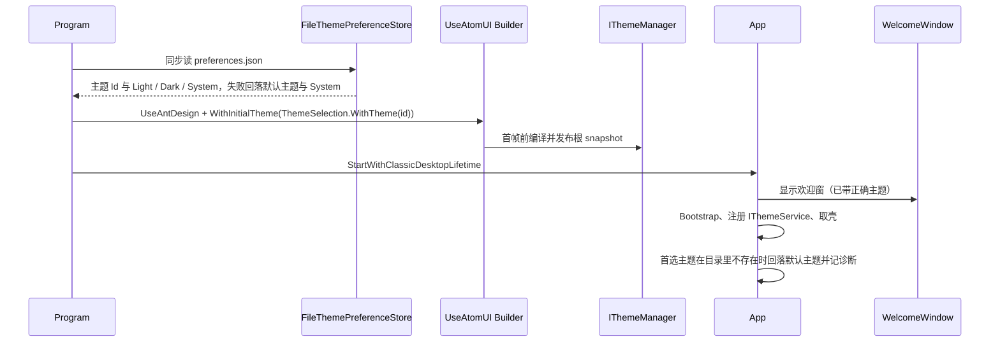
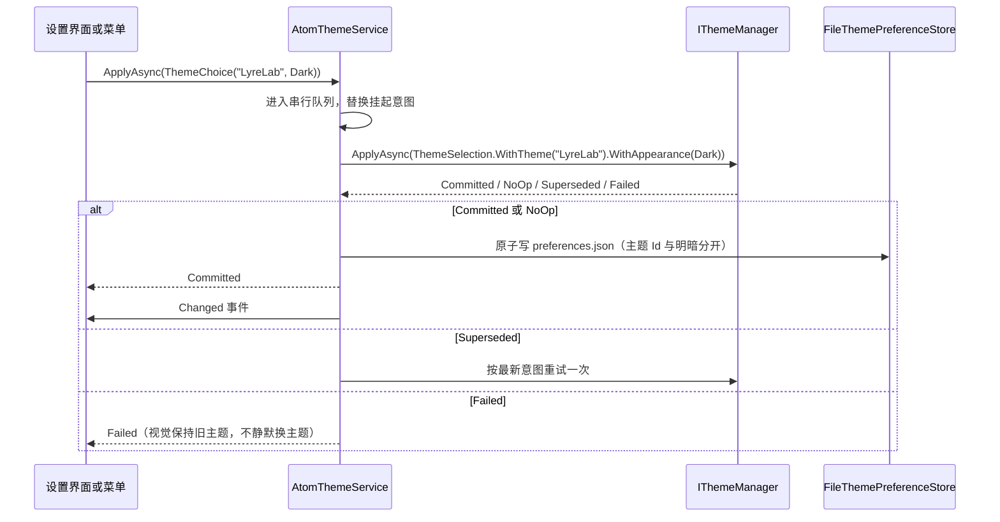

# DESIGN-0003 主题体系：单语言底座、主题目录与令牌映射

| 版本 | 日期 | 状态 | 作者 | 说明 |
| :--- | :--- | :--- | :--- | :--- |
| 0.1 | 2026-11-24 | 历史 | lukan | 首版：在 AtomUI 6.3 的主题模型上定语言、主题文件、令牌映射、切换与持久化、作用域与插件边界、启动与切换开销；不重复色值与控件规格，那部分仍以 §2.2 的基线为准 |
| 0.2 | 2026-11-24 | 历史 | lukan | 按业主口径「以后支持换主题」修订：主题由单套改为目录多套，补 §4.6 主题契约，§6 的枚举、持久化与接口签名随之改；首发仍只交付一套，第二套作为架构验收（对应 PRD 4.x 把 THEME-003 高对比主题推迟到首个更新） |
| 0.3 | 2026-11-24 | 历史 | lukan | 核实 11-20 的提交与 11-22 的删除链（`dc0f4b9`，327 个文件），把 §2.2 的断代说明改写为“已从标签恢复”，§11 的 T0 结项；映射表取值与恢复后的原文一致 |
| 0.4 | 2026-11-24 | 历史 | lukan | 恢复 `main-window-spec.md` 后按其 §9 核对：设置的外观组含主题、语言、界面缩放与密度；据此重写 §4.3 与结论第 4 条，把“密度”拆成语言轴（不提供）、面板段距（用户可选，归布局层）与缩放（视觉层） |
| 0.5 | 2026-11-24 | 历史 | lukan | 按“定稿存档要进交付类目录、不被过程文档清理扫到”的口径，把 11-20 产物从 `docs/design/lukan/bakeoff-2026-11-20/` 迁进 `docs/reference/`；§2.2、§5、§11 与 §12 的路径引用随之更新 |
| 0.6 | 2026-11-24 | 草稿（待拍板） | lukan | 落点按业主口径定在 `reference/`：撤销上一步新建的 `docs/design-archive/` 与登记行，改为在 `docs/README.md` 的交付类 `reference/` 条目与 `docs/reference/README.md` 里写明“定稿设计存档”的定位、存取规则与存档清单；11 处路径引用统一为 `docs/reference/2026-11-20-appearance/` |
| 0.7 | 2026-11-24 | 草稿（待拍板） | lukan | 按业主口径整理存档命名：定稿报告 `report.html` 改为 `index.html`、三十版过程总览 `index.html` 改为 `gallery.html`，目录按登记表的 `<日期>-<主题-slug>` 规则改名 `2026-11-20-appearance/`；`docs/reference/README.md` 的入口清单与 §2.2 的说明同步更新 |
| 0.8 | 2026-11-25 | 历史 | lukan | 读完恢复回来的 UI 稿（收口报告、主界面规格、控件与八态样张）后校订：补缺失的警告与错误状态色、状态栏定到 28、焦点按 `:focus-visible` 落实、页签墨条写出映射、画布底定为随明暗；另记四份基线之间的六处口径冲突 |
| 0.9 | 2026-11-25 | 草稿（待拍板） | lukan | 按业主口径把六处缺口全部补掉：`color-tokens.md` 升 1.4 增 §6.4 状态提示两档、`spacing.md` 升 1.1 统一状态栏 28 并登记 6px 例外、主界面规格升 0.2、收口报告改两处笔误值、`states.html` 按 1.3 重刷配色；本文 §5.1 补映射行并给出 AtomUI 落法 |

## 1 结论

主题这一块的做法是**一份主题、一种语言、一层映射，但主题目录从一开始就是多套**：我们把外观的取值收进编译进应用的主题文件，首发只启用 Ant Design 一种设计语言、只交付一套主题，再把设计基线的语义名逐行映射到 AtomUI 的全局 Token 与控件 Token 上，运行时按「主题 + 明暗」切换。

1. **首发只启用一种设计语言，并且锁定为 Ant Design；语言这一层不锁死主题数量。** Shadcn 与 PrimeNG 不进入产品，只在 §4.1 的对照实验里出现一次；理由是设计语言决定的不只是配色，而是整套推导公式与按钮、菜单、输入框的行为开关，两种语言并存意味着每份覆盖写两遍、每个插件控件发两个取值包、每个缺陷复现两次。换主题与换语言是两件事：前者加一个主题文件，后者加一套取值包，前者是产品需求，后者只是架构上要留出的口子。
2. **明暗不是两套主题，而是一份主题文件的两个分支。** 每份 `*.theme.xml` 的基础段是亮色、`<When Appearance="Dark">` 是暗色，二者共用一份选择，切换只改 `Appearance` 一个轴，因此不存在颜色与尺寸各切一半的中间态。
3. **我们的词表不另立第二套资源系统。** `color-tokens.md`、`typography.md`、`spacing.md` 里的语义名保留为设计与代码的共同词汇，但取值只在 AtomUI 的种子、Map、Alias 与控件 Token 上出现一次；任何 XAML 里都不出现十六进制，也不出现第二个 `ResourceDictionary`。
4. **用户能选的是主题、明暗与面板密度，不是语言密度轴与品牌色。** 首发主题目录只有一套（Lyre Lab，亮/暗），后续按 THEME-003 增加高对比或色盲友好主题；`main-window-spec.md` 设置里的“密度”只是右栏段距的两档（标准 16/24、紧凑 12/12），归布局层与首选项，不归主题；AtomUI 的语言密度轴会连带改字号与行高，与排印四档、4px 栅格冲突，不提供；应用内缩放属于 Avalonia 视觉层，三者不能互相冒充。
5. **作用域只承载模式，不承载风格。** 插件面板与后续的无障碍模式可以用局部 `ThemeConfigProvider` 声明自己的密度或明暗，但不得改强调色、不得 `Inherit=false`、不得启用语言，也不得换全局主题。
6. **多套主题靠主题契约约束，而不是靠每套主题各自遵守。** 主题只允许改颜色与材质，字号档、间距、线宽、圆角、状态语法与控件尺寸全部冻结（§4.6）；这样第二套主题落地时不需要碰代码，也不会把遮标测试与对比度验收搞坏。

## 2 事实基线

### 2.1 AtomUI 6.3 给了什么

主题在 6.3 里已经不是一个可覆盖的 Brush 集合，而是一次编译：配置与主题定义经 `ThemeConfigMerger` 合并、`ThemeCompiler` 推导，产出不可变 `ThemeSnapshot`，再由稳定的 `ThemeContext` 原子发布（见 AtomUI 仓 `docs/architecture/systems/theming/runtime.md` 第 3 节与第 15 节）。这条模型决定了我们能用什么、不能用什么。

| 能力 | 语义 | 我们的用法 |
| :--- | :--- | :--- |
| 设计语言三件套 | 语言包给出种子与推导，控件包只声明 Token，取值包按语言写出控件取值；每个已启用控件包在每种已启用语言下都必须有取值包，缺一即启动失败 | 只启用 `AntDesign` 一套，配齐 `AddDesktopControls()` |
| 四个轴 | `Language`、`Style`、`Appearance`、`Density`，另有形态 `Idiom`；主题根上写了的轴被固定，没写的轴开放 | 只开放 `Appearance`，其余不动 |
| 主题定义 XML v2 | 一份文件可覆盖全部变体，变体差异写进 `<When>`；编译进包的主题在构建期完成 Reader 与 XSD 校验并生成类型化主题程序，运行时零解析 | 一份 `Lyre.theme.xml`，声明为 `AtomUIThemeDefinition` |
| 配置分层 | 语言推导 → 主题定义 → 应用初始配置 → 运行时请求 → 父作用域 → 局部 `ThemeConfigProvider`，六层固定优先级 | 我们的品牌值全部停在“主题定义”这一层 |
| 作用域 | `ThemeConfigProvider` 建立局部 `ThemeContext`，轴独立继承，Token 按 key 覆盖；`Inherit=false` 会丢弃所选主题定义 | 只给插件面板与辅助模式用 |
| 发布语义 | 先编译完整 snapshot，再在 UI 线程交换引用；终态为 `Committed`、`NoOp`、`Superseded`、`Failed`，失败不改变已显示主题 | 切换入口据此设计串行与失败语义 |
| 读取入口 | `SharedTokenResource` 永远读全局，`XxxTokenResource` 读该控件的有效值，`OwnerTokenResource` 读所属控件的有效全局值 | 自定义控件用 `SharedTokenResource`，AtomUI 控件由主题内部自读 |
| 首帧 | `WithInitialTheme(ThemeSelection)` 在首个可见帧前完成全局主题准备；`FollowSystemAppearance()` 在首帧前同步解析系统明暗，不先按默认编译再补一次切换 | 启动路径的唯一入口，见 §6.2 |
| 主题目录 | `IThemeManager.Languages`、`Themes`、`CurrentSelection` 提供语言、具名主题、锁定种子等只读元数据 | 设置界面若需要枚举，只读它，不自己维护清单 |

有两条边界必须提前记住，它们决定了本文不少取舍：`LanguageTokens` 只能写当前语言声明的语言 Token，而 `AntDesignToken` 没有属性，因此 Ant Design 主题写不了 `LanguageTokens`，我们的自有词汇无处安放；`ControlTheme` 里消费 Token 必须用带 identity 的 `XxxTokenResource`，否则控件级覆盖对该消费点失效，这也是我们对 AtomUI 控件“能覆盖到什么程度”的硬顶。

### 2.2 我们手上有什么

需求基线在库里，取值基线不在。`docs/spec` 下与主题相关的条款可以直接引用，取值却仍然缺源。

| 文件 | 与主题相关的条款 |
| :--- | :--- |
| `docs/spec/requirements/product-requirements.md` §4.1 | 画布优先、图像托住视觉中心；信号色只给选中、警告与关键状态；数字用等宽或表格数字 |
| 同文件 §5.10 与需求表 | CORE-10「浅/深/跟随系统，切换不重启，两套完整，图像视口中性底，对比度 AA」；THEME-001 三模式与偏好保存、THEME-002 完整覆盖与 AA、THEME-003 高对比与色盲友好（本版推迟到首个更新）、THEME-004 跟随系统且用户显式选择优先 |
| `docs/spec/requirements/interaction-requirements.md` IX-11 | 标题栏点主题/语言即切、布局不跳、数据不变；主题资源缺失时保持当前主题并提示 |
| `docs/spec/requirements/core-1.0-boundary.md` | 主题是技术内核七项之一，CORE-10 是核心产品结果之一；§5.2 把高对比主题放在首个更新 |
| `docs/spec/requirements/product-appearance.md` 0.2 | 气质、五个外观决定、七条反面清单、八项验收测试；§12 把稿 30/31 定为现行基准 |
| `docs/spec/m1/M1-interaction-spec.md` 1.1 | 窗口骨架（菜单栏、工具条、视口、右侧 Results、五段状态栏）；§2 写「视口底色用深灰 `#2B2B2B`」，这是早于 30/31 的旧口径，见下方冲突表第 5 条 |

结构侧还有 `docs/reference/2026-11-20-appearance/main-window-spec.md`（标题栏、窗口分区与 §9 设置页），它把「主题、语言、界面缩放、密度」同列在外观组，本文 §4.3 按它拆分这四种“大小开关”，§6.6 因此明确密度与缩放不进主题服务。

取值基线的位置如下，它们定义稿 30/31 的具体数值。

| 文件 | 定义了什么 | 交给谁 |
| :--- | :--- | :--- |
| `docs/reference/2026-11-20-appearance/color-tokens.md` 1.4 | 表面、线、文字、信号、状态四组，含明暗两套取值、状态提示两档与对比度矩阵 | 架构落 Token |
| `docs/reference/2026-11-20-appearance/typography.md` 2.0 | 四档字号 11/13/16/20、字重、行高、数字与中英混排 | 架构落 Token；§14 明确把「AtomUI 令牌、Avalonia 资源键、控件模板」交给架构 |
| `docs/reference/2026-11-20-appearance/spacing.md` 1.1 | 4px 基线、六级间距、区域与控件尺寸、100–200% 缩放口径；状态栏 28 与 6px 例外 | 架构落 Token |
| `docs/reference/2026-11-20-appearance/controls.md` 1.1 与同目录 `state-model.md` 0.1 | 每类控件的五态形状与优先级 | 架构评估能否用 Token 表达 |

这批文件有过一段断代：2026-11-22 的重置提交 `dc0f4b9`（327 个文件、40 712 行）把 `docs/design/` 整体当过程文档清掉，工作区一度只剩 `product-appearance.md` 与 `interaction-requirements.md` 的七处悬空引用，实现者拿不到任何色值；2026-11-24 已从标签 `archive/pre-reset-2026-11-22` 恢复，并按“定稿存档进交付类目录”的口径迁到 `docs/reference/2026-11-20-appearance/`（`reference/` 收定稿存档的定位与存取规则写在 `docs/README.md` 的交付类表与 `docs/reference/README.md`），共 106 个文件、25 MiB（原计 117 个文件、36 MiB，按“剔除原型页未引用的截图”订正为现值），含六个方向的竞标稿、`index.html`（定稿报告）、`gallery.html`（三十版过程总览）、`controls.html`、`e-science/states.html`、`type-specimen.html` 与 25 张被页面引用的预览图，页面 64 处资源引用零缺失。七处文档引用随文件存在而复原，`interaction-requirements.md` 里只写文件名的 `main-window-spec.md` 也补成了完整路径。本文的映射表按恢复后的原文编写。

三份 HTML 的取色可信度不一样，必须先分清再用：`index.html`（收口报告）与 `controls.html`（控件样张）的配色已是 1.3 的取值（2026-11-25 重刷后 `states.html` 也一并对齐），表外用色为 0，可以直接取样；`e-science/states.html`（八态）的尺寸与排印 token 是对的（`--h-title:44`、`--h-status:28`、四档字号），但它的颜色是 1.0 之前的旧纸白基线（`--paper:#F2F2F0`、`--ink:#1B1B1B`、`--hair:#DEDEDA`、`--rule:#C6C6C1`），不能拿来取色；其余六个方向的原型是过程稿，只看结构不看值。

四份基线之间还有六处口径冲突。2026-11-25 已按“改源头、不改下游引用”的顺序全部处置：能判为笔误的直接改基线并在版本表留痕，判为缺口的补 token，判为旧口径的以 30/31 为准。

| # | 冲突点 | 两种说法 | 处置结果 |
| :--- | :--- | :--- | :--- |
| 1 | 状态栏高度 | `spacing.md` §3.1 与 §4 写 32；§5、收口报告与主界面规格都写 28 | 采用 28：`spacing.md` 升 1.1，两处 32 改 28，并把上下 6 登记为六级间距的唯一例外（理由与 1px 线、78 批次同属密集读数带） |
| 2 | 状态栏分隔线 | 主界面规格 §13 写“1px `line.divider`，上下 6” | 保留 6 并补注为同一条例外，不再当作新的间距阶；主界面规格升 0.2 |
| 3 | 输入框暗色底 | `color-tokens.md` 1.3 写 `#121417`；收口报告写 `#12120F` | 采用 `#121417`，收口报告已改 |
| 4 | 悬停暗色底 | 1.3 写 `#292E34`；收口报告写 `#2A2E33` | 采用 `#292E34`，收口报告已改 |
| 5 | 画布底 | M1 交互规范写固定深灰 `#2B2B2B`；30/31 与收口报告写随明暗（`#E8EAED` / `#0D0F11`） | 采用随明暗；M1 那份是旧口径，技术落法见 §7 第 1 行 |
| 6 | 警告与错误状态色 | 主界面规格要求缺校准黄条与六类错误条；`states.html` 用旧配色时代的 `#F7EBC8`/`#E2CB92`；`color-tokens.md` 1.3 没有这两种色且禁止表外值 | 补成 token：`color-tokens.md` 升 1.4 新增 §6.4，给 `state.warning.line` 与 `state.error.line` 两档，底取窗口色；`states.html` 已按 1.3 与新 token 重刷 |

上表第 5 条已经把画布底的口径定下来：30/31 与收口报告都写随明暗，M1 交互规范的固定深灰是更早的旧口径；剩下的不是“选哪个色”，而是“AtomUI 没有第三个不透明表面该怎么落”，技术处置在 §7 第 1 行，取值路线在 §12 第 2 条。

代码侧的现状同样是缺口清单：

| 位置 | 现状 | 缺口 |
| :--- | :--- | :--- |
| `src/App/ImageLyre.App/Program.cs` | 已调用 `UseAtomUI` 并显式启用 Ant Design | 没有 `WithInitialTheme`，首帧是 Daybreak Blue 默认外观 |
| 仓库 | 没有主题文件，没有 `AtomUIThemeDefinition` 构建项 | 品牌值无处存放 |
| 仓库 | 没有首选项存储，主题偏好没有落点 | 重启后无法记住明暗 |
| `WelcomeWindow`、壳窗口 | 直接用 AtomUI 默认主题（圆角、投影、蓝主色） | 与稿 30 的方角、1px 线、单一信号色正面冲突 |
| 全仓 | 没有主题服务，也没有 `IThemeService` 契约 | 设置界面（未来 Feature）没有可注入的依赖，IX-11「切主题不重启」不可验证 |

### 2.3 现状里也有已经做对的部分

`DESIGN-0001` 1.1 已经钉住两条实现级硬约束：壳窗口必须派生自 `AtomUI.Desktop.Controls.Window`，否则没有 `OverlayLayer`，弹出层会抛异常；设计语言必须显式启用，否则启动抛 `ThemeLoadException`。这两条说明 UI 路线与 AtomUI 的耦合已经落在明面上，主题只是在这条路线上继续叠加一层取值，不需要再论证是否该用 AtomUI。

## 3 约束

### 3.1 必须满足

| 编号 | 约束 | 来源 |
| :--- | :--- | :--- |
| C1 | 单一取值真源：任何颜色、字号、间距在仓库只有一个来源，XAML 不写十六进制，不建第二套资源字典 | 本文 §4.4；`color-tokens.md` §1 |
| C2 | 切换不重启进程、不重建窗口、不跳布局 | IX-11；CORE-10 验收「切换不重启，无半套主题」 |
| C3 | 明暗两套逐项同构，只换色值，不存在「暗色少一层灰」 | `color-tokens.md` §0 前提 1 |
| C4 | 首个可见帧即正确外观，不得先亮后暗、不得在 `OnFrameworkInitializationCompleted` 里补一次 `ApplyAsync` | AtomUI 启动时序；`product-appearance.md` §4.1 |
| C5 | 契约层不引用 Avalonia 与 AtomUI | `DESIGN-0001` §5 第 4 条 |
| C6 | 插件不得启用语言、换全局主题、注入品牌色；插件自带控件必须随宿主语言提供取值包 | 本文 §6.5；ADR-0001 的插件边界 |
| C7 | 冷启动主题准备与切换开销可测，100 次切换后内存不增长 | 发布说明第 3 条的承诺要有对应验收 |
| C8 | 不引入第二种设计语言；将来若换，按 §4.1 的判据另立决策，不做双语言并存 | 本文 §4.1 |
| C9 | 增加一套主题只加文件与注册，不改 C# 代码；主题与明暗是两个独立的选择项，各自持久化 | 本文 §4.6、§6.4；THEME-001 与 THEME-004 |
| C10 | 主题只允许改颜色与材质，字号、间距、线宽、圆角、状态语法与控件尺寸冻结 | 本文 §4.6；`typography.md`、`spacing.md`、`controls.md` 的验收条款 |

### 3.2 应该满足

| 编号 | 期望 | 理由 |
| :--- | :--- | :--- |
| S1 | 设计文档里的名字能在代码里一次查到，反向也成立 | 设计与实现共用一套词汇，评审才吵得起来 |
| S2 | 新控件接入有固定动作：查映射 → 定覆盖点 → 取色验收 | 否则每接一个控件就重新发明一遍做法 |
| S3 | 覆盖表每行都标注 Token 名与 6.3.0 基线 | AtomUI 升级时能逐行判断是否失效 |
| S4 | 作用域有准入清单，而不是“需要时随手开一个” | 作用域是半套主题的主要来源 |

### 3.3 非目标

- **首发不启用用户主题目录**：`UseUserThemeDirectory()` 不启用，但 Resolver 入口、路径安全与主题契约先写清；理由是第三方主题目前没有消费者，而目录枚举、路径逃逸与刷新事务都是实打实的成本，THEME-003 的高对比主题由我们自己以编译主题包提供，不需要用户目录。
- **不做主题编辑器与主题市场**：没有当前消费者。
- **不做密度用户开关**：见 §4.3。
- **不做高对比模式**：属于无障碍范围的后续议题，本文只预留作用域入口。
- **不把 Shadcn、PrimeNG 产品化**：见 §4.1。

## 4 关键取舍

### 4.1 为什么只选一种语言，为什么是 Ant Design

设计语言在 6.3 里不是皮肤，而是取值与行为的来源：种子怎么推成 Map 与 Alias、按钮的默认形态是描边还是填充、按下是否位移、链接是否染色，都由语言自己的取值规则给出，`AbstractButtonGeometryToken` 上那一组 `RecipeVariants`、`PressMoves`、`OutlineOnlyDefaultShadow` 就是语言写进来的行为开关。因此换语言等于换一整套取值表与行为表，两种语言并存的代价是每份覆盖写两遍、每个插件控件发两个取值包、同一条视觉缺陷要在两套公式里各复现一次；这个代价换不来任何用户可见的收益，因为产品只有一种外观。

选 Ant Design 有三条实证理由，每条都能独立成立：

- 它是 AtomUI 的参考语言，CHANGELOG 里「与 antd 6.7 对齐」的条目逐条可查，因此它的取值包覆盖最全、契约测试最严，出了问题也最容易找到上游依据。
- 当前代码已经跑通 6.3 的显式语言注册，而这次注册是硬失败（缺取值包即拒绝启动），换成别的语言等于把这条链路重走一遍。
- 它把我们要的行为差异暴露成 Token 而非写死在模板里，方角、无填充、无投影、按下不位移这四件事因此都能在取值层表达，不必改模板。

反方向的证据必须写明：我们的外观更接近 Shadcn 的缺省气质（中性、细线、低圆角），用 Ant Design 意味着缺省值离目标更远、覆盖行数更多。因此 T2 阶段安排一次对照：取 Button、LineEdit、TabControl 三个控件，用同一份取值表分别在 `AntDesign` 与 `Shadcn` 下各渲染一次，比较覆盖 Token 行数、必须改 `ControlTheme` 的控件数、行为开关的额外覆盖数三项；三项都更少才重开选型，任一项更多则维持本文结论。这是一次上限一天的开销，用来换一个长期决定的证据。

### 4.2 一份主题文件、编译进包、首帧指定

明暗两套做成两个文件是常见的错解：v2 规范要求同语言同风格的变体合并进一个文件，两个文件就是两个 `Theme.Id`、两次切换、两套对比与两份指纹，而且切换时先后替换两个定义必然出现半套状态，正好是 CORE-10 要避免的情形。

主题声明为 `AtomUIThemeDefinition` 构建项，由生成的 `ThemePackageRegistration` 注册进目录，好处是构建期就用同一个 Reader 与权威 XSD 完成校验、由生成器产出类型化主题程序，运行时既不解析 XML 也不初始化 XSD，词法或结构错误在构建时就以 `ATOMUITOKEN002`、`ATMTHM3xxx` 一类诊断报出，而不是等用户点开设置才发现某个 Token 名拼错。

首帧入口只有一个：`UseAtomUI` 回调里的 `builder.WithInitialTheme(ThemeSelection…)`。任何“先挂默认主题、显示后再 `ApplyAsync`”的写法都会在首帧暴露 Daybreak Blue，属于 C4 的违规；同理，跟随系统必须用 `FollowSystemAppearance()` 交给主题管理器在首帧前同步解析，不能自己读一次系统配色再拼 `WithAppearance`，后者会在系统明暗变化后失去自动跟随。

### 4.3 密度、缩放、字号是三件事

这三者都会被误当成“大小开关”，但它们改的东西完全不同，混用会把 4px 栅格和排印四档撕开。

| 概念 | 谁负责 | 我们的取值 | 用户可选 |
| :--- | :--- | :--- | :--- |
| 语言密度轴（`DesignDensity`） | AtomUI 的轴，Ant Design 声明 `Default` 与 `Compact` | 不走密度档，控件高度与区域高度用种子和控件 Token 直接落到取值表的值 | 否 |
| 面板段距密度 | 布局层（`spacing.md` §3.3 的两档：标准 16/24、紧凑 12/12） | 只改面板内边与段距，行高与字号不动 | 是（`settings.appearance` 的一项） |
| 应用内缩放 100–200% | Avalonia 视觉层（根视觉的缩放变换与平台 DPI） | 全部 DIP 不变，1px 线保持 1 物理像素 | 是（CORE-15） |
| 字号四档 | 主题的字号种子与字高 Token | 11/13/16/20，行高 16/20/24/28 | 否 |

`main-window-spec.md` §9 把「主题、语言、界面缩放、密度」同列在外观组，这四种“大小开关”必须拆开看：语言密度轴会同时改字号、行高与内边距，而我们的字号只有四档硬约束、行高是绝对值、间距只有六级，切一次就会同时破坏三张表，所以它虽然要随语言包启用，却不提供给用户；面板段距密度只改右栏内边与段距（`spacing.md` §3.3 明确规定不压行高、不缩字、不截断，两档是标准 16/24 与紧凑 12/12，收口报告里的 `density.panel 12/12` 指的就是紧凑档），它是一项布局偏好，归属首选项而不归主题服务，实现时在两组间距 Token 之间选，不新增第二套间距；应用内缩放改的是同一组 DIP 到物理像素的换算，字号表本身不动（`spacing.md` §6）。三者互不相干，谁也不能拿来冒充另一个。

### 4.4 语义名是词汇，不是第二套 Token

在 AtomUI 之外再建一套 ImageLyre 资源字典是最自然的诱惑，代价是第二份真源：`ThemeConfigProvider` 的作用域管不到它、`ThemeSnapshot` 的原子发布管不到它，切换时必然出现“AtomUI 已经换完、自建字典还差一帧”的半套状态，而且同一个 `background` 会在两处各有一个值。所以 `surface.panel` 这类名字保留为设计与代码的共同词汇（S1），取值落到 AtomUI 的 Token 上，映射表就是这两套词汇之间的唯一桥。

两个例外是有理由的：`canvas.ink` 与 `canvas.edge` 按 `color-tokens.md` §8 明暗两套同值、不参与主题切换，它们不是 Token 而是常量，放一个静态类即可；画布控件本身将来会有自己的 Token 身份（见 §7 第 1 行），那是控件契约，不是第二个资源体系。

### 4.5 作用域只承载模式

作用域适合表达“这块区域按另一种模式运行”，不适合表达“这块区域我想微调一下”。允许的三类在 §6.5 列清单，这里只说禁止项的道理：`Inherit=false` 在局部作用域会丢弃所选主题定义、让风格与明暗回到语言缺省，结果是一块 Daybreak Blue 的区域长在我们自己的主题里；在作用域里改 `ColorPrimary` 会为整个作用域重新推导，出现第二个强调色，直接违反 `color-tokens.md` §5「一屏只有一处当前」；而“只为这块更好看”开的作用域，本质上就是把覆盖表分裂成两份，S3 的可追溯性随之失效。

### 4.6 多套主题与主题契约

需求上主题会变多：THEME-003 要高对比与色盲友好（本版推迟到首个更新），THEME-004 要跟随系统且用户显式选择优先，IX-11 要标题栏随手切。机制上这不需要新设计——每套主题就是一个 `*.theme.xml`，AtomUI 的目录会把它列进 `IThemeManager.Themes`，选择用 `ThemeSelection.WithTheme(id)`——真正必须先定的是“主题能改什么”，否则每加一套主题，验收矩阵就翻一倍。

| 主题可以改 | 主题不可以改 |
| :--- | :--- |
| 表面、线、文字、信号与状态的颜色 | 字号四档与行高（`typography.md` 2.0） |
| 明暗之间的明度关系与对比度，下限 AA | 间距六级、控件与区域尺寸（`spacing.md` 1.0） |
| 语义映射不变前提下的具体色值 | 线宽 1px、圆角 0、无投影 |
| 主题的 `Id` 与面向用户的 `Name` | 五态五通道与叠加优先级（`state-model.md` 0.1） |

冻结几何有两个理由：`product-appearance.md` 的遮标测试要求遮住 logo 仍认得出是同一款软件，如果主题能改间距与状态语法，这条测试就得按主题逐个重做；而 `spacing.md` 的 4px 审计、`controls.md` 的尺寸审计、`color-tokens.md` 的对比度矩阵都是按几何写的，几何一动三份验收同时失效。

这条契约同时规定了高对比主题的做法：它只能从色值上做，把正文与弱化文字的对比推得更高、把线与底的差值拉大，不能靠加粗字重、加粗线或放大字号；如果将来确实需要“大字号模式”，那是作用域改字号种子的辅助模式，不是第三套主题，两者不能混成一个开关。

第二套主题的落地路径因此很短：新增 `Themes/LyreHighContrast.theme.xml`（同一语言、不同 `Id`，明暗两分支写在同一个文件里），在 `LyreThemeCatalog` 里多注册一个 `AtomUIThemeDefinition` 构建项，设置界面从 `IThemeManager.Themes` 枚举而不是自己维护清单，切换走 §6.3 的同一条通道，主题选择与明暗偏好分别持久化（§6.4）。跨语言的主题是另一个量级——要加语言包与取值包，并对 §5 的覆盖表逐行复核——因此本轮不做，只在 §4.1 留了判据。

## 5 令牌映射

映射表是本文的核心交付物：左列是设计基线的语义名，右列是 AtomUI 的 Token 名，中间是明暗两套取值。种子行的取值会触发推导，Map 与 Alias 行的取值是冻结的显式值（v2 规范第 5.1 节），因此同一个视觉量只能在其中一处出现。

### 5.1 颜色

| 语义名 | 亮 | 暗 | AtomUI Token | 写在哪一层 |
| :--- | :--- | :--- | :--- | :--- |
| `surface.window` | `#F5F6F8` | `#15171A` | `ColorBgLayout` | Map，显式 |
| `surface.panel` | `#FFFFFF` | `#1C1F23` | `ColorBgContainer` | Map，显式 |
| `surface.input` | `#FFFFFF` | `#121417` | `ColorBgContainer` 只够亮色用 | 亮色与面板同值；暗色比面板深一档，antd 没有对应的全局 Token，见 §7 第 8 行 |
| `surface.hover` | `#EAEDF0` | `#292E34` | `ControlItemBgHover` | Map，改为不透明实色（antd 缺省是半透明） |
| `line.divider` | `#DFE2E6` | `#2A2E33` | `ColorBorderSecondary` | Map，显式 |
| `line.border` | `#C2C7CD` | `#3C4249` | `ColorBorder` | Map，显式 |
| `line.focus` | `#B83A24` | `#D89A4A` | `ColorPrimary` | 同 `signal.active`，见下 |
| `text.t1` | `#141619` | `#E9ECEF` | `ColorText` | Map，显式 |
| `text.t2` | `#4C5259` | `#B5BBC2` | `ColorTextSecondary` | Map，显式 |
| `text.t3` | `#6A717A` | `#8C939B` | `ColorTextTertiary` | Map，显式 |
| `text.disabled` | `#7B828A` | `#7E858D` | `ColorTextDisabled` | Map，显式 |
| `signal.active` | `#B83A24` | `#D89A4A` | `ColorPrimary` | 种子，`Locked="true"` |
| `signal.running` | 同 `signal.active` | 同 `signal.active` | `ColorPrimary` | 不设第二个名字，靠形状区分 |
| `state.selected.bg` | `#E2E6EA` | `#2E333A` | `ControlItemBgActive` | Map，显式中性底 |
| `state.disabled.bg` | `#F1F3F5` | `#1A1D21` | `ColorBgContainerDisabled` | Map，显式 |
| `state.warning.line` | `#A9791C` | `#D9A441` | `ColorWarning` | 种子；派生的底与边按下表覆盖 |
| `state.error.line` | `#B83A24` | `#D89A4A` | `ColorError` | 种子，与 `ColorPrimary` 同值不同义 |
| `state.warning.bg` / `state.error.bg` | 同 `surface.window` | 同 `surface.window` | `ColorWarningBg` / `ColorErrorBg` | 显式覆盖为 `ColorBgLayout` 的值，压掉推导出的暖底与红底 |
| `surface.canvas` | `#E8EAED` | `#0D0F11` | 无对应 Token | 见 §7 第 1 行 |
| `canvas.ink` | `#F5F7FA` | 同值 | 常量 `LyreCanvasPalette.Ink` | 不随主题 |
| `canvas.edge` | `#0B0D0F` | 同值 | 常量 `LyreCanvasPalette.Edge` | 不随主题 |

`line.focus`、`signal.active`、`signal.running` 取同一个值不是巧合，而是把「一屏只有一处当前」编码进种子：全应用只有一个强调色，它就是 `ColorPrimary`，焦点线与信号标共用它，杜绝第二种强调色从组件缺省值里漏出来。`ColorPrimary` 标 `Locked` 之后，`ThemeSelection.WithSeed` 与设置界面的色板都会失效，正好挡住“换个品牌色玩两天”的口子。

`ColorLink` 的处置单独说明：按 `state-model.md` §3「不做色字」，链接不作为正文的染色文本，`ColorLink` 取 `ColorText`、靠下划线区分，不取 `ColorPrimary`，否则一屏会同时出现两处强调。

`ControlItemBgActive` 的缺省值是主色的浅色推导，我们必须把它换成中性底，这是“选中不反白、不铺 signal”在 Token 层的唯一落点；6.3 新增的 `ControlItemColorActive` 缺省即 `ColorText`，正好把“选中不改字色”变成 Token 事实而不是逐控件覆盖。

表里只有一种强调色，主界面却需要两类提示：缺校准的黄条与六类错误的内联条（`main-window-spec.md` §5 的 `error.missingCalibration` 与 `error.banner`）。2026-11-25 已把它们补成 token（`color-tokens.md` 1.4 §6.4）：警告与错误各给一条 1px 线，底一律取窗口色，暖色只出现在线与图标上。落法三条：

- **种子与服务端覆盖**：`ColorWarning` 取 `#A9791C` / `#D9A441`，`ColorError` 取 `#B83A24` / `#D89A4A`（与 `ColorPrimary` 同值不同义）；AtomUI 会由种子推导出暖底与红底，这两张推导值不符合“表面全中性”，所以把 `ColorWarningBg`、`ColorErrorBg` 显式冻结成 `ColorBgLayout` 的取值，`ColorWarningBorder`、`ColorErrorBorder` 冻结成两条线的值。
- **形状承担语义**：警告条用三角图标，错误条用圆形叉号，文案回答“发生了什么、影响什么、怎么退回去”；颜色不是唯一信息，灰度下两档靠图标与文案区分。
- **不做半套覆盖**：两个种子、两个底、两个边一起写进主题文件；只写一半会出现“黄条是蓝的、错误条是红的”这种两头不靠的结果。

对比度：警告线对窗口 3.57（亮）/ 7.98（暗），错误线 5.29 / 7.39，都过 3:1；提示条内文字仍用 `ColorText`，对窗口 16.76 / 15.14，过 AA。

### 5.2 字号与字重

| 档 | 字号 / 行高 | AtomUI Token | 写在哪一层 |
| :--- | :--- | :--- | :--- |
| 20 | 20 / 28 | `FontSizeXL`；行高无对应 Token | Map，显式；行高由控件局部承担 |
| 16 | 16 / 24 | `FontSizeLG` / `FontHeightLG` | Map，显式 |
| 13 | 13 / 20 | `FontSize` / `FontHeight` | 种子与 Map，显式 |
| 11 | 11 / 16 | `FontSizeSM` / `FontHeightSM` | Map，显式 |
| 拉丁 600 | — | `FontWeightStrong` | Alias，显式 |
| 中文 400 | — | `FontWeight` | 全局缺省 |

20 档的行高缺口要在 T2 落实：6.3.0 有 `FontSizeXL` 但没有 `FontHeightXL`，而 28 这个行高只服务主读数，因此它由主读数控件的局部行高直接给出，不为了凑一个字高去改全局字高 Token；这样做也顺带避免了“全局行高被拉大、其余控件跟着变松”的连锁反应。

字体族用系统栈，不内嵌字体、不引用 `AtomUI.Fonts.AlibabaSans`：`FontFamily` 写 `Segoe UI Variable Text, Microsoft YaHei UI, PingFang SC, Noto Sans CJK SC` 一类回退链，三端共用一条规则。等宽数字不能做成全局 Token——全局字体是无衬线、而等宽只出现在读数、数值框、状态栏与哈希处——因此它属于逐控件设置，记入 §7 的逐控件清单。

字重是本文最容易失守的一处：`controls.md` §3 要求按钮、表头、选中项用拉丁 600 而中文 400，但同一段文字不可能按字符分字重，实际做法是拉丁为主的元素（表头、按钮）整体用 600 并接受中文在 600 下被系统回退到 700 的风险，或者整体用 400 并接受拉丁不够挺。这一条需要在 T2 用真机字体验证后二选一，暂记入 §12。

### 5.3 形状、线与投影

| 项 | 取值 | AtomUI Token | 说明 |
| :--- | :--- | :--- | :--- |
| 圆角 | 全零 | 种子 `BorderRadius`，并显式清 `BorderRadiusSM`、`BorderRadiusMD`、`BorderRadiusLG` | 只清种子会留下推导残留，方角要逐档写死 |
| 线宽 | 1 | 种子 `LineWidth`，显式 `LineWidthBold` = 1 | 全仓没有 2px 分隔线；信号标是画出来的 2px 轨，不是线宽 |
| 投影 | 空 | `BoxShadows` 系列、`ToolTipShadows`、`Card.RestingShadows` | 卡片常驻阴影是 6.3 新增 Token，正好用来关掉它 |
| 输入框焦点光晕 | 空 | `InputActiveShadow` 及错误、警告两个变体 | 关掉光环后才能谈“焦点只换底边线” |
| 动效时长 | 保持缺省 | 不覆盖 `MotionDuration*` | 动效只解释空间，不为了“更快”去改时长 |

投影与光晕的空值写法（`BoxShadows` 一类的复合值词法由 descriptor 声明的 parser 决定）必须在 T1 落地时用一次构建确认，不能先写一个猜的词法再等运行期报 `ATMTHM3002`。

### 5.4 状态与控件

`state-model.md` 的五态五通道在 Token 层的对应关系如下；“结构性”一列标出只能靠模板与样式完成的部分，它们是 §7 那张差异表的分母。

| 状态 | 通道 | Token 可表达的 | 结构性、需样式或模板 |
| :--- | :--- | :--- | :--- |
| 悬停 | 只换底 | `ControlItemBgHover` 一处取值 | 无 |
| 选中 | 轴上 2px 轨 + 中性底 | `ControlItemBgActive`、`ControlItemColorActive` | 轨的位置（下沿、左沿） |
| 焦点 | 底边 1px 线 | 线色取 `ColorPrimary` | 焦点形状：AtomUI 缺省是边框与光环，不是下划线 |
| 当前 | 沿形 2px | `ColorPrimary` | 画布对象由我们自绘，不受控件模板影响 |
| 禁用 | 三层同时降级 | `ColorTextDisabled`、`ColorBgContainerDisabled`、`ColorBorder` | 无 |
| 编辑 | 光标 + 底边线 | 同上 | 光标色与下划线形状 |

## 6 结构设计

### 6.1 工程与文件落点

| 位置 | 放什么 | 依赖方向 |
| :--- | :--- | :--- |
| `src/Infrastructure/Contracts/ImageLyre.Shell.Contracts/Theming/` | `ThemePreference`、`ThemeOption`、`ThemeChoice`、`ThemeChangeOutcome`、`IThemeService` | 只引 `ImageLyre.Contracts`，不引 Avalonia 与 AtomUI（C5） |
| `src/Infrastructure/ImageLyre.Shell.Theme/` | `Themes/*.theme.xml`、`LyreThemeCatalog`（主题 Id 常量、`ThemeSelection` 构造、`AtomUIThemeDefinition` 注册）、`AtomThemeService`、`FileThemePreferenceStore`、`LyreCanvasPalette`、README | 引 `ImageLyre.Shell.Contracts`、Avalonia、AtomUI |
| `src/App/ImageLyre.App/Program.cs` | 启动前读偏好，拼 `ThemeSelection`，调 `WithInitialTheme` | 引 `ImageLyre.Shell.Theme` |
| `src/App/ImageLyre.App/App.cs` | 把 `AtomThemeService` 注册进容器，供 Feature 解析 | 同上 |

新建 `ImageLyre.Shell.Theme` 的理由是它同时满足两个互斥条件：要能被 Feature 通过契约解析，又要引用 AtomUI。全仓目前没有第二个具备这两个条件的工程，`ImageLyre.Shell.Menus` 是纯基础设施不引 UI，契约层按规定不引 UI，App 按 `DESIGN-0002` 的方向要变薄。若 `DESIGN-0002` 定稿后落地了桌面宿主工程，主题实现可以并入其中，届时以 `git mv` 迁移并登记，不要现在就等一个不存在的工程。

主题文件按“一套主题一个文件”放，首发只有 `Lyre.theme.xml`，第二套主题（§4.6）只加文件与一行构建项，`LyreThemeCatalog` 里的 `Id` 常量与 `ThemeSelection` 构造随之增加；设置界面枚举主题时读 `IThemeManager.Themes`，不在我们这边维护第二份清单，避免目录与界面各说一套。

主题要覆盖的容器在 UI 稿里已经列全：44 标题栏、32 菜单栏、44 左轨、400 右栏（可拖 320–560）、28 文档标签条、78 批次条（折叠 28）、28 状态栏、32 错误内联条、560×480 命令面板、280 高导出抽屉、720×560 设置对话框；它们全部复用同一套尺寸与颜色 Token，不引入第二套尺寸阶，也不为某个容器单开主题作用域。

依赖上有一处容易漏的细节：`ThemeSelection.Of<AntDesignLanguage>()` 需要 `AtomUI.DesignLanguages.AntDesign` 里的语言类型，`UseAntDesign(language => language.AddDesktopControls())` 需要桌面取值包里的扩展方法，因此这两个包要被 `ImageLyre.Shell.Theme` 与 App 同时看到，版本仍集中在根 `Directory.Packages.props`，并沿用 `DESIGN-0001` 1.1 的整组升级口径。

### 6.2 启动时序

首帧正确性靠“偏好读取前移 + 首帧入口唯一”两件事保证，读取在一次同步文件读之内完成，失败不阻塞启动。



偏好读取放在 `Program` 而不是 `App` 的原因很实际：`WithInitialTheme` 只在 Builder 阶段有效，而 Builder 在 Avalonia 启动之前执行，此时插件、DI 与本地化都还不存在，任何“等宿主起来再读偏好”的写法都会退化成首帧补切（C4）。

### 6.3 运行时切换

切换只走 `IThemeService`，服务内部串行，语义是“最后一次意图获胜”；一次切换同时携带主题 Id 与明暗意向，两者都来自同一个枚举源（`IThemeManager.Themes` 与语言的 `Densities` 之外的轴）。



`Superseded` 必须由服务消化而不是丢给调用方：连续点三次明暗，用户要的是第三下的结果，前两次被替代属于正常，重试到最新意图即可；`Failed` 只在视觉未变时返回，调用方据此提示，但不得自行回滚。持久化在提交之后，写文件失败不改变视觉，只记诊断并在下一次设置时重写，因为视觉已经切了、把结果说成失败会误导调用方去“重试切换”。主题 Id 不在目录里时同样返回 `Failed`，不允许悄悄换成默认主题——IX-11 要求的正是“主题资源缺失时保持当前主题并提示”。

### 6.4 首选项存储

主题与明暗属于“用户显式配置”，落在首选项而不是用户习惯：用户习惯是软件默默记住的布局与最近文件，主题与明暗是用户主动选的。文件放 `%APPDATA%/ImageLyre/preferences.json`（macOS 与 Linux 取平台等价目录），内容是带版本号的两个字段：

```json
{ "version": 1, "theme": { "id": "LyreLab", "appearance": "system" } }
```

`id` 必须与主题文件的 `Id` 一致，缺失或不在目录里时回落到默认主题并记诊断，而不是把用户留在空白主题上；`appearance` 存的是意愿（`system`）而不是解析结果（`dark`），否则跟随系统会在第一次启动后冻结成固定明暗。两者分开存的好处是换主题不会重置明暗偏好，换明暗也不会把主题退回默认。写入用临时文件加替换的原子写法，读取遇到损坏时回落默认主题与 `system` 并把损坏文件改名留档，不阻塞启动。收口报告把 `theme.default` 定为 `light` 并注明“首次启动跟随系统，默认亮色”，与这里的 `system` 不矛盾：首次启动读系统明暗，系统没有明暗通知或读取失败时落亮色，正是 §8 的回落规则。

### 6.5 插件与第三方控件边界

插件是主题最容易失控的地方：一个插件把自己的面板刷成蓝色，产品的“单一信号色”就没了。边界用允许与禁止两张清单表达，配一条检查脚本守卫。

| 允许 | 禁止 |
| :--- | :--- |
| 用 `{atom:SharedTokenResource}` 读全局 Token | 调 `WithInitialTheme`、`ApplyAsync`、`ApplyThemeAsync` |
| 在宿主提供的 `ThemeConfigProvider` 里声明密度或明暗意图 | 自建 `Inherit=false` 的作用域 |
| 自带控件时按第三方控件包提供 `Themes.AntDesign` 取值包 | 启用新语言、注册新语言包、改品牌色 |
| 用 Semantic Part 选择器调整自己控件内部的稳定区域 | 写主题文件、注册 `AtomUIThemeDefinition` |

自带控件的插件要额外注意两件事：取值包必须覆盖宿主实际启用的每一种语言（我们只有 AntDesign 一种，因此只发一份），且控件包的 Token Schema 摘要要与宿主一致，否则启动期会被拒绝；控件包在启动后经 `LoadPackages` 追加时，只要其取值规则会改变已提交的编译结果就会被整体拒绝，因此插件的自定义控件最好在宿主构建期就随包启用。

### 6.6 接口契约

```csharp
namespace ImageLyre.Shell.Contracts.Theming;

public enum ThemePreference
{
    System,
    Light,
    Dark,
}

public sealed record ThemeOption(string Id, string DisplayName, bool IsDefault);

public readonly record struct ThemeChoice(string? ThemeId, ThemePreference Preference);

public enum ThemeChangeOutcome
{
    Committed,
    NoOp,
    Failed,
}

public interface IThemeService
{
    ThemeChoice Current { get; }

    IReadOnlyList<ThemeOption> Themes { get; }

    bool IsApplying { get; }

    event EventHandler<ThemeChoice>? Changed;

    Task<ThemeChangeOutcome> ApplyAsync(
        ThemeChoice choice,
        CancellationToken cancellationToken);
}
```

| 契约项 | 规定 |
| :--- | :--- |
| 线程 | 允许从任意线程调用，实现内部切回 UI 线程提交；`Changed` 在 UI 线程派发 |
| 主题目录 | `Themes` 是 `IThemeManager.Themes` 的只读投影，`ThemeId` 为空表示语言默认条目（`$AntDesign`）；实现不维护第二份清单 |
| 并发 | 同一时刻最多一个在途事务，后到的调用替换挂起意图；被替换的调用方得到最新意图的结果，而不是自己的 |
| 取消 | 已开始的提交不因取消回滚；取消只影响尚未开始的那一次 |
| 失败 | 视觉未变才返回 `Failed`，不抛异常；主题 Id 不存在同样返回 `Failed`，不静默替换；视觉已变而持久化失败返回 `Committed` 并记诊断 |
| 事件顺序 | `Changed` 在提交完成且持久化尝试之后派发，先于 `ApplyAsync` 的任务完成；它只在用户意图变化时派发，系统明暗变化由主题管理器解析，不经过本事件 |
| 生命周期 | 单例，由 App 构建并注册；实现不持有窗口或控件引用，不订阅主题事件，跟随系统的外观解析全部交给主题管理器 |
| 边界 | 本服务只管主题与明暗；面板段距密度归布局层、界面缩放归视觉层、语言归本地化子系统，都不并入 `ThemeChoice` |
| 订阅者 | 订阅者异常不影响提交，实现逐个隔离 |

## 7 未覆盖的结构差异

Token 能表达颜色、尺寸、线宽与时长，表达不了“焦点是一条底边下划线而不是四面边框”。下表逐条列出稿 30 的规格与 AtomUI 缺省的差距，以及三档处置：Token 覆盖、Semantic Part 选择器、自定义 `ControlTheme`；最后一档是成本上限，用几个就登记几个。

| # | 控件 | 稿 30 的规格 | AtomUI 缺省 | 处置 |
| :--- | :--- | :--- | :--- | :--- |
| 1 | 画布容器 | 底比窗口深一档（`surface.canvas`：亮 `#E8EAED`、暗 `#0D0F11`） | 全局没有第三个不透明表面 Token | 暂按 `ColorBgLayout`（与窗口同色），画布控件接入时用自有的 Own Token `CanvasBackground` 承接，值由主题按明暗覆盖 |
| 2 | 输入框 | 焦点只换底边 1px，不画外框、不加光环；焦点只在键盘触发 | 1px 边框四边换色 + 焦点阴影 | 阴影可由 Token 关掉；下划线必须改 `ControlTheme`，或让步为“四面 1px `ColorPrimary` 边框、无阴影”。选择器要用 `:focus-visible` 而不是 `:focus`（主界面规格 `focus.visible` 明确“鼠标点击不显示焦点”）；控件样张用 `inset 0 -1px 0 var(--foc)` 画的正是这条线，Avalonia 侧对应单边 1px 边框 |
| 3 | 按钮三档 | 靠线与字色分层，无填充、按下不位移 | 主按钮填充、按下位移 | 先试按钮几何的那组行为 Token；剩余差异进 `ControlTheme` |
| 4 | 选中轨 | 横向贴下沿、纵向贴左沿的 2px 轨 | 页签有墨条，列表、表格、菜单只有底色 | 页签走 Token：`TabControl` 墨条厚 2、贴下沿、颜色取 `ColorPrimary`，与文档标签“当前 = 底 + 下沿 2px 信号线”是同一件事（标签条高 28 属控件尺寸，不进主题）；列表与表格的左沿轨属于样式，逐控件登记 |
| 5 | 表格 | 表头 24、行 28、单元格左右 8 | DataGrid 有自己的控件 Token | 未接 DataGrid 包，接入时再映射 |
| 6 | 工具提示 | 无投影、1px 边框、11 字号 | 有 `ToolTipShadows`、`ToolTipFontSize` | Token 可及 |
| 7 | 复选框 | 16 方框、勾是 2px 信号色、底为选中中性色 | 勾跟随 `ColorWhite`、选中底为主色 | 控件级覆盖 `ColorPrimary`、`ColorWhite`、`CheckIndicatorSize`、`CheckedMarkSize` |
| 8 | 输入框暗色底 | 比面板深一档（`#121417` 对 `#1C1F23`） | 输入类控件一律读 `ColorBgContainer`，没有单独的输入底 Token | 逐个输入控件覆盖 `ColorBgContainer`（约八个），或在暗色下让步为与面板同色 |
| 9 | 缺校准与错误提示条 | 32 高内联条，中性底 + 1px 提示边 + 图标，不弹窗 | AtomUI `Alert` 缺省的暖底、红底与圆角 | 走 Token：`ColorWarningBg`、`ColorErrorBg` 冻结成窗口色，`ColorWarningBorder`、`ColorErrorBorder` 冻结成两条提示线；`Alert` 的圆角随全局 `BorderRadius` 归零，不必改模板 |

这张表的意义不是罗列麻烦，而是给出成本上限：如果第 2、3、4 行最后都要自定义 `ControlTheme`，G2 阶段就会有三个 AtomUI 主题的副本，每个都要随 AtomUI 升级复核。因此 §12 把它们列为需要拍板的让步项，先争取用 Token 与语义让步消化掉，而不是默认开工造模板。

## 8 边界情况

边界情况按“会不会让用户看到半套主题”来排序，前几条必须处理到位，后几条是已知限制但当前没有消费者。

| 情形 | 行为 | 理由与补偿 |
| :--- | :--- | :--- |
| 偏好文件损坏、不可读 | 回落默认主题与 `System` 并继续启动，损坏文件改名留档 | 启动不能被一份 JSON 拦住；回落系统明暗是最不突兀的默认 |
| 偏好文件不可写（便携运行、只读介质） | 切换在本次会话内生效，不写文件，记诊断 | 把“记不住”和“切不了”分开，用户当次仍有反馈 |
| 偏好里的主题 Id 不在目录里 | 回落默认主题并记诊断，设置界面标出原选择已不可用 | 主题被删或被改名属于配置漂移，不能把用户留在空白主题上 |
| 主题文件与宿主 Token Schema 不匹配 | 该主题在加载期被拒绝，保持当前主题并提示，不崩溃 | 这是编译主题包的摘要校验；插件主题包升错版本时同样走这条 |
| 平台没有系统明暗通知（部分 Linux 桌面） | `FollowSystemAppearance()` 解析当前值，但不会自动跟随平台变化 | T4 实测后决定：要么在设置里把“跟随系统”标注为“开机时读取”，要么退化为亮色 |
| 切换途中窗口关闭或进程退出 | 视觉可能已经切了、持久化没写成，下次启动回到旧值 | 关窗途中的切换本就没有确认语义，宁可回旧值也不要在关停路径上写文件 |
| 出现独立 TopLevel（浮动面板、独立预览窗） | 必须用 `ThemeContextLease` 从 owner 继承，无 owner 的静态弹窗只能用根主题 | 这是 AtomUI 的显式契约；漏掉就会得到一棵脱离主题的子树 |
| 系统 DPI 与界面缩放叠加 | 主题不感知缩放，全部 DIP 不变，1px 线按 1 物理像素绘制 | 取色验收要加一档 200% 截图，防止有人用缩放去“修”线宽 |
| 某套主题把明暗固定了 | 选择里的明暗被忽略（`IgnoredAxes`），设置界面的明暗开关禁用并说明原因 | 固定的轴由主题负责，界面不能假装还能改 |
| 语言切换与明暗切换同时发生 | 两者走不同子系统，互不阻塞，界面可能重绘两次 | 验收只要求“不出现半套”，不要求合并成一次重绘 |

## 9 验收

| 检验 | 通过的样子 |
| :--- | :--- |
| 取色 | 全屏取样只出现 §5.1 表内的值，没有表外色值，没有暖黄残留 |
| 首帧 | 以暗色偏好启动，首帧截图无白色或蓝色闪帧；以跟随系统启动，系统为暗时首帧即暗 |
| 切换 | 点击明暗后面不重启、不重建窗口，切换前后截图只在颜色通道有差异，控件矩形逐项一致 |
| 换主题 | 在设置里换到第二套主题不重启；切换前后几何不变，明暗偏好不被重置，反向换回也不丢设置 |
| 跟随 | 系统切换明暗后应用跟随，不需要重启也不出现半套状态 |
| 记忆 | 切到暗色后重启仍是暗色；切到第二套主题后重启仍是第二套；两者互不覆盖 |
| 新增主题 | 加一套主题只新增 `*.theme.xml` 与一行构建项，不改任何 C# 代码；契约检查脚本对新文件同样通过 |
| 主题不可用 | 偏好里的主题被删后启动不崩，回落默认主题并给出可读诊断 |
| 开销 | 冷启动主题准备与一次切换的耗时记入启动报告；100 次切换后进程工作集不单调增长 |
| 构建期 | 主题 XML 的 Token 名写错时构建失败并给出 `ATMTHM2003` 一类诊断，不等到运行期 |
| 守卫 | `verify` 脚本新增三条：插件工程不出现主题 API；XAML 不出现十六进制色值；主题文件只出现颜色类 Token 名 |

## 10 风险

| 风险 | 触发条件 | 缓解 |
| :--- | :--- | :--- |
| 覆盖表静默失效 | AtomUI 升级改了某个 Token 的语义或消费点，配置合法但无视觉效果 | 每行标注 Token 名与 6.3.0 基线（S3），升级时跑一次取色验收 |
| 结构差异累积 | 第 2、3、4 行都走向自定义 `ControlTheme` | 设定上限：G2 阶段不超过三个，超出就回头改设计或向 AtomUI 提 issue |
| 首帧闪白 | 偏好读取失败回落、或有人删掉 `WithInitialTheme` | 冒烟加“暗色首帧”用例，作为启动验收的固定项 |
| 插件绕过主题 | 插件直接调 `ApplyAsync` 或自带语言包 | §6.5 的清单加检查脚本，纳入 `verify` |
| 主题文件膨胀 | 覆盖行数随控件增长到数百行 | 允许，但按控件分节、每节注明设计文档章节；超过 500 行时改为按控件拆多个 `<Control>` 仍在同一文件内组织，不拆文件 |
| 主题契约被绕过 | 第二套主题顺手改了字号、间距或线宽，几何验收随之失效 | 主题文件只允许颜色类 Token，由检查脚本按白名单校验（§9 守卫第三条） |
| 字重二选一拖到最后 | §5.2 的中文与拉丁字重冲突没有在 T2 验证 | 把真机字体截图定为 T2 的退出条件之一 |

## 11 路线

| 阶段 | 内容 | 退出条件 |
| :--- | :--- | :--- |
| T0 | 已办（2026-11-24）：从标签 `archive/pre-reset-2026-11-22` 恢复 `bakeoff-2026-11-20/` 共 106 个文件（入库时改名 `2026-11-20-appearance/`）（117 个中剔除 11 张未被原型页引用的截图），并迁到交付类目录 `docs/reference/2026-11-20-appearance/` | 页面资源引用零缺失；七处文档引用已按新路径复原 |
| T1 | 主题文件骨架（种子、字号、圆角、线宽、投影、光晕）+ `AtomUIThemeDefinition` + `WithInitialTheme` + 暗色首帧冒烟 | 构建 0 警告，桌面冒烟通过，暗色首帧无闪白 |
| T2 | 完成 §5.1–§5.3 全部行，用欢迎窗与壳窗口做取色验收；同时做 §4.1 的 Shadcn 对照实验 | 取色验收通过；对照实验结论落盘，选型维持或重开 |
| T3 | 按 G2 所需控件逐个补 `Controls[…]`：窗口标题栏、菜单、页签、分栏、按钮、复选框、工具提示、列表与树 | 每个控件一张“规格 vs 覆盖点”小表，差异进 §7 |
| T4 | `IThemeService`、首选项文件、跟随系统、IX-11 冒烟 | 切换、记忆、跟随三项验收通过；100 次切换无内存增长 |
| T5 | 插件边界：作用域 helper、检查脚本、接入说明 | `verify` 三条新检查为绿；一个示例插件面板走通作用域 |
| T6 | 第二套主题（高对比）：新主题文件 + 构建项 + 设置枚举 + 契约检查脚本 | 换主题不改代码；几何逐项不变；对比度 AAA；契约脚本对新主题通过 |

## 12 待拍板

| # | 议题 | 需要谁 | 本文的建议 |
| :--- | :--- | :--- | :--- |
| 1 | 输入框焦点下划线（§7 第 2 行）：做自定义 `ControlTheme`，还是让步为四面 1px 边框 | 设计（林一）与架构 | 先让步一版给评审看，若判定“外框复活”不可接受，再排一个控件的 `ControlTheme` |
| 2 | 画布底在 AtomUI 里的表达：30/31 与收口报告已经定了“随明暗”（亮 `#E8EAED`、暗 `#0D0F11`），但全局 Token 里没有第三个不透明表面 | 架构（设计已定值） | 先用 `ColorBgLayout` 近似并计入 §7 第 1 行；画布控件接入时给它自己的 Own Token `CanvasBackground`，值由主题按明暗覆盖，不再借用布局色 |
| 3 | 面板密度的归属（§4.3）：设计稿把它放进 `settings.appearance`，本文判定它归布局层、不进 `IThemeService`，且只有两档段距 | 产品经理与架构 | 按布局偏好实现（两组间距 Token 二选一），不新增间距阶，也不动 AtomUI 密度轴 |
| 4 | 字重二选一（§5.2）：拉丁 600 与中文 400 无法同段共存 | 设计 | 表头与按钮用 600 并接受中文字面偏重，或整体 400 并接受拉丁偏轻；T2 真机截图后定 |
| 5 | UI 初稿的取值来源：需求侧文档（PRD、交互、外观、M1 交互规范）在 `docs/spec`，取值文件已按 T0 迁到 `docs/reference/2026-11-20-appearance/` | 产品经理与设计 | 若另有比 11-20 更新的稿，先给值再改 §5 的表，架构不动 |
| 6 | 输入框暗色底（§7 第 8 行）：八个输入控件逐个覆盖，还是让步为与面板同色 | 设计与架构 | 先让步同色跑通 G2，等输入类控件大面积落地后再补覆盖 |
| 7 | 主题契约的执行强度（§4.6）：白名单脚本够，还是要把可改 Token 收敛成“种子 + 一组颜色类 Map” | 架构 | 先上白名单脚本，第二套主题落地时按实际越界情况收紧 |
| 8 | 状态提示两档的取值复核（§5.1 末）：已补 `state.warning.line` 为 `#A9791C` / `#D9A441`、`state.error.line` 同 `signal`，底取窗口色 | 设计 | 已按此落地；若设计偏好别的警告色，只换这一对值，映射与组件都不用动 |
