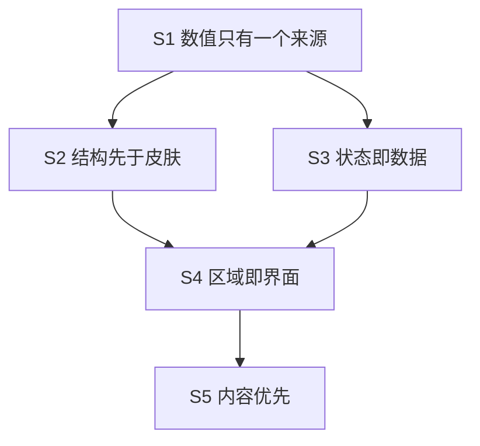

# DESIGN-0004：设计理念与架构不变式

| 版本 | 日期 | 状态 | 作者 | 说明 |
| :--- | :--- | :--- | :--- | :--- |
| 0.1 | 2026-11-20 | 历史 | lukan | 从 120 份设计稿与产品外观、交互需求中提炼七条设计理念，转译为六条架构不变式，并用它裁决现有代码 |
| 0.2 | 2026-11-20 | 草案 | lukan | 按三位独立评审修订：S6 移出列表（属文档纪律），S2、S3、S5 降级为人工清单并逐条登记判定人与复核动作，S1 收窄，S5 的动效口径收窄 |

> 本文是设计文档，不是决策记录：它回答"设计的意图是什么、架构凭什么说某个实现算对"，随设计与实现反馈持续修改。而"基座自建""Libs 恒为四个工程"这类不可逆取舍已由 `docs/adr/lukan/ADR-0008-self-built-base.md` 与 `docs/design/lukan/DESIGN-0003-libs-layering.md` 冻结，本文不重复论证。

## 1 约束与来源

本文的输入只有两类：产品与设计自己写下的文档，以及仓库里已经存在的代码事实。任何一条理念都必须能指回具体文件的具体章节，指不回去的属于我自己的偏好，不收。

| 来源 | 取用什么 |
| :--- | :--- |
| `docs/spec/requirements/product-appearance.md` 0.2 | 第一直觉、桌面而非网页、亮暗同构 |
| `docs/design/lukan/bakeoff-2026-11-20/typography.md` 2.0 | 四档字号、两版同字、层级四要素 |
| `docs/design/lukan/bakeoff-2026-11-20/spacing.md` 1.0 | 4px 基线、六级间距、每个值有名字 |
| `docs/design/lukan/bakeoff-2026-11-20/color-tokens.md` 1.3 | 18 语义色、同构换值、一屏一处当前 |
| `docs/design/lukan/bakeoff-2026-11-20/state-model.md` 0.1 | 五态五通道、叠加优先级、不用开关 |
| `docs/design/lukan/bakeoff-2026-11-20/controls.md` 1.1 | 控件尺寸的 token 落点、不做整行外框 |
| `docs/design/lukan/bakeoff-2026-11-20/main-window-spec.md` 0.1 | 窗口、文档、区域与键盘 |
| `docs/spec/requirements/interaction-requirements.md` 0.1 | 15 条主交互流、就地反馈、命令四入口 |

## 2 设计理念

七条，按"从整体气质到局部手段"排列。

| # | 理念 | 依据 | 落到界面上是什么 |
| :--- | :--- | :--- | :--- |
| P1 | 像被灯照亮的实验台 | 产品外观 §1 | 样本是唯一发光的东西，画布拿走全部注意力；工具栏低对比、无装饰、不抢视线 |
| P2 | 桌面软件，不是网页 | 产品外观 §2.1 | 有窗框、菜单与状态栏；没有路由、没有页面级滚动、没有全屏浮层；界面是区域拼合而不是页面跳转 |
| P3 | 同构换值，只换皮 | 排印 §0.2、颜色 §0.1、外观 §0.2 | 亮 30 与暗 31 的结构、字段、状态逐项相同，切换主题只改值 |
| P4 | 状态是语法，不是装饰 | 状态模型 §0 | 五态五通道是投影规则：当前走沿形线、选中走轴上轨、焦点走下划线、悬停只换底、编辑走光标；换控件不换语法 |
| P5 | 层级靠字号、字重、色层与留白 | 排印 §0.3 | 灰度之后主次仍成立；颜色只做辅助，一屏只有一处"当前" |
| P6 | 就地反馈，不弹窗 | 交互 §1 | 缺校准是画布上一根内联黄条；错误贴着出错的对象出现，不打断手上的操作 |
| P7 | 每个值有名字 | 间距 §0.3 | 任何 padding、字号、颜色、尺寸都能指回 token；找不到名字就是错 |

P7 需要单独说一句，因为它是设计主动交给实现的接口约定而不是审美：设计承诺"组件里不出现裸数值"，这等于把可判定性交给了架构，架构必须接住，否则这条承诺在代码里立刻失效。

## 3 架构不变式

（0.2 修订：三位独立评审指出 S6 属文档纪律而不是系统性质、S2 与 S3 与 S5 当前无法自动判定，故 S6 移出列表，S2、S3、S5 降级为人工清单并登记判定人与自动化时点；S1 收窄为"设计定义的数值只有一个来源"，放行由键组合出的 `Brush` 与 `Thickness`，因为那份 ADR 明确允许壳使用处现场组合。）

| # | 不变式 | 技术含义 | 判定方式 | 违反后果 |
| :--- | :--- | :--- | :--- | :--- |
| S1 | 设计定义的数值只有一个来源 | 颜色、字号、行高、字距、间距、线宽只来自 `Lyre.*` 键；`Brush` 与 `Thickness` 允许由键组合 | 机器：亮暗两字典键集合相等、被引用键都存在（进现有架构测试）；源码字面量扫描推迟到首个屏幕出现 | 设计与实现各说一套，改色要全仓搜 |
| S2 | 结构先于皮肤 | 亮暗是同一棵控件树的两份字典，切主题不重建树、不改布局 | 人工清单（判定人 lukan；自动化时点：首个可切换界面落地后）。当前可用的机器证据只有"两字典键集合相等"，它是前置条件不是充分条件 | 两套界面向两处漂移 |
| S3 | 状态即数据 | 五态由一份状态模型投影到五种通道，控件模板里不写状态分支 | 人工清单：判定人 lukan，复核动作是每态对照 `e-science/states.html` 打勾；自动化时点为五态基座落地后，与 Headless 基线同批 | 同一状态在不同控件上长得不一样 |
| S4 | 区域即界面 | 界面由区域组成，功能向区域附着；没有页面与导航 | 机器：附件只能挂到已声明区域，未声明进诊断 | 插件无处可挂，或挂上去撤不掉 |
| S5 | 内容优先 | 壳与工具不抢画布：不做装饰性动效（解释空间关系的动效按 `docs/spec/requirements/product-requirements.md` §4.3 与 `docs/spec/requirements/product-appearance.md` §6.5 保留）、不做装饰、不为未实现的样式预留属性 | 人工清单：判定人 lukan，复核动作是首个界面上目检画布面积占比并出像素基线，阈值待首个可运行界面再定 | 界面越做越像仪表盘，样本被挤到角落 |

S6 不再列为不变式。它是本文的写作纪律而不是系统属性：每条约定必须写明判定手段，不能自动断言的降级为人工清单并登记判定人与时点。把它混在不变式里，会让人以为它也能被代码检查。

五条里真正能马上被代码守住的是 S1 的键集合部分与 S4；S2、S3、S5 靠清单，S1 的字面量部分靠源码扫描，后者要等有界面可扫才有意义。

S1 是地基，S2 与 S3 建在它上面，S4 决定结构，S5 管取舍。

## 4 用不变式裁决现有代码

| 现状 | 违反 | 裁决 |
| :--- | :--- | :--- |
| `src/Libs/ImageLyre.Themes` 没有任何令牌 | S1 | 最高优先级：地基不存在时，之后写的每个界面都在造字面量 |
| 槽位注册表未实现，仍用沧溟 `SlotManager`（无按所有者摘除） | S4 | 区域机制缺执行机构，"停用插件即撤"无法成立 |
| 菜单附件与槽位附件是两套模型 | S3、S4 | 形态与状态必须统一，否则同一条规则要写两遍 |
| `ICommandRegistry` 保留 `When` 字符串表达式 | 写作纪律（原 S6） | 自造语法不可判定，改委托谓词 |
| 成熟度三级标注（已删） | 写作纪律（原 S6） | 没有判定人与转换机制，标注恒为真 |
| 亮暗若各写一套布局 | S2、S1 | 必须一套 XAML 两套值，否则同构只能靠人盯 |

## 5 边界情况

| 情况 | 处置 |
| :--- | :--- |
| 设计改一个值（例如暗色 `surface.panel` 调深一档） | 只改字典值，键名与结构不动；改完跑键清单与像素基线 |
| 设计要新增一个语义色或一档间距 | 先看能否复用现有键；确需新增时同步改 `color-tokens.md` 或 `spacing.md`，再改 `Themes`，两边不同步判失败 |
| 设计要新增一种视觉手段（例如阴影表达层级） | 按"删减优先"先回答"删掉哪一条"，答不出则不实现；已删的开关与焦点框不因怀旧回补 |
| 设计与不变式冲突 | 设计定值、架构定值怎么落；冲突时先改其中一份文档再改代码，不允许代码里两种口径并存 |
| 某条不变式在当前里程碑无法自动判定 | 降级为人工清单并在本文登记，写明谁判与最晚补自动化的时点 |
| 出现第二个界面宿主（Web 或移动端） | 回到 `docs/design/lukan/DESIGN-0003-libs-layering.md` §4 的同类条款，先拆契约目标框架，再谈界面 |
| 主题资源需要整包替换（换品牌色） | 允许：字典可换、键名不变，因此 S1 与 S2 同时成立 |

## 6 什么条件下这些结论要改

1. 若设计把四档字号放宽到五档以上，S3 的"一态一通道"仍成立，但 S1 的键清单要扩，本文 S1 的判定从"档位白名单"改为"档位来源单一"。
2. 若 AtomUI 提供正式的全局令牌覆盖机制，S1 的映射层可删，但"值只有一个来源"不退让。
3. 若 200% 实测显示线宽补偿或文字清晰度不达标，按 `docs/adr/lukan/ADR-0009-theme-token-landing.md` §5 处理，本文不预设混合方案。
4. 若出现必须支持的网页端，P2 失效，本文与 `docs/spec/requirements/product-appearance.md` 一并重写。

## 7 与既有文档的关系

`docs/spec/requirements/product-appearance.md` 与 `docs/design/lukan/bakeoff-2026-11-20/` 下的六份基线文档定义"值"；本文定义"值怎么落、落成什么样算对"。`docs/design/lukan/DESIGN-0003-libs-layering.md` 定义"代码放在哪个工程"；本文定义"放在里面的东西要满足什么"。两者不重叠：一个管位置，一个管约束。

`docs/adr/lukan/ADR-0008-self-built-base.md` 冻结的"基座自建"在本文中体现为 S5 与写作纪律（原 S6）——不为能力过剩的抽象付费，也不为不可判定的约定背书。

## 8 变更记录

| 版本 | 变更 |
| :--- | :--- |
| 0.1 | 首次成文：七条设计理念（含依据与界面含义）、六条架构不变式（含判定方式与违反后果）、依赖图、对现有代码的六条裁决、七种边界情况、四条失效条件。 |
| 0.2 | 按三位评审修订：S6 移出不变式列表（属文档纪律），S2、S3、S5 降级为人工清单并登记判定人与自动化时点，S1 收窄为"设计定义的数值只有一个来源"并放行由键组合出的 `Brush` 与 `Thickness`；S5 的"不做动效"收窄为"不做装饰性动效"，为解释空间关系的动效留出准入。证据见 `docs/analyses/lukan/2026-11-20_arch-review-loop.md`。 |

## 9 待办

1. S1 的键集合断言与令牌同批写；字面量扫描等首个屏幕出现后再接，之前用人工清单一轮。
2. S2 的自动化时点：首个可切换界面落地后，补"切换前后控件树指纹一致"的断言。
3. S3 的自动化时点：五态基座落地后，随 Headless 基线一起验；期间判定人为 lukan，每态对照 `e-science/states.html`。
4. S5 的像素阈值等首个可运行界面出来再定，现在写数字是编的。
5. `docs/design/lukan/bakeoff-2026-11-20/typography-avalonia.md` 的键形与八档映射需要按 `docs/adr/lukan/ADR-0009-theme-token-landing.md` §2.1 更新，属设计侧参考文件的勘误。
