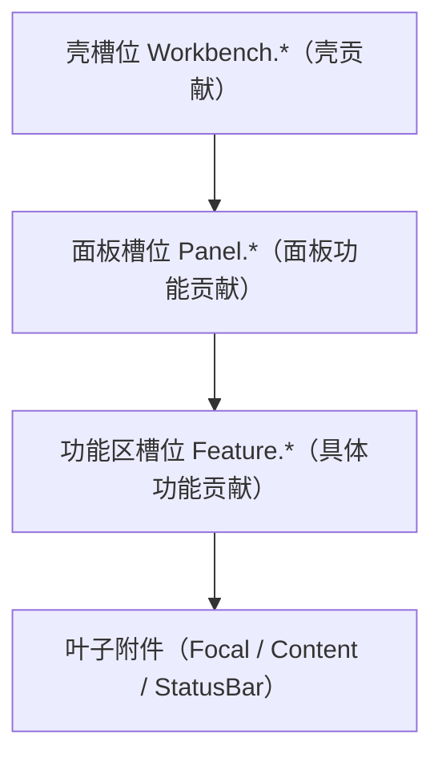

# DESIGN-0005：槽位规划

| 版本 | 日期 | 状态 | 作者 | 说明 |
| :--- | :--- | :--- | :--- | :--- |
| 0.1 | 2026-11-20 | 历史 | lukan | 首版：三层结构、命名、九个位置清单、嵌套规则 |
| 0.2 | 2026-11-20 | 现行 | lukan | 撤回固定清单：槽位是开放能力，壳只给锚点，其余位置由功能自开自用 |

> 本文是设计文档。它回答"界面由哪些位置组成、每个位置谁能占、位置之间怎么嵌套"，不回答"某个功能长什么样"。功能由 Feature 提供，架构只负责把位置规划清楚，让功能一级一级挂下去。

## 1 为什么槽位是架构的事

功能可以无限细化，位置不能。一个功能如果只能整体挂上去，界面就会被切成固定几块；一旦允许功能在自己的位置里再开出子位置，插件化才真正成立：外层功能负责一块区域，内层功能往里填内容，内外彼此不知道对方存在。

因此架构的核心产出不是功能，而是**一张位置表**：谁拥有哪块位置、这块位置允许挂什么形态、子位置由谁开、父位置消失时子位置怎么收。

## 2 三层结构

| 层 | 谁贡献 | 例子 | 停用时的效果 |
| :--- | :--- | :--- | :--- |
| 壳 | 工作台 | `Workbench.Menu`、`Workbench.Content`、`Workbench.StatusBar.Left` | 整个应用起不来 |
| 面板 | 拥有该面板的功能 | `Panel.Right`、`Panel.Right.Dossier`、`Panel.Right.Agent` | 面板连同其子槽位一起消失 |
| 功能 | 具体功能 | `Feature.Agent.Input`、`Feature.History.Toolbar` | 只影响该功能自身 |

三层不是硬编码的深度限制，而是**约定**：任何功能都可以在自己的位置里再开子位置，深度不限。约定存在的理由是排障——三个层级名称前缀就能判断"这个位置是谁开的、停谁会让它消失"。

## 3 命名

沿用 Mercury 的三段式：`<区域>[.<用途>][.<方位>]`，逐段点上推。

| 形状 | 例子 | 说明 |
| :--- | :--- | :--- |
| 壳区域 | `Workbench.Menu` | 固定三段以内 |
| 带方位 | `Workbench.StatusBar.Left` | 方位只允许 Top/Bottom/Left/Right |
| 面板 | `Panel.Right` | 面板名用单数名词 |
| 功能子位 | `Feature.Agent.Input` | 前缀 `Feature.<功能名>`，后面自定 |

槽位名是**唯一真源**，集中在一张常量表里（本仓为 `WorkbenchSlots` 与后续的面板常量类），不散落在功能代码中。重命名只改常量表，靠编译期报错找出全部引用。

## 4 形态与容量

每个槽位声明两件事：允许挂什么形态（`SlotKind`）、能挂几个（`SlotCapacity`）。

| 形态 | 允许的附件 | 典型位置 |
| :--- | :--- | :--- |
| `Menu` | 菜单分类附件 | `Workbench.Menu` |
| `StatusBar` | 状态栏附件 | `Workbench.StatusBar.*` |
| `Content` | 内容附件（控件工厂） | `Workbench.Content`、`Panel.Right.Agent` |
| `Document` | 文档页附件 | `Workbench.Documents` |
| `ToolArea` | 工具窗格附件 | `Panel.Right.Dossier` |

容量只有两档：`Multiple` 与 `Exclusive`。单值槽用于"一屏只能有一个"的位置（当前文档、当前 Agent 面板）；多值槽用于列表式位置。单值槽收到第二个附件时拒绝并记 `CapacityExceeded`，不静默覆盖。

## 5 壳只给锚点，不做清单

0.1 在这里列了九个位置并在壳里预留声明，那是错的：**架构师无法预知未来插件作者想把功能塞到哪里**。位置一旦被固定成清单，插件的落点就要等架构加一行，插件化就退化成"申请位置"。

0.2 的规则是：

1. 壳只贡献**锚点**：Workbench.Menu、Workbench.Content、Workbench.StatusBar。这三个是任何桌面软件都有的，且必须由壳拥有。
2. 其余位置全部由**功能自己开**：功能在自己的 OnStartAsync 里 ContributeSlot，用 <功能名>.<用途> 命名，停止时连同子位置一起收回。
3. 壳不预留、不枚举、不校验"位置是否在清单里"。唯一约束是命名前缀与形态，不是位置集合。

下面这张表只作为**命名与形态的示例**，不是封闭清单，新增位置不需要改本文。

| 槽位 | 形态 | 容量 | 说明 |
| :--- | :--- | :--- | :--- |
| `Workbench.Menu` | Menu | Multiple | 顶层菜单，按标题合并 |
| `Workbench.DocumentTabs` | Content | Multiple | 文档标签条 |
| `Workbench.Content` | Content | Exclusive | 主内容区，一屏一块 |
| `Workbench.StatusBar.Left` | StatusBar | Multiple | 状态栏左侧 |
| `Workbench.StatusBar.Right` | StatusBar | Multiple | 状态栏右侧 |
| `Workbench.StatusBar.Rightmost` | StatusBar | Multiple | 状态栏最右，版本号一类 |
| `Panel.Right` | Content | Exclusive | 右栏容器 |
| `Panel.Right.Dossier` | Content | Exclusive | 右栏的标本档案分区 |
| `Panel.Right.Agent` | Content | Exclusive | 右栏的 Agent 分区 |

右栏两个子位由右栏容器在构建时贡献：谁开容器谁开子位。这样"档案与 Agent 互相切换"就不需要容器认识两者的类型，只需要各自往对应子位附着。

## 6 嵌套的三条硬规则

1. **开位置的人负责收**：容器功能在 `OnStartAsync` 里贡献子槽位，在 `Detach` 时把子位置里的附件一并摘除。父位置消失时子位置不能残留，否则会出现"父面板没了但子附件还在诊断里"的幽灵条目。
2. **子位置不继承父位置的所有者**：子位置里附着的附件归附着者自己所有，父级停用只摘除父级自己的附件，不替子级清理。要清理子级，由子级的拥有者响应自己的停用。
3. **附着到未开的位置不报错**：进入待解析桶，等父级贡献时冲刷；收口时仍未解析的进 `UnresolvedSlot` 诊断。这条宽容是必须的，因为加载顺序不保证父先于子。

## 7 判定

| 判据 | 怎么验 |
| :--- | :--- |
| 位置名有前缀、无清单校验 | 功能自开位置必须带自己的名字前缀；壳不校验位置是否在某个清单里 |
| 形态与附件匹配 | 附着时校验，不符进 `KindMismatch` |
| 单值槽不超员 | 附着时校验，超出进 `CapacityExceeded` |
| 父停用后无残留 | 端到端：停用面板功能，检查其子位置的附件数与诊断同时归零 |
| 预留位置不算空槽 | 声明 `IsReserved` 的槽位不进 `EmptySlot` 诊断 |

## 8 不做什么

不预设业务槽位；不做权限门禁（附件没有权限字段）；不做跨进程槽位；不做槽位的运行期增删 API 对外开放——增删只由拥有者在启动与停止两个时点执行。

## 9 边界情况

| 情况 | 处置 |
| :--- | :--- |
| 两个功能想开同名子位置 | 后贡献者抛异常，名字必须在功能内唯一（前缀已保证） |
| 父位置停用时子位置里还有附件 | 保留附件并记 `AttachedAfterClose`，同时父级诊断报告列出残留 |
| 功能想换自己的子位置结构 | 停用再启用，不允许在运行中改槽位声明 |
| 子位置深度超过三层 | 允许，但名称必须保持三段式前缀可读，否则排障困难 |

## 10 与其它文档的关系

`docs/design/lukan/DESIGN-0003-libs-layering.md` 定义槽位契约放在 `UI.Contracts`、实现在工作台；本文定义这些槽位本身怎么规划。`docs/analyses/lukan/2026-11-20_mercury-guides-digest.md` 记录了 Mercury 槽位指南的读后结论，本文的命名与形态口径与之一致。

## 11 变更记录

| 版本 | 变更 |
| :--- | :--- |
| 0.1 | 首次成文：三层结构、命名、形态与容量、第一批九个槽位、嵌套三条硬规则、五条判定、五条边界情况。 |

## 12 0.2 的教训

把位置写成清单，等于替未来的插件作者决定他们能往哪里塞东西。正确做法是**把开位置的能力交出去**：谁拥有界面区域，谁就有权在自己下面再开位置；壳只保证"锚点存在、命名可追溯、父亡子收"。架构的职责是保证这套机制可靠，不是预言位置。

## 13 嵌套参考实现：面板自己开位置

这是整套设计的核心用法。一个功能插入一块面板，面板在构建时开出若干位置，下一个功能的作者只要知道名字就能往里放内容，两者互不认识。

`csharp
// 面板功能：开位置、摆渲染器、把子位置公开出去
public sealed class DossierPanelFeature : BasePicoFeatures
{
    public const string PanelSlot = "Dossier.Panel";          // 我往壳的内容区占一块
    public const string SummarySlot = "Dossier.Panel.Summary"; // 我开给别人的位置
    public const string DetailSlot = "Dossier.Panel.Detail";

    public override void RegisterAttachments(IAttachmentRegistry registry)
    {
        registry.AttachToSlot(WorkbenchSlots.Content, new ContentAttachment
        {
            Create = () => BuildPanel(registry),
        });
    }

    private Control BuildPanel(IAttachmentRegistry registry)
    {
        registry.ContributeSlot(new SlotDescriptor(SummarySlot, SlotKind.Content, SlotCapacity.Exclusive, "摘要", IsReserved: true));
        registry.ContributeSlot(new SlotDescriptor(DetailSlot, SlotKind.Content, SlotCapacity.Multiple, "明细", IsReserved: true));

        return new StackPanel
        {
            Children =
            {
                SlotHost.For(SummarySlot),   // 每个子位置一个宿主控件
                SlotHost.For(DetailSlot),
            },
        };
    }
}
`

`csharp
// 外部功能：只要知道名字，无需引用面板功能的程序集
public sealed class CalibrationDetailFeature : BasePicoFeatures
{
    public override void RegisterAttachments(IAttachmentRegistry registry) =>
        registry.AttachToSlot("Dossier.Panel.Detail", new ContentAttachment { Create = BuildCalibrationBlock });
}
`

要点逐条：

| 要点 | 原因 |
| :--- | :--- |
| 子位置在**构建面板时**贡献，不是启动时 | 位置的生命与面板同寿；面板没被渲染时子位置不存在，附着进待解析桶 |
| 子位置一律 IsReserved: true | 位置开出来是给未来用的，当下空是正常状态，不该进空槽诊断 |
| 名称用 面板名.分区 前缀 | 排障时一眼看出归属；两个面板不会撞名 |
| 外部功能只用字符串，不引用对方程序集 | 这是解耦的关键：插入不需要编译期依赖，只需要名字契约 |
| 面板停止时要连带摘除子位置 | 父亡子收；子位置里的附件由附着者自己响应停用，面板不替它清 |

**发现机制**：位置是开放的，但名字必须可被发现。三条渠道：面板功能把自己开的位置常量公开（public const string），第二是写进接入指南，第三是插件中心的自检窗口按槽位名列出当前所有位置与附件来源。没有这三条，开放会变成"谁也找不到谁"。

