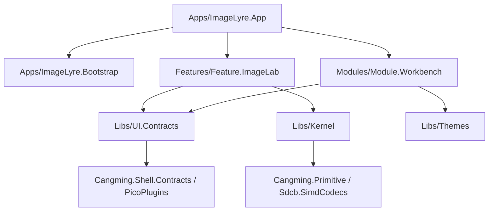

# DESIGN-0006：重建蓝图（沧溟基座 + 产品内核）

| 版本 | 日期 | 状态 | 作者 | 说明 |
| :--- | :--- | :--- | :--- | :--- |
| 0.1 | 2026-11-21 | 草案 | lukan | 按 ADR-0011 重建应用层：工程落点、依赖规则、装配顺序、沧溟缺口落点与 M1 内核契约；取代 DESIGN-0002、DESIGN-0003、DESIGN-0005 |
| 0.2 | 2026-11-21 | 草案 | lukan | 按独立可执行性评审修订：补齐内核成员签名与 CSV 口径，修正槽位写入口、菜单登记时序、迁移工程数与中央包表，R2 给出可写门禁的判据边界 |
| 0.3 | 2026-11-21 | 草案 | lukan | 按独立基线一致性评审修订：补 R8、六槽位映射与首方 Feature 的 UI 边界，登记 CLI、沙箱、sidecar 等分期项指向 `docs/adr/lukan/ADR-0012-m1-baseline-applicability.md`，`TiffImageCodec` 明确为 SimdCodecs 适配器 |

## 1 约束

本次设计受四条硬约束支配，任何一条被违反时先改本文再改实现：其一，基座能力只从沧溟包取，应用侧只补沧溟缺失的实现，且补的是沧溟的接口（ADR-0011 §2）；其二，M1 的验收对象是产品内核与一条可对照的分析链路，界面与插件生态只要够用；其三，技术栈固定为 .NET 10、AtomUI 6.2.15、Avalonia 12.1.6、SkiaSharp 3.119.4（由 `Avalonia.Skia` 12.1.6 的传递依赖决定）、沧溟统一钉 0.1.8.1117；其四，测量口径以 `docs/spec/requirements/measurement-baseline.md` 为唯一真源，本文只把它的条款翻译成类型与函数，不复述判定值。

## 2 结构设计

### 2.1 工程落点

重建后只保留九个工程，工程数从 21 降到 9 的理由是每个工程必须对应一个不可合并的职责（进程、无界面装配、契约词汇、内核、插件单元、资源、测试），而不是对应一次分类冲动：

| 工程 | 类型 | 职责 | 引用（Project → Package） |
| :--- | :--- | :--- | :--- |
| `src/Apps/ImageLyre.App` | WinExe | 进程入口、Avalonia 启动、三步主窗口编排、反序收尾、注册 `IAtomUIThemeService` | → Bootstrap、Workbench、ImageLab；Avalonia 12.1.6、Avalonia.Desktop、AtomUI.Desktop.Controls、`Cangming.Toolkit.Avalonias.AtomUI`、`Cangming.Shell`、`Cangming.Platform`、`Cangming.PicoPlugins.Avalonias` |
| `src/Apps/ImageLyre.Bootstrap` | 类库 | 无界面 Host 装配：日志、异常通道、插件前缀、`Launch`、托管服务 | → 无；`Microsoft.Extensions.Hosting`、NLog、`Cangming.Logs`、`Cangming.Logs.NLog`、`Cangming.PicoPlugins`、`Cangming.Shell`、`Cangming.Platform` |
| `src/Libs/ImageLyre.Kernel` | 类库 | 图像容器、校准、ROI 几何、测量、CSV、TIFF 编解码 | `Sdcb.SimdCodecs` 2.0.0、`Cangming.Primitive` |
| `src/Libs/ImageLyre.UI.Contracts` | 类库 | 壳契约 `IWorkbenchShell`、槽位名常量、菜单项实现 | Avalonia 12.1.6、`Cangming.Shell.Contracts`、`Cangming.PicoPlugins` |
| `src/Libs/ImageLyre.Themes` | 资源库 | AtomUI 令牌、控件样式、亮暗两套字典 | AtomUI.Desktop.Controls |
| `src/Modules/ImageLyre.Module.Workbench` | 插件 | 唯一创建窗口的模块：槽位拓扑、菜单渲染、状态栏、忙遮罩 | → UI.Contracts、Themes；Avalonia、AtomUI、`Cangming.PicoPlugins`、`Cangming.PicoPlugins.Avalonias`、`Cangming.Shell.Contracts` |
| `src/Features/ImageLyre.Feature.ImageLab` | 插件 | M1 产品切片：打开、视口、ROI、测量、结果表、CSV | → Kernel、UI.Contracts；Avalonia、AtomUI、SkiaSharp、`Cangming.PicoPlugins`、`Cangming.Shell.Contracts` |
| `tests/ImageLyre.Kernel.Tests` | 测试 | 内核单测：容器、校准、ROI 几何、测量口径、CSV | → Kernel；xUnit 2.9.3 |
| `tests/ImageLyre.Architecture.Tests` | 测试 | 依赖规则与唯一真源的门禁（R1 至 R7） | Mono.Cecil 0.11.6、xUnit 2.9.3 |

依赖方向是一条向下的链：`App → {Bootstrap, Workbench, ImageLab} → {UI.Contracts, Kernel, Themes} → 沧溟包`；`Workbench` 与 `ImageLab` 互不引用，二者只在运行时经 `IWorkbenchShell` 与槽位名耦合，这正是 R3 要守的那条线。

九工程不含 CLI 与独立的编解码工程，这是 M1 分期而非长期形态：`docs/adr/lukan/ADR-0006-cli-headless-entry.md` 仍然有效，M2 建 `ImageLyre.Cli` 时直接复用无 UI 依赖的 `ImageLyre.Kernel`；编解码在 M1 以 `IImageCodec` 加 SimdCodecs 适配器落在 Kernel 内，厂商格式进沙箱时再按 M2 的沙箱设计拆出独立程序集。基线 §6.3 的六个能力槽位（IO、View、Operator、Measure、Script、System）与本文 §3.2 的两个界面槽位不在同一层：前者是插件能力与依赖边界，M1 由 `ImageLab` 一个首方 Feature 覆盖 IO、View、Measure 三条，内部以 `IO/`、`View/`、`Measure/` 命名空间隔离，M2 按这三个命名空间拆分；后者是沧溟 `ISlotManager` 的界面附着点。首方 Feature 允许引用 Avalonia 与 AtomUI，第三方插件一律走六槽位与沙箱、不得持有控件，这条边界的判据与依据登记在 `docs/adr/lukan/ADR-0012-m1-baseline-applicability.md` §2 决策 3 与决策 4。



### 2.2 依赖规则

规则以测试实现，红牌即阻断合并；每条都对应一次已经发生过的失败，不是预防性洁癖：

| 编号 | 规则 | 判定方式 | 对应失败 |
| :--- | :--- | :--- | :--- |
| R1 | `ImageLyre.Kernel` 不得引用 Avalonia、AtomUI、SkiaSharp 与任何 `Cangming.*.Avalonias` 包 | 读 `Kernel` 程序集的引用清单（Mono.Cecil） | 内核必须能在无界面进程与单测中运行（基线 §3.4） |
| R2 | 本仓任何程序集的公开类型简单名，不得与输出目录中任一 `Cangming.*.dll` 的公开类型简单名相同 | Cecil 扫描 `src` 全部产物 vs `bin` 下 `Cangming.*.dll`；扫描集为空时测试失败，防规则空过 | 44 个同名契约导致的双真源 |
| R3 | `Feature.*` 不得引用其他 `Feature.*` 或任何 `Module.*` 实现工程 | 读 csproj 的 `ProjectReference` | Mercury 指南点名的反模式：跨 Feature 反引 |
| R4 | 只有 `ImageLyre.Module.Workbench` 可以创建 `Window`；`App` 只调用壳契约 | 对 `App` 程序集扫描 `new Window`/`Window` 构造调用 | 启动期建控件导致的时序崩溃 |
| R5 | 槽位名只能来自 `ImageLyreSlots` 常量表 | 源码扫描字符串字面量 `ImageLyre.Workbench.*` 出现在常量表之外 | 槽位声明/附着/宿主三处不一致 |
| R6 | 所有包版本只写在 `Directory.Packages.props`，`src` 与 `tests` 下工程不得内联 `Version=`；沧溟全套同一版本线 | 解析 csproj 与中央表 | 版本漂移与半套主题 |
| R7 | 唯一构建入口 `src/ImageLyre.slnx`，且其中登记的工程必须存在 | 读 slnx、比对磁盘 | 旧方案并存的构建歧义 |
| R8 | `AddCangmingShellDefaults` 与 `AddCangmingPlatformDefaults` 已注册的能力，不得出现自建实现（判决：`src` 下除 Workbench 与 ImageLab 外，不得出现实现 `IBusyManager`、`ICommandRegistry`、`IContextKeyService`、`IKeybindingMap`、`INotificationCenter`、`IOutputChannelManager`、`IMostRecentlyUsedDocuments`、`IUserStateMemory`、`IPreferencesManager`、`IExternalChangeNotifier`、`IBackgroundTaskManager` 的类型） | Cecil 扫描 `src` 全部类型实现的接口集合 | 八个服务模块的重造 |

R2 的边界写死在这里，避免实现时各自解释：比较键是公开类型的**简单名**而不是全名，因为同名不同命名空间正是本仓已经犯过的错；扫描面是输出目录里实际被引用的 `Cangming.*.dll`（`Cangming.Shell.Contracts`、`Cangming.Platform.Contracts`、`Cangming.PicoPlugins`、`Cangming.PicoPlugins.Avalonias`、`Cangming.Shell`、`Cangming.Platform`、`Cangming.Primitive`、`Cangming.Toolkit`），不是"测试进程碰巧加载了什么"；`internal` 类型不在扫描面内，因为同名 `internal` 不构成对外歧义。

### 2.3 启动装配顺序

装配顺序由三条硬时序决定：日志必须先于任何插件类型的静态字段初始化，否则早期诊断永久丢失；控件必须在 Avalonia 启动之后创建，因此窗口由插件产出、编排推迟到 `OnFrameworkInitializationCompleted`；菜单由 Feature 在附着阶段登记，而附着发生在建窗之后，因此壳必须支持"建窗后追加菜单"。

```mermaid
flowchart LR
    A["UnhandledExceptionProcessor.Setup"] --> B["Host.CreateDefaultBuilder + LogHub 初始化"]
    B --> C["AddCangmingPlatformDefaults / AddCangmingShellDefaults / AddAtomUIThemeService"]
    C --> D["插件前缀 + PicoPluginSystem.Launch(services)"]
    D --> E["HostedService：NotifyServiceProviderBuilt + StartAsync"]
    E --> F["BuildAvaloniaApp().UseCangmingAtomUI()"]
    F --> G["InjectSlotManager + 壳模块 CreateShell"]
    G --> H["RegisterFeatureAttachments（含菜单登记）"]
    H --> I["窗口显示"]
    I --> J["反序收尾：Task.Run 中 StopAsync + Dispose"]
```



主窗口编排三步的顺序不能交换，第一步注入槽位管理器是因为壳模块的上下文只保存延迟引用，第二步由壳模块建窗口并贡献槽位，第三步才是 Feature 附着：

```csharp
ISlotManager slots = pluginManager.InjectSlotManager<SlotManager>();
IWorkbenchShell shell = pluginManager.FindModuleBuilder<IWorkbenchShell>()?.Build().Value
                        ?? throw new InvalidOperationException("工作台模块缺席：宿主必须引用它，否则 dll 不在输出目录。");
Window window = shell.CreateShell();
pluginManager.RegisterFeatureAttachments(slots);
```

`UnhandledExceptionProcessor` 与 `PluginManagerHostedService` 沧溟没有提供，两者在重建时重写而不是从旧分支搬：前者只需挂 `AppDomain.UnhandledException` 与 `TaskScheduler.UnobservedTaskException` 并写 `LogHub`（约 40 行），后者必须保留 `NotifyServiceProviderBuilt` 先于 `StartAsync` 这条顺序（约 50 行）。

## 3 接口契约

### 3.1 壳契约

`IWorkbenchShell` 是本仓自有契约（沧溟只提供样例，不提供该接口），放在 `ImageLyre.UI.Contracts`，参照 Studio 的 `Studio.Shell.Avalonias/IWorkbenchShell.cs` 但多两项菜单能力；它只暴露建窗、改标题、登记菜单，不暴露槽位管理器与控件树，原因是一旦把 `ISlotManager` 交给 Feature，Feature 就会绕过依赖声明做跨模块定位：

```csharp
public interface IWorkbenchShell
{
    Window CreateShell();
    void SetTitle(string title);
    void RegisterMenu(IMenuItem item);
}
```

菜单登记允许发生在建窗之前或之后：建窗前的登记进缓冲表，建窗时一次渲染；建窗后的登记追加到缓冲表并触发菜单重建。M1 菜单项不超过二十个，重建成本可忽略；等菜单项上百再改成按容器增量维护，这一条与 `docs/design/lukan/DESIGN-0002-cangming-engineering-base.md` §3.3 的结论一致，只是实现位置从槽位附件换成壳的直接登记。

`IMenuItem` 取沧溟 `Cangming.Shell.Contracts.Commands.IMenuItem`，本仓在 `UI.Contracts` 提供唯一的实现类 `MenuItemDefinition`（`Header`、`Order`、`Group`、`Execute`、`CanExecute`、`Children`），不另造接口。该契约标 `Experimental`，其文档写着"禁止新代码依赖"，因此 M1 把它当作**可撤销依赖**处理：只使用六个成员，不碰 `Observe*` 流与 `CommandId`，把使用面收敛到 `MenuItemDefinition` 一个文件，升级或撤回时只改这一处；这条依赖的取舍与撤销条件登记在 `docs/adr/lukan/ADR-0011-base-adoption-rebuild.md` §4 与 `docs/adr/lukan/ADR-0012-m1-baseline-applicability.md` §5。

### 3.2 槽位与区域

M1 只有两个槽位，由壳在建窗时一次性贡献，名字集中在 `ImageLyreSlots`：

| 槽位 | 用途 | 附着物 |
| :--- | :--- | :--- |
| `ImageLyre.Workbench.Content` | 主内容区，单值语义 | 沧溟 `ContentAttachment(Control)` |
| `ImageLyre.Workbench.StatusBar` | 状态栏文本段 | 沧溟 `StatusBarAttachment(Text, ToolTip)` |

**写入口必须拿 `IAttachmentRegistry` 而不是 `ISlotManager`**：后者只读（`GetAllSlots`/`GetSlotContents`/`TryGetSlot`/`RefreshSlot`），贡献与附着在 `IAttachmentRegistry` 上。因此 `Workbench` 模块实现 `ISupportSlotManager` 接住 `Lazy<ISlotManager>`，在 `CreateShell` 内 `(IAttachmentRegistry)slots` 后调用 `ContributeSlot`，并用一个 `_created` 标志保证只贡献一次（重复贡献抛 `InvalidOperationException`）：

```csharp
public sealed class WorkbenchModule : BasePicoModule<IWorkbenchShell>, ISupportSlotManager
{
    private readonly Lazy<ISlotManager> _slots;   // 由 InjectAsync 注入
    public Task<IPicoPlugin> InjectAsync(Lazy<ISlotManager> slots) { ... }

    public override Lazy<IWorkbenchShell> Build(params object[] args) =>
        _shell ??= new Lazy<IWorkbenchShell>(() => new WorkbenchShellService(_slots));
}
```

内容区用沧溟 `SlotPanel` 直接渲染，不写 `SlotHost`；沧溟没有 detach API 这条缺口在 M1 不补，因为 M1 不启停插件，等插件中心开工时以装饰器形式实现 `ISlotManager` 并另开设计。

### 3.3 内核契约

内核是产品资产，按"像素、校准、选区、测量、编解码、导出"六组给最小可用签名，全部无 UI 依赖、可在单测中构造；这些签名是编码者的起点而不是终点，但改它们要同步改调用方：

```csharp
namespace ImageLyre.Kernel;

public enum PixelType { UInt8, UInt16, Float32 }

public readonly record struct PlaneIndex(int Channel, int Z = 0, int T = 0);

public sealed class ImageContainer
{
    public int Width { get; }
    public int Height { get; }
    public int ChannelCount { get; }
    public int ZCount { get; }
    public int TCount { get; }
    public PixelType PixelType { get; }
    public ImageMetadata Metadata { get; }
    public Calibration Calibration { get; }
    public PixelPlane GetPlane(PlaneIndex index);   // 越界抛 ArgumentOutOfRangeException
}

public readonly record struct PixelPlane(int Width, int Height, PixelType PixelType, ReadOnlyMemory<byte> Pixels)
{
    public double GetDouble(int x, int y);          // 像素中心整数坐标；NaN 原样返回
    public ReadOnlySpan<byte> GetRow(int y);
}
```

```csharp
public sealed record Calibration(string Unit, double PixelSizeX, double PixelSizeY, double PixelSizeZ = 1.0)
{
    public static Calibration Uncalibrated { get; }  // Unit = "pixel"，三个尺寸均为 1
    public bool IsCalibrated { get; }                // Unit 非 "pixel" 且尺寸大于 0
    public double ToPhysicalLength(double pixels);
    public double ToPhysicalArea(double pixelArea);
}
```

```csharp
public enum RoiKind { Rectangle, Ellipse, Polygon, Freehand, Line, Point }

public abstract class Roi
{
    public abstract RoiKind Kind { get; }
    public abstract RectI Bounds { get; }
    public abstract bool Contains(double x, double y);
    public abstract double GetArea(Calibration calibration);
    public abstract double GetPerimeter(Calibration calibration);
    public abstract Roi Translate(double dx, double dy);
}

public sealed class RectangleRoi : Roi { public RectangleRoi(RectI bounds); }
public sealed class PolygonRoi : Roi
{
    public IReadOnlyList<PointD> Vertices { get; }
    public void MoveVertex(int index, PointD position);
}
```

坐标约定写死在这里，因为它是与 ImageJ 对照的第一枚钉子：像素 `(x, y)` 的中心坐标为整数 `(x, y)`，矩形面积按 `Width × Height` 个像素计，多边形面积按顶点鞋带公式计、周长按相邻顶点欧氏距离含闭合段；空选区（顶点数小于 3 或宽高为 0）由 `MeasurementEngine` 判为无效并返回空行，不抛异常。

```csharp
public static class MeasurementEngine
{
    public static MeasurementRow Measure(
        PixelPlane plane, Roi roi, Calibration calibration, MeasurementOptions options);
}
```

`MeasurementRow` 以列枚举为键，值可空（NaN 或未计算列为空），并带 `ValidPixelCount`；`MeasurementOptions` 持有列集合，M1a 只产出 `Area`、`Mean`、`StdDev`、`Min`、`Max`、`Perimeter` 六列，其余十一列（`IntDen`、`Median`、`Skew`、`Kurt`、`X`、`Y`、`Feret`、`FeretAngle`、`MinFeret`、`Circ.`、`N`）在枚举里保留、在 M1b 补齐。

CSV 的口径直接引基线而不另立：列名与列序取 `docs/spec/requirements/measurement-baseline.md` §3，M1a 输出六列并按列名与 fixture 逐列比对，未实现的十一列既不输出也不改名，因此"不得删列"约束的是选项集而非首版输出集；格式按基线 §7，即 UTF-8 无 BOM、逗号分隔、LF、小数点固定为 `.`、NaN 写空值。

```csharp
public interface IImageCodec
{
    bool CanDecode(ReadOnlySpan<byte> header);
    ImageContainer Decode(Stream stream, CancellationToken cancellationToken);
}

public sealed class TiffImageCodec : IImageCodec { }   // Sdcb.SimdCodecs 2.0.0
```

解码异常收敛为三个类型（`UnsupportedFormatException`、`ImageDecodeException`、`ImageTooLargeException`），调用方只按这三个分支处理，不按底层异常类型分支；`TiffImageCodec` 负责把 TIFF 的 `XResolution`/`YResolution`/`ResolutionUnit` 与 ImageJ `ImageDescription` 中的 scale 映射为 `Calibration`，两者冲突时以 ImageJ 描述为准并记一条警告。

`TiffImageCodec` 不是第三套解码器，而是基线固定的 SimdCodecs 实现的 `IImageCodec` 适配器：基线 §3.2 把编解码限定为 SimdCodecs 与 BioFormats 两套，因此这里只允许包装 SimdCodecs，不允许自行写 TIFF 解析器；BioFormats 作为内置插件随 M2 的沙箱一起落地，M1 不引入。

CSV 之外的 sidecar 由 PRD CORE-07 要求，M1a 不做，偏差与解除条件登记在 `docs/adr/lukan/ADR-0012-m1-baseline-applicability.md` 的偏差表第 6 条；M1a 的产物只有 CSV 六列与界面内结果表，两者共用同一份 `MeasurementRow`，不各自计算。

### 3.4 沧溟缺口的落点

以下七项沧溟只有契约、只有 `internal` 实现或干脆没有，重建时必须给出显式落点：

| 缺口 | 沧溟现状 | 本仓落点 | 是否实现沧溟契约 | 替换或复核里程碑 |
| :--- | :--- | :--- | :--- | :--- |
| 菜单 | `IMenuService` 仅契约 | 壳持有 `IMenuItem` 缓冲并渲染，不实现服务 | 否，临时机制 | M2 需要外部插件动态菜单时实现 `IMenuService`，壳改为转发 |
| 文档管理 | `IDocumentManager` 实现为 `internal`，外部不可注册 | M1 单文档，`ImageLab` 内部持有当前容器 | 否，临时机制 | M1b 多文档时实现 `IDocumentManager` 或向上游申请公开实现 |
| 热键分发 | `IHotkeyManager` 仅契约 | M1 用 Avalonia `KeyBindings` 直接绑命令 | 否，临时机制 | M1b 引入快捷键表时实现 `IHotkeyManager` |
| 主题 | Shell `IThemeManager` 无实现；Avalonia 侧 `IAtomUIThemeService` 不在 `AddCangming*Defaults` 内 | App 显式注册 `AtomUIThemeService`，资源取 `Themes` | 是，用 AtomUI 契约 | M2 主题切换界面开工时重开 ADR（见 `docs/adr/lukan/ADR-0012-m1-baseline-applicability.md` §5） |
| 通知呈现 | `INotificationService` 仅契约，`INotificationCenter` 有实现 | M1 只用状态栏与忙遮罩 | 否，临时机制 | M2 通知中心界面开工时实现 `INotificationService` |
| 偏好持久化 | `InMemoryPreferencesManager` 不落盘 | M1 不持久化 | 是，复用沧溟实现 | M2 需要记忆窗口与最近文件时补落盘委托 |
| 宿主异常通道 | 无 `UnhandledExceptionProcessor` | `Bootstrap` 重写 40 行并通过 `IGlobalExceptionHandler` 上报 | 是，用平台契约 | 无替换计划，属应用职责 |

## 4 不作为范围

M1 明确不做以下八项，理由是把它们提前会重演"外壳先行、内核缺位"的失败：插件中心与外部插件发现、`.plugindesc` 与菜单附件体系、沙箱与厂商格式解码、主题切换界面、本地化、偏好落盘、工作区与数据引擎、ImageJ `.roi`/`.zip` 互操作（M1b 随 ROI Manager 一起做）。触发条件写明：外部插件在第二个产品 Feature 出现且需要第三方扩展时启动（M2）；沙箱在首个厂商格式需求出现时启动（M2）；`.roi` 互操作在 ROI Manager 落地时启动（M1b）。

M1a 的 ImageJ 操作对照只覆盖"打开、缩放与适应窗口、矩形与多边形绘制、顶点拖动、测量、CSV 导出"六步，菜单层级、工具栏分组、完整快捷键表与 ROI 手势细节均按最小集实现，偏差项与替代路径登记在 `docs/adr/lukan/ADR-0012-m1-baseline-applicability.md` 的偏差表第 6 条，M1b 结束时补齐偏差表并交产品经理确认。

## 5 边界情况

| 情况 | 处置 |
| :--- | :--- |
| 图像无校准信息 | 以像素为单位测量并在状态栏标注"未校准"，不弹错、不阻断分析 |
| TIFF 元数据损坏或缺失 | 解码继续，缺失项记日志并按默认值降级，测量行标注来源不可靠 |
| 图像超过 16384 像素边长 | 抛 `ImageTooLargeException` 并由界面提示拒绝打开，不降采样，避免预览像素进入测量（基线 §10.2） |
| 打开失败 | 经 `IGlobalExceptionHandler` 记录并用状态栏提示，进程不退出 |
| 关窗不退出 | 收尾在 `Task.Run` 中执行，主动离开 Avalonia 同步上下文 |
| Feature 附着失败 | 沧溟只记日志并继续（`FeatureAttachmentExtensions` 吞单个异常），因此启动汇总里必须打印"已附着 N 个 Feature"，缺项时能从数字看出来 |
| 插件缺 `[Plugin]` 特性 | 扫描不到且无报错，壳模块缺席时启动即抛并给出"宿主必须引用"的提示 |

## 6 验收

M1a 的验收按可判定条款列出，每一条都给出判定载体：

1. `dotnet build src/ImageLyre.slnx` 零警告零错误（`TreatWarningsAsErrors` 已开）。
2. 内核单测覆盖八类用例并逐条命名：校准换算（有校准/无校准/各向异性）、矩形面积与周长、多边形鞋带面积、空选区返回空行、NaN 像素不计入均值与 N、样本标准差、CSV 六列表头与格式、越界 `PlaneIndex` 抛异常。
3. 架构测试 R1 至 R7 全绿，且对 R2 与 R5 各做一次改坏验证：临时在 `UI.Contracts` 里加一个 `ContentAttachment` 类应使 R2 变红，在 `ImageLab` 里写槽位字面量应使 R5 变红，恢复后转绿。
4. 用一张带校准的 ImageJ TIFF 走完"打开 → 缩放 → 矩形 → 多边形 → 测量 → 导出"，CSV 与 fixture 的六列表头逐字一致、数值满足基线 §6 的 A/B/C 类容差。
5. 黄金数据集 v0.1 至少 6 张图 × 每图 6 个 ROI（合计 36 个）完成对照，差异清单与裁决结论写入验证记录。
6. ImageJ 操作对照按 §4 的六步最小集执行，偏差项逐条登记并给出替代路径，登记表与 `docs/adr/lukan/ADR-0012-m1-baseline-applicability.md` 的偏差表第 6 条互相引用。

第 4、5 条的前置条件是 ImageJ fixture 与黄金数据集入库（`docs/spec/m1/M1-imagej-fixture.md` 当前状态为"待执行"，`tests/fixtures/` 仅有 README）；前置未完成前，第 4、5 条判定为"未执行"而不是"通过"。

## 7 迁移

重建以分支方式落地：从 `dev` 切 `lukan/dev/rebuild`，先在旧分支打标签 `archive/pre-rebuild-2026-11-21` 保留可追溯状态，再在重建分支上执行下列五步：

1. `git rm -r src tests/fixtures/README.md` 覆盖 18 个 `src` 工程与 2 个测试工程；`tools/Screenshot` 一并删除（它引用旧 `ImageLyre.Themes`，且截图基线要等新界面稳定后重做）。
2. 重写 `src/ImageLyre.slnx` 为九个新工程，`Directory.Build.props` 保留 `TreatWarningsAsErrors`/`Nullable`/`net10.0`，删除指向 DESIGN-0002 的注释。
3. `Directory.Packages.props` 增补 `Sdcb.SimdCodecs` 2.0.0、`SkiaSharp` 3.119.4、`Mono.Cecil` 0.11.6，沧溟全套保持 0.1.8.1117，Avalonia 12.1.6 与 AtomUI 6.2.15 不动。
4. 按 §2.1 建工程与 §2.3 接线，先到"空窗口 + 菜单 + 两个槽位"冒烟，再写内核。
5. `docs/` 一份不动，ADR-0008 与 DESIGN-0002、DESIGN-0003、DESIGN-0005 在原路径首部补退役登记块，不搬目录，原因是这四份被历史日志、PM 评审与 ADR-0009 大量引用，搬动会在同一次提交里制造十余处死链，而 ADR 的替代本身要求"两份文件互相登记"而非移动。

## 8 变更记录

| 版本 | 变更 |
| :--- | :--- |
| 0.1 | 首版：按 ADR-0011 给出九工程落点、七条依赖规则、启动装配顺序、壳与内核契约、六项缺口落点与 M1 验收条款 |
| 0.2 | 补内核六组签名与坐标约定、CSV 六列口径、槽位 `IAttachmentRegistry` 写入口、菜单缓冲与重建语义、R2 的扫描面与比较键、迁移的五步与工程实数（18 + 2 + 1）、`IAtomUIThemeService` 与 AtomUI 包的归属、`UnhandledExceptionProcessor` 重写、`.roi` 列入不作为范围 |
