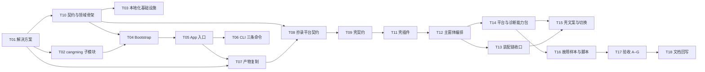

# PLAN-0001：M1 插件骨架实施

| 版本 | 日期 | 状态 | 作者 | 说明 |
| :--- | :--- | :--- | :--- | :--- |
| 0.1 | 2026-11-23 | 待评审 | lukan | M1 骨架的批次、任务、依赖、验收与风险；上游为 ADR-0001（Accepted）与 DESIGN-0001 0.9 |
| 0.2 | 2026-11-23 | 待评审 | lukan | 按 DESIGN-0001 0.10 订正依赖：契约与领域骨架前移到 B1（T10 改挂 B1 并缩为骨架，T08 缩为 Demo 命名空间），T03、T04 补前置 T10；构建入口定址 `src/ImageLyre.slnx`；三条顺序约束改写为只约束插件契约 |
| 0.3 | 2026-11-23 | 待评审 | lukan | 处置独立评审的 4 条阻断与 6 条应改：T04 判据去掉 B1 不存在的 Feature 实证并移到 F/T16，T05 补 T03，T09 拆出附着物词汇工程，T11/T12 改按 `ISupportSlotManager` 与同一本地化实例验收，T14 收下 Feature 文案源、T15 提前到 T13 之后，T03 补测试入解决方案与 `dotnet test`，§5 改按 C→D→B→A 顺序并补恢复列与解决方案条目增删，§7 按十二工程与示范工程生命周期改口径 |
| 0.4 | 2026-11-23 | 待评审 | lukan | 作者口径替换示范契约：T08 改为取 cangming 的 `IPlatformCapabilities` 与 `IPerformanceMonitor`，T14 改为 `Module.Platform`、`Module.Performance`、`Feature.Diagnostics` 三个插件并落 `Require`/`After` 链，故障样本改名 `Module.Broken`；A/C/D 验收、依赖图与交付物同步 |
| 0.5 | 2026-11-23 | 待评审 | lukan | 作者口径改「引用」为「抄录」：T08 把两个契约的源码落进 `ImageLyre.Contracts`，不引用 `Cangming.Platform.Contracts` 包，本仓可独立演进；构建入口与验收判据不变 |
| 0.6 | 2026-11-23 | 待评审 | lukan | T11 落地后订正两处：壳文案资源化与 `ILocalizationSource` 归 T15（T11 不实现），插件依赖改为经 `src/Plugins/Directory.Build.props` 与根 `PluginOutputMerge.targets` 归并，不再给 App 按名加插件依赖 |

## 1 目标与完成定义

M1 的目标是把 ADR-0001 的三条判定落到可运行的骨架上：机制层没有产品词、空壳能启动、新增能力只动一个能力包；同时把双宿主、多语言、三端同构三条原则做成基础支持，而不是等到后面补。完成定义不是“代码能跑”，而是下面五条同时成立：四个任务批次、十八个任务全部收口；第七节 A–G 逐条通过并留下提交号与日志摘录；构建入口写回 `AGENTS.md` §4；每个工程带 README 且被检查脚本覆盖；检查脚本进仓库并可重复执行。

本计划只覆盖机制，不覆盖任何产品能力；图像、ROI、测量、文档、设置一律不在 M1 内，违反即视为范围失控，需先修改本计划再动代码。

## 2 前置条件

1. 工具链：.NET 10 SDK、Git（含子模块）、PowerShell 7；Avalonia 与 AtomUI 的具体版本在 T01 选定并写进 `Directory.Packages.props`，选定后整批锁定，升级须成对回归。
2. 上游文档：`docs/adr/lukan/ADR-0001-插件机制架构基线.md`（Accepted，正文冻结）、`docs/design/lukan/DESIGN-0001-M1-插件骨架.md` 0.11、`docs/spec/baseline/startup-requirements.md` 2.2、`docs/spec/m1/M1-interaction-spec.md` §2。
3. cangming：只读子模块锁定 tag `v0.1.9.1122`，不修改其源码；M1 只使用该版本的 v1 槽位契约。
4. 仓库：`src/` 与 `tests/` 只有 README、无工程，允许新建；`docs/` 的分类与命名规则已生效；提交信息用中文并带 scoped 前缀。

## 3 批次与任务

四个批次之间是串行门禁：上一批的完成判据未通过，不开始下一批。批次内部允许并行，但 T01、T07、T12 三个关键任务各自独占一个完成点。任务编号按写作顺序排，不随批次移动，判定批次只看下表“批次”列。

| 任务 | 批次 | 前置 | 产出 | 完成判据 |
| :--- | :--- | :--- | :--- | :--- |
| T01 解决方案与根配置 | B1 | 无 | `src/ImageLyre.slnx`、根 `Directory.Build.props`（net10.0、可空、警告即错误）、根 `Directory.Packages.props`（Avalonia、AtomUI、SkiaSharp 与测试框架版本锁定）、根 `.editorconfig` 复核 | `dotnet build src/ImageLyre.slnx` 在空解决方案上通过；属性与包版本在仓库根集中一处，`src/` 与 `tests/` 同时生效 |
| T02 cangming 子模块 | B1 | T01 | `.gitmodules` 与 `src/cangming`，检出 tag `v0.1.9.1122` | `git submodule status` 显示该 tag；构建不修改子模块工作区 |
| T03 本地化基础设施 | B1 | T01、T10 | `ImageLyre.Localization`（`LocalizationService`、回退、诊断回调）与 `tests/UnitTest.ImageLyre.Localization` | 单测覆盖：缺键回退 zh-CN、键按命名空间隔离、切换触发一次事件、重复注册资源源幂等；测试工程进 `src/ImageLyre.slnx`，`dotnet test tests/UnitTest.ImageLyre.Localization` 通过 |
| T04 Bootstrap 骨架 | B1 | T01、T02、T10 | `ImageLyre.Bootstrap`：`HostMode`、`StartAsync`、扫描前缀、容器、`Launch`、管理器、计数日志 | 以无界面模式跑通一次 Bootstrap，输出 `能力插件 0 个`；日志显示 `HasUiRoute=false`（Feature 过滤的实证放在 F 与 T16，此时树内还没有 Feature 工程） |
| T05 App 入口与宿主分派 | B1 | T03、T04 | `ImageLyre.App`：`StartupOptions`、桌面/无界面分派、欢迎占位窗口 | 无参数启动出现欢迎窗口，且文案来自 `LocalizationService`；进入无界面分支时不初始化 Avalonia 且退出码为 0；三条命令的真实输出与退出码归 T06 |
| T06 CLI 三条命令 | B1 | T05 | `CliHost`：`--version`、`--plugins`、`--help`，退出码 0/2/1 | `--plugins` 输出 Id、名称、状态、是否 Feature；Feature 数为 0；未知参数返回 2 |
| T07 产物复制机制 | B1 | T01、T05 | `ImageLyre.App.csproj` 的通配工程引用；空插件工程验证 | 新增一个空插件工程后输出目录出现其 dll，扫描候选列表含它，且 `ImageLyre.App.csproj` 改动为零；复制行为不达预期时退化为仓库级 MSBuild 目标并记录 |
| T08 抄录平台契约 | B2 | T07、T10 | `ImageLyre.Contracts` 新增 `Platform/IPlatformCapabilities.cs` 与 `Diagnostics/IPerformanceMonitor.cs`，源码抄自 cangming（去掉 `ContractMaturity` 依赖、裁剪性能快照里的壳字段）；不引用 `Cangming.Platform.Contracts` 包 | 构建通过且两个契约可用；产品契约不引用 Avalonia、AtomUI、SkiaSharp，也不引用任何 cangming 包；抄录来源与裁剪理由写在 XML 注释与设计 §5.4 |
| T09 壳契约与附着物词汇 | B2 | T08 | `ImageLyre.Shell.Contracts`（`ShellSlots`、`IWorkbenchShell`，只依赖产品契约）与 `ImageLyre.Shell.Attachments`（`DockPaneAttachment`，引用机制包、`Cangming.Toolkit`、Avalonia、产品契约） | 壳契约不引用 Avalonia、AtomUI、SkiaSharp 与任何机制包；附着物程序集不引用任何插件工程；两个工程各带 README，写明为什么附着物不放进契约 |
| T10 契约与领域骨架 | B1 | T01 | `ImageLyre.Domains` 空工程与 README（意义、边界、依赖方向、变更指向）、`ImageLyre.Contracts` 骨架（仅 `ILocalizationService`、`ILocalizationSource`） | 三个方向成立：Domains 无类型且 README 四要素齐全、Contracts 单向依赖 Domains、两者不引用 Avalonia/AtomUI/SkiaSharp |
| T11 壳插件 | B2 | T09、T10 | `ImageLyre.Module.Shell`：`ISupportSlotManager` 注入、以 `IAttachmentRegistry` 贡献三个槽位、`ShellWindow`、静态菜单、状态栏五段占位、面板空态；壳文案资源化归 T15，本任务不实现 `ILocalizationSource` | 启动日志显示槽位管理器已注入壳；`GetAllSlots` 返回三个槽位；窗口由 `Build()` 产出；App 里没有布局代码 |
| T12 主窗体编排 | B2 | T11 | `ImageLyre.App/Startup/MainWindowFactory`：注册同一本地化实例、注入、取壳、附着、挂主窗体、关停 | 主窗体显示后欢迎窗口关闭；关窗后进程退出；壳缺失时欢迎窗口显示失败原因；欢迎界面与主界面取到同一 `ILocalizationService` 实例 |
| T13 装配链收口 | B2 | T12 | 单例槽位管理器、顺序约束、重复启动保护 | 连续两次启动不出现槽位重名异常；关停顺序为先窗后插件 |
| T14 平台与诊断能力包 | B3 | T12 | `ImageLyre.Module.Platform`（提供 `IPlatformCapabilities`）、`ImageLyre.Module.Performance`（提供 `IPerformanceMonitor`，`Require<IPlatformCapabilities>` 与 `After<IPlatformCapabilities>`）、`ImageLyre.Feature.Diagnostics` 与三个上下文；Feature 自带文案源 | 工具条与面板各出现一项；日志显示 `After` 决定的启动先后；拔掉 `Module.Platform` 时 `Performance` 落 `Failed` 并写明缺 `IPlatformCapabilities`；构造期无 `Lazy.Value`；切换语言后诊断面板文案同步变化 |
| T15 壳文案与语言切换 | B2 | T13 | 壳实现 `ILocalizationSource`，菜单与状态栏文案走资源键，标题栏语言切换入口 | 中英切换后壳菜单与状态栏占位文案变化、窗口不重建、缺键回退并记诊断；诊断面板的文案随 T14 在 B3 验证 |
| T16 故障样本与检查脚本 | B4 | T14 | `ImageLyre.Module.Broken`；`scripts/qa/verify-m1.ps1`（引用方向、词表、通配引用计数、README、平台符号、壳契约纯度） | 脚本在完整树上通过；`Broken` 以 `BrokenPlugin` 形式出现，且只在 Debug 输出、Release 输出不含它；`--plugins` 在无界面模式的日志确认 Feature 被扫描期过滤 |
| T17 验收 A–G | B4 | T16 | 验收记录（提交号、日志摘录、判据对应） | 七条逐条通过，记录写入本计划 §5 下方 |
| T18 文档回写 | B4 | T17 | `AGENTS.md` §4 构建入口与现状、各工程 README 复核、`DESIGN-0001` 若与实现有偏差则升版 | 文档与实现一致；无“先实现后解释”的条目 |

## 4 依赖与顺序

三条顺序约束不可打乱：其一，T07 必须在 T08 之前，先证明“加插件不改 App”的机制成立，再往机制上叠插件契约——这条只管插件契约，本地化契约随 T10 在 B1 落地，不受它约束；其二，T11 与 T12 必须相邻完成，壳的槽位贡献点与 App 的编排顺序是同一条时序的两端；其三，T17 必须在 T16 之后，验收脚本先能跑，验收结论才可信。另有一条跨批次依赖：T10 编号在 T08 之后，却排在 B1、先于 T03、T04、T08，因为 `ILocalizationService` 是 Localization、Bootstrap 与 App 欢迎文案的共同前提，而 `ImageLyre.Contracts → ImageLyre.Domains` 的方向要求 Domains 先存在。

## 5 验收标准

验收在完整树上执行，每条先 `dotnet clean` 再用 `dotnet build src/ImageLyre.slnx` 构建，并记录提交号；判据取自 DESIGN-0001 §7，任何一条不通过即整批退回。执行顺序按 DESIGN §7 的 C → D → B → A → E → F → G，不用字母序：A 要删的 `ImageLyre.Feature.Hello` 由 B 创建，先跑 A 会在一个不存在的工程上动手；每一步执行前先确认 `src/ImageLyre.slnx` 里没有指向已删工程的条目，恢复时同样把工程与解决方案条目一并还原。

| 编号 | 动作 | 通过判据 | 恢复 |
| :--- | :--- | :--- | :--- |
| C 拔插件 | 删除 `ImageLyre.Module.Platform`，同时从 `src/ImageLyre.slnx` 摘除该工程 | `Performance` 落 `Failed` 并写明缺 `IPlatformCapabilities`；Feature 不附着；应用可用 | 恢复工程与解决方案条目 |
| D 隔离 | 保留 `ImageLyre.Module.Broken`（Debug 输出）启动 | Broken 以 `BrokenPlugin` 出现并带构造异常；其余插件 `Running`，窗口正常 | 无需恢复 |
| B 加插件 | 新增 `ImageLyre.Feature.Hello`（一个 Feature 工程，只依赖契约、附着物词汇与路线包），并加进 `src/ImageLyre.slnx` | 工具条与面板各多一项；`git status` 只有新增文件；`ImageLyre.App.csproj` 无改动 | 保留，供 A 一起删除 |
| A 空壳 | 移除 `ImageLyre.Module.Platform`、`ImageLyre.Module.Performance`、`ImageLyre.Feature.Diagnostics`、`ImageLyre.Feature.Hello` 及其解决方案条目后重建 | 欢迎窗口出现、主窗体显示空窗口（视口“无图像”、面板“尚无测量”），Bootstrap 日志 `能力插件 0 个`，壳仍在运行 | 恢复全部工程与解决方案条目 |
| E 纪律 | 运行 `scripts/qa/verify-m1.ps1` | 引用方向、词表、通配引用计数、README、平台符号、壳契约纯度六项全部通过 | 无需恢复 |
| F 双宿主 | `ImageLyre.App --plugins`（无界面环境） | 输出插件清单、Feature 数为 0、退出码 0、未创建窗口、扫描日志显示 Feature 被过滤；同一产物的桌面模式仍启动 | 无需恢复 |
| G 多语言 | 桌面模式切到 `en-US` 再切回 `zh-CN` | 菜单、状态栏占位与示范面板文案变化，窗口不重建，数字与单位不变；缺键回退中文并记诊断 | 无需恢复 |

验收记录格式：每条写“提交号 + 命令 + 观察到的关键日志行 + 结论”，附在提交说明或本计划的后续修订里；没有日志摘录的验收视为未执行。

## 6 风险与应对

| 风险 | 触发条件 | 应对 |
| :--- | :--- | :--- |
| 通配工程引用的复制行为与预期不符 | T07 验证时空插件 dll 未进输出目录 | 立即退化为 `Directory.Build.targets` 的仓库级复制目标，仍不改 `ImageLyre.App.csproj`；把实际机制写回 DESIGN §3.7 |
| 槽位顺序被写反 | 附着先于壳构造 | 报 `InvalidOperationException`；按 DESIGN §3.5 的固定顺序修正，并在 T13 加重复启动用例防回归 |
| 启动动作里出现异步等待 UI | 某个插件 `StartServiceAsync` 返回未完成任务 | 停下并改启动编排，把 `StartAsync` 移到 UI 循环启动之前；不允许用 `Task.Run` 掩盖 |
| AtomUI 与 Avalonia 版本组合不稳定 | T01 空窗启动失败或控件异常 | 回退到上一组已验证组合，升级改为单独任务；版本只在此处集中 |
| 单入口导致 CLI 拉起 UI 程序集 | `--plugins` 进程加载 Avalonia | 检查是否在 `Main` 顶部实例化 `App`；把宿主实现改为按参数延迟加载，仍不达标时改独立 host 程序集 |
| 本地化出现两个实例 | 欢迎界面文案与主界面文案不同源 | T12 的判据已含“同一 `ILocalizationService` 实例”断言；Bootstrap 注册必须传同一实例 |
| Windows 专属捷径混入 | 检查脚本命中注册表、Win32、盘符 | 当场改为适配接口或 `Path` 调用；不达标不进入 B2 |
| 范围膨胀 | 任务表外出现功能代码 | 回到本计划增补任务与判据，不在实现里顺手做 |

## 7 交付物

`src/ImageLyre.slnx`、根构建配置、cangming 子模块、十二个工程（八个常驻骨架工程：App、Bootstrap、Domains、产品契约、壳契约、附着物词汇、Localization 与壳插件；三个验收用能力/表达工程；一个只随 Debug 输出的故障样本）、`tests/UnitTest` 下的三套测试工程、`scripts/qa/verify-m1.ps1`、验收记录、`AGENTS.md` §4 的构建入口，以及每个工程的 README。三个验收用插件在 M1 验收后移除，不随产品发布；抄录的契约不随之删除。

## 8 变更与例外

本计划的改动只能通过增补任务与判据完成，不允许“实现时顺手改”；与 ADR-0001 或 DESIGN-0001 冲突的发现，先改文档再改代码，并在提交说明里写明对应条目。临时例外进 ADR-0001 §2.5 的表，写明现状、解除阶段与验证方式，不留在对话里。

## 9 评审处置

2026-11-23 对 0.2 跑了一轮独立评审，提出阻断 4 条、应改 6 条、存疑 0 条；逐条处置如下，涉及契约归属的两条以改设计解决、不动已冻结的 ADR 与基线。

| 意见 | 处置 |
| :--- | :--- |
| T04 要求观察 `HasUiRoute=false` 时 Feature 被过滤，但 B1 内没有 Feature 工程 | 采纳：T04 判据只留“`能力插件 0 个`”与 `HasUiRoute=false`，Feature 过滤移入 F 与 T16 复验 |
| `ImageLyre.Shell.Contracts` 为实现 `DockPaneAttachment` 要引 `Cangming.PicoPlugins` 与 `Cangming.Toolkit`，与 ADR-0001 §2.4 的 L0 方向相反 | 采纳（取“移出 L0”路径）：新增 `ImageLyre.Shell.Attachments`，壳契约只留 `ShellSlots` 与 `IWorkbenchShell`，不引机制包、不引 Avalonia；ADR 无需新开 |
| `DockPaneAttachment` 把 Avalonia `Control` 放进契约程序集，触碰基线 §10.2 | 采纳：随上一条一并解决，附着物移出契约层，基线不必修订 |
| 壳的 `ShellModuleContext.SetSlotManager` 不是 cangming v1 的注入协议，`ISlotManager` 也没有 `ContributeSlot` | 采纳：壳声明 `ISupportSlotManager`，`Build()` 内把 `ISlotManager` 转 `IAttachmentRegistry` 再贡献；已按 tag `v0.1.9.1122` 源码逐处核对，T11/T12 判据补注入与贡献证据 |
| design §2.2 自称对应 ADR §2.5，却少两条、多一条 | 采纳：DESIGN 逐条对齐五条，欢迎界面占位移出该表并保留在 §4.4 |
| A 的动作用到 B 才建的 `ImageLyre.Feature.Hello`，且未说明解决方案条目的增删 | 采纳：验收顺序改为 C→D→B→A→E→F→G，补恢复列与 slnx 条目增删说明 |
| 本地化链与 DESIGN §9 步骤 1/5 不对齐：T05 缺 T03 前置，T15 被压到 T14 之后 | 采纳：T05 前置补 T03；T15 前置改为 T13，Feature 文案源归 T14 |
| T03 的测试工程没进解决方案，A–G 只构建不跑测试 | 采纳：T03 写明进 `src/ImageLyre.slnx` 并以 `dotnet test` 跑通 |
| §7 称示范工程“常驻”、Broken“只随测试产物”，与删除契约、通配复制矛盾 | 采纳：改按十二工程口径，示范工程标为验收后移除，Broken 用 `Exclude` + Debug 条件复制 |
| 风险表承诺在 T03 与 T12 加实例一致性日志，判据里没有 | 采纳：并入 T12 判据（欢迎界面与主界面取同一实例） |
