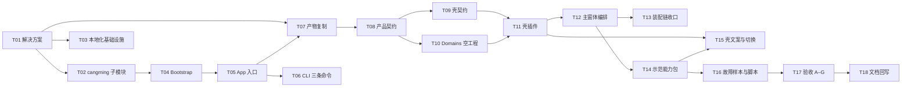

# PLAN-0001：M1 插件骨架实施

| 版本 | 日期 | 状态 | 作者 | 说明 |
| :--- | :--- | :--- | :--- | :--- |
| 0.1 | 2026-11-23 | 待评审 | lukan | M1 骨架的批次、任务、依赖、验收与风险；上游为 ADR-0001（Accepted）与 DESIGN-0001 0.9 |

## 1 目标与完成定义

M1 的目标是把 ADR-0001 的三条判定落到可运行的骨架上：机制层没有产品词、空壳能启动、新增能力只动一个能力包；同时把双宿主、多语言、三端同构三条原则做成基础支持，而不是等到后面补。完成定义不是“代码能跑”，而是下面五条同时成立：四个任务批次、十八个任务全部收口；第七节 A–G 逐条通过并留下提交号与日志摘录；构建入口写回 `AGENTS.md` §4；每个工程带 README 且被检查脚本覆盖；检查脚本进仓库并可重复执行。

本计划只覆盖机制，不覆盖任何产品能力；图像、ROI、测量、文档、设置一律不在 M1 内，违反即视为范围失控，需先修改本计划再动代码。

## 2 前置条件

1. 工具链：.NET 10 SDK、Git（含子模块）、PowerShell 7；Avalonia 与 AtomUI 的具体版本在 T01 选定并写进 `Directory.Packages.props`，选定后整批锁定，升级须成对回归。
2. 上游文档：`docs/adr/lukan/ADR-0001-插件机制架构基线.md`（Accepted，正文冻结）、`docs/design/lukan/DESIGN-0001-M1-插件骨架.md` 0.9、`docs/spec/baseline/startup-requirements.md` 2.2、`docs/spec/m1/M1-interaction-spec.md` §2。
3. cangming：只读子模块锁定 tag `v0.1.9.1122`，不修改其源码；M1 只使用该版本的 v1 槽位契约。
4. 仓库：`src/` 与 `tests/` 为空，允许新建；`docs/` 的分类与命名规则已生效；提交信息用中文并带 scoped 前缀。

## 3 批次与任务

四个批次之间是串行门禁：上一批的完成判据未通过，不开始下一批。批次内部允许并行，但 T01、T07、T12 三个关键任务各自独占一个完成点。

| 任务 | 批次 | 前置 | 产出 | 完成判据 |
| :--- | :--- | :--- | :--- | :--- |
| T01 解决方案与根配置 | B1 | 无 | `ImageLyre.slnx`、`Directory.Build.props`（net10.0、可空、警告即错误）、`Directory.Packages.props`（Avalonia、AtomUI、SkiaSharp 版本锁定）、根 `.editorconfig` 复核 | `dotnet build ImageLyre.slnx` 在空解决方案上通过；版本号与包版本集中在一处 |
| T02 cangming 子模块 | B1 | T01 | `.gitmodules` 与 `src/cangming`，检出 tag `v0.1.9.1122` | `git submodule status` 显示该 tag；构建不修改子模块工作区 |
| T03 本地化基础设施 | B1 | T01 | `ImageLyre.Localization`（`LocalizationService`、回退、诊断回调）与 `tests/UnitTest.ImageLyre.Localization` | 单测覆盖：缺键回退 zh-CN、键按命名空间隔离、切换触发一次事件、重复注册资源源幂等 |
| T04 Bootstrap 骨架 | B1 | T01、T02 | `ImageLyre.Bootstrap`：`HostMode`、`StartAsync`、扫描前缀、容器、`Launch`、管理器、计数日志 | `--plugins` 路径下输出 `能力插件 0 个`；日志显示 `HasUiRoute=false` 时 Feature 被过滤 |
| T05 App 入口与宿主分派 | B1 | T04 | `ImageLyre.App`：`StartupOptions`、桌面/无界面分派、欢迎占位窗口 | 无参数启动出现欢迎窗口；`--version` 不初始化 Avalonia 且返回 0 |
| T06 CLI 三条命令 | B1 | T05 | `CliHost`：`--version`、`--plugins`、`--help`，退出码 0/2/1 | `--plugins` 输出 Id、名称、状态、是否 Feature；Feature 数为 0；未知参数返回 2 |
| T07 产物复制机制 | B1 | T01、T05 | `ImageLyre.App.csproj` 的通配工程引用；空插件工程验证 | 新增一个空插件工程后输出目录出现其 dll，扫描候选列表含它，且 `ImageLyre.App.csproj` 改动为零；复制行为不达预期时退化为仓库级 MSBuild 目标并记录 |
| T08 产品契约 | B2 | T07 | `ImageLyre.Contracts`：`ILocalizationService`、`ILocalizationSource`、`ImageLyre.Contracts.Demo` 命名空间 | 工程不引用 Avalonia、AtomUI、SkiaSharp；Demo 类型集中在一个命名空间内 |
| T09 壳契约 | B2 | T08 | `ImageLyre.Shell.Contracts`：`ShellSlots`、`IWorkbenchShell`、`DockPaneAttachment` | 单向依赖 `ImageLyre.Contracts`；不引用任何插件工程 |
| T10 Domains 空工程 | B2 | T08 | `ImageLyre.Domains` 与 README（意义、边界、依赖方向、变更指向） | 工程无类型；README 四要素齐全；产品契约依赖它 |
| T11 壳插件 | B2 | T09、T10 | `ImageLyre.Module.Shell`：`ShellWindow`、三个槽位、静态菜单、状态栏五段占位、面板空态、`ILocalizationSource` | 启动后 `GetAllSlots` 返回三个槽位；窗口由 `Build()` 产出；App 里没有布局代码 |
| T12 主窗体编排 | B2 | T11 | `ImageLyre.App/Startup/MainWindowFactory`：注入、取壳、附着、挂主窗体、关停 | 主窗体显示后欢迎窗口关闭；关窗后进程退出；壳缺失时欢迎窗口显示失败原因 |
| T13 装配链收口 | B2 | T12 | 单例槽位管理器、顺序约束、重复启动保护 | 连续两次启动不出现槽位重名异常；关停顺序为先窗后插件 |
| T14 示范能力包 | B3 | T12 | `ImageLyre.Module.Demo.Clock`、`ImageLyre.Module.Demo.Greeter`、`ImageLyre.Feature.Demo` 与四个上下文 | 工具条与面板各出现一项；日志显示 `After` 决定的启动先后；构造期无 `Lazy.Value` |
| T15 壳文案与语言切换 | B3 | T11、T14 | 壳菜单与状态栏文案走资源键，标题栏语言切换入口；Feature 自带文案源 | 中英切换后文案变化、窗口不重建、缺键回退并记诊断 |
| T16 故障样本与检查脚本 | B4 | T14 | `ImageLyre.Module.Demo.Broken`；`scripts/qa/verify-m1.ps1`（引用方向、词表、通配引用计数、README、平台符号） | 脚本在完整树上通过；`Broken` 以 `BrokenPlugin` 形式出现 |
| T17 验收 A–G | B4 | T16 | 验收记录（提交号、日志摘录、判据对应） | 七条逐条通过，记录写入本计划 §5 下方 |
| T18 文档回写 | B4 | T17 | `AGENTS.md` §4 构建入口与现状、各工程 README 复核、`DESIGN-0001` 若与实现有偏差则升版 | 文档与实现一致；无“先实现后解释”的条目 |

## 4 依赖与顺序

三条顺序约束不可打乱：T07 必须在 T08 之前，先证明“加插件不改 App”的机制成立，再往机制上叠契约；T11 与 T12 必须相邻完成，壳的槽位贡献点与 App 的编排顺序是同一条时序的两端；T17 必须在 T16 之后，验收脚本先能跑，验收结论才可信。

## 5 验收标准

验收在完整树上执行，每条先 `dotnet clean` 再构建，并记录提交号；判据取自 DESIGN-0001 §7，任何一条不通过即整批退回。

| 编号 | 动作 | 通过判据 |
| :--- | :--- | :--- |
| A 空壳 | 移除 `ImageLyre.Module.Demo.*`、`ImageLyre.Feature.Demo`、`ImageLyre.Feature.Hello` 与 `ImageLyre.Contracts.Demo` 命名空间后重建 | 欢迎窗口出现、主窗体显示空窗口（视口“无图像”、面板“尚无测量”），Bootstrap 日志 `能力插件 0 个`，壳仍在运行 |
| B 加插件 | 新增 `ImageLyre.Feature.Hello`（一个 Feature 工程，只依赖契约与路线包） | 工具条与面板各多一项；`git status` 只有新增文件；`ImageLyre.App.csproj` 无改动 |
| C 拔插件 | 删除 `ImageLyre.Module.Demo.Clock` | Greeter 落 `Failed` 并写明缺 `IClock`；Feature 不附着；应用可用 |
| D 隔离 | 保留 `ImageLyre.Module.Demo.Broken` | Broken 以 `BrokenPlugin` 出现并带构造异常；其余插件 `Running`，窗口正常 |
| E 纪律 | 运行 `scripts/qa/verify-m1.ps1` | 引用方向、词表、通配引用计数、README、平台符号五项全部通过 |
| F 双宿主 | `ImageLyre.App --plugins`（无界面环境） | 输出插件清单、Feature 数为 0、退出码 0、未创建窗口；同一产物的桌面模式仍启动 |
| G 多语言 | 桌面模式切到 `en-US` 再切回 `zh-CN` | 菜单、状态栏占位与示范面板文案变化，窗口不重建，数字与单位不变；缺键回退中文并记诊断 |

验收记录格式：每条写“提交号 + 命令 + 观察到的关键日志行 + 结论”，附在提交说明或本计划的后续修订里；没有日志摘录的验收视为未执行。

## 6 风险与应对

| 风险 | 触发条件 | 应对 |
| :--- | :--- | :--- |
| 通配工程引用的复制行为与预期不符 | T07 验证时空插件 dll 未进输出目录 | 立即退化为 `Directory.Build.targets` 的仓库级复制目标，仍不改 `ImageLyre.App.csproj`；把实际机制写回 DESIGN §3.7 |
| 槽位顺序被写反 | 附着先于壳构造 | 报 `InvalidOperationException`；按 DESIGN §3.5 的固定顺序修正，并在 T13 加重复启动用例防回归 |
| 启动动作里出现异步等待 UI | 某个插件 `StartServiceAsync` 返回未完成任务 | 停下并改启动编排，把 `StartAsync` 移到 UI 循环启动之前；不允许用 `Task.Run` 掩盖 |
| AtomUI 与 Avalonia 版本组合不稳定 | T01 空窗启动失败或控件异常 | 回退到上一组已验证组合，升级改为单独任务；版本只在此处集中 |
| 单入口导致 CLI 拉起 UI 程序集 | `--plugins` 进程加载 Avalonia | 检查是否在 `Main` 顶部实例化 `App`；把宿主实现改为按参数延迟加载，仍不达标时改独立 host 程序集 |
| 本地化出现两个实例 | 欢迎界面文案与主界面文案不同源 | T03 与 T12 的验收各加一条实例一致性日志；Bootstrap 注册必须传同一实例 |
| Windows 专属捷径混入 | 检查脚本命中注册表、Win32、盘符 | 当场改为适配接口或 `Path` 调用；不达标不进入 B2 |
| 范围膨胀 | 任务表外出现功能代码 | 回到本计划增补任务与判据，不在实现里顺手做 |

## 7 交付物

`ImageLyre.slnx`、根构建配置、cangming 子模块、十一个工程（七个常驻骨架工程、三个常驻示范工程、一个只随测试产物的故障样本）、`scripts/qa/verify-m1.ps1`、验收记录、`AGENTS.md` §4 的构建入口，以及每个工程的 README。

## 8 变更与例外

本计划的改动只能通过增补任务与判据完成，不允许“实现时顺手改”；与 ADR-0001 或 DESIGN-0001 冲突的发现，先改文档再改代码，并在提交说明里写明对应条目。临时例外进 ADR-0001 §2.5 的表，写明现状、解除阶段与验证方式，不留在对话里。
