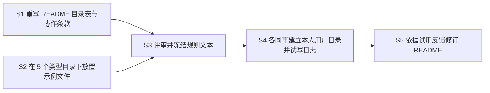

# PLAN-0001：docs 文档体系落地计划

> 本文件同时充当 `docs/plans/` 的格式示例与可复制模板，正式使用时请复制到本人用户目录、按 `PLAN-<四位序号>-<主题-slug>.md` 改名，并替换正文内容。

| 项目 | 内容 |
| :--- | :--- |
| 目标 | 让 `docs/README.md` 中登记的目录规则可被每位同事直接执行 |
| 负责人 | lukan |
| 开始日期 | 2026-11-18 |
| 关联文档 | `docs/design/lukan/DESIGN-0001-docs-convention.md`、`docs/adr/lukan/ADR-0001-docs-per-user-layout.md` |

## 前置条件

- `docs/` 下已存在 `adr`, `analysis`, `daily`, `design`, `plans` 五个类型目录。
- 团队成员的 Git 账号已确定，因为用户名必须与 `git config user.name` 一致。
- 目录规则已由 ADR 决策定型，执行阶段不再讨论编号是否需要全局唯一。

## 步骤与依赖

| 步骤 | 内容 | 依赖 | 产出 |
| :--- | :--- | :--- | :--- |
| S1 | 重写 `docs/README.md`，补齐目录职责、命名约定、协作条款与流转说明 | 无 | 规则文本 |
| S2 | 在 5 个类型目录下各放置一份本人名下的示例文件 | 无 | 5 份示例 |
| S3 | 组织评审并冻结规则文本 | S1、S2 | 评审结论 |
| S4 | 每位同事建立本人用户目录并试写一份日志 | S3 | 各自目录 |
| S5 | 汇总试用反馈并修订 README | S4 | 修订版 README |

进度（2026-11-20 更新）：S1、S2、S4 已交付——`docs/README.md` 已重写并在其后多轮补条款，5 个类型目录的示例文件齐备，`docs/daily/lukan/` 下已有 11-18、11-19、11-20 三份小结；S3 的评审没有单独成文，规则文本在两轮实现反馈中直接修订单项，视为已冻结；S5 仍未做，等出现第三条独立反馈再一次性修订，避免为单条意见反复改 README。本计划不阻塞后续工作。

## 验收标准

1. `docs/README.md` 的目录表与磁盘上的实际目录逐条一致，不存在仅存在于文档中的目录。
2. 5 个类型目录下均存在至少一份符合命名约定的示例文件。
3. 任意一位同事在不询问他人的前提下，能依据 README 独立完成“新建用户目录、写入一份日志、引用他人文档”三项操作。

## 风险与应对

- 风险：同事直接在其他人的用户目录内改动文件，导致归属语义失效；应对方式是在评审意见中显式指出，并在 README 的协作条款中保留该禁令。
- 风险：示例文件被误当作真实结论引用；应对方式是在每份示例文首标注其为示例与模板。
