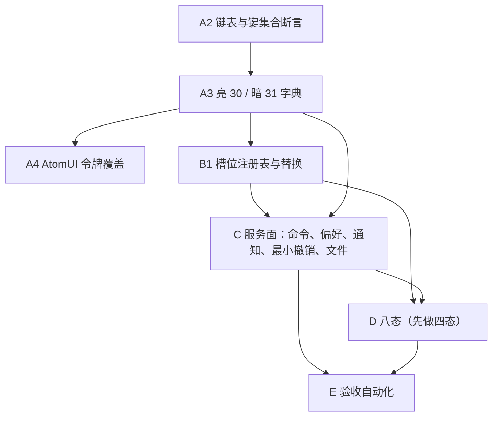

# PLAN-0002：架构落地计划

| 项目 | 内容 |
| :--- | :--- |
| 目标 | 把 `docs/design/lukan/DESIGN-0004-architecture-principles.md` 的六条不变式从文档变成可运行、可判定的基座：令牌可引用、区域可附着、停用可撤、八态可跑、验收可自动 |
| 负责人 | lukan（架构与实现同一顶人，按批次换帽子） |
| 开始日期 | 2026-11-20 |
| 关联文档 | `docs/design/lukan/DESIGN-0004-architecture-principles.md`、`docs/design/lukan/DESIGN-0003-libs-layering.md`、`docs/spec/requirements/product-appearance.md`、`docs/spec/requirements/interaction-requirements.md` |

> 本文排的是技术依赖顺序，不是里程碑。里程碑取舍与优先级归产品经理，本文只回答"先做哪个代价最小、哪个后做会返工"，并在每批写明体量与代价。

## 1 前置条件

1. `docs/adr/lukan/ADR-0009-theme-token-landing.md` 先定稿：键空间、覆盖层、缩放机制三个结论不到位，令牌层无法开工。
2. 网络到 `origin` 可用。本地不受影响，但"给外部看"这条会被阻塞。
3. AtomUI 锁在 6.2.15，覆盖清单先只做六个控件（按钮、输入、分段、复选框、菜单项、表格），清单之外不预做。
4. `warn.bg`、`warn.line` 两个值由设计补齐，或接受临时值并标 `TODO(设计确认)`。

## 2 批次与依赖

（0.2 修订：按 2026-11-20 三位独立评审重排。A1 已完成，转入前置；B2 的验收并入 B1；A5 移出关键路径等实测；A2 的三项判定脚本降为一项；C4 只留 M1 需要的最小撤销，会话持久化、脏标记、关闭守卫与 C5、D6、D8 推迟到 M1 之后。0.1 正文写"十七步"而表内实为二十五步，此处按实际重列，不再写总数。）

### A 令牌层

| 步骤 | 内容 | 验收 | 体量 |
| :--- | :--- | :--- | :--- |
| A2 | 按 ADR-0009 §2.1 生成键表：18 语义色 ×2 套，另加 `Lyre.Signal.Warning.*` 两条并标 `TODO(设计确认)`；四档字号与四档行高、三档字距、两档字重、六级间距、两级线宽。判定写成一类断言，含四项检查：① 两套字典键集合相等；② 源码里每个 `{DynamicResource Lyre.` 引用都能在字典中找到；③ 同一字典内 `x:Key` 不重复；④ 防空跑——字典少于两本或引用数为零直接判失败 | 断言进现有架构测试，先在夹具上红过再绿；`x:Key` 的输入是 `Themes` 下的字典文件，引用扫描的输入是 `src` 下的 `.axaml` 与 `.cs` | 中 |
| A3 | 亮 30 与暗 31 两份字典，键名一一对应 | 两套键集合差异为空 | 中 |
| A4 | AtomUI 令牌覆盖，走 6.2.15 的 `DesignTokens` 与 `WithToken`；覆盖清单六个控件：按钮、输入、分段、复选框、菜单项、表格；先做一个控件的六态试点再按控件排期 | 六控件不出现四档之外的字号；试点结论回写本表 | 大 |
| A5 | 缩放：根级缩放加 1px 与 2px 线宽反向补偿；在 150% 与 200% 实测 | 线宽物理像素正确、文字清晰度可接受 | 中 |

A5 不在关键路径上：它要等首个可运行界面才有实测对象，提前排会空转。

### B 区域机构

| 步骤 | 内容 | 验收 | 体量 |
| :--- | :--- | :--- | :--- |
| B1 | `ISlotRegistry` 实现：所有者作用域、按所有者摘除、变更增量、诊断收口；工作台改用它并去掉对沧溟 `SlotManager` 的依赖 | 停用一个插件，其菜单项、状态栏项与面板内容同批消失；架构测试断言实现工程不再引用沧溟 `SlotManager` | 大 |
| B2 | 三处归位：`IPluginCenter` 到 `Hosting`，`UI.Contracts` 根目录三份到 `Workbench` | 构建通过，两份 README 的待办划掉 | 小 |

### C 服务面

| 步骤 | 内容 | 验收 | 体量 |
| :--- | :--- | :--- | :--- |
| C1 | 命令模块：注册表、委托谓词取代 `When`、命令面板数据 | 菜单与命令面板读同一注册表；不可用时置灰而非消失 | 中 |
| C2 | 偏好与习惯，只做 M1 需要的三项：窗口几何、最近文件、面板可见性；设置项定义与设置页随 M2 | 重启后窗口位置与上次文档恢复 | 小 |
| C3 | 通知与输出：通知中心、输出通道 | 一处产生、两处可见；无界面时不崩 | 小 |
| C4 | 最小撤销：只覆盖 M1 需要的 ROI 几何与校准改动 | 撤销重做按文档实例，几何与校准可回到上一步 | 中 |
| C5 | 文件：文件对话框、外部变更通知 | 文件被外部修改时提示 | 小 |

推迟到 M1 之后的：文档会话持久化、脏标记、关闭守卫、崩溃恢复与结果版本（`docs/spec/plans/PM-PLAN-0002-m1-vertical-slice.md` §2.0 与 §4 已把这几项排在 M2）。本计划不提前实现，只保留接口。

### D 八态落地

| 步骤 | 状态 | 依赖 | 验收 |
| :--- | :--- | :--- | :--- |
| D1 | 空态 | B1 | 与 `e-science/states.html` 01 逐项对照 |
| D2 | 加载态 | B1、C3 | 进度与取消可用，状态栏同步 |
| D3 | 缺校准 | A3（含 warn 键） | 内联黄条，不弹窗 |
| D4 | 多文档标签条 | C4 | 标签条 28 高，当前与只读两种标记可辨；脏标记随 M2 |

设置、历史、导出、Agent 抽屉四态依赖 M2 的设置页、结果版本与流程能力，随 M2 排，不在本计划内。

### E 验收自动化

| 步骤 | 内容 | 验收 |
| :--- | :--- | :--- |
| E1 | 每落地一态加一张 Headless 基线，不做一次性十六张 | 基线随状态增加，差异超容差即红 |
| E2 | 真机清单：125%/150% 系统缩放、暗色、灰度 | 每次发版前逐条打勾并留记录 |
| E3 | 端到端三条：停用即撤、切主题键集合不变、缩放后线宽物理像素不变 | 三条各一个测试 |

## 3 关键路径

`A2 → A3 → B1 → C4 → D1`，再加 `E3` 作为出口闸门。A4 与 C1 至 C5 可以并行，但 A4 的体量最不可控，越早开越好。

## 4 总验收标准

以下六条全部成立，本计划才算完成：

1. `dotnet build` 0 警告 0 错误，`dotnet test` 全绿；新增断言至少包含"亮暗键集合相等且被引用键存在"与"附件只能挂到已声明区域"两类。
2. 删掉 `src/Modules` 后 `src/Libs` 仍能独立编译。
3. 停用一个插件，其菜单项、状态栏项与面板内容同批消失，并在日志留一条诊断。
4. 切换亮暗后两字典键集合不变、控件树不重建。
5. 150% 与 200% 下，1px 与 2px 线仍为对应物理像素，文字清晰度可接受。
6. 已落地的每一态都有 Headless 基线图，且与设计稿逐项对照过。

## 5 风险

| 风险 | 最早暴露点 | 应对 |
| :--- | :--- | :--- |
| AtomUI 覆盖量远超预期 | A4 | 先六控件，其余按需；超出两天即减范围并记账 |
| 缩放重算闪动 | A5 | 当场实测 100%→150%，不可接受就提 ADR 改混合方案 |
| `warn` 值缺失 | A3 | 临时值加 `TODO(设计确认)`，不许散落字面量 |
| 文档先行导致实现漂移 | D | 每态先出基线图再写样式，不靠记忆对照 |
| C 批改 `UI.Contracts` 牵动调用方 | C1 | 单独提交，契约与调用方同批改，一次构建验证 |

## 6 明确不做

不做权限系统、单实例、自动更新；不做图像、ROI、测量与任何业务内容；不为未实现的样式预留属性；不重排已有的设计文档。

## 7 未决

1. `docs/adr/lukan/ADR-0009-theme-token-landing.md` 已于 2026-11-20 修订为 0.2，A2 解锁；若其 §5 失效条件被触发，A2 回退重做。
2. `IThemeManager` 现有契约（按 URI 换整本字典）与 `RequestedThemeVariant` 并存会造成两套机制，改契约的提案另开 ADR-0010，在此之前外观模块只用后者。
3. 缩放补偿系数与文字清晰度要等 A5 实测，实测前不写数字。
4. `warn.bg` 与 `warn.line` 的设计值未给，暂挂 `Lyre.Signal.Warning.*` 并标 `TODO(设计确认)`。
5. 设计文档内部有两处数据冲突需设计侧勘误：`size.statusbar.height` 在 `spacing.md` §3.1 为 32、§5 为 28；`typography-avalonia.md` 仍是八档旧键形。

## 9 进度（2026-11-20 夜）

| 步骤 | 状态 | 提交 |
| :--- | :--- | :--- |
| A1 ADR-0009 | 完成，0.3 定稿 | `41e73f8` |
| A2 键表与断言 | 完成：18 色 ×2（warning 待设计确认）、四档字号与行高、三档字距、两档字重、两条家族栈、六级间距、两级线宽；五项断言含防空跑与重复键检测，已做红绿验证 | `1994271` |
| A3 亮暗字典 | 完成：Tokens.Light、Tokens.Dark、Tokens.Shared、Tokens.axaml；App 合并并引用一个键 | `1994271` |
| A4 AtomUI 覆盖 | 试点完成（机制按止损条款调整）：控件字号与家族改由 Themes/Controls.axaml 的 Avalonia 样式绑定 Lyre.Type.* 令牌，覆盖按钮、输入、组合框、复选框、菜单项与文本六类；ControlStyleTests 断言样式里不出现字号字面量且只引用四档令牌。原计划的 AtomUI Schema 路线（SemanticPartRegistry + TokenDescriptor.SetValue）保留为后续深化项，因为按试点预算两轮内做不出可验证结果，按风险表减范围并记账。 | 见下一次提交 |
| A5 缩放与线宽补偿 | 未开始（等可运行界面实测） | — |
| B1 槽位注册表 | 完成：ISlotManager + ISlotRegistry + ISlotChangeSource；按所有者摘除、待解析冲刷、形态与容量校验、收口诊断；实测启动 5 插件 | `ea6a8ab` |
| B2 三处归位 | 完成 | `5bb16fa` |
| C1 命令模块 | 完成：删 When 字符串，谓词决定可用性；注册/幂等注销/令牌撤销/变化流 | `3202e2f` |
| C2 偏好与习惯 | 完成：偏好与习惯分成两个实现，避免同签名契约串存储；落盘与变更流；四条测试 | `1b57bae` |
| C3 通知与输出 | 完成：通知中心含未读数与已读，输出通道按名唯一并推增量；补 IDisposable | `32100e3` |
| C4 最小撤销 | 完成：Contracts.Undo 的 IUndoableAction 与 IUndoHistory；Module.Documents 提供工厂，容量与重做分支语义齐备；四条测试 | `e4d9d54` |
| C5 文件 | 完成：外部变更通知模块；文件对话框依赖 Avalonia，按计划归壳层 | `0362525` |
| D1 至 D4 四态 | 未开始 | — |
| E1 至 E3 | 未开始 | — |

C 批已全部交付：命令、偏好与习惯、通知与输出、撤销、文件五个模块，加上 B1 的槽位注册表，基座的服务面已经连通。构建 0 警告 0 错误，测试 41 条全绿。

下一轮做 A4（AtomUI 令牌覆盖，先做一个控件的六态试点）与 A5（缩放与线宽补偿实测），随后 D 批四态与 E 批验收。

2026-11-20 收尾补记：A1 到 A4（样式层试点）、B1、B2、C1 到 C5 已完成并逐批提交；剩余 A5、D1 到 D4、E1 到 E3。
D 批的前置已明确：内容区目前仍由沧溟的 SlotPanel 渲染，它只认沧溟自带的附件形状，不认识本仓 ContentAttachment 的控件工厂；
因此 D1 动手前要先在壳里补一层"按附件建控件"的投影（订阅 ISlotChangeSource，取 Content 槽位里的 ContentAttachment 调工厂设给内容区），
再做空态功能。这一条不写清，D1 会卡在"附着了但看不见"。

D1 已于 2026-11-20 完成（e78b47）：内容区投影接通，空态功能附着后实机启动 6 个插件、Content 附着数从 0 变 1。
D2 加载态的边界：只做壳层状态（画布骨架、进度文本、取消按钮），进度由可控的模拟源驱动，真实解码属业务插件，不在本计划内。

## 8 变更记录

| 版本 | 变更 |
| :--- | :--- |
| 0.1 | 首次成文：五批、依赖图、关键路径、六条总验收、五条风险、三条未决。 |
| 0.2 | 按三位独立评审重排：A1 转入前置、B2 并入 B1、A5 移出关键路径、A2 降为单项断言、A4 明确走 AtomUI 令牌 API 且覆盖清单改为六个控件、C4 收窄为 M1 最小撤销并推迟会话与关停、D 批只做四态、E1 改为每态一张；总验收第 1 与第 5 条按新口径重写。证据见 `docs/analyses/lukan/2026-11-20_arch-review-loop.md`。 |

## 10 交接（2026-11-20 末）

已完成：A1 到 A4（A4 为控件样式层试点）、B1、B2、C1 到 C5、D1、ADR-0010。未完成：A5、D2、D3、D4、E1 到 E3。

D2 的落地配方（下一位按此做，不必重新摸索）：
1. 先读 src/Libs/ImageLyre.UI.Contracts/Busy/ 下的 IBusyManager、BusyRecord、BusyIndicator、BusyEventArgs、BusyIndicatorType，确认 ReportProgress/ReportCompleted/ReportFailed 与五个流的签名。
2. 新建 src/Modules/ImageLyre.Module.Busy，实现 IBusyManager：以 Guid 为键记活跃记录，五个流用 Subject，Dispose 时链式释放；套用 C3 与 C5 已验证的模式（含 override Dispose 与 ase.Dispose()）。
3. 在 WorkbenchShell 里加一层遮罩：订阅 BusyStarted / BusyCompleted / BusyFailed，显示进度文本与取消按钮；进度源用可控模拟器（Task.Delay），不接任何解码。
4. 加四条测试：开始后可查、进度更新、完成清空、失败清空；闸门仍是构建 0 警告 0 错误与全部测试通过。

D3 与 D4 的前置都已在 §9 写明；E 批等 D 批四态齐了再建 Headless 基线，避免反复重拍。
