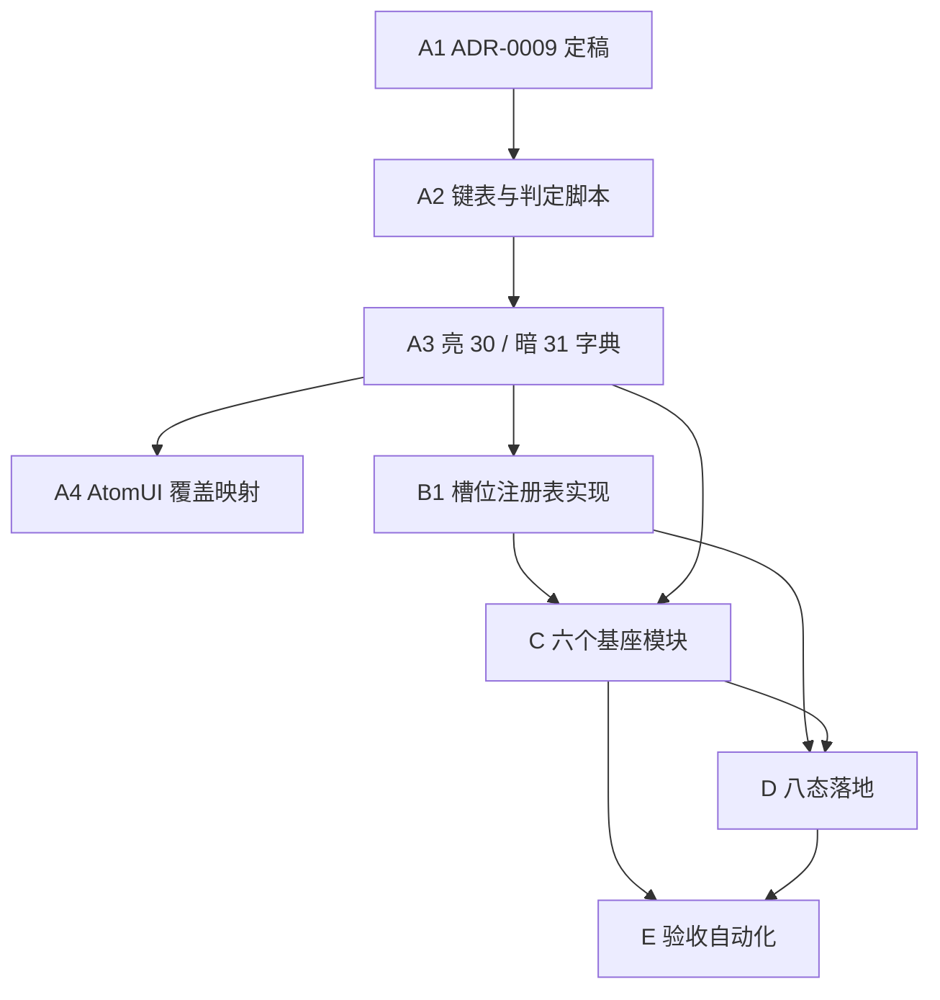

# PLAN-0002：架构落地计划

| 项目 | 内容 |
| :--- | :--- |
| 目标 | 把 `docs/design/lukan/DESIGN-0004-architecture-principles.md` 的六条不变式从文档变成可运行、可判定的基座：令牌可引用、区域可附着、停用可撤、八态可跑、验收可自动 |
| 负责人 | lukan（架构与实现同一顶人，按批次换帽子） |
| 开始日期 | 2026-11-20 |
| 关联文档 | `docs/design/lukan/DESIGN-0004-architecture-principles.md`、`docs/design/lukan/DESIGN-0003-libs-layering.md`、`docs/spec/requirements/product-appearance.md`、`docs/spec/requirements/interaction-requirements.md` |

> 本文排的是技术依赖顺序，不是里程碑。里程碑取舍与优先级归产品经理，本文只回答"先做哪个代价最小、哪个后做会返工"，并在每批写明体量与代价。

## 1 前置条件

1. `docs/adr/lukan/ADR-0009-theme-token-landing.md` 先定稿：键空间、覆盖层、缩放机制三个结论不到位，令牌层无法开工。
2. 网络到 `origin` 可用。本地不受影响，但"给外部看"这条会被阻塞。
3. AtomUI 锁在 6.2.15，覆盖清单先只做五个基础控件（按钮、输入、列表、标签、表格）。
4. `warn.bg`、`warn.line` 两个值由设计补齐，或接受临时值并标 `TODO(设计确认)`。

## 2 批次与依赖

### A 令牌层

| 步骤 | 内容 | 验收 | 体量 |
| :--- | :--- | :--- | :--- |
| A1 | 落 ADR-0009：`Lyre.*` 键空间、全局覆盖一次、缩放重算 | 三问各有结论与失效条件 | 小 |
| A2 | 键表：18 语义色 ×2 套、四档字号、六级间距、两条家族栈、线宽与圆角；三项判定脚本（键清单比对、字号白名单、源码字面量扫描） | 三个脚本接入测试并全绿 | 中 |
| A3 | 亮 30 与暗 31 两份资源字典，键名一一对应 | 两套键集合差异为空 | 中 |
| A4 | 五个基础控件的 AtomUI 覆盖映射 | 这五个控件不出现四档以外的字号 | 大 |
| A5 | `Module.Appearance`：主题切换、跟随系统、缩放重算 | 切换前后控件树指纹一致；100%→150% 字号只出现四档乘缩放 | 中 |

### B 区域机构

| 步骤 | 内容 | 验收 | 体量 |
| :--- | :--- | :--- | :--- |
| B1 | `ISlotRegistry` 实现：所有者作用域、按所有者摘除、变更增量、诊断收口 | 停用一个插件，其菜单项、状态栏项与面板内容同批消失 | 大 |
| B2 | 工作台改用自实现，去掉对沧溟 `SlotManager` 的依赖 | 架构测试断言实现工程不再引用该类型 | 小 |
| B3 | 三处归位：`IPluginCenter` 到 `Hosting`，`UI.Contracts` 根目录三份到 `Workbench` | 构建通过，README 的待办划掉 | 小 |

### C 六个基座模块

| 步骤 | 内容 | 验收 | 体量 |
| :--- | :--- | :--- | :--- |
| C1 | 命令模块：注册表、委托谓词取代 `When`、命令面板数据 | 菜单与命令面板读同一注册表；不可用时置灰而非消失 | 中 |
| C2 | 偏好与习惯：存值、设置项定义、窗口与面板记忆 | 重启后窗口位置与上次文档恢复 | 中 |
| C3 | 通知与输出：通知中心、输出通道 | 一处产生、两处可见；无界面时不崩 | 小 |
| C4 | 文档与撤销：会话持久化、脏标记、撤销栈、关闭守卫 | 关窗时脏文档拦截；撤销重做按文档实例 | 大 |
| C5 | 诊断与宿主：崩溃上报、关停清理、后台任务 | 强制终止后再启动能看到上次的崩溃记录 | 小 |
| C6 | 文件：文件对话框、外部变更通知 | 文件被外部修改时提示 | 小 |

C 批六个模块互不引用，可并行；但 C1 的谓词改造会同时动 `UI.Contracts`，要单独提交，避免与其他模块的改动混在一起。

### D 八态落地

| 步骤 | 状态 | 依赖 | 验收 |
| :--- | :--- | :--- | :--- |
| D1 | 空态 | B | 与 `e-science/states.html` 01 逐项对照 |
| D2 | 加载态 | B、C5 | 进度与取消可用，状态栏同步 |
| D3 | 缺校准 | A（warn 键） | 内联黄条，不弹窗 |
| D4 | 多文档 | C4 | 标签条 28 高，当前、脏、只读三种标记可辨 |
| D5 | 设置 | C2、A5 | 720×560 居中，左五分区 |
| D6 | 历史 | C4 | 版本五条，两条对比，回退与前进在栏底 |
| D7 | 导出 | C4 | 底部 280 抽屉，固定列与 sidecar |
| D8 | Agent 抽屉 | C4、C1 | 只读只提案，可把分析转成流程 |

D 批不做业务内容：画布里的图像、ROI、测量全部属于业务插件，本批只交壳与状态。

### E 验收自动化

| 步骤 | 内容 | 验收 |
| :--- | :--- | :--- |
| E1 | Headless 基线：八态 × 亮暗共 16 张 | CI 能跑，差异超容差即红 |
| E2 | 真机清单：125%/150%、暗色、灰度 | 每次发版前逐条打勾并留记录 |
| E3 | 端到端：停用即撤、切主题树指纹、缩放档位 | 三条各一个测试 |

## 3 关键路径

`A1 → A2 → A3 → B1 → C4 → D1`，再加 `E3` 作为出口闸门。A4 与 C1 到 C6 可以并行，但 A4 的体量最不可控，越早开越好。

## 4 总验收标准

以下六条全部成立，本计划才算完成：

1. `dotnet build` 0 警告 0 错误，`dotnet test` 全绿，且新增四类断言（键清单、字号白名单、源码字面量、控件树指纹）。
2. 删掉 `src/Modules` 后 `src/Libs` 仍能独立编译。
3. 停用一个插件，其菜单项、状态栏项与面板内容同批消失，并在日志留一条诊断。
4. 亮暗切换后控件树指纹不变。
5. 100% 到 150% 缩放，字号只出现四档乘缩放，1px 线保持 1 物理像素。
6. 八态各有 Headless 基线图，且与设计稿逐项对照过。

## 5 风险

| 风险 | 最早暴露点 | 应对 |
| :--- | :--- | :--- |
| AtomUI 覆盖量远超预期 | A4 | 先五控件，其余按需；超出两天即减范围并记账 |
| 缩放重算闪动 | A5 | 当场实测 100%→150%，不可接受就提 ADR 改混合方案 |
| `warn` 值缺失 | A3 | 临时值加 `TODO(设计确认)`，不许散落字面量 |
| 文档先行导致实现漂移 | D | 每态先出基线图再写样式，不靠记忆对照 |
| C 批改 `UI.Contracts` 牵动调用方 | C1 | 单独提交，契约与调用方同批改，一次构建验证 |

## 6 明确不做

不做权限系统、单实例、自动更新；不做图像、ROI、测量与任何业务内容；不为未实现的样式预留属性；不重排已有的设计文档。

## 7 未决

1. `ADR-0009` 已于 2026-11-20 定稿（`docs/adr/lukan/ADR-0009-theme-token-landing.md`），A2 解锁；若其 §5 的失效条件被触发，A2 回退重做。

（2026-11-20 更新：原第 1 条写"A2 尚未解锁，阻塞 A2"，当日完成 A1 后按事实改写。）
2. S3 的"模板内禁止状态判断"在 Avalonia 侧的表达方式待确认，落地时把判定手段写实。
3. S5 的像素阈值要等首个可运行界面，现在写数字是编的。

## 8 变更记录

| 版本 | 变更 |
| :--- | :--- |
| 0.1 | 首次成文：五批十七步、依赖图、关键路径、六条总验收、五条风险、三条未决。 |
