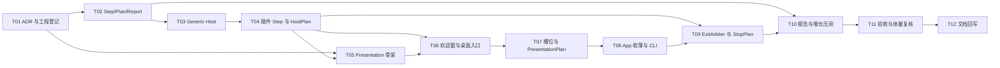

# PLAN-0002 启动宿主与编排模式实施

| 版本 | 日期 | 状态 | 作者 | 说明 |
| :--- | :--- | :--- | :--- | :--- |
| 0.1 | 2026-11-24 | 待评审 | lukan | 按 `DESIGN-0002` 1.0 的 D 方案拆解：ADR 与工程登记、Generic Host、两阶段 Step Pipeline、嵌套 Plan、`ImageLyre.Presentation.Desktop`、关停与增长压测；上游为 `DESIGN-0002` 与五席评审记录 |
| 1.0 | 2026-11-24 | 已评审（执行中） | lukan | 作者评审通过；以 subagent + ponytail 工作模式执行 T01–T12，ADR-0003 与工程登记先行 |

## 1 目标与完成定义

本计划把“App 只做入口、Bootstrap 编排启动项”从设计落成可运行的代码，目标不是移动代码位置，而是把启动顺序、失败归属、回滚与关停从 `App.ComposeAsync` 的方法体提升为 `Bootstrap` 拥有的 Plan 与 Step。

完成定义同时满足六条：

1. `ImageLyre.App` 不再出现启动项名称、启动顺序、`BootstrapHost`、`SlotManager`、`MainWindowFactory` 与 `ComposeAsync`；它只保留参数解析、UTF-8、桌面/CLI 分派与 Avalonia 生命周期转交。
2. `ImageLyre.Bootstrap` 用 Generic Host 承载进程生命周期，并提供类型化 Step、嵌套 Plan、`StartupReport` 与 `ExitArbiter`；Bootstrap 的引用闭包不含 Avalonia 与 AtomUI。
3. `ImageLyre.Presentation.Desktop` 承载桌面 Presentation Plan、欢迎窗、主题、槽位、取壳、主窗体与冒烟钩子；它单向引用 Bootstrap，Bootstrap 不反向引用它。
4. 插件启动是一个复合 Step，内部保留 cangming 的固定顺序；单插件失败记 `Degraded`，不触发整链异常回滚。
5. 启动失败能定位 StepId、按已完成且持资源的 Step 逆序回滚、写出报告；正常关停有显式 StopPlan，进程退出前等待插件停止完成。
6. 既有 61 项测试、`verify-m1.ps1` 六项与 `smoke-m1.ps1` 六项保持通过；新增顺序快照、失败注入、并发关停与 50 步增长测试。

本计划不包含 Web 宿主、`ImageLyre.Themes` 立项、G2 面板与任何产品能力；`ImageLyre.Themes` 的归属见 `DESIGN-0002` §10.3 的未决项，不在本计划内顺手实现。

## 2 前置条件

1. 上游文档：`ADR-0001`、`ADR-0002`（Accepted，正文冻结）、`DESIGN-0001` 1.1、`DESIGN-0002` 1.0（已拍板 D）、`docs/reviews/lukan/2026-11-24_启动编排模式专家辩论.md`。
2. 工具链：.NET 10 SDK、PowerShell 7；AtomUI 6.3.0 与 Avalonia 12.2.0 已锁定，升级须整组回归。
3. 当前基线：`dotnet build src/ImageLyre.slnx` 0 警告 0 错误；7 套测试 61 项；`verify-m1.ps1` 与 `smoke-m1.ps1` 各六项通过。迁移期间不得让基线回退。
4. cangming：只读子模块 `v0.1.9.1122`；插件启动的静态开关、扫描前缀、`Launch`、`NotifyServiceProviderBuilt` 与 `StartAsync` 顺序不得拆散。
5. 约定：每个新工程先写 README 再写代码；目录与文件迁移用 `git mv`；提交信息中文并带 scoped 前缀；测试工程以 DLL 直接执行，不依赖 MTP 命名管道。

## 3 批次与任务

五个批次串行门禁，上一批的完成判据未过不进入下一批；批次内允许并行，但 T01、T04、T08、T09 各自独占完成点。任务编号按写作顺序排，不随批次移动。

| 任务 | 批次 | 前置 | 产出 | 完成判据 |
| :--- | :--- | :--- | :--- | :--- |
| T01 ADR 与工程登记 | B1 | 无 | `docs/adr/lukan/ADR-0003-启动宿主与Presentation分层.md`；`DESIGN-0001` 工程表与依赖图补 `ImageLyre.Presentation.Desktop`；`src/ImageLyre.slnx` 加该工程与 `tests/UnitTest.ImageLyre.Presentation.Desktop`；两个 README；`verify-m1.ps1` 的 roots 扩到新工程并新增“Bootstrap 无 Avalonia/AtomUI 引用”检查 | ADR 记录 Generic Host、L5 边界、App 入口边界与对 `ADR-0001` §2.4 的补充；`dotnet build src/ImageLyre.slnx` 通过；`verify-m1.ps1` 全绿；新工程尚未写业务代码 |
| T02 Step、Plan 与 Report 骨架 | B1 | T01 | `src/App/ImageLyre.Bootstrap/Startup/`：`IBootstrapStep<TContext>`、`BootstrapPlan<TContext>`、`BootstrapGroup<TContext>`、`StepOutcome`、`StepResult`、`StepRecord`、`StartupReport`、`StepPhase`；`tests/UnitTest.ImageLyre.Bootstrap` 新增测试 | 先写失败测试再实现；测试覆盖 Plan 扁平化顺序、组内 5–9 项约束、重复 Id 拒绝、`Degraded` 不中断、报告按组聚合；构建与既有测试全绿 |
| T03 Generic Host 构建器 | B2 | T02 | `ImageLyre.Bootstrap` 增加 `Microsoft.Extensions.Hosting` 引用；`BootstrapHostBuilder` 产出 `IHost`；`LogHub.Initialize`、`HasUiRoute`、扫描前缀、`PicoPluginSystem.Launch`、`NotifyServiceProviderBuilt` 的时机写进构建器；`Test` 工程覆盖构建与重复构建 | 无界面与桌面模式都能构建 `IHost`；`HasUiRoute` 日志正确；静态开关只在 `Launch` 前设置；重复构建同一进程不会因静态状态互相污染（无重入时明确抛错并测试） |
| T04 插件复合 Step 与 HostPlan | B2 | T03 | `StartPluginsStep` 封装 `IPluginManager.StartAsync` 与 `NotifyServiceProviderBuilt`；`HostPlan` 分 `infrastructure`、`plugins`、`host-services` 三组；`HostBootstrapContext`；`AppBootstrapService` 作为唯一 HostedService 执行 HostPlan；保留 `BootstrapHost` 兼容入口并让其内部改走 HostPlan，T08 再删除 | `--plugins` 的插件清单、Feature 数与退出码与迁移前一致；Broken 插件启动后 HostPlan 结果为 `Degraded` 而不是异常；插件启动仍是一个 Step，内部七动作顺序不变；HostPlan 顺序快照测试通过 |
| T05 Presentation 工程骨架 | B3 | T01、T04 | `ImageLyre.Presentation.Desktop` csproj 与 README；引用 Bootstrap、Contracts、Shell.Contracts、Avalonia、AtomUI 与设计语言包；`DesktopStartupOptions`（只含入口需要的语言等少量字段）与空 `DesktopStartup` | 工程可独立构建；不引用 App、不引用任何 Module/Feature 工程；README 写明“L5 桌面 Presentation，不是 `IHost`”；`verify-m1.ps1` 通过 |
| T06 欢迎窗、主题与桌面入口 | B3 | T04、T05 | 从 App 迁移 `WelcomeWindow`、欢迎文案源与 AtomUI 主题注册；`DesktopStartup` 创建并显示欢迎窗、构建并启动 Host、运行 PresentationPlan 的 `welcome` 与 `show` 组；App 的 `OnFrameworkInitializationCompleted` 改为委托 | 无参数启动时欢迎窗出现、主窗体显示后关闭；AtomUI 6.3 设计语言仍在启动期启用；App 不再包含欢迎窗构造代码；桌面冒烟仍通过 |
| T07 槽位、取壳与 PresentationPlan | B3 | T06 | 从 App 迁移 `MainWindowFactory`、槽位管理器创建、取壳、附着与显示逻辑；`PresentationPlan` 分 `composition` 与 `show` 组；冒烟钩子迁入 Presentation 的宿主回调（不进入 Plan） | 顺序仍为“注入槽位 → 取壳 → 断言四槽 → 附着 → 显示”；主窗显示、欢迎窗关闭、菜单展开与中英切换冒烟通过；`MainWindowFactory` 不再位于 App |
| T08 App 收薄与 CLI 复用 | B3 | T07 | App 只保留 `Program`、`StartupOptions`、Avalonia `Application` 与 CLI 分派；`Program.RunDesktop` 只配置 AppBuilder 并转交 `DesktopStartup`；CLI 改用 `BootstrapHostBuilder` + HostPlan；删除 `App.ComposeAsync`、`App.StopAsync`、`App.CreateSlotManagerOnce`、冒烟字段与 `BootstrapHost` 兼容入口 | `App.cs` 只剩入口与生命周期转交，不含启动项名称/顺序、`BootstrapHost`、`SlotManager`、`MainWindowFactory`；`--plugins` 与桌面启动行为不变；代码审查确认无残留死代码 |
| T09 ExitArbiter、StopPlan 与取消 | B4 | T04、T08 | `ImageLyre.Bootstrap` 的 `ExitArbiter`（`TryStop` 先于 `TryBegin`、唯一 `TryStopAsync`、超时与完整 await）；Presentation 的 `DesktopStopPlan`（释放壳 → 停插件 → 刷日志）；`StartPluginsStep` 接收取消令牌；迁移 `CompositionGateTests` | 64 并发 `TryStop` 只执行一次；停止先于开始不会让迟到的启动继续；进程退出前插件停止完成；取消后不再执行后续 Step；既有 5 个门闩测试语义保留 |
| T10 报告、失败注入与增长压测 | B4 | T02、T09 | `StartupReport` 接入 Pipeline 与日志；失败步骤的 StepId、异常类型、回滚轨迹写入报告；`PresentationPlan` 失败时回到“插件运行、无 UI”并显示失败界面；50 个假 Step 的嵌套 Plan 测试 | 失败注入能定位 StepId 并按逆序回滚；报告按组聚合且含 `Degraded`；50 步 Plan 顺序快照、组容量、失败回滚与耗时通过；新增 Step 只改所属组一个文件 |
| T11 验收与体量复核 | B5 | T10 | 完整树构建、8 套测试、两份脚本、桌面/CLI 行为、App 行数与职责清单 | 构建 0 警告 0 错误；61 项既有测试 + 新增测试全绿；`verify-m1.ps1` 与 `smoke-m1.ps1` 通过；`App.cs` 无启动项顺序，行数与职责清单写入验收记录 |
| T12 文档回写 | B5 | T11 | `DESIGN-0001` 工程表/依赖图、`AGENTS.md` §4/§5、`README.md` 工程与测试计数、各新工程 README、`PLAN-0002` 完成记录 | 文档与实现一致；`verify-m1.ps1` 的工程 README 计数与新测试工程吻合；无“先实现后解释”的条目 |

## 4 依赖与顺序

四条顺序约束不可打乱：

- T02 必须先于 T03/T04：先把 Step/Plan/Report 的类型与测试立起来，再让 Generic Host 接线，避免先写一版 HostedService 再重写成 Step；这也直接封住评审反对的“二次重写”。
- T04 必须先于 T06：桌面 Presentation 需要 HostPlan 已能启动插件，否则欢迎窗后的宿主没有可用的插件管理器。
- T07 必须先于 T08：壳装配仍在 App 时不能先删 `ComposeAsync`，否则会出现 App 与 Presentation 两套编排并存。
- T09 必须先于 T10：失败注入与报告要在可等待关停与取消语义成立后才能验证，否则回滚测试会掩盖退出截断。

## 5 验收标准

验收在完整树上执行，每条记录提交号与命令；任一条不通过即整批退回。

| 编号 | 验收项 | 通过判据 |
| :--- | :--- | :--- |
| A 构建与测试 | `dotnet build src/ImageLyre.slnx`；8 套测试 DLL | 0 警告 0 错误；61 项既有测试无回退；新增顺序、回滚、并发关停与 50 步增长测试通过 |
| B App 入口纯度 | 阅读 `App.cs` 与 App 工程引用 | 不含 `ComposeAsync`、`StopAsync`、`CreateSlotManagerOnce`、`BootstrapHost`、`SlotManager`、`MainWindowFactory`、启动项名称或顺序；只做参数解析、UTF-8、分派与 Avalonia 生命周期转交 |
| C Generic Host 与 HostPlan | 启动日志与 HostPlan 顺序快照 | 一个 `IHost`；Host 阶段先基础设施、再插件、再宿主服务；插件复合 Step 内部顺序不变；插件失败为 `Degraded` |
| D 桌面行为 | `smoke-m1.ps1` 六项 | 欢迎窗、主窗体、菜单展开、中英切换、关于功能注册、退出码与迁移前一致 |
| E 失败与回滚 | 注入失败步骤；检查 `StartupReport` | 报告含失败 StepId、异常类型与逆序回滚记录；桌面停在失败界面；无半启动进程；插件软失败不触发回滚 |
| F 关停与取消 | 64 并发 `TryStop`；停止先于开始；启动中取消 | 关停只执行一次且完整 await；迟到启动不再执行；取消后后续 Step 停止；进程退出前插件已停止 |
| G 增长压测 | 50 个假 Step 的嵌套 Plan | 组内 5–9 项、组间顺序显式、扁平化唯一序列；新增 Step 只改一个组文件；无全局 `Order`、DI 扫描或运行期注册 |
| H 文档与纪律 | `verify-m1.ps1`、`git status` | 新工程 README 齐全；Bootstrap 引用闭包无 Avalonia/AtomUI；新工程已登记 slnx/verify；无遗留 `BootstrapHost` 或旧门闩引用 |

## 6 风险与应对

| 风险 | 触发条件 | 应对 |
| :--- | :--- | :--- |
| Host 与 Avalonia 双生命周期互等 | Host 阶段等待 UI 线程，或 UI 线程同步等待 Host | Host 阶段禁止构造依赖插件产物的控件；Presentation 阶段在 Avalonia 启动后运行；禁止 `.GetAwaiter().GetResult()` 在 UI 线程等待需要 Dispatcher 的停止动作 |
| 欢迎窗时序冲突 | 插件启动完成前欢迎窗已构造，被误判为违反 C4 | 欢迎窗只依赖本地化与启动参数，作为 Host 阶段前的宿主入口例外；C4 按“依赖插件产物的控件”判定 |
| 插件静态状态不可重入 | 同一进程重复构建 Host、重复设置 `HasUiRoute` 或扫描前缀 | T03 明确检测重复构建并抛错；两个 Plan 共用一个 Host；测试覆盖重复构建的失败路径 |
| 插件失败被误当异常 | `StartPluginsStep` 对单个 `Failed` 抛出并触发整链回滚 | 只把插件管理器返回的状态汇总为 `Degraded`；壳缺失、容器构建失败等硬失败才走 `Failed` 回滚 |
| 关停被进程退出截断 | `desktop.Exit`/`window.Closed` 只发起不等待 | T09 的 `ExitArbiter` 提供唯一 `TryStopAsync`；退出事件与失败分支共用；测试断言插件停止完成后才放行退出 |
| 新工程绕过检查 | `verify-m1.ps1` 的 roots 未覆盖 Presentation 工程 | T01 先扩 roots 与 UI-free 检查，再写代码；验收 H 复跑 |
| Presentation 与 App 循环引用 | App 需要 `StartupOptions`，Presentation 需要 App 类型 | Presentation 只接收 `DesktopStartupOptions`（语言等少量字段）与 `ILocalizationService`；App 负责解析并映射，禁止反向引用 |
| Plan 退化为新的过程式文件 | 组内出现几十条 `Add(new XStep())`、`if`、`try/catch`、匿名 lambda | 组内 5–9 项、新增项只改一个组文件；T10 用 50 步压测与代码评审守住 |
| 范围膨胀 | 任务表外出现 Web 宿主、Themes、G2 功能 | 回到本计划增补任务与判据，不顺手做 |

## 7 交付物

- `docs/adr/lukan/ADR-0003-启动宿主与Presentation分层.md`；
- `src/App/ImageLyre.Bootstrap` 的 Generic Host 构建器、Step/Plan/Report、`ExitArbiter` 与 HostPlan；
- `src/App/ImageLyre.Presentation.Desktop` 的桌面入口、欢迎窗、主题、槽位、取壳、PresentationPlan 与冒烟回调；
- `src/App/ImageLyre.App` 的入口收薄与 CLI 共用 HostPlan；
- `tests/UnitTest.ImageLyre.Bootstrap` 的 Step/Plan/Report/ExitArbiter 测试与 `tests/UnitTest.ImageLyre.Presentation.Desktop` 的桌面计划测试（第 8 套）；
- `scripts/qa/verify-m1.ps1` 的 roots 与 Bootstrap UI-free 检查；
- `DESIGN-0001`、`AGENTS.md`、`README.md` 与各工程 README 的同步回写。

不交付：`ImageLyre.Themes`、Web 宿主、G2 面板、任何产品能力。

## 8 变更与例外

本计划的改动只能通过增补任务与判据完成；实现中发现与 `DESIGN-0002` 冲突的地方，先改设计再改代码，并在提交说明里写明对应条目。临时例外写入 `DESIGN-0002` §10.3 的未决项或新 ADR，不留在对话里。
