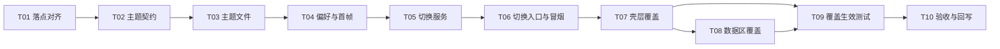

# PLAN-0003 主题体系实施

| 版本 | 日期 | 状态 | 作者 | 说明 |
| :--- | :--- | :--- | :--- | :--- |
| 0.1 | 2026-11-25 | 草稿（待评审） | lukan | 按 `DESIGN-0003` 0.9 与基线 1.4/1.1 拆解：工程落点对齐、主题契约、主题文件、首帧、切换、控件覆盖、验收与回写；上游为 `DESIGN-0003` 与 `PLAN-0002` 的 T05/T06 |

## 1 目标与完成定义

本计划把“一份主题、一种语言、一层映射”从设计落成可运行的主题：用户能在标题栏切换亮、暗、跟随系统，切换不重启也不跳布局；界面取色只来自一份编译进应用的主题文件；设计基线的语义名在代码里只有一处取值。

完成定义同时满足六条：

1. `ImageLyre.Presentation.Desktop` 拥有主题实现（主题文件、偏好读取、切换服务与首帧接线），`ImageLyre.App` 只在 `UseAtomUI` 回调里转交一次配置，不出现 Token 名与主题 Id。
2. `ImageLyre.Shell.Contracts` 提供 `IThemeService`、`ThemePreference`、`ThemeOption`、`ThemeChoice`、`ThemeChangeOutcome`，契约层不引用 Avalonia 与 AtomUI。
3. 主题文件 `Themes/Lyre.theme.xml` 以 `AtomUIThemeDefinition` 编译进包：种子与颜色类覆盖可改，字号、间距、线宽、圆角与状态语法冻结；主题出现在 `IThemeManager.Themes`，构建期绑定零诊断。
4. 首帧正确：以暗色偏好启动时第一个可见帧就是暗色；跟随系统时按平台当前明暗解析；不存在“先亮后暗”。
5. 切换语义完整：`ApplyAsync` 的 `Committed`、`NoOp`、`Superseded`、`Failed` 四种终态都有对应行为，`Superseded` 由服务消化，`Failed` 不改视觉；主题选择与明暗偏好分别持久化。
6. 既有 61 项测试、`verify-m1.ps1` 与 `smoke-m1.ps1` 保持通过；新增契约、首帧、切换与覆盖生效测试，以及三条守卫检查。

本计划不含第二套主题（高对比）、用户主题目录、密度与缩放的实现，也不含 `DataGrid` 的控件覆盖；这些要么在 `DESIGN-0003` §4.6 与 §12 里另排，要么等对应控件包接入。

## 2 前置条件

1. 上游文档：`docs/design/lukan/DESIGN-0003-主题体系.md` 0.9、`docs/reference/2026-11-20-appearance/` 下的 `color-tokens.md` 1.4、`spacing.md` 1.1、`typography.md` 2.0、`controls.md` 1.1、`state-model.md` 0.1、`main-window-spec.md` 0.2。
2. 工具链与基线：.NET 10 SDK、PowerShell 7；AtomUI 6.3.0 与 Avalonia 12.2.0 成组锁定；`dotnet build src/ImageLyre.slnx` 0 警告 0 错误；7 套测试 61 项；两份验收脚本各六项通过。
3. 分支与工作树：本计划在 `lukan/dev/theme-design` 与工作树 `ImageLyre-theme` 上执行，主题相关提交不落到 `dev`；合回 `dev` 前先等启动宿主线把未提交改动提交完。
4. 交接点：`PLAN-0002` 的 T05/T06 负责把欢迎窗与 AtomUI 主题注册迁进 `ImageLyre.Presentation.Desktop`，本计划的 T02 起全部在该工程内落地；`PLAN-0002` 已声明不立 `ImageLyre.Themes`，本计划不新增工程，`DESIGN-0003` §6.1 的落点按 T01 回写。
5. 约定：每个新目录先写说明再写代码；主题文件按控件分节并注明设计文档章节；提交信息中文带 scoped 前缀；测试以 DLL 直接执行，不依赖 MTP 命名管道。

## 3 批次与任务

五个批次串行门禁，上一批完成判据未过不进入下一批；批次内允许并行，但 T01、T04、T05、T10 各自独占完成点。

`DESIGN-0003` §11 的 T0–T6 是设计侧路线，本计划把它重切成 T01–T10：T0 已随存档迁移完成；设计 T1（骨架与首帧）对应本计划 T02–T04；设计 T2（令牌映射全量）对应 T03 与 T07–T08；设计 T3（控件覆盖）对应 T07–T09；设计 T4（切换与首选项）对应 T05–T06；设计 T5（插件边界）只取守卫部分进 T10；设计 T6（第二套主题）不在本计划内。

| 任务 | 批次 | 前置 | 产出 | 完成判据 |
| :--- | :--- | :--- | :--- | :--- |
| T01 落点对齐与登记 | B1 | `PLAN-0002` T05 合并 | `DESIGN-0003` §6.1 改写为“实现并入 `ImageLyre.Presentation.Desktop`，不新建 `Shell.Theme`”；该工程 README 增加“主题归属”一节；`docs/plans/lukan/PLAN-0002` 的交接点回指本计划 | 三份文档对同一落点；不新增工程，`verify-m1.ps1` 的 roots 不需扩；无需新测试即可构建通过 |
| T02 主题契约 | B1 | T01 | `Shell.Contracts/Theming/`：`ThemePreference`、`ThemeOption`、`ThemeChoice`、`ThemeChangeOutcome`、`IThemeService`；`tests/UnitTest.ImageLyre.Shell.Contracts` 或现有契约测试补用例 | 契约层引用闭包不含 Avalonia、AtomUI；`ThemeChoice` 的空主题 Id 语义（语言默认条目）有测试；XML 注释写明线程、并发、失败与事件顺序四条契约 |
| T03 主题文件与编译 | B2 | T02 | `Presentation.Desktop/Themes/Lyre.theme.xml`：种子（`ColorPrimary`、`ColorBgLayout`、`ColorBgContainer`、`ColorBorder`、`ColorText`、`FontSize`、`BorderRadius`、`LineWidth`）与冻结项（圆角各档 0、`LineWidthBold` 1、`BoxShadows*`、`InputActiveShadow*`、`ToolTipShadows`、状态提示四值）；`AtomUIThemeDefinition` 构建项 | 构建期绑定零诊断；主题出现在 `IThemeManager.Themes`；单测断言 `ThemeSelection` 能解析该 Id，且暗色分支的 `ColorBgLayout` 与基线一致 |
| T04 偏好存储与首帧 | B2 | T03 | `ThemePreferenceStore`（`preferences.json`、原子写、损坏回落 `system` 并留档）；`Program` 在 `UseAtomUI` 前读取并调用 `WithInitialTheme`；`LYRE_SMOKE_THEME` 覆盖偏好，供冒烟用 | 暗色偏好启动时 stderr 打印首帧选择为 `Dark` 且窗口已可见时为暗色；文件损坏时回落 `System` 并继续启动；不出现“启动后再 `ApplyAsync`”的路径 |
| T05 切换服务 | B3 | T04 | `AtomThemeService`：串行队列、`Superseded` 消化、`Failed` 不改视觉、持久化两段（先提交后写盘）；注册进 Bootstrap 的服务回调，与 `ILocalizationService` 同一处 | 并发调用只发生一次提交；被替代调用得到最新意图结果；主题 Id 不存在返回 `Failed`；持久化失败返回 `Committed` 并记诊断；单测覆盖四种终态 |
| T06 切换入口与 IX-11 冒烟 | B3 | T05 | 标题栏主题入口（三档）或设置页最小入口；`LYRE_SMOKE_THEME_SWITCH` 冒烟钩子；切换时刷新标题栏状态 | 切换后 `CurrentSelection.Appearance` 与用户选择一致；窗口尺寸与面板宽度不变；`smoke-m1.ps1` 现有六项不回退，新增一项切换断言 |
| T07 壳层覆盖 | B4 | T06 | `Controls[…]` 覆盖：`Window` 标题栏、`Menu`、`TabControl`、`SplitView`；每个控件一节注释并注明 `controls.md` 章节 | 每个控件一张“规格 vs 覆盖点”小表；改任一 Token 后该控件的像素或属性发生变化；未覆盖处不残留 antd 蓝与圆角 |
| T08 数据区覆盖 | B4 | T07 | `Button`、`CheckBox`、`ToolTip`、`ListBox`、`TreeView` 的覆盖；状态提示条（`Alert` 或自绘内联条）接入 `ColorWarning`/`ColorError` | 同 T07 的判据；提示条灰度截图下仍可辨（图标 + 文案），对比度记录写入验收 |
| T09 覆盖生效测试 | B4 | T07、T08 | 逐控件生效测试：在主题作用域内改一个 Token，断言目标控件的视觉属性或尺寸变化；未覆盖的控件不受影响 | 至少覆盖 T07、T08 的每个控件各一条；改 `ControlItemBgActive` 能验证选中底变色；覆盖失效的条目为零 |
| T10 验收、守卫与回写 | B5 | T09 | 取色断言（资源值比对或截图取色，二者择一并记录）、100 次切换内存、`verify-m1.ps1` 三条新守卫、`DESIGN-0003`/`AGENTS.md`/`README.md` 回写 | 验收 A–H 全绿；三条守卫进脚本且对现状为绿；`PLAN-0003` 填完成记录 |

## 4 依赖与顺序

四条顺序约束不可打乱：

- T01 必须先于 T02：工程落点没定就写契约与主题文件，会在 `Shell.Theme` 与 `Presentation.Desktop` 之间出现两套目录，迁移成本高于先对齐。
- T03 必须先于 T04：首帧接线依赖主题 Id 与文件已能编译，否则 `WithInitialTheme` 只能指向语言默认条目，首帧颜色不可控。
- T04 必须先于 T05：先有正确的首帧，运行时切换才有“起点”可比；反过来做会把首帧缺陷误判为切换缺陷。
- T07、T08 必须先于 T09：覆盖生效测试要针对已存在的覆盖写断言，顺序颠倒等于先写测试再猜覆盖点。

## 5 验收标准

验收在完整树上执行，每条记录提交号与命令；任一条不通过即整批退回。

| 编号 | 验收项 | 通过判据 |
| :--- | :--- | :--- |
| A 构建与测试 | `dotnet build src/ImageLyre.slnx`；全部测试 DLL | 0 警告 0 错误；61 项既有测试无回退；契约、首帧、切换、覆盖生效测试通过 |
| B 首帧 | 以暗色偏好启动；以跟随系统启动 | 前者首帧即暗；后者首帧等于平台当前明暗；两次都不出现亮色闪帧（录屏取证一次并记入验收） |
| C 切换 | 三次连续切换、快速连点、切换到不存在的主题 Id | 每次只发生一次提交；布局与窗口尺寸不变；不存在的 Id 返回 `Failed` 且视觉不变；重启后仍是最后选择 |
| D 取色 | 读取 `ColorBgLayout`、`ColorBgContainer`、`ColorBorder`、`ColorText`、`ColorPrimary`、`ColorWarning`、`ColorError` 的实际值 | 与 `DESIGN-0003` §5.1 表逐项相等；若 AtomUI 不公开资源键，退化为截图取色并把退化原因写进验收记录 |
| E 覆盖生效 | 逐控件改一个 Token 并观察 | 目标控件变化、相邻控件不变；未覆盖处不出现 antd 蓝、圆角与投影 |
| F 主题文件纯度 | 主题 XML 与检查脚本 | 只出现颜色类 Token 与允许的种子；几何冻结项齐全；白名单脚本通过 |
| G 守卫 | `verify-m1.ps1` 三条新检查 | 插件工程不出现 `WithInitialTheme`、`ApplyAsync`、`ThemeConfigProvider`；XAML 无十六进制色值；主题文件 Token 白名单通过 |
| H 文档与纪律 | `DESIGN-0003`、`PLAN-0003`、`AGENTS.md`、`README.md`、工程 README | 落点、计数、验收记录与实际一致；无“先实现后解释”的条目 |

## 6 风险与应对

| 风险 | 触发条件 | 应对 |
| :--- | :--- | :--- |
| 与启动宿主线撞车 | `ImageLyre.Presentation.Desktop` 未合并就开工 | T01 以 `PLAN-0002` T05 合并为前置；等待期只写主题文件内容与文档，不建目录、不写代码 |
| 覆盖合法但无视觉效果 | Token 名写对但控件不消费，配置静默失效 | 每个覆盖项配一条生效测试（T09）；覆盖表逐行记 6.3.0 基线，升级时按表复核 |
| AtomUI 升级改 Token 词法 | 升级后主题文件绑定诊断报错 | 主题文件与包版本成组锁定；构建期绑定失败即阻断，不留到运行期 |
| 首帧闪白 | 有人在 `OnFrameworkInitializationCompleted` 里补一次 `ApplyAsync` | T04 只保留 `WithInitialTheme` 一个入口；冒烟断言首帧选择并进脚本 |
| 偏好文件损坏或只读 | 便携运行、磁盘满、手工编辑错 | 回落 `system` 并留档；只读时不写盘、会话内生效并记诊断（`DESIGN-0003` §8） |
| 主题文件膨胀 | 覆盖随控件增长到数百行 | 按控件分节并注明设计章节；超过 500 行时拆分 `<Control>`，不拆文件 |
| 调色反复 | 警告色等取值调整 | 调色只改主题文件与 `color-tokens.md`，映射与代码不动；T09 的测试断言 Token 名而非具体色值 |
| 设置界面未就绪 | 切换入口依赖未完成的设置页 | T06 先做标题栏入口，设置页后接；`IThemeService` 不依赖界面 |

## 7 交付物

- `src/App/ImageLyre.Presentation.Desktop/Themes/Lyre.theme.xml` 与主题注册接线；
- 该工程的 `Theming/`：偏好存储、切换服务、首帧配置；
- `src/Infrastructure/Contracts/ImageLyre.Shell.Contracts/Theming/` 的契约；
- 两份冒烟钩子（`LYRE_SMOKE_THEME`、`LYRE_SMOKE_THEME_SWITCH`）与 `verify-m1.ps1` 的三条守卫；
- 覆盖表与逐控件生效测试；
- `DESIGN-0003`、`PLAN-0002`、`AGENTS.md`、`README.md` 与工程 README 的回写。

不交付：第二套主题、用户主题目录、密度与缩放实现、`DataGrid` 覆盖。

## 8 变更与例外

本计划的改动只能通过增补任务与判据完成。实现中发现与 `DESIGN-0003` 冲突的地方，先改设计再改代码，并在提交说明里写明对应条目；`DESIGN-0003` 的版本表必须留痕。临时例外写入 `DESIGN-0003` §12 的待拍板表，不留在对话里。调色、换警告色一类纯取值调整不属于计划变更，只改主题文件与 `color-tokens.md`。

2026-11-25 进度：本计划初版落库，B1 未开始。开工前置已有部分进展——`ImageLyre.Presentation.Desktop` 已随 `ccd10f9`（2026-11-25 00:04）进入 `dev`，但主题分支基点 `aa5efa1` 不含该提交，故 T01 之前先把 `lukan/dev/theme-design` rebase 到 `dev`；T01 的落点改动同时登记在 `DESIGN-0003` §12 第 9 条待拍板。
