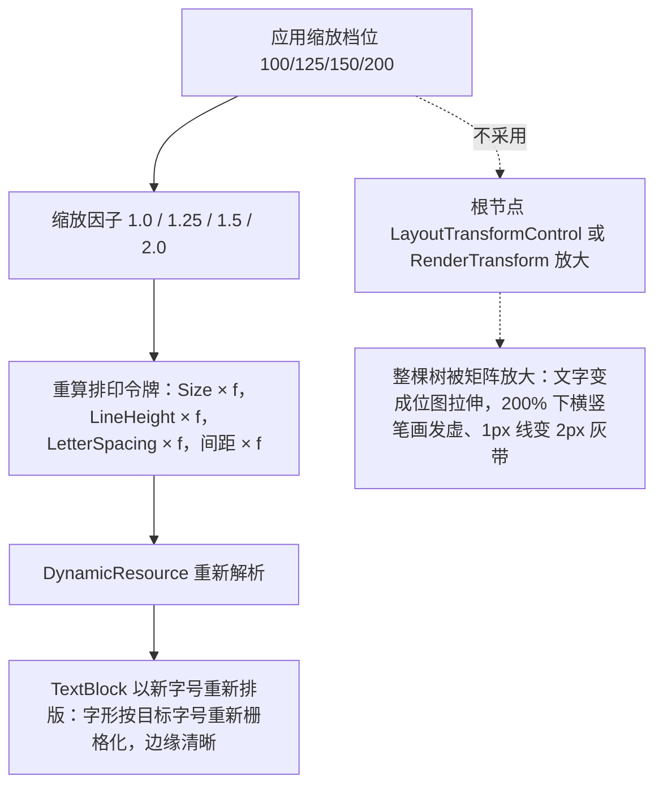

# ImageLyre 排印基线的 Avalonia 落地规范

| 版本 | 日期 | 状态 | 作者 | 说明 |
| :--- | :--- | :--- | :--- | :--- |
| 1.0 | 2026-11-20 | 现行 | lukan | 把 `typography.md` 的设计值映射为 Avalonia 12.1.6 / AtomUI 6.2.15 可执行规范；只定规范，不含生产代码 |
| 1.1 | 2026-11-20 | 现行 | lukan | 对齐设计值 1.1：中文只用 400、10 档不给中文；新增 Mermaid 说明为何不用 LayoutTransform，并标注 U3 的 Ant 默认值为待验证假设 |

> 本文是给架构的落地参考，由架构维护；设计契约是 `typography.md` 2.0（四档 11/13/16/20）。本文现有映射按 1.x 的八档写成，字号与令牌映射待架构按 2.0 更新；API 选择、令牌钉法、待实测项与验收脚本由架构决定，设计只认 `typography.md` 的数值、角色与验收语言。

本文是 `docs/reference/2026-11-20-appearance/typography.md`（下称"设计值"）在桌面端的实现口径，读者是接手的 Avalonia 研发与后续验收者。设计值给出的是字体、八档字号、字重、行高、数字规则、对比度与缩放要求；本文只回答一件事：这些数值在 Avalonia 12.1.6 与 AtomUI 6.2.15 上分别落到哪个 API、哪个资源键、哪种类型，以及哪些点因为本仓版本限制只能标为待实测。

文中"已核实"指本次通过包内元数据、运行时探针或 XAML 编译器验证过的结论，验证方法与临时工程见第 1 节；"待实测"指本仓当前无法验证、必须由研发在真机或已还原的工程上测一次的点，第 10 节汇总了全部待实测项。

## 1 版本与依据

### 1.1 实际版本

| 组件 | 版本 | 依据 |
| :--- | :--- | :--- |
| Avalonia | 12.1.6 | `Directory.Packages.props` 第 7、8 行（`Avalonia`、`Avalonia.Desktop`） |
| AtomUI.Desktop.Controls | 6.2.15 | `Directory.Packages.props` 第 9、10 行（含 `.DataGrid` 分包） |
| 目标框架 | net10.0 | `Directory.Build.props` 第 6 行 |
| 基础 UI 库 | Cangming.Toolkit.Avalonias.AtomUI 0.1.8.1117 | `Directory.Packages.props` 第 18 行；`src/Apps/ImageLyre.App/Program.cs` 第 66 行 `.UseCangmingAtomUI()` |
| 主题工程 | `src/Libs/ImageLyre.Themes`，当前只有 `README.md` 与对 AtomUI 的包引用 | 工程目录实况；其 `README.md` 第 34 行自述"令牌表尚未落笔" |
| 应用壳 | `src/Apps/ImageLyre.App/App.axaml`，`RequestedThemeVariant="Light"`，`Application.Styles` 为空 | 文件实况 |

本仓的 SDK 固定与真机不一致：`global.json` 要求 `10.0.404`，本机只装了 `10.0.403`，且 `ImageLyre.App` 从未还原（无 `obj/`），`Cangming.Toolkit.Avalonias.AtomUI` 也不在本机 NuGet 缓存内，因此**本次无法在仓内编译或运行任何界面**，凡需运行期确认的结论都降级为待实测。本文的全部"已核实"来自三个仓库外的临时探针工程（`%TEMP%\fontprobe`、`%TEMP%\breakprobe`、`%TEMP%\xamlprobe`，未写入本仓、未引用本仓工程）：

| 手段 | 覆盖的问题 | 结论强度 |
| :--- | :--- | :--- |
| Mono.Cecil 读取 `AtomUI.Core.dll`、`AtomUI.Desktop.Controls.dll`、`Avalonia.Base.dll`、`Avalonia.Controls.dll`、`Avalonia.Skia.dll`、`Avalonia.HarfBuzz.dll` 的元数据与 IL | 类型、属性、继承标记、默认值、LetterSpacing 的实际算法 | 强（读到的是包内真身） |
| SkiaSharp 3.119.4（Avalonia.Skia 12.1.6 的依赖版本）直接调用 `SKFontManager` | 字体族解析、字重匹配、字符宽度、字形覆盖 | 强：`Avalonia.Skia.dll` 只含一个 `Avalonia.Skia.FontManagerImpl`，`Avalonia.Win32.dll` 里没有任何名字含 `FontManager` 的类型，故 Skia 的解析结果就是 Avalonia 的解析结果 |
| HarfBuzzSharp 8.3.1.3（Avalonia.HarfBuzz 12.1.6 的依赖版本）整形对比 | `tnum`/`lnum`/`pnum` 是否真的改变数字宽度 | 强 |
| 引用 Avalonia 12.1.6 的程序直接调用 `LineBreakEnumerator`、`FontFeatureCollection.Parse`、读取属性元数据 | 不换行空格是否真的不断行、属性是否可继承、默认值 | 强 |
| Avalonia XAML 编译器（`Avalonia` 12.1.6 包内的 Build.Tasks）编译探针样式 | 资源与 Setter 的写法能否通过编译 | 强（先以故意写错的属性验证编译器确实在跑，报 `AVLN2000`，再换成目标写法） |

### 1.2 本文依据的文件

- 设计值：`docs/reference/2026-11-20-appearance/typography.md`（第 1–13 节全文，尤其第 2、3、4、5、8、9 节）。
- 版本：`Directory.Packages.props`、`Directory.Build.props`、`global.json`。
- 现有资源：`src/Libs/ImageLyre.Themes/README.md`、`src/Apps/ImageLyre.App/App.axaml`、`src/Apps/ImageLyre.App/Program.cs`。
- 架构约束：`docs/design/lukan/DESIGN-0003-libs-layering.md`（Themes 工程只放资源与常量，不放逻辑）、`docs/design/lukan/DESIGN-0001-docs-convention.md`（文档归档口径）。

## 2 单位与缩放

### 2.1 三种尺度必须分开算

Avalonia 里只有一个书写单位，就是 DIP；一个 DIP 最终落到多少物理像素，由两个互相独立的因子相乘决定，这两个因子在代码里绝不能混成一个"缩放"概念：

| 因子 | 来源 | 是否可写 | 变化时机 | 谁消费 |
| :--- | :--- | :--- | :--- | :--- |
| 系统 DPI 缩放（`RenderScaling`） | 操作系统每显示器 DPI；Avalonia 侧只读：`TopLevel.RenderScaling`（get-only）、`Screen.Scaling`、`TopLevel.ScalingChanged` 事件 | 不可写，只能读 | 窗口移到另一块屏、用户在系统设置里改缩放 | 渲染后端，把 DIP 换算成像素 |
| 应用内界面缩放（100%–200%） | 设计值第 9 节要求的产品行为 | 必须自己实现（见 2.3） | 用户点界面缩放按钮 | 令牌数值本身 |
| 图像缩放（画布 200%） | 样本放大，不是界面放大 | 由画布视图自己管 | 用户缩放图像 | 只影响图像绘制矩阵，不影响任何文字 |

物理像素的换算式只有一条：`物理像素 = DIP × 应用缩放因子 × RenderScaling`。设计值第 9 节写的"200% 时最小 20px 物理像素"隐含了两个前提，即应用缩放 200% 且系统 DPI 缩放 100%；在 150% 系统缩放下应用 200% 的实际最小物理高是 `10 × 2 × 1.5 = 30` 像素，反之在 125% 系统缩放下、应用 100% 时 10 DIP 只有 12.5 物理像素，正是第 8 节第 3 条风险的来源。

### 2.2 Avalonia 没有内置的界面缩放开关

检索 12.1.6 的公开 API 只找到 `Key.Zoom`（键盘枚举）、`Screen.Scaling`、`TopLevel.RenderScaling` 与 `TopLevel.ScalingChanged`，没有任何"设置全局 UI 缩放百分比"的入口，因此应用内 100%–200% 必须由本仓自己实现。可选路径与取舍如下：



推荐路径是重算令牌（C 行），因为 Avalonia 的 `FontSize` 是 DIP 数值、`LineHeight` 是 DIP 数值，两者改变会触发文本重新整形与字形重新栅格化，只有这条路能在 200% 下保持字形锐利。不采用 `LayoutTransformControl`（虽然 12.1.6 里确实存在，且带 `UseRenderTransform` 开关）的原因是它只做几何变换，不重排文本，放大后是位图拉伸。

### 2.3 缩放后的令牌表

缩放因子只作用于字号、行高、字距与间距，不作用于线宽与圆角的语义（1px 细线在 150% 下变成 1.5 物理像素必然发灰，这一点由 `Layoutable.UseLayoutRounding`（12.1.6 已核实存在）缓解，但仍不能保证 1px 永远是 1 物理像素，属于可接受的降级）。八档在四个缩放档下的数值：

| 档 | 100% | 125% | 150% | 200% |
| :--- | :--- | :--- | :--- | :--- |
| 24 / 32 | 24 / 32 | 30 / 40 | 36 / 48 | 48 / 64 |
| 20 / 28 | 20 / 28 | 25 / 35 | 30 / 42 | 40 / 56 |
| 18 / 24 | 18 / 24 | 22.5 / 30 | 27 / 36 | 36 / 48 |
| 16 / 24 | 16 / 24 | 20 / 30 | 24 / 36 | 32 / 48 |
| 14 / 20 | 14 / 20 | 17.5 / 25 | 21 / 30 | 28 / 40 |
| 12 / 20 | 12 / 20 | 15 / 25 | 18 / 30 | 24 / 40 |
| 11 / 16 | 11 / 16 | 13.75 / 20 | 16.5 / 24 | 22 / 32 |
| 10 / 16 | 10 / 16 | 12.5 / 20 | 15 / 24 | 20 / 32 |

125% 与 150% 会出现 13.75、22.5 这类分数 DIP，Avalonia 不会对字号取整（字号是 double，栅格化时按 DIP 计算），因此不必为凑整而改动档位数值；但间距与列宽若取整，必须整列同向取整，否则同一行的数字与单位会错位一像素。

### 2.4 缩放的实现约束

缩放因子不得写成控件里的常量，而应由 `ImageLyre.Module.Appearance`（`ImageLyre.Themes/README.md` 第 3 行已把"现在用哪个主题"归给该模块，缩放档位与主题是同一类运行期状态）写进令牌，再由 `DynamicResource` 让界面重新解析；这一点与主题切换是同一条机制，区别只在写的是数值型令牌还是颜色型令牌。缩放档位切换时必须同时重算排印令牌与间距令牌，只改字号会造成行高不足与切字。

## 3 字体与回退

### 3.1 结论先行

界面字体与等宽字体的选择必须落到 `FontFamily` 资源，中文回退落到 `FontManagerOptions.FontFallbacks`（12.1.6 已核实存在 `DefaultFamilyName`、`FontFallbacks`、`FontFamilyMappings` 三个属性，`FontFallback` 由 `FontFamily` 与 `UnicodeRange` 组成），**不要**照抄设计值第 1 节的 `font-family` 栈字面量，因为 Avalonia 的 `FontFamily` 支持逗号分隔的多字体名但不做 Unicode 范围协商，中文落哪款字由回退表决定。

### 3.2 Windows

本机实测（Skia 解析，等价于 Avalonia，理由见 1.1）：

| 名称 | 能否解析 | 说明 |
| :--- | :--- | :--- |
| `Segoe UI Variable Text` | 能 | 解析结果族名完全一致，2530 字形；这是 Win11 的可变字体 Optical Size 变体之一 |
| `Segoe UI Variable` | **不能** | 裸族名返回 null；系统里只有 `Segoe UI Variable Text`、`Segoe UI Variable Small`、`Segoe UI Variable Display` 三个名字 |
| `Segoe UI` | 能 | 5395 字形，作为 Win10 与可变字体缺席时的回退 |
| `Microsoft YaHei UI` | 能 | 30209 字形，中文主回退 |
| `Cascadia Mono` / `Consolas` | 能 | 等宽主选与次选 |

因此 Windows 的 `FontFamily` 应写 `Segoe UI Variable Text, Segoe UI`（12.1.6 的 `FontFamily` 带 `FamilyNames` 集合，逗号分隔的多族名由它承载，但拉丁与中文的分工必须靠 `FontFallbacks` 而不是这个列表），中文用 `FontFallbacks` 显式指定 `Microsoft YaHei UI` 覆盖 CJK 统一表意区；不要写 `Segoe UI Variable`，写了就静默落到下一个族。

### 3.3 macOS 与 Linux

这两端本次无法核实（本机只有 Windows），只能给出可验证的配置意图，落地前必须逐条实测：macOS 主字体取 `SF Pro Text`（若不可解析则 `Helvetica Neue`），中文回退 `PingFang SC`，等宽 `SF Mono` 后接 `Menlo`；Linux 主字体取 `Noto Sans` 后接 `DejaVu Sans`，中文回退 `Noto Sans CJK SC` 后接 `Source Han Sans SC`，等宽 `DejaVu Sans Mono` 后接 `Liberation Mono`。注意本机实测给出了一个反例：这台 Windows 上装了 `Noto Sans SC` 却没有 `Noto Sans CJK SC`（后者解析为 null），说明 Linux/Windows 上的 Noto 家族命名并不统一，把 `Noto Sans CJK SC` 写死会在部分发行版上整段中文回落失败。

不用下载字体这条设计约束在 Avalonia 里的落点是：不要通过 `FontFamilyMappings` 或 `avares://` 嵌入字体，也不要把 AtomUI 自带的 `AlibabaSans`（包 `AtomUI.Fonts.AlibabaSans` 6.2.15，随依赖进入输出目录）设为默认族。AtomUI 6.2.15 提供了 `IThemeManagerBuilder.WithDefaultFontFamily(string)` 与 `WithDefaultFontFamily(FontFamily)`，这是设置默认族的官方入口；而本仓入口 `.UseCangmingAtomUI()` 是否把 builder 暴露出来尚未核实（该包不在本机缓存内），因此这一条列进待实测。

### 3.4 中文与拉丁分工

设计值第 1、6 节的规则在 Avalonia 里的三条硬约束：

1. 拉丁与中文都由同一个 `FontFamily` 起头、中文靠回退表命中，而同一行里两者共用一条基线，中文字面比拉丁更满，行高不足时先显得贴顶，所以行高必须按设计值第 6 节的"按中文给"；实测两种字体在 12px 的自然行高分别是 Segoe UI Variable Text 15.96 DIP 与 Microsoft YaHei UI 15.24 DIP，都低于设计给的 20 DIP，因此 12/20 在两种字体上都不会裁字。
2. 等宽族里**没有汉字**：实测 `Cascadia Mono` 仅 1780 字形且 `中` 取不到字形，`Consolas` 3031 字形同样取不到；因此等宽列一旦混入中文，就会按字符逐个回退到 YaHei，列宽立刻失准（Cascadia Mono 每字符 7.03 DIP @12px，汉字回退后是 12 DIP）。等宽列只允许数字、拉丁 ID、单位、文件名。
3. 单位里的 `µ`（U+00B5）与 `²`（U+00B2）在等宽族里有真字形且占满一格（Cascadia Mono 实测均 703/1200 em，与数字同宽），所以 `µm²` 可以留在等宽列内；但 `−`（U+2212）在等宽族里同样占满一格，而在 YaHei 里是 890/2048 em（比数字 704 宽 26%），一旦回退就会把小数点顶偏，见第 5 节。

## 4 令牌表

### 4.1 命名、类型与取值

令牌全部落在 `src/Libs/ImageLyre.Themes`（该工程按 DESIGN-0003 只放资源与常量）。命名用三段式 `Lyre.Typography.<维度>.<档>`，维度只允许 `FontFamily`、`Size`、`LineHeight`、`Weight`、`LetterSpacing` 五种，档位命名与设计值的数字一致，避免出现"小/中/大"这类会随主题漂移的别名：

| 资源键 | Avalonia 类型 | 值 | 说明 |
| :--- | :--- | :--- | :--- |
| `Lyre.Typography.FontFamily.Ui` | `FontFamily` | `Segoe UI Variable Text, Segoe UI` | 平台相关，按第 3 节分平台给 |
| `Lyre.Typography.FontFamily.Mono` | `FontFamily` | `Cascadia Mono, Consolas` | 等宽，只放数字与拉丁 |
| `Lyre.Typography.Size.24` … `.10` | `double` | 24 / 20 / 18 / 16 / 14 / 12 / 11 / 10 | 八档，不允许出现第九个键 |
| `Lyre.Typography.LineHeight.24` … `.10` | `double` | 32 / 28 / 24 / 24 / 20 / 20 / 16 / 16 | 绝对 DIP |
| `Lyre.Typography.Weight.Regular` | `FontWeight` | `Normal`（400） | 中文唯一可用字重 |
| `Lyre.Typography.Weight.Medium` | `FontWeight` | `Medium`（500） | 仅拉丁：面板标题、按钮、选中项、命令面板标题 |
| `Lyre.Typography.Weight.SemiBold` | `FontWeight` | `SemiBold`（600） | 仅拉丁：窗口标题、段标题、表头 |
| `Lyre.Typography.LetterSpacing.Tight24` | `double` | -0.24 | 设计 -0.01em @24 |
| `Lyre.Typography.LetterSpacing.Tight18` | `double` | -0.18 | 设计 -0.01em @18 |
| `Lyre.Typography.LetterSpacing.Caps11` | `double` | 1.10 | 设计 0.10em @11，仅拉丁大写 |
| `Lyre.Typography.LetterSpacing.Menu12` | `double` | 0.12 | 设计 0.01em @12，仅拉丁 |
| `Lyre.Typography.LetterSpacing.None` | `double` | 0 | 中文与数字一律用这个 |

### 4.2 字距必须换算成 DIP，不能照抄 em

这一条是本次核实里最容易被凭记忆写错的地方。`TextBlock.LetterSpacing` 在 12.1.6 里是绝对 DIP，不是 em：`Avalonia.Harfbuzz.HarfBuzzTextShaper.ShapeText` 的 IL 里，每个字形的推进量是 `GetGlyphAdvance(...) + get_LetterSpacing()`，中间没有任何按字号缩放的乘算。因此设计值第 4 节的 `-0.01em`、`0.10em` 必须先换算成 DIP 再写进令牌，换算结果就是上表的 -0.24、-0.18、1.10、0.12；若直接把 `0.10` 写进 `LetterSpacing`，11px 的段标题只会多出 0.1 DIP，肉眼完全看不出字距，等于设计意图丢失。

另有一个副作用必须写进规范：Avalonia 是把字距加在**每个字形**上的，所以最后一个字形后面也会多出一份字距，右对齐的数字列若设了非零字距，右边界会多出一个字距的空白；这就是设计值要求"数字列字距 0"的第二个理由（第一个是等宽本身不需要）。

### 4.3 行高是绝对值，且都高于自然行高

`TextBlock.LineHeight` 默认值是 `NaN`（已核实元数据），即"自动"；设成数值后它就是该段落的绝对行高，与字号没有乘算关系。设计值的八档行高是否够高，取决于字体自然行高，本次实测各字体在八档下的自然行高（`-ascent + descent + leading`）全部小于设计值：

| 档 | 设计行高 | Segoe UI Variable Text | Microsoft YaHei UI | Cascadia Mono | Consolas |
| :--- | :--- | :--- | :--- | :--- | :--- |
| 24 | 32 | 31.92 | 30.48 | 27.89 | 28.10 |
| 20 | 28 | 26.60 | 25.40 | 23.24 | 23.42 |
| 18 | 24 | 23.94 | 22.86 | 20.92 | 21.08 |
| 16 | 24 | 21.28 | 20.32 | 18.59 | 18.73 |
| 14 | 20 | 18.62 | 17.78 | 16.27 | 16.39 |
| 12 | 20 | 15.96 | 15.24 | 13.95 | 14.05 |
| 11 | 16 | 14.63 | 13.97 | 12.78 | 12.88 |
| 10 | 16 | 13.30 | 12.70 | 11.62 | 11.71 |

24/32 这一档余量只有 0.08 DIP（Segoe UI Variable Text 31.92 vs 32），属于临界值：任何一处把 24 档设成 31 或让行高继承到 24 号字上，就会出现裁字或行距塌陷，因此 24 档必须显式绑定 `Lyre.Typography.LineHeight.24`，不能依赖默认值。

### 4.4 属性一律可继承，因此禁止在根节点设全局值

已核实的属性元数据（`AvaloniaProperty.Inherits` 与默认值）：

| 属性 | 可继承 | 可附加 | 类型 | 默认值 |
| :--- | :--- | :--- | :--- | :--- |
| `TextBlock.FontSize` | 是 | 是 | `double` | 12 |
| `TextBlock.FontFamily` | 是 | 是 | `FontFamily` | `$Default` |
| `TextBlock.FontWeight` | 是 | 是 | `FontWeight` | `Normal` |
| `TextBlock.LineHeight` | 是 | 是 | `double` | `NaN` |
| `TextBlock.LineSpacing` | 是 | 是 | `double` | 0 |
| `TextBlock.LetterSpacing` | 是 | 是 | `double` | 0 |
| `TextBlock.FontFeatures` | 是 | 是 | `FontFeatureCollection` | null |
| `TextBlock.TextWrapping` | 是 | 是 | `TextWrapping` | `NoWrap` |
| `TextBlock.TextTrimming` | 是 | 是 | `TextTrimming` | `None` |
| `TextBlock.MaxLines` | 是 | 是 | `int` | 0（不限） |
| `TextBox.LineHeight` | 是 | 是 | `double` | `NaN` |

两个直接后果：第一，`FontSize` 默认 12 恰好等于设计值的正文档，所以"什么都不设"的界面在字号上是合规的，这降低了漏设的风险；第二，正因为全部可继承，**不允许**在 `Window` 或根 `Grid` 上设 `LineHeight`、`LetterSpacing`、`FontSize`，否则 24 档的样本号会继承 20 的行高而裁字、拉丁大写的 1.10 字距会落到中文标签上。正确做法是每条语义角色各有一条样式，样式里逐项引用令牌，见 4.5。

`LineSpacing` 是 12.x 新增的"行间额外间距"，与 `LineHeight`（整行高度）语义不同；本规范只用 `LineHeight`，`LineSpacing` 保持默认 0，两者叠加会导致行高不可预测（叠加规则待实测，见第 10 节）。

### 4.5 令牌与语义角色的两层结构

`ImageLyre.Themes/README.md` 第 17 行要求"数值只有一份"，因此数值只在上表的阶令牌里出现一次，语义角色层只做引用：角色样式通过 `Style` 的 Setter 指向阶令牌，颜色通过 `ThemeVariant` 资源给（见第 6 节），两者都不写字面量。已用 Avalonia XAML 编译器验证可编译的写法如下（`Assets` 为示意目录名，落地时按 Themes 工程实际结构放）：

```xml
<ResourceDictionary xmlns="https://github.com/avaloniaui"
                    xmlns:x="http://schemas.microsoft.com/winfx/2006/xaml"
                    xmlns:sys="using:System">
  <sys:Double x:Key="Lyre.Typography.Size.14">14</sys:Double>
  <sys:Double x:Key="Lyre.Typography.LineHeight.14">20</sys:Double>
  <FontWeight x:Key="Lyre.Typography.Weight.Medium">Medium</FontWeight>
  <FontFamily x:Key="Lyre.Typography.FontFamily.Mono">Cascadia Mono, Consolas</FontFamily>
</ResourceDictionary>
```

```xml
<Style Selector="TextBlock.readout-m">
  <Setter Property="FontFamily" Value="{DynamicResource Lyre.Typography.FontFamily.Mono}" />
  <Setter Property="FontSize" Value="{DynamicResource Lyre.Typography.Size.14}" />
  <Setter Property="LineHeight" Value="{DynamicResource Lyre.Typography.LineHeight.14}" />
  <Setter Property="FontWeight" Value="Normal" />
  <Setter Property="LetterSpacing" Value="0" />
  <Setter Property="TextAlignment" Value="Right" />
  <Setter Property="TextWrapping" Value="NoWrap" />
</Style>
```

上面的 `FontWeight="Normal"` 与 `FontFeatures="tnum,lnum"` 这类字面量也已验证可编译；`<FontWeight x:Key="...">Medium</FontWeight>` 这种把枚举写成资源的形式同样可编译，但 `FontWeight` 没有公开的 `Parse` 也没有 `TypeConverter` 特性，能编译是 XAML 编译器内部处理枚举的结果，因此建议**字重只写在 Setter 里，不做成资源键**，以减少一处依赖编译器内部行为的地方。

### 4.6 语义角色到档位的映射

| 角色 | 字号/行高 | 字重 | 字距 | 字体 | 令牌引用 |
| :--- | :--- | :--- | :--- | :--- | :--- |
| 样本号（身份主键，一屏一个） | 24 / 32 | Regular | None | Mono | Size.24 + LineHeight.24 + Tight24 |
| 窗口标题（应用名） | 18 / 24 | SemiBold | Tight18 | Ui | Size.18 + LineHeight.18 |
| 窗口标题（文件名） | 18 / 24 | Regular | Tight18 | Ui | 同上 |
| 面板标题 | 16 / 24 | 拉丁 SemiBold / 中文 Regular | None | Ui | Size.16 + LineHeight.16 |
| 读数 L | 20 / 28 | Regular | None | Mono | Size.20 + LineHeight.20 |
| 读数 M（六项 Results） | 14 / 20 | Regular | None | Mono | Size.14 + LineHeight.14 |
| 读数 S | 11 / 16 | Regular | None | Mono | Size.11 + LineHeight.11 |
| 正文 / 菜单 / 列表项 | 12 / 20 | Regular | Menu12（仅拉丁菜单） | Ui | Size.12 + LineHeight.12 |
| 段标题（拉丁大写段标题） | 11 / 16 | SemiBold | Caps11 | Ui | Size.11 + LineHeight.11 |
| 段标题（中文部分） | 11 / 16 | Regular | None | Ui | 同上，字距用 None |
| 字段标签 / 表头 | 11 / 16 | Regular（中文）/ SemiBold（拉丁） | None（拉丁表头字距 0） | Ui | Size.11 + LineHeight.11 |
| 单位（L / M / S） | 14 / 11 / 10 | Regular | None | Ui | 对应 Size 与 LineHeight |
| 状态栏 / 工具提示 | 11 / 16 | Regular | None | Ui | Size.11 + LineHeight.11 |
| 命令面板标题 | 14 / 20 | 拉丁 Medium / 中文 Regular | None | Ui | Size.14 + LineHeight.14 |
| 命令面板项 / 已保存状态 | 12 / 20、11 / 16 | Regular | None | Ui | 按档取 Size 与 LineHeight |
| 按钮 / 操作 | 12 / 20 | 拉丁 Medium / 中文 Regular | None | Ui | Size.12 + LineHeight.12 |
| 快捷键 / 哈希 / 版本 | 10 / 16 | Regular | None | Mono | Size.10 + LineHeight.10 |

## 5 数字

### 5.1 Cascadia Mono 与 Consolas 天然等宽数字

实测这两个族里**所列字形同宽**，不只是数字：`0`、`1`、`i`、`W`、`.`、`-`、`−`（U+2212）、`µ`、`²` 均为同一推进量，Cascadia Mono 是 703/1200 em，Consolas 是 660/1200 em，且 `0` 与 `1`、`i` 与 `W` 的差值都是 0，可判定为定宽族。有一个例外必须记住：窄不换行空格 U+202F 在 Cascadia Mono 里只占**半格**（351/1200 em），在 Consolas 里是整格（660/1200 em），因此设计值第 5.2 节要求的千分位窄空格在 Cascadia Mono 上只推进半格，给含千分位的列预留宽度时若按整格计算会多留半格空白，这一点在列宽按最长字符串测量的实现里自然消化，但写死列宽的实现会露馅。按字号换算成 DIP：

| 字号 | Cascadia Mono 单字符 | Consolas 单字符 |
| :--- | :--- | :--- |
| 10 | 5.86 | 5.50 |
| 11 | 6.44 | 6.05 |
| 12 | 7.03 | 6.60 |
| 14 | 8.20 | 7.70 |
| 16 | 9.37 | 8.80 |
| 20 | 11.72 | 11.00 |
| 24 | 14.06 | 13.20 |

由此可得两条可直接用于布局的算式：读数 M 的六字符值（如 `1433.0`）在 14px 下正好 49.2 DIP；读数 L 的同类值在 20px 下 70.3 DIP。设计值的"同一列固定小数位 + 右对齐即小数点对齐"在这个前提下成立，因为小数点本身也占一格。

### 5.2 `tnum`/`lnum` 在本仓版本可用，但对等宽族无效

`TextBlock.FontFeatures`（`FontFeatureCollection` 类型）与附加属性 `TextElement.FontFeatures` 在 12.1.6 里都存在且可继承，XAML 里写 `FontFeatures="tnum,lnum"` 已通过编译器验证，C# 侧 `FontFeatureCollection.Parse` 实测接受 `tnum`、`tnum,lnum`、`tnum=1,lnum=1`、`+tnum`、`tnum[3:5]=2` 五种写法。特性是否真的改变字形，用 HarfBuzz 对同一字符串做"开/关"对比测得：

| 字体 | tnum | lnum | pnum | onum | 结论 |
| :--- | :--- | :--- | :--- | :--- | :--- |
| Cascadia Mono | 无变化 | 无变化 | 无变化 | 无变化 | 全族等宽，特性无作用 |
| Consolas | 无变化 | 无变化 | 无变化 | 无变化 | 同上 |
| Segoe UI（静态） | 无变化 | 无变化 | **有变化** | 无变化 | 默认已是等宽数字（全 647/2048） |
| Segoe UI Variable | **有变化** | 无变化 | 无变化 | 无变化 | 默认是比例数字：`1` 只有 455/2048，开 tnum 后才是 647 |
| Microsoft YaHei UI | 无变化 | 无变化 | 无变化 | 无变化 | 数字默认等宽 704/2048 |
| Noto Sans SC | 无变化 | 无变化 | 无变化 | 无变化 | 数字默认等宽 625/1000 |

这张表给出三条规范结论：

1. 等宽族不需要 `tnum`，写了也没有效果，因此数字列**不要**依赖特性，直接靠等宽族 + 右对齐。
2. 主字体是 `Segoe UI Variable Text`，而它的默认数字是**比例宽**，所以任何走 UI 字体显示的数字（例如状态栏里的数值、带单位的混合行里的数字）必须开 `tnum`，否则 `1111` 会比 `9999` 窄 4.5 DIP（12px 下：4×455/2048×12=10.66 vs 4×647/2048×12=15.16），列对不齐。
3. 因为第 1 条，`FontFeatures` 的用法应限定为"UI 字体承载数字时开 tnum"，不要全局打开 `lnum`（设计值并不要求旧式数字，`lnum` 在实测中在所有字体上都没有作用）。

### 5.3 小数对齐靠布局，不靠字体

字体只能保证"同一列里每个数字占同样宽度"，小数点是否落在同一条竖线上取决于三条布局规则，缺一条就会错位：同一列固定小数位（设计值第 5.1 节已定 Area/Mean/StdDev/Perimeter 1 位、Min/Max 0 位）；数字列 `TextAlignment="Right"` 且列宽由该列**最长**字符串决定（不是由标题决定）；单位不进数字列，另起一个左对齐位。

单位另起的那个位用 UI 字体 400，按设计值第 5.3 节降一级，且必须与数值同一行，因此不能简单放在两个 `Grid` 列里就完事：一旦列宽不足，`Grid` 会把单位挤到下一行或者裁掉。可行做法是"数值 + 不换行空格 + 单位"放进同一个 `TextBlock`，数值与单位分别用 `Run` 设不同字号与前景色，整块 `TextWrapping="NoWrap"`，由外层容器负责在空间不足时整体换行（设计值第 5.3 节"单位永远贴在数值后同一行"）。

### 5.4 单位与数值不换行的可核实依据

设计值第 5.2 节要求数值与 SI 单位之间用 U+00A0、整数部分的窄分隔用 U+202F，这两个字符在 Avalonia 的换行算法里确实不产生断行机会。直接调用 12.1.6 的 `LineBreakEnumerator` 测得：

| 字符串 | 断行位置（`PositionMeasure/PositionWrap`） | 解读 |
| :--- | :--- | :--- |
| `1240.5\u00A0µm²` | 只有末尾 10/10 | NBSP 之间不断行，整个读数是一个不可拆单元 |
| `12\u202F480.5` | 只有末尾 8/8 | NNBSP 之间不断行，千分位不会拆开 |
| `0.5\u00A0µm/px` | 7/7、9/9 | NBSP 保住 `0.5 µm`，但 `/` 是断行点，`µm/px` 会在斜杠后断开 |
| `−21.7` | 只有末尾 | 减号不与数字断开 |
| `200%` | 只有末尾 | 百分号不与数字断开 |
| `ROI 01` | 3/4、6/6 | 普通空格可断，符合设计值"拉丁与数字之间用普通空格" |

最后两行给出两条额外规范：`µm/px` 这类复合单位必须整体放进 `NoWrap` 的 `TextBlock`（或改用 `/` 之外的写法），否则 200% 缩放下会被拆成两行；而所有"数值 + 单位"必须使用 NBSP 而不是普通空格，普通空格在窄列里就是断行点。同时中文之间按 UAX #14 的 ID 类逐字可断（`6 个 ROI` 的断点包含 1/2、3/4），所以中英混排的读数行不能指望"中文不会断"。

## 6 主题

### 6.1 用 `ThemeVariant` 与 ThemeDictionaries，不用样式表

12.1.6 的 `ResourceDictionary` 实现了 `IResourceDictionary.ThemeDictionaries`，配合 `Application.RequestedThemeVariant`（本仓现为 `Light`）即可做到"同一组键、两套值、切换即时生效"。设计值第 0.1 节"主题切换用亮/暗主题资源，不用类名与样式表"在 Avalonia 里的正确落点是：**颜色只写在 `ThemeDictionaries` 的 `Light`/`Dark` 两套里，控件样式只引用颜色键，不写颜色字面量**；样式表本身仍要用（Avalonia 没有别的办法把令牌套到控件上），只是样式表里不出现颜色值。这一解释是对设计原文的落地解读，已列入第 10 节待设计确认。

两套同构是硬要求：`ImageLyre.Themes/README.md` 第 18 行"同一个令牌在两套主题里都要有值，缺一个就说明这套主题不能交付"，因此每个颜色键在 `Light` 与 `Dark` 里都必须存在，缺失时 Avalonia 会回落成默认色而在切换瞬间露馅。

### 6.2 颜色资源键清单

按设计值第 7、8 节的五个色层与一个非文字色，需要下列键（值与设计值第 8 节一致，此处只固化键名）：

| 资源键 | 用途 | Light（21） | Dark（22） | 对比度 |
| :--- | :--- | :--- | :--- | :--- |
| `Lyre.Color.Text.Primary` | T1 主文、读数、标题 | `#1B1B16` | `#ECEAE3` | 15.3 / 15.2 |
| `Lyre.Color.Text.Secondary` | T2 字段值、状态、次标题 | `#4A4840` | `#B8B5AC` | 8.1 / 8.9 |
| `Lyre.Color.Text.Tertiary` | T3 标签、单位、脚注 | `#6B675C` | `#8C8A81` | 5.0 / 5.3 |
| `Lyre.Color.Text.Signal` | 当前 ROI、当前状态 | `#B83A24` | `#D89A4A` | 5.1 / 7.5 |
| `Lyre.Color.Line.Hairline` | 1px 分隔线（非文字） | `#CFCABA` | `#3A3832` | — |
| `Lyre.Color.Surface.Paper` | 亮版纸底 / 暗版底 | `#F4F1E8` | `#151512` | — |

`Lyre.Color.Text.Disabled` 与 `Lyre.Color.Surface.Panel` 设计值没有给值，但禁用态与面板底是控件必需的，必须补测；按设计值第 8 节"3:1 只允许用于禁用态"，禁用文字取 T3 与底色之间约 3:1 的中间值即可，这一条列入待实测（第 10 节）。

### 6.3 AtomUI 侧的颜色与字号也必须钉住

AtomUI 控件的模板从它自己的全局令牌取色与取字号，只改本仓资源键不会影响 AtomUI 控件。已核实存在的相关令牌：`ColorText`、`ColorTextSecondary`、`ColorTextTertiary`、`ColorTextQuaternary`、`ColorTextDescription`、`ColorTextHeading`、`ColorTextLabel`、`ColorTextDisabled`、`ColorTextPlaceholder`、`ColorBorder`、`ColorBorderSecondary`、`ColorBgContainer`、`ColorBgLayout`、`ColorFill`、`ColorFillSecondary`、`ColorFillTertiary`。映射关系建议为：T1 → `ColorText`、T2 → `ColorTextSecondary`、T3 → `ColorTextTertiary`、Signal → 单独的 `Lyre.Color.Text.Signal`（AtomUI 没有对应语义，只能自建键并在用到的模板里引用）。

覆盖令牌的官方入口在 6.2.15 里是 `ThemeConfigBuilder.WithToken(string name, string value)`（配 `ThemeConfigProvider.Config`，后者本身继承 `ThemeVariantScope`，因此可以按子树局部改），以及 `ThemeManagerBuilder.WithInitialTheme(string themeId, ThemeConfig)`。注意 `WithToken` 的键是字符串、值是字符串，具体字符串如何拼（是否与属性同名 `FontSize`、大小写是否敏感）需要实测；`ThemeManager.FontFamily` 只有 getter，改默认族必须走 `WithDefaultFontFamily`，不能在运行期赋值。

## 7 控件覆盖清单

下表的"AtomUI 自带"一列指的是该控件在 AtomUI 6.2.15 里是否已有自己的字号/行高令牌（已核实令牌存在）；存在就意味着必须在主题初始化时把它钉到八档之一，否则它会带着 Ant Design 的默认字号进入界面。

| 控件 | 必须覆盖的属性 | AtomUI 自带字号 | 备注 |
| :--- | :--- | :--- | :--- |
| `TextBlock`（含 AtomUI 的 `TextBlock` 子类） | `FontFamily`、`FontSize`、`FontWeight`、`LineHeight`、`LetterSpacing`、`FontFeatures`、`TextWrapping`、`TextTrimming`、`TextAlignment` | 否（`AtomUI.Desktop.Controls.TextBlock` 核实为 `Avalonia.Controls.TextBlock` 的空子类，没有新增排印属性） | 默认 `FontSize=12`、`TextWrapping=NoWrap`、`TextTrimming=None`，读数行必须显式设 `NoWrap`+`None` 并靠容器换行 |
| `Menu` / `MenuItem` | `FontSize`、`FontFamily`、`LineHeight`、`LetterSpacing`（仅拉丁时 0.12） | 是：`MenuToken.TopLevelItemFontSize`、`TopLevelItemFontSizeLG`、`TopLevelItemFontSizeSM`、`TopLevelItemLineHeight`、`TopLevelItemLineHeightLG`、`TopLevelItemLineHeightSM` | 三档压到 12 / 14 / 11，行高统一 20；菜单项文字 12/400 |
| `ToolTip` | `FontSize`、`LineHeight`、`Foreground` | 否（`ToolTipToken` 已核实没有排印属性） | 只能继承或显式设，务必显式设为 11/16，否则会继承宿主（例如 10 号快捷键提示） |
| 状态栏（AtomUI 无此控件） | 自建 `Border` + `StackPanel`，内部 `TextBlock` 设 11/16，数值部分 11 Mono | 无 | AtomUI 6.2.15 的控件命名空间里没有 `StatusBar`，必须自建；标签 T3、数值 T2 |
| `Button` | `FontSize`、`FontWeight`、`LineHeight`、`FontFamily` | 是：`ButtonToken.ContentFontSize`、`ContentFontSizeLG`、`ContentFontSizeSM`、`ContentLineHeight`、`ContentLineHeightLG`、`ContentLineHeightSM`，另有 `FontWeight`（类型竟是 `double`，与 Avalonia 的 `FontWeight` 结构不同，需实测怎么用） | 12/20；拉丁按钮 500、中文按钮 400（设计值 1.1 中文只用 400）；`FontWeight` 令牌类型异常，若不可用则只用样式设 `FontWeight` |
| `TextBox` / `TextArea` | `FontSize`、`FontFamily`、`LineHeight`（`TextBox.LineHeight` 是继承的附加属性，已核实）、`TextWrapping` | 否（`TextBoxToken` 无排印属性；`TextAreaToken` 只有颜色） | 输入数字的框建议直接用 Mono 族，避免输入内容与显示内容宽度不一致 |
| `ComboBox` / `ComboBoxItem` | `FontSize`、`FontFamily`、`LineHeight`，以及控件自身的 `OptionFontSize` 属性 | 部分：`ComboBox.OptionFontSize`（控件属性，不是令牌） | 选项 12/20；`OptionFontSize` 必须与 `FontSize` 一致，否则展开后的列表比输入框字大一号 |
| `Window` 标题 | `WindowTitleBar` 的 `TitleFontSize`、`TitleFontWeight`；`WindowToken.TitleBarHeight` | 是：`WindowTitleBarToken.TitleFontSize`、`TitleFontWeight`、`TitleBarPadding`、`LogoAndTitleSpacing` | 标题 18/600、文件名 18/400（两个 `TextBlock` 拼一行），标题栏高度需随缩放因子重算 |
| `TextElement` 附加属性 | `TextElement.FontFeatures`、`TextElement.LetterSpacing` | — | 已核实两者都是可继承的附加属性，可用于把 tnum 传给非 `TextBlock` 的内容呈现器 |

### 7.1 AtomUI 会不会引入第九档：会

不需要看到具体数值就能判定：AtomUI 的全局设计令牌里有 **10 个独立的字号位**——`FontSize`、`FontSizeSM`、`FontSizeLG`、`FontSizeXL`、`FontSizeHeading1`、`FontSizeHeading2`、`FontSizeHeading3`、`FontSizeHeading4`、`FontSizeHeading5`、`FontSizeIcon`（均已在 `AtomUI.Theme.DesignTokens.DesignToken` 上核实为 `double`），另有 `FontHeight`、`FontHeightSM`、`FontHeightLG`、`RelativeLineHeight`、`RelativeLineHeightSM/LG`、`RelativeLineHeightHeading1..5` 一整套行高；控件级还各自带 `ContentFontSize`/`ContentFontSizeLG`/`ContentFontSizeSM`、`TopLevelItemFontSize(+LG/SM)`、`TitleFontSize`、`OptionFontSize`。这些位若照默认值走，界面上必然出现八档之外的第九、第十个字号。

因此本节给出一张强制映射表，主题初始化时必须把上述每一位都显式钉到八档之内（未列出的位表示本产品不使用，应设为最近的已用档）：

| AtomUI 令牌 | 钉到 | 依据 |
| :--- | :--- | :--- |
| `FontSize` | 12 | 设计值正文档 |
| `FontSizeSM` | 11 | 标签/状态档 |
| `FontSizeLG` | 14 | 读数 M 档 |
| `FontSizeXL` | 20 | 读数 L 档（不使用则设 16） |
| `FontSizeHeading1..5` | 24 / 20 / 18 / 16 / 14 | 五档一一对应，禁止出现 Heading 的原始默认值 |
| `FontSizeIcon` | 10 | 图标不承载文字，取最小档 |
| `ButtonToken.ContentFontSize` / `LG` / `SM` | 12 / 14 / 11 | 按钮正文 12 |
| `WindowTitleBarToken.TitleFontSize` | 18 | 窗口标题档 |
| `MenuToken.TopLevelItemFontSize` / `LG` / `SM` | 12 / 14 / 11 | 菜单档 |
| `ComboBox.OptionFontSize` | 12 | 与 `FontSize` 一致 |

`RelativeLineHeight*` 这一族不需要单独钉：只要每一处文字都显式设了 `LineHeight`，AtomUI 算出来的 `FontHeight*` 就不会被用到；但如果发现某个模板用 `FontHeight` 定容器高度，就必须同时钉行高，否则 24/32 这类临界档会被容器压掉（第 4.3 节）。

## 8 风险

### 8.1 中文 600 在 YaHei 上实际是 700，中文 500 与 400 无差别

本机用 Skia 的字重匹配实测（等价于 Avalonia，理由见 1.1）：

| 请求字重 | Microsoft YaHei UI 实际命中 | Segoe UI / Segoe UI Variable Text 实际命中 |
| :--- | :--- | :--- |
| 400 | 400 | 400 |
| 500 | **400** | **600** |
| 600 | **700** | 600 |
| 700 | 700 | 700 |

这张表是设计值 1.1 把中文收紧到 400 的直接依据（`typography.md` 版本表 1.1 行写明"按 Avalonia 实测收紧"）。三条后果：中文 500 落在 400 上，若照旧写"面板标题 16/500"则它与"正文 12/400"的笔画完全一样，层级只能靠 16 与 12 的字号差与 T1/T2 的颜色差撑住，因此规范改为中文面板标题直接写 400；中文 600 落在 700 上，是 YaHei 根本没有 Medium/Semibold 面、匹配算法只能跳到真 Bold 的结果，不是 faux bold，正因如此它无法用"关掉合成"规避；反过来拉丁这边 500 与 600 都落到 Segoe UI Semibold，所以拉丁的面板标题（500）与窗口标题、段标题、表头（600）在 Windows 上是同一个笔画，判别只能靠字号与位置。

### 8.2 等宽族缺字会把列宽打乱

`Cascadia Mono` 1780 字形、`Consolas` 3031 字形，两者都没有 CJK：实测 `中` 取不到字形。等宽列里一旦出现汉字、全角标点、全角括号（哪怕只是"（"），该字符会回退到 YaHei，宽度从 7.03 DIP 变成 12 DIP（12px 下），同一列立刻错位。`Cascadia Mono` 还缺 `①` 这类序号字形（`Consolas` 有），这类字符不要出现在等宽列。相反，`µ`、`²`、`−`、`%`、`/`、字母都在，单位可以留在等宽列。

### 8.3 10px 在 125% 系统缩放下是 12.5 物理像素

设计值第 9 节把 10px 定为硬下限，但 10 DIP 落到物理像素要乘两个因子：系统 125% 时是 12.5 像素，若应用同时放大 125% 则是 15.6 像素；反向的组合（系统 100%、应用 100%）才是 10 像素。真正需要担心的是 10 DIP 的**中文**：YaHei 的汉字推进量正好是一个 em（12px 下实测 12.00 DIP，故 10px 下是 10 DIP），自然行高 12.7 DIP，10px 的汉字笔画会粘连，而设计值原来把 10 档给了"单位、快捷键、哈希、脚注"，其中哈希与版本号是拉丁与数字（安全）、单位是拉丁（安全）、快捷键是拉丁（安全），**只有脚注可能是中文**；设计值 1.1 已据此把 10 档收紧为"拉丁脚注"，并在第 11 节加入"禁止 10px 中文"，因此 Avalonia 侧的落点从"改设计"变成"如何自动拦住中文落进 10 档"，见第 9 节验收与 U11。

### 8.4 右栏 400px 的挤压

按实测字宽算一下六项 Results 在 400 DIP 右栏里的余量：数值 14px Mono 最长 6 字符（`1433.0`）占 49.2 DIP，单位 11px UI（`µm²`）约 22 DIP，两者同格共约 71 DIP；标签 11px 中文两字约 22 DIP；再加一段间距，单行内容约 100 DIP，400 DIP 横向放四项没问题。压力出现在两处：其一是把六项 Results 排成 6 列横向表格时，列宽由表头决定，11px 600 的 `Perimeter` 一类的长词按 Segoe UI 估算约 45–55 DIP，六列加间距的合计约 `6×55 + 5×8 = 370` DIP，在 400 DIP 里仅剩 30 DIP 余量，任何一处 600 字重被系统换成更宽的 Bold（见 8.1）都会溢出；其二是在 200% 应用缩放下同样的表需要 740 DIP，必然溢出，只能按设计值第 9 节改两行（标签上、值下）或五段纵向滚动。因此规范要求：六项 Results 的默认布局是**每行一项**（标签左、值右），横向 6 列表格只在宽度 ≥ 720 DIP 且缩放 ≤ 125% 时启用。

### 8.5 其余风险

AtomUI 自带的 `AlibabaSans` 字体包随依赖进入输出目录，若默认族被设成它，界面会用一款非系统字体，直接违反设计值"不下载字体"；必须用 `WithDefaultFontFamily` 显式指定并在验收时截图核对字形。此外 `FontWeight` 在 `ButtonToken` 上的类型是 `double` 而 Avalonia 是 `FontWeight` 结构，若该令牌真的被模板消费，500 这个值怎么传需要实测，否则按钮可能变成非法字重回退到 Normal。

## 9 验收

设计值第 13 节给了五条验收，下面是每条在 Avalonia 12.1.6 里的具体测法。全部测法都要求先解决本仓的两处前置：`global.json` 的 SDK 版本与 `Avalonia.Headless` 的引入（后者本机缓存只到 12.1.4，12.1.6 需联网还原，仓库当前未引用）。

| 验收项 | 测什么 | 在 Avalonia 里怎么测 | 通过判据 |
| :--- | :--- | :--- | :--- |
| 并排遮色 | 21/22 两套只差颜色，字号、字重、行高逐项一致 | `RenderTargetBitmap.Render(visual)` 把同一段界面按 `Light`、`Dark` 各渲染一次；再用一次"强制单色"渲染（测试期把 `Foreground` 与背景全部覆盖成同一色，`Lyre.Color.*` 全部指向同一黑）得到第三张纯几何图。前两张与第三张逐像素异或后做闭运算，统计差异区域 | 两张彩图与几何图的差异只出现在颜色变化处（即色块边缘），任何字形轮廓出现在差异里即判失败 |
| 灰度 | 灰度下层级仍成立 | 对渲染结果套 Skia 颜色矩阵（饱和度置 0）转灰度，取每个文字区域的平均灰度，按 T1/T2/T3 三组抽样 | 三组平均灰度必须保持设计值 15.3/8.1/5.0 的同一单调顺序，且相邻两组的灰度差不低于可辨识阈值（建议先按 8 个灰阶试用，再在样张上标定） |
| 200% | 最小字号 20 物理像素、无截断无重叠 | 把缩放因子设为 2 重新渲染，遍历视觉树收集所有 `TextBlock` 的 `FontSize`、`Bounds` 与所在 `TopLevel.RenderScaling`，断言 `FontSize × 2 × RenderScaling ≥ 20`；再用 `TextLayout` 的 `TextLines.Count` 与 `Width` 判断是否被裁（`TextTrimming != None` 或 `DesiredSize.Width > Bounds.Width` 即视为截断） | 最小物理字号达标、无 `TextTrimming`、无 `DesiredSize` 溢出 |
| CSV 精度一致 | 界面与 CSV 小数位、数值一致，CSV 无千分位无单位 | 单元测试层面比同一个格式化服务的两端输出：UI 文本去掉 U+202F、U+00A0、单位、并把 U+2212 换回 `-` 之后，必须与 CSV 单元格字符串逐字符相等；六个字段（Area/Mean/StdDev/Min/Max/Perimeter）各取 `0`、负数、超大数、末尾 0 四个边界样本 | 全部样本逐字符相等，且 CSV 中出现 `\u202F`、`\u00A0`、`µ`、`−` 即判失败 |
| 10px 下限 | 全屏无 10px 以下文字，且 10 档无中文 | 静态侧：在 `tests/ImageLyre.Architecture.Tests` 里扫全部 `.axaml`（沿用该工程现成的 `Repository.cs` 取文件的方式）断言没有小于 10 的 `FontSize` 字面量；运行期侧：遍历视觉树断言每个 `TextBlock.FontSize ≥ 10`（含继承后的有效值），并对 `FontSize == 10` 的节点断言 `Text` 不含 CJK（设计值 1.1 第 11 节） | 两侧均为零命中 |
| 中文无字距、无 faux bold | 中文没有 letter-spacing、没有 500/600 | 遍历视觉树，对 `Text` 含 CJK 的 `TextBlock` 断言 `LetterSpacing == 0` 且 `FontWeight == Normal`（设计值 1.1 已把中文收紧到 400）；代码层面无法判 faux bold，需配合 8.1 的截图抽查 | 断言通过 + 截图抽查无 Bold 感 |
| 中文与拉丁、数字与单位的空格 | NBSP 用对、普通空格用对 | 对格式化输出的字符串做字符级断言（含 U+00A0、U+202F 的位置），并用第 5.4 节的 `LineBreakEnumerator` 方式断言该字符串只有末尾一个断行点 | 断点数量为 1 |

## 10 未确认项清单

| 编号 | 待确认 | 为什么不确定 | 建议的实测方法 | 归属 |
| :--- | :--- | :--- | :--- | :--- |
| U1 | 仓内无法编译 | `global.json` 要求 SDK 10.0.404，本机 10.0.403；`ImageLyre.App` 从未还原；`Cangming.Toolkit.Avalonias.AtomUI` 不在本机缓存 | 装 10.0.404 或降 `global.json`，还原后跑一次 `dotnet build src/ImageLyre.slnx` | 研发 |
| U2 | `.UseCangmingAtomUI()` 是否暴露 `IThemeManagerBuilder` | 该包未还原，无法看签名 | 还原后查 `AppBuilder` 扩展方法签名；若未暴露，需要在沧溟侧开口子才能调 `WithDefaultFontFamily` 与 `WithInitialTheme` | 研发 / 沧溟 |
| U3 | AtomUI 全局令牌的实际默认数值 | 主题是编译进程序集的 Avalonia 资源，包内没有可读的 token 文档 | 运行期打印 `ThemeSnapshot` / `DesignToken` 各属性值；下面的 14/12/16/20/38/30/24/20/16 只是 Ant Design 通行的默认假设，不是本仓核实结论，核对的目的是确认它们是否确实落在八档之外 | 研发 |
| U4 | `WithToken(string,string)` 的键名拼法 | 只知道签名，不知道字符串约定（大小写、是否等于属性名） | 写一个改 `FontSize` 的最小用例，看界面字号是否变 | 研发 |
| U5 | `LineHeight` 是否被裁字、与 `LineSpacing` 的叠加规则 | 只核实了属性存在与自然行高，未在真机渲染验证 24/32 临界档 | 渲染 24px 样本号，量行盒高度与字形外接框；再对比 `LineSpacing=2` 的差异 | 研发 |
| U6 | `FontFeatures` 在运行期是否真的传到整形器 | 只验证了 XAML 编译与 `FontFeatureCollection.Parse`，未验证渲染结果 | 用 `Segoe UI Variable Text` 显示 `1111`，比开/关 tnum 的 `TextBlock` 宽度（预期 10.66 vs 15.16 DIP） | 研发 |
| U7 | macOS / Linux 的族名解析 | 本机只有 Windows | 在两端各跑一次族名解析探针（`SKFontManager.MatchFamily`），核对 `SF Pro Text`、`PingFang SC`、`Noto Sans CJK SC`、`DejaVu Sans Mono` | 研发 |
| U8 | AtomUI 默认 `FontFamily` 是否为 AlibabaSans | 默认值在编译进程序集的令牌里 | 启动后读 `ThemeManager.FontFamily`，并截图核对字形 | 研发 |
| U9 | `ButtonToken.FontWeight` 是 `double` 怎么消费 | 类型与 Avalonia 的 `FontWeight` 结构不一致 | 把按钮字重设为 500 与 600 各渲染一次，看实际笔画 | 研发 |
| U10 | 禁用态与面板底色的具体值 | 设计值只给了五个色层，没给禁用色与面板底 | 按 T3 与底色补测到 3:1，回填设计值第 8 节并复核对比度 | 设计 + 研发 |
| U11 | 10 档禁止中文如何自动化拦住 | 设计值 1.1 已拍板禁止（第 11 节），但 Avalonia 没有"按脚本判字体"的属性，只能在测试侧断言 | 运行期遍历视觉树，对 `FontSize == 10` 的节点断言 `Text` 不含 CJK（见第 9 节）；另需约定"单位/快捷键模板不允许绑定中文资源" | 研发 |
| U12 | "不用样式表"的边界 | 设计值第 0.1 节字面禁止样式表，但 Avalonia 只能靠样式把令牌套上去 | 本文按"颜色不用样式表、排印令牌用样式引用"落地，需设计确认这一解读 | 设计 |
| U13 | 六项 Results 何时切横向表格 | 400 DIP 下的余量是按字宽估算的（第 8.4 节），未在真机量 | 在 400 DIP 容器里渲染 6 列表头，量每列 `DesiredSize`，据此定切换阈值 | 研发 |
| U14 | `Avalonia.Headless` 的引入 | 仓库未引用，本机缓存只到 12.1.4 | 在 `Directory.Packages.props` 加 12.1.6 并还原，再建一个渲染快照测试工程 | 研发 |
