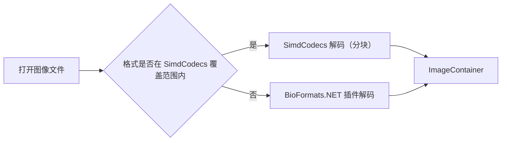
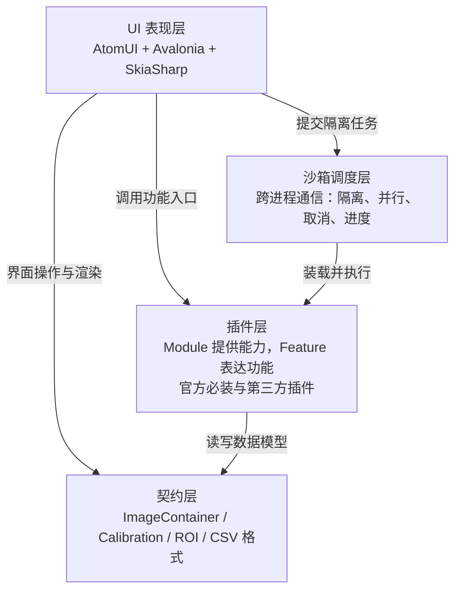
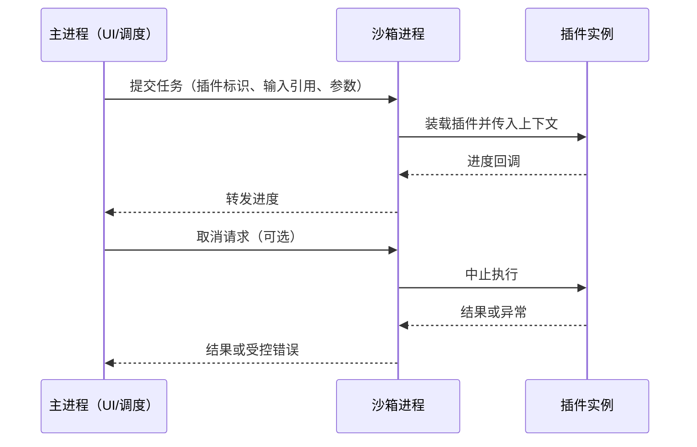

# ImageLyre 启动需求与架构基线

> 本文件是新一代 ImageLyre 的启动需求与架构基线，凡本文件与仓库内旧代码、旧文档冲突之处，一律以本文件为准。

| 版本 | 日期 | 状态 | 作者 | 变更说明 |
| :--- | :--- | :--- | :--- | :--- |
| 1.0 | 2026-11-18 | 定稿 | lukan | 首版：确立项目定位、固定技术栈、四层架构、内核模型、插件体系与兼容边界 |
| 1.1 | 2026-11-18 | 定稿 | lukan | UI 层确立 AtomUI 为界面一等公民，运行时固定 .NET 10，Avalonia 降为平台底座、SkiaSharp 收敛到视口自绘（ADR-0002） |
| 1.2 | 2026-11-18 | 定稿 | lukan | 新增设计原则：保留 ImageJ 的操作习惯，交互层兼容纳入准入清单（ADR-0003） |
| 1.3 | 2026-11-18 | 定稿 | lukan | 补充 AtomUI 商业授权事实，许可证约束按授权范围收窄（ADR-0002 补记） |
| 1.4 | 2026-11-18 | 定稿 | lukan | 插件像素访问改为只读句柄与写时复制租约，明确进程拓扑（ADR-0004）；BioFormats.NET 改为内置插件、默认启用可禁用（ADR-0005） |
| 1.5 | 2026-11-21 | 定稿 | lukan | 新增 §10.3：§10.1 各条款的验证里程碑，条款文字与判定方式不变；偏差登记与解除条件见 `docs/adr/lukan/ADR-0012-m1-baseline-applicability.md` |
| 1.6 | 2026-11-22 | 定稿 | lukan | 术语澄清：§6.3 的六个“槽位”改称“能力域”，与界面槽位区分（`docs/adr/lukan/ADR-0001-插件机制架构基线.md` §2.6），分类与边界不变；§10.3 移除指向已随重置删除的 ADR-0012 的引用，偏差登记改为 M1a 前补齐 |
| 1.7 | 2026-11-22 | 定稿 | lukan | 按 `docs/adr/lukan/ADR-0001-插件机制架构基线.md` 登记三处修订：§3 插件层选型明确为自研基座 cangming（PicoPlugins），沙箱传输以基座实现为准；§4 规则 2 按插件类别拆分，算子类插件义务不变，View 域与 Feature 可依赖 UI 路线包但仍不得操作宿主控件与画布；§6.3 增加 Platform 能力域承载文档、命令、设置、通知、主题与布局，六域改七域，并清理其余以“槽位”指能力域的表述 |
| 2.0 | 2026-11-22 | 定稿 | lukan | 按 `docs/adr/lukan/ADR-0001-插件机制架构基线.md` §9.1 登记作者口径修订：编解码、图像处理、内核不再作为层，改称官方必装插件，分别落在 IO、Operator、Measure 能力域；契约层只留数据模型（ImageContainer、Calibration、ROI）与 CSV 等契约；§4 由“四层架构”改为“四类构件与依赖方向”，层间规则按构件重述；准入清单中“内核层”相应改为“契约层” |

## 1 适用范围

本文件规定 ImageLyre 全新一代跨平台显微图像分析系统的项目定位、固定技术栈、四类构件、契约层与数据模型、插件体系，以及必须保留与必须放弃的兼容边界，其条款对 UI 表现层、契约层、插件层与沙箱调度层同时生效。本文件不规定 API 签名、程序集划分粒度、迭代排期与人力安排，这些内容分别由 `docs/design/` 下的设计文档与 `docs/plans/` 下的实施计划承接。

仓库中 2022 年春季启动、基于 WPF 与 .NET 6 的既有 ImageLyre 代码整体弃用，既不作为新系统的迁移来源，也不作为接口与实现的参考；新系统按本文件从零构建，旧代码中任何与本文件冲突的设计均不再有效。若后续确需复用旧代码中的个别算法或资源，必须另开设计文档与决策记录说明理由，不得在实现过程中默认沿用。

## 2 项目定位

ImageLyre 是一套基于 C# 与 .NET 10、以 AtomUI 为界面一等公民并从零自研的现代跨平台显微图像分析系统，目标是在功能覆盖、交互体验与科研定量能力上全面替代 ImageJ / Fiji，服务于生物显微、荧光成像、电子显微与一般科学定量图像分析场景。

### 2.1 设计理念

1. **不继承历史包袱**：ImageJ 的插件模型、宏语言与全局状态体系定型于上世纪的桌面软件范式，因此本项目不兼容任何 ImageJ Java 插件、不实现 IJM 宏解释器，也不桥接 Fiji 或引入 Java 运行时，以免把旧生态的耦合缺陷与单线程模型带进新架构。
2. **自建新一代插件体系**：以 Feature、界面槽位、能力域、依赖管理与跨进程沙箱为核心构建插件模型，使并行、沙箱隔离与模块化成为默认能力，功能能力对标并超越 ImageJ 插件生态。
3. **保留科研必需的兼容性**：图像格式、ROI 文件、测量指标与 CSV 结果必须与 ImageJ 对齐，因为论文数据需要可对照、可复用、可发表，兼容性在此不是可选项而是准入条件。
4. **规避商业授权风险**：完全弃用 ImageSharp 等 AGPL 授权图像库，编解码与图像处理均选择或自研可自由分发的实现，以免分发与商业使用受传染性条款约束。
5. **保留 ImageJ 的操作习惯**：菜单层级、工具栏分组、ROI 绘制手势、测量流程与常用快捷键尽量与 ImageJ 一致，使用户凭既有经验即可完成核心分析；保留的是用户可见的操作序列与术语，不是 Swing 外观与 Java 实现，视觉与控件仍按 AtomUI 现代化。

### 2.2 与 ImageJ 的边界

需要兼容的只有数据与结果层面：ImageJ TIFF 的元数据与标尺校准、标准 `.roi` / `.zip` 选区文件、测量指标定义与 CSV 表头，必须做到可对照、可互换。不需要兼容的是实现与生态层面：Java 插件、IJM 宏、Fiji 桥接与任何 Java 运行时都不在支持范围内，任何以「兼容旧插件」为理由引入 Java 依赖的提案都不予接受。

交互层面同样属于兼容范围：打开图像、缩放与平移、绘制与编辑 ROI、测量、导出 CSV 与浏览栈的操作路径应贴近 ImageJ，术语沿用其常用叫法；无法保留的习惯必须在设计文档中登记原因与替代路径。数据兼容保证结果可对照，操作兼容保证迁移成本可接受，两者共同构成本项目的兼容承诺。

## 3 固定技术栈

技术栈在本版本内视为定稿，变更须按第 11 节的决策流程处理；运行时固定为 .NET 10，UI 层的 AtomUI 与 Avalonia 版本组合随解决方案锁定，升级时成对回归。各类构件与官方必装插件的选型及硬性约束如下表。

| 构件 | 选型 | 职责 | 硬性约束 |
| :--- | :--- | :--- | :--- |
| UI 层 | AtomUI + AvaloniaUI + SkiaSharp | 应用框架与通用控件（AtomUI）、跨平台窗口与输入（AvaloniaUI）、图像视口与 ROI 自绘（SkiaSharp） | 视图缩放不得修改原始像素；AtomUI 与 Avalonia 版本组合锁定 |
| 官方必装插件 · IO | SimdCodecs（`Sdcb.SimdCodecs`）；BioFormats.NET 作为内置插件（默认启用、可禁用） | 标准与 ImageJ TIFF、BigTIFF、16/32 位浮点图像、PNG/JPG；CZI、LIF、ND2、OIB 等厂商私有格式 | 纯托管、无原生依赖、支持 NativeAOT、支持分块懒加载；厂商格式解码在沙箱执行（ADR-0004） |
| 官方必装插件 · Operator | 自研算子，基于 `Span<T>` 与 `System.Numerics` | 几何变换、重采样、阈值与滤波、栈投影、通道与像素运算 | 不引入任何 AGPL 图像库 |
| 契约层与官方必装插件 · Measure | 契约：ImageContainer、Calibration、ROI、CSV 格式；插件：测量算法 | 图像数据模型、空间校准、选区；测量与 CSV 导出 | 契约不依赖 UI、可单元测试、可后台批处理；算法以 Module 提供、以 Feature 暴露结果 |
| 插件与沙箱层 | 自研基座 `Cangming.PicoPlugins` + Feature 槽位 + 依赖管理 + 跨进程沙箱（传输以实现为准） | 插件装载、任务隔离、并行执行、取消与进度回调 | 插件崩溃不得波及主进程 |

### 3.1 UI 层

UI 层由 AtomUI、AvaloniaUI 与 SkiaSharp 三部分组成，运行时固定为 .NET 10。AtomUI 作为界面一等公民，承担应用框架、通用控件、主题令牌、对话框、表单、导航、通知与数据表格，新界面默认从 AtomUI 选控件；AvaloniaUI 作为平台底座，承担窗口、输入路由、高 DPI 与多平台生命周期；SkiaSharp 只负责图像视口、画布变换、ROI 叠加与视图缩放，因为这一区域需要逐帧自绘与像素级控制，不适合套用通用控件。

「一等公民」的判据是三条：新界面默认使用 AtomUI 控件与主题令牌；AtomUI 缺失的能力先评估扩展或自定义控件能否落在同一体系内；确需绕过 AtomUI 自绘的界面，必须在设计文档中写明理由与边界。AtomUI 与 Avalonia 的版本必须锁定为一组兼容组合，任一侧升级都要整体回归。AtomUI 已由项目负责人持有商业授权，使用与分发范围以授权条款为准并保留授权记录，超出授权范围的组件不得启用；其余依赖仍须复核许可证与依赖树，确保不违背无 AGPL 授权的原则。

视图缩放属于渲染行为，不得改写原始像素，这一约束与 3.3.2 节的数据缩放分界共同构成精度保证的基础。

### 3.2 IO 官方必装插件

编解码以 IO 能力域的官方必装插件提供，固定为 SimdCodecs（`Sdcb.SimdCodecs`）与内置的 BioFormats.NET 插件两套实现，并按 `IImageCodec` 统一抽象接入。SimdCodecs 覆盖标准 TIFF、ImageJ TIFF、BigTIFF、16 位与 32 位浮点科学图像以及 PNG、JPG 等常见格式，其纯托管、SIMD 加速、无原生依赖、支持 NativeAOT 与分块懒加载的特性，使大尺寸栈图像可以在不预载全图的前提下按需读取。CZI、LIF、ND2、OIB 等显微镜厂商私有格式由随安装包分发的 BioFormats.NET 插件提供，默认启用、可在插件管理器中禁用，解码在沙箱进程执行并按瓦片回传，插件加载失败时标准格式仍然可用。

统一抽象 `IImageCodec` 的意义在于：解码器只负责把字节流转换为契约层可消费的像素与元数据，格式差异被收敛在能力域内部，上层不必知道某份数据来自 TIFF 还是 CZI，也便于后续替换或并列引入新的编解码实现。

### 3.3 Operator 官方必装插件

算子以 Operator 能力域的官方必装插件提供，完全放弃 ImageSharp，全部基于 `Span<T>` 与 `System.Numerics` 的 SIMD 能力自研，以同时满足无授权风险与性能可控两个目标。算子按用途分为五类，见下表。

#### 3.3.1 算子范围

| 类别 | 算子 | 说明 |
| :--- | :--- | :--- |
| 几何 | 裁剪、旋转、翻转 | 改变像素布局，不改变数值含义 |
| 重采样 | 最近邻、双线性、双三次 | 供数据缩放使用，按精度与速度取舍 |
| 增强与滤波 | 阈值、卷积、滤波 | 覆盖科研图像常用的增强与去噪路径 |
| 栈投影 | 最大值投影（MIP）、均值、求和 | 对 Z 栈按像素位置聚合 |
| 像素运算 | 通道运算、像素算术 | 多通道合并、拆分与逐像素计算的基础算子 |

#### 3.3.2 视图缩放与数据缩放

视图缩放由 SkiaSharp 的变换矩阵完成，只改变显示变换、不重写像素数据，因此缩放级别变化不引入插值误差，也不影响后续测量。数据缩放由自研 SIMD 重采样完成，生成新的像素缓冲区，供真实分析、导出与批处理使用。

两条路径必须在 API 与调用链上分离，因为一旦预览与定量共用同一条插值链路，视图交互产生的重采样像素就可能进入测量与导出结果，而依赖用户「测量前不要缩放」的操作纪律并不可靠。二者的差异如下表。

| 路径 | 实现 | 是否生成新像素 | 典型用途 |
| :--- | :--- | :--- | :--- |
| 视图缩放 | SkiaSharp 矩阵变换 | 否 | 交互预览、ROI 定位 |
| 数据缩放 | 自研 SIMD 重采样 | 是 | 真实分析、导出、批处理 |

### 3.4 契约层与 Measure 官方必装插件

契约层以纯 C# 实现，不依赖 AtomUI、Avalonia、SkiaSharp 或任何 UI 类型，承载 ImageContainer、Calibration、ROI 与 CSV 格式等数据与格式契约，可在无图形界面的进程中创建与处理图像；测量算法不以契约形式提供，它以 Measure 能力域的官方必装插件提供，通过契约读写数据模型，因此既能被 UI 调用，也能被批处理与单元测试直接调用。具体模型见第 5 节。

## 4 四类构件与依赖方向

系统固定为四类构件——UI 表现层、契约层、插件层与沙箱调度层，依赖方向与职责边界如下；编解码、算子、测量、视口与文档都不是构件，而是插件层里的官方必装插件。

四条构件规则同时成立，任何实现都不得违反：

1. 契约层不得引用 UI 程序集，也不得持有窗口、渲染上下文或输入状态。
2. 算子类插件（IO、Operator、Measure、Script、System 各能力域）只依赖契约层公开契约与统一上下文，不得直接操作 UI 控件；View 域与 Feature 可以依赖 UI 路线包并在自己的槽位内构造内容，但同样不得操作宿主控件、不得抢占全局画布与输入上下文。
3. 沙箱调度层只认识任务描述、插件清单与执行结果，不感知插件内部实现。
4. UI 层不得绕过契约层与插件层直接改写像素缓冲区，所有像素变更必须经由契约层或插件层完成。

这一划分把「界面长什么样」与「数据怎么算」彻底拆开：UI 可以整体替换而不影响测量逻辑，测量算法可以在无界面环境中独立跑批，插件可以在沙箱中崩溃而不拖垮主程序；同时不再出现“内核层”这种既含数据又含算法、既在进程内又随时可被替换的模糊构件。

## 5 契约层与数据模型

契约层是项目的核心资产，完全解耦 UI、可单元测试、可后台批处理，其数据模型一旦定型，插件与界面都围绕它生长；测量算法属于 Measure 官方必装插件，不在契约层里。

### 5.1 ImageContainer

ImageContainer 是统一图像容器，承载 8 位、16 位与 32 位浮点三类科学像素，并按通道、Z 栈与时序 T 三个维度组织数据。容器内同时保存空间校准 Calibration、物理标尺与完整元数据，使像素坐标与物理单位之间的换算、以及元数据在导入导出链路中的保真，都由同一个对象负责，而不是散落在界面与插件中。容器不依赖 UI，可在无图形界面的后台进程中创建与处理，这是批处理与单元测试得以成立的前提。

### 5.2 ROI 子系统

ROI 子系统以 ImageJ 的 `.roi` 与 `.zip` 为互操作格式，支持读取与写出矩形、椭圆、多边形、自由手绘、点与线六类选区。ROI 的几何定义、坐标基准与叠加渲染相互分离：几何数据属于契约层，渲染叠加属于 View 能力域，因此同一份 ROI 既能在界面中编辑，也能在批处理中直接用于测量。

### 5.3 测量与导出

测量子系统覆盖颗粒分析、连通域筛选、圆度、Feret 直径、面积与周长等指标。指标定义与 CSV 契约属于契约层，算法实现以 Measure 能力域的官方必装插件提供，插件可被替换或被第三方实现顶替，而结果口径保持不变。CSV 导出沿用 ImageJ 的表头名称、列顺序与数值格式，以保证既有分析脚本、论文表格与统计流程可以直接复用，这一条是「科研数据可对照」承诺的具体落点。

## 6 插件体系

插件体系是本项目相对 ImageJ 的核心优势所在，其设计目标不是复刻 ImageJ 的插件能力，而是从进程模型、依赖管理与运行方式上补齐后者无法通过补丁解决的短板。

### 6.1 ImageJ 插件体系的固有缺陷

1. 插件强绑定全局 `ImagePlus` 状态，多个插件共享同一份可变上下文，导致数据互相污染且结果难以复现。
2. 单线程执行模型使任一插件的死循环或长任务卡住整个应用，用户只能强杀进程。
3. 缺少依赖管理与版本隔离，插件之间的类库冲突只能在运行期暴露。
4. UI 与内核深度耦合，插件无法脱离图形界面进行后台批处理。
5. 异常没有进程边界，插件抛出的错误会直接击穿主程序。

### 6.2 新体系的设计

1. **进程隔离**：重计算、厂商格式解码与批量任务运行在独立的沙箱进程中，通信传输以基座实现为准；标准 TIFF、BigTIFF、PNG、JPG 的解码在主进程完成；插件崩溃不炸主程序，任务可取消，执行过程可回传进度。
2. **模块化与依赖显性化**：插件按 Module / Feature / Driver 分层，清单中声明依赖与版本区间，并按依赖度分级标记（0、≤3、≤10、>10），依赖树可视化，任一插件可单独启停。
3. **无全局可变状态**：所有插件通过统一上下文接收输入、返回输出，不占用全局画布，也不修改其他插件或内核的共享数据。
4. **一套插件双运行模式**：同一份插件既可由 UI 交互调用，也可在无界面后台批量调用，两条路径共用同一上下文契约。
5. **脚本层现代化**：不再实现 IJM 宏解释器，Python 作为一等脚本语言接入 Script 能力域，用于自动化与批量流程。

沙箱内一次任务的生命周期如下，主进程与插件之间不存在共享可变状态，通信只经过任务描述、控制消息与结果消息；批量像素经宿主发放的只读瓦片句柄或写时复制租约传递，具体见 ADR-0004。

### 6.3 能力域划分

插件按职责归入七个能力域，能力域之间的边界即依赖边界，见下表；本节在 1.5 版及以前把这一分类写作“槽位”，自 1.6 版起改称“能力域”，1.7 版起增加 Platform 域承载壳能力，分类成员与边界的变化以版本表为准，改称理由与两个术语的定义见 `docs/adr/lukan/ADR-0001-插件机制架构基线.md` §2.6。

| 能力域 | 职责 | 典型内容 |
| :--- | :--- | :--- |
| IO | 图像解码、编码、导入导出 | TIFF、PNG/JPG、厂商私有格式、ROI 读写 |
| View | 渲染、LUT、伪彩、标尺、ROI 编辑器 | 视口叠加层、伪彩映射、比例尺 |
| Operator | 图像算子、滤波、阈值、形态学 | 卷积、重采样、栈投影、形态学处理 |
| Measure | 颗粒分析、统计、CSV 导出 | 连通域、圆度、Feret、结果表 |
| Script | Python 自动化、批量流程 | 脚本执行、流程编排 |
| System | 沙箱调度、插件管理、日志 | 任务队列、清单解析、依赖树 |
| Platform | 壳能力：文档、命令、设置、通知、主题、布局 | 文档服务、命令注册表、设置页、通知中心 |

## 7 兼容与取舍

兼容与放弃的边界按「数据可比」「操作可迁移」与「架构纯净」三条标准划定，前两条决定哪些必须保留，第三条决定哪些必须割舍。

### 7.1 必须保留

| 对象 | 要求 | 依据 |
| :--- | :--- | :--- |
| ImageJ ROI 文件格式 | `.roi` / `.zip` 双向读写 | 既有选区资产可迁移、可复用 |
| ImageJ TIFF 元数据与标尺校准 | 保真读取，导出不丢失 | 像素与物理单位的换算必须可对照 |
| 测量指标与 CSV 结果 | 表头、指标顺序、数值格式完全对齐 | 论文数据可复现、脚本可迁移 |
| 科研定量精度 | 与 ImageJ 结果可对照 | 发表级结果需要可核验的一致性 |
| ImageJ 核心操作路径 | 菜单、工具栏、ROI 手势与快捷键贴近，偏差须登记 | 降低迁移与培训成本 |

### 7.2 彻底放弃

| 对象 | 处理方式 | 依据 |
| :--- | :--- | :--- |
| ImageJ Java 插件 | 不加载、不桥接 | 避免全局状态模型与 JVM 依赖 |
| IJM 宏语法 | 不实现解释器，不提供兼容层 | 旧宏体系与现代脚本层无法共存 |
| Fiji 与 Java 运行时 | 不依赖 | 发布体积与运行环境不可控 |
| AGPL 图像库（含 ImageSharp） | 不使用 | 规避传染性授权对分发与商业化的限制 |

## 8 相对 ImageJ 的核心竞争力

1. **架构领先一代**：内核、插件与 UI 解耦，依赖显性与沙箱隔离使并行、取消与崩溃隔离成为默认能力，而 ImageJ 的单线程全局状态模型无法在不重写的前提下提供同等保障。
2. **无授权风险**：从编解码到算子的每个环节都选择或自研可自由分发的实现，项目整体不引入 AGPL 依赖。
3. **现代 UI 体验**：以 AtomUI 统一控件与主题，AvaloniaUI 提供高 DPI 与跨平台底座，SkiaSharp 负责视口渲染，使缩放、平移与多视图在三个平台上保持一致。
4. **科研级精度**：视图缩放与定量重采样分属两条路径，预览不污染测量，精度承诺由架构保证而非使用纪律保证。
5. **可长期迭代**：无历史包袱，内核契约与插件接口可以按版本演进，不必为兼容旧生态而保留死代码。
6. **可自动化、可批量、可流水线化**：Python 脚本、沙箱批处理与统一上下文，使流水线化分析成为工程能力而不是脚本技巧。

## 9 非目标

1. 不加载、不转换、不桥接任何 Java 插件。
2. 不实现 IJM 宏语法与解释器，也不提供兼容层。
3. 首个版本不承诺覆盖 ImageJ 的全部功能，缺失能力按 Feature 插件逐步补齐并超越。
4. 不以兼容 2022 年版 ImageLyre 的代码、插件或配置为目标。

## 10 准入判定清单

评审设计、方案或实现时，以下两组条款逐条核对；必须成立项任一不满足即退回，不得出现项任一出现即判定不合格。

### 10.1 必须成立

- [ ] 视图缩放由 SkiaSharp 变换完成，且不修改原始像素。
- [ ] 数据缩放由自研 SIMD 重采样实现，独立于视图缩放。
- [ ] 沙箱类插件任务在沙箱进程中执行，可取消、可回调进度、崩溃不影响主进程；主进程内插件限于不加载第三方代码的官方插件路径。
- [ ] 插件按「主进程内 / 沙箱」两类登记，宿主 broker 与操作系统隔离对越权文件与网络调用返回明确错误码。
- [ ] ROI 可与 ImageJ `.roi` / `.zip` 双向互操作。
- [ ] CSV 表头、指标顺序与数值格式与 ImageJ 对齐。
- [ ] 同一插件可在 UI 交互与后台批处理两种模式下运行。
- [ ] 应用框架界面以 AtomUI 控件与主题构建，图像视口与 ROI 叠加使用 SkiaSharp 自绘。
- [ ] 核心分析路径（打开图像 → 选区 → 测量 → 导出）的操作序列与 ImageJ 一致，或已在设计文档登记偏差与替代路径。
- [ ] 插件像素访问遵循 ADR-0004：只读句柄或写时复制租约，不存在共享可变状态。
- [ ] 厂商格式由内置 BioFormats.NET 插件提供，默认启用且可禁用，解码在沙箱执行。

### 10.2 不得出现

- [ ] 依赖 AGPL 图像库，包括 ImageSharp。
- [ ] 为读取标准 TIFF、BigTIFF 或浮点图像引入原生库或 Java 运行时。
- [ ] 契约层引用 Avalonia、SkiaSharp 或 UI 类型。
- [ ] 插件通过全局可变状态共享数据，或抢占全局画布。
- [ ] 预览插值结果进入测量或导出。
- [ ] 无法取消的长任务，或未隔离的插件异常。
- [ ] 在 AtomUI 之外另建一套并行的通用控件体系。

### 10.3 验证里程碑

§10.1 与 §10.2 的条款文字与判定方式不因里程碑而改变，本节只规定每条在哪个阶段必须被验证通过，未到该阶段的条款按"未执行"处理、不得记为"通过"；偏差项、解除条件与责任边界由 M1a 前的专项决策记录补齐，原登记文件已随 2026-11-22 的重置删除。

| 条款 | 首次必须成立的阶段 |
| :--- | :--- |
| 视图缩放不改原始像素、数据缩放独立于视图缩放 | M1a |
| AtomUI 承载应用框架、SkiaSharp 承载视口与 ROI 叠加 | M1a |
| 核心分析路径操作序列与 ImageJ 一致或已登记偏差 | M1a（最小集），M1b 补齐偏差表 |
| ROI 与 ImageJ `.roi`/`.zip` 双向互操作 | M1b |
| CSV 表头、指标顺序与数值格式对齐 | M1a（六列子集），M2（全集与 sidecar） |
| 同一插件可在 UI 与后台批处理两种模式下运行 | M2 |
| 沙箱执行、主进程与沙箱两类登记、broker 错误码 | M2 |
| 厂商格式由内置 BioFormats 插件提供、默认启用可禁用 | M2 |
| 契约层不得引用 UI、插件不得共享全局可变状态 | M1a |

## 11 变更管理

本文件自 1.0 版起为定稿基线，条款变更只能通过新增决策记录完成：先记录背景、备选方案与后果，经评审后更新本文件版本表并递增版本号，其中语义不兼容的变更递增 `MAJOR`，增量补充递增 `MINOR`。已发布条款不得直接改写，历史版本的内容差异以版本表与决策记录为准。

## 12 项目定义

本项目是一套：基于 .NET 10 + Avalonia + AtomUI + SimdCodecs + 自研 SIMD 算子 + 现代化 Feature 插件沙箱架构、完全自主可控、无授权风险、科研精度对标 ImageJ、架构全面超越 ImageJ 的新一代跨平台显微图像定量分析系统。
