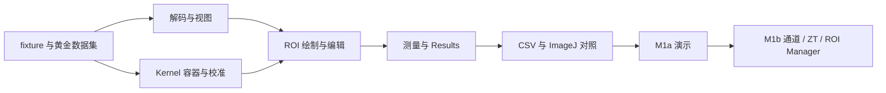

# PLAN-0002：M1 垂直切片

| 版本 | 日期 | 状态 | 作者 | 说明 |
| :--- | :--- | :--- | :--- | :--- |
| 1.0 | 2026-11-19 | 现行 | lukan | M1a 打通闭环、M1b 补齐视图与结果表；两周排期与验收口径 |

## 1 目标

用两周时间打通一条可对照的垂直切片：打开一张带校准的 ImageJ TIFF，完成缩放、像素探针、矩形/多边形 ROI 与顶点编辑，测量面积、均值、标准差、最小、最大与周长，导出与 ImageJ 基线列一致的 CSV，并用黄金数据集完成第一轮对照。

M1 分两段，避免一次铺开 16 条需求：M1a 先让上面这条链路端到端跑通；M1b 再补通道、Z/T、叠加层、ROI Manager 与物理单位切换。M1a 不通过，不启动 M1b。

## 2 范围

### 2.1 M1a：闭环（9 条）

| 序号 | 需求 | 在 M1a 中的子集 | 依赖 |
| :--- | :--- | :--- | :--- |
| 1 | IO-001 | 标准 TIFF、ImageJ TIFF、BigTIFF 的读取与校准保留 | fixture |
| 2 | VIEW-001 | 缩放、平移、适应窗口、1:1 | 无 |
| 3 | VIEW-002 | 坐标、像素值、通道、Z/T 读数 | 无 |
| 4 | ROI-001 | 矩形与多边形两类，椭圆/自由手绘/线/点放 M1b | 无 |
| 5 | ROI-002 | 顶点编辑与整体移动 | ROI-001 |
| 6 | CAL-002 | 已知距离设置比例尺 | 无 |
| 7 | MEAS-001 | 面积、均值、标准差、最小、最大、周长；积分密度等延后 | fixture |
| 8 | MEAS-004 | CSV 基线列、表头、数值格式 | fixture |
| 9 | VAL-002 | 黄金数据集 v0.1，≥8 张图、≥6×6 个 ROI | fixture |

### 2.2 M1b：补齐（7 条）

| 序号 | 需求 | 说明 | 依赖 |
| :--- | :--- | :--- | :--- |
| 1 | VIEW-003 | 通道开关、合成、伪彩 LUT | M1a |
| 2 | VIEW-004 | Z/T 滑块与逐帧浏览 | M1a |
| 3 | VIEW-005 | ROI、标尺、文本叠加层显隐 | M1a |
| 4 | ROI-003 | ROI Manager 列表、重命名、显隐 | ROI-001 |
| 5 | ROI-004 | `.roi` / `.zip` 读写 | ROI-003 |
| 6 | MEAS-002 | 像素单位与物理单位切换 | CAL-002 |
| 7 | MEAS-003 | Results 表多行、排序、复制 | MEAS-001 |

### 2.3 不做

M1 不做厂商格式、插件市场、Python、工程文件、颗粒分析、安装分发、团队配置与可访问性专项；这些属于 M2 及以后。M1 也不引入沙箱插件，标准 TIFF 解码留在主进程。

## 3 前置条件

1. **ImageJ fixture 必须先于 M1a 编码入库**：ImageJ 1.54f 安装包 SHA-256、Set Measurements 选项模板、基准 CSV、测试图四件套，缺一不可。
2. **黄金数据集 v0.1 与 fixture 同批**：至少 8 张图覆盖 8/16 位、带校准/不带校准、单通道；ROI 集至少 6×6，含矩形、多边形、椭圆各两类。
3. **构建基线**：`dotnet build src/ImageLyre.slnx` 零错误；Avalonia 12.1.6 与 AtomUI 6.2.15 的版本组合锁定。
4. **测量口径**：PRD 附录 B.1 的列序、选项与容差已冻结；M1a 只实现 B.1 的子集列，不得临时改列。
5. **决策无阻塞**：M1 不依赖企业授权、市场、遥测与工程文件，这四项不阻塞开工。

## 4 步骤与依赖

| 阶段 | 工作 | 产出 | 依赖 |
| :--- | :--- | :--- | :--- |
| 第 1–2 天 | fixture 生成、黄金数据集 v0.1 选样 | `docs/spec` fixture 记录、数据集目录与清单 | 无 |
| 第 2–4 天 | Kernel 容器、校准、TIFF 解码 | 内核单测、可打开测试图 | fixture |
| 第 4–6 天 | 视图缩放、像素探针 | 可缩放、可读数 | 解码 |
| 第 6–8 天 | 矩形/多边形 ROI、顶点编辑 | ROI 可绘制、可移动 | 视图 |
| 第 8–9 天 | 面积/均值/标准差/周长、Results | 测量结果可显示 | ROI |
| 第 9–10 天 | CSV 导出与 ImageJ 对照 | 对照报告、M1a 演示 | 测量 |
| 第 10–12 天 | M1b：通道、Z/T、叠加层 | 视图补齐 | M1a |
| 第 12–14 天 | M1b：ROI Manager、单位切换、Results 表 | M1b 演示 | M1b 前序 |

第 1–2 天与编码并行是允许的，但 fixture 未入库前不得开始 CSV 对照，也不得用自造数据代替。

## 5 验收标准

1. 用一张带校准的 ImageJ TIFF，按「打开 → 缩放 → 画矩形 → 画多边形 → 测面积/均值/周长 → 导出 CSV」十步演示，全程无崩溃、无阻塞。
2. 9 条 M1a 验收用例全部通过；CSV 与 fixture 的列名、顺序、数值格式一致，面积与像素计数完全一致，浮点统计量满足 PRD §6.5 的 B 类容差。
3. 黄金数据集 v0.1 的至少 6 个 ROI 完成对照，差异清单与裁决结论写入验证记录。
4. `dotnet build src/ImageLyre.slnx` 零警告零错误；Kernel 与测量核心有单元测试，覆盖校准换算、边界 ROI、空选区。
5. 没有未关闭的 P0 缺陷；已知问题与绕过方案记录在计划或验证记录中。
6. M1a 演示通过后才启动 M1b；M1b 的 7 条按同一口径验收。

## 6 风险

| 风险 | 影响 | 应对 |
| :--- | :--- | :--- |
| fixture 生成延迟 | CSV 对照无法开工 | 第 1 天先冻结 ImageJ 环境与选项模板，数据集选样并行 |
| ImageJ 选项口径漂移 | 列不一致、结论不可比 | 只用 B.1 模板，不在实现期改列；差异走勘误表 |
| AtomUI 主题与控件接入耗时 | 视图与 ROI 交互返工 | 先接最小主题与窗口壳，控件逐步替换 |
| 大图首屏与缩放性能 | 演示卡顿 | 先用 4K 图验证，16k 图放 M1b 压测 |
| 校准边界情况 | 结果单位错误 | 黄金数据集包含无校准与各向异性样本，先写测试 |

## 7 交付物

- M1a 可运行演示与演示脚本；
- ImageJ fixture 记录与黄金数据集 v0.1 清单；
- M1 验收用例执行记录（对应 `docs/spec/m1/archive/M1-acceptance-matrix-3.4.xlsx` 的状态列）；
- GitHub Issues #2–#17 与索引 #18、Milestone #1 `M1 垂直切片`、九个标签；每周状态见 `docs/spec/status/PM-STATUS-*.md`；
- 本计划的进度回填与风险更新。
