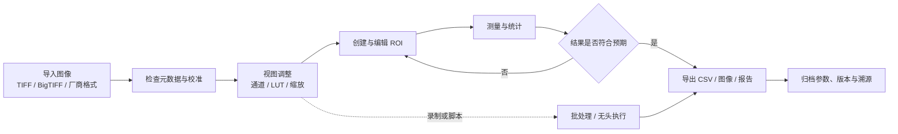

# ImageLyre 产品需求文档（PRD）

> 本文件回答「为谁做、做什么、做到什么程度」，是研发排期、交互设计与验收的共同输入；技术选型、分层与插件架构以 [启动需求与架构基线](../baseline/startup-requirements.md) 为准，两者冲突时先改基线再改本文件。1.0 与 1.1 版经七位第三方专家评审后重构为 2.0，评审记录见 `docs/spec/reviews/PM-REVIEW-2026-11-18-prd-expert-review.md`。

| 版本 | 日期 | 状态 | 作者 | 变更说明 |
| :--- | :--- | :--- | :--- | :--- |
| 1.0 | 2026-11-18 | 评审稿 | lukan | 首版：产品定位、用户与场景、功能需求、兼容与精度、体验规范、非功能需求、路线图与发布门禁 |
| 1.1 | 2026-11-18 | 评审稿 | lukan | 关闭五项开放问题：引入 `.lyre` 工程、插件市场上线、可选遥测、核心开源 + 企业插件、三维/AI 走插件 |
| 2.0 | 2026-11-18 | 评审稿 | lukan | 按七位专家意见重构：补齐可复现与验证体系、团队配置、安装部署、离线与网络分级、插件数据与 API 契约、工程格式规格、跨平台一致性与可访问性；统一优先级与需求计数 |
| 2.1 | 2026-11-18 | 评审稿 | lukan | 第二轮复核收口：基线升 1.4（ADR-0004/0005），钉死测量基线附录与 CSV 序列化契约，插件最小底座与前移无头入口，修正支持矩阵与 VAL-004 依赖，补运行时策略、课程实验清单与可访问性指标 |
| 2.2 | 2026-11-18 | 定稿 | lukan | 终审修订：进程拓扑与 ADR-0004 对齐（颗粒分析、栈投影入沙箱），VAL-004 收窄为三类工作流并移至 M4，基线 §6.2 明确标准解码在主进程 |
| 2.3 | 2026-11-18 | 定稿 | lukan | 签核修订：PLUG-003 升 P0 并纳入权限与拓扑验收；CSV 只含基线列并删除诊断扩展；组合预算改按字节；离线全量包补体积门禁；容差补 D/E/F 类 |
| 2.4 | 2026-11-19 | 评审稿 | lukan | 新增 CLI 工作模式：纯命令行闭环、版本化 JSON、退出码与 AI 调用约束；CLI 五项 P0、两项 P1，待评审 |
| 2.5 | 2026-11-19 | 定稿 | lukan | 增量评审收口：补 CLI 命令/参数表、JSON Schema、退出码与错误码、校准/ROI/选项输入、批处理与 CLI-only 分发；AUTO-004 复用 `lyre`，CLI-007 升 P0 |
| 2.6 | 2026-11-19 | 定稿 | lukan | Agent-first CLI：能力发现、全能力覆盖、计划与流式、批处理升 P0、MCP 与插件命令；CLI 从自动化附属升为与桌面并列的产品入口 |
| 2.7 | 2026-11-19 | 定稿 | lukan | Agent 接口六专家评审收口：补齐契约注册表、capabilities 信封、plan/event/audit Schema、路径与信任边界、MCP/插件写入授权、批处理预算与 VAL-008 评测；M2 拆为 M2a/M2b |
| 2.8 | 2026-11-19 | 评审稿 | lukan | v1 范围收口：MCP/插件 CLI 与全能力 CLI 延后到 v2/P1；统一 ROI/batch 单一 Schema；planHash、retryArgv、审计字段与批处理终止语义；VAL-008 改为点估计 + 下限口径 |
| 2.9 | 2026-11-19 | 定稿（条件） | lukan | v1.1 轻量收口：移除 plan/confirm/events/audit/policy/options 的 v1 承诺，CLI-010 移 P1；固定可写根与审计 sink；补 info/version/doctor Schema；CLI P0 8 条、P1 4 条 |
| 3.0 | 2026-11-19 | 定稿 | lukan | 产品复位：PRD 只保留要什么、为什么、怎样算好；CLI 技术契约拆到 cli-contract.md；补产品宪法、现代体验规范、ImageJ 迁移体验；指标回到用户结果；移除阶段排期 |
| 3.1 | 2026-11-19 | 定稿 | lukan | 新增多语言：简体中文与英文一等语言、术语审校、语言切换、导出语言无关、插件与社区语言包；P0 75、P1 68、P2 8 |
| 3.2 | 2026-11-19 | 定稿 | lukan | 新增主题：浅色/深色/跟随系统、随时切换、两套主题完整、对比度 AA、高对比与系统跟随；P0 77、P1 70、P2 8 |
| 渲染版 | [HTML](product-requirements.html) | — | — | — |

## 0 摘要

ImageLyre 是显微镜旁的第一块屏幕：面向科研显微图像的现代定量分析平台。它要做的不是把 ImageJ 换个皮，而是把「看图 → 校准 → 选区 → 测量 → 复核 → 导出」这条路重新设计，让研究者更快拿到可信数字，让老用户迁移得舒服，让 Agent 能当同事而不是外挂。

产品边界是「日常定量分析闭环 + 可扩展插件底座 + 可验证的科研输出」：桌面服务人的判断，CLI 服务 Agent 与流水线的跑腿；两端共享同一结果口径。核心完全开源，企业插件增值。

## 1 产品定位

### 1.1 一句话定义

面向生物显微、荧光、电镜与一般科学定量场景的开源分析平台：让 ImageJ 老用户舒服地迁移，让新用户三秒见图、十秒见数，让 Agent 能看见上下文、提出可审阅的下一步；桌面与 CLI 是两个入口，同一套结果。

### 1.2 目标与非目标

**目标**：

1. 打开软件三秒内看见图，十秒内得到第一个可信数字；新用户不看文档完成第一次测量。
2. 有 ImageJ 经验的研究者五分钟内完成第一次测量，二十个高频动作首次尝试成功率不低于 95%，所有改动都能查到新旧对照。
3. 同一图像、同一参数在 ImageLyre 与 ImageJ 上得到可对照的结果；每个导出都能被同事原样复现。
4. Agent 能看见用户当前的分析上下文，提出可审阅的下一步，并把一次分析变成可复用流程；人始终保留判断权。
5. 界面与交互达到现代仪器水准：画布优先、零模态、直接操作、克制动效，不是复古复刻，也不是 Web 仪表盘。
6. Windows、Linux 与 macOS 界面与结果一致，核心功能完全离线可用。
7. 简体中文与英文都是一等语言，界面、错误、帮助与导出不因语言产生歧义。

**非目标**：

- 不做显微镜采集控制与硬件联动，采集仍由厂商软件完成。
- 不做通用图像编辑与平面设计。
- 不做云端协作与在线项目库；商业授权可采用离线授权码，账号体系不属于首版。
- 不做医学影像诊断用途。
- 不兼容 Java 插件与 IJM 宏，不引入 Java 运行时。
- 主程序不做三维重建、反卷积与 AI 分割，这些能力通过插件提供。
- 不把 ImageJ 菜单原样搬过来；迁移要舒服，但不是复刻。

### 1.3 竞争格局与商业模式

| 产品 | 优势 | 相对 ImageLyre 的缺口 |
| :--- | :--- | :--- |
| ImageJ / Fiji | 生态最大、习惯成熟、免费 | 界面与交互停留在上个时代，批处理与协作弱，结果溯源靠人 |
| QuPath | 病理全切片与标注强 | 面向病理流程，通用显微定量与 ROI 兼容弱 |
| CellProfiler | 流水线化批量分析强 | 交互式探索弱，学习曲线陡 |
| 商业平台（Imaris、ZEN、NIS-Elements 等） | 采集与分析一体、售后完善 | 昂贵、绑定硬件、导出与脚本自由度低 |

差异化落在四点：

- **迁移舒适**：老用户不是「重新学」，是「顺手多了」；习惯有落点，升级有说法，回退有路径。
- **结果可信**：每个数字可解释、每次导出可复现；ImageJ 兼容是底线，不是卖点。
- **现代交互**：画布优先、零模态、直接操作、命令面板与克制动效，做出这个时代该有的仪器感。
- **Agent 协作**：Agent 看见上下文、提出可审阅的计划、把分析变成可复用流程，而不是外挂一个聊天框。

核心完全开源，企业插件以商业授权提供，两者共用同一插件市场与沙箱；免费用户不缺核心能力，商业用户为增强功能、批量规模与支持付费。

## 2 用户与场景

### 2.1 用户画像

| 画像 | 典型身份 | 核心诉求 | 主要痛点 |
| :--- | :--- | :--- | :--- |
| 课题负责人 | PI、教授 | 数据可复现、可发表、团队口径一致 | 学生各用一套脚本，结果不可比 |
| 日常分析者 | 博士后、研究生 | 快速完成测量、少写代码、批量处理 | ImageJ 操作繁琐、批处理要写宏 |
| 成像平台技术员 | 显微镜平台工程师 | 多格式读取、批量部署、稳定 | 厂商格式互不兼容、软件崩溃丢进度 |
| 方法开发者 | 算法、生信背景 | 插件与脚本扩展、接口清晰、可调试 | ImageJ 插件耦合全局状态、调试困难 |
| 教学用户 | 讲师、学生 | 免费、免管理员安装、机房可批量部署 | 机器受限、许可证复杂、无外网 |
| AI agent / 流水线 | 外部 LLM、脚本、CI | 可发现、可预演、可重试、结果可校验 | 现有工具无工具清单、无 JSON Schema、错误码与退出码不稳定 |

### 2.2 核心任务（JTBD）

1. 拿到一批显微图像时，按熟悉的 ImageJ 流程完成校准、选区与测量，并导出可直接进论文的 CSV。
2. 同一实验需要重复分析几十上百张图时，用录制脚本或批处理流水线在后台跑完，并给出进度与失败原因。
3. 厂商格式或新算法出现时，通过插件扩展能力，不必等主程序发版，也不担心插件把软件弄崩。
4. 复核他人结果时，能看到测量参数、校准来源与软件版本，并用同一份输入复现。
5. 课题组统一分析口径时，一套配置、一份工程与一份验证报告能在多台机器与多人之间传递。
6. 当 AI 或外部流水线需要调用时，用纯 CLI 与 JSON 结果完成校准、ROI、测量与导出，不需要模拟桌面操作。
7. 让 agent 自主完成多步分析：先读 capabilities 选工具，再执行、按错误码重试，最后用输出 SHA 与 sidecar 复核。

### 2.3 核心工作流

典型路径与 ImageJ 对齐：打开图像 → 设校准 → 画选区 → Measure → 看 Results → 保存。批量路径复用同一套能力，不允许出现「只有界面能做、脚本做不了」的分析能力。

## 3 产品宪法

1. **三秒见图，十秒见数**：打开软件到看见第一张图不超过三秒，从打开图到得到第一个可信数字不超过十秒；没有欢迎页、强制向导与「请先配置」。
2. **零模态**：九成操作不弹窗，校准、选区、测量、导出在画布边上完成；对话框只留给真正不可逆的事，并说清发生了什么、影响什么、怎么退回去。
3. **一切可逆、可解释、可复现**：任何一步都能撤销，包括校准、ROI 编辑、批量任务与 AI 建议；点任何一个数字都能看到它的来源；导出是另一个人能原样重跑的起点。
4. **AI 是同事，不是侧边栏**：Agent 能看见用户正在看的图、选中的 ROI、当前校准与结果，能提醒、能提议、能把一次分析变成可复用流程；人负责判断，Agent 负责跑腿，每一步都能退回人工操作。
5. **现代仪器感**：安静、精确、有光；不是医疗仪表盘，不是复古拟物，也不是塞满卡片的 Web 后台。图像是主角，数据有秩序，动效只解释空间关系。
6. **迁移要舒服**：ImageJ 老用户的第一反应应是「还是那套逻辑，但顺手多了」，而不是「我又要学一套软件」。习惯可以升级，但每次升级都要让人知道少了哪一步、快了多少、怎么回去。
7. **默认离线、结果可信**：核心路径零网络请求；没有静默默认值，缺校准、缺元数据、越界 ROI 必须当场说；每个结果都有可核对的身份证。
8. **语言不挡路**：中文与英文都是一等语言；术语统一、错误可读、导出不随语言变化，用户不需要为了用软件先学一门语言。

## 4 信息架构与核心对象

### 4.1 界面骨架

主窗口由菜单栏、工具栏、图像视口、可停靠面板区、状态栏与通知区组成。面板区默认提供 Results、ROI Manager、Histogram、Line Profile、Log 与插件管理器，可折叠、可拖拽、可保存布局。每个图像默认以标签页管理，支持拖出为独立窗口（P1）。

- 菜单栏保留 ImageJ 的八个顶层菜单名：File、Edit、Image、Process、Analyze、Plugins、Window、Help。
- 工具栏按 ImageJ 分组顺序放置选择、缩放、手形与测量入口；图标可用 AtomUI 风格，顺序与快捷键不变。
- 状态栏常驻显示坐标、像素值、尺寸、位深、校准单位、缩放比例与内存占用。

### 4.2 菜单与需求的对应

| ImageJ 菜单 | ImageLyre 内容 | 对应需求 |
| :--- | :--- | :--- |
| File | 打开、导入序列、保存、导出、工程、最近文件 | IO-001~010、PRJ-001、PRJ-006 |
| Edit | 撤销重做、复制、粘贴、选项 | PROC-008、SYS-001 |
| Image | 类型转换、属性、通道、校准、栈、几何变换 | PROC-009、CAL-001/002、STACK-002、VIEW-003 |
| Process | 平滑、锐化、滤波、阈值、形态学、算术、投影 | PROC-001~007、PROC-010 |
| Analyze | 测量、设置测量项、直方图、剖面、颗粒分析 | MEAS-001~009 |
| Plugins | 插件管理、市场、脚本、录制 | PLUG-001~015、AUTO-001~009 |
| Window | 窗口排列、面板显隐 | VIEW-001、SYS-001 |
| Help | 快捷键、迁移指南、诊断、关于与许可 | SYS-005、SYS-006、LIC-003 |

菜单可见性由所挂需求的最高优先级推导，不再单独维护「首版范围」列，避免与功能表冲突。完整的 ImageJ 命令对照见附录 B。

### 4.3 核心对象

| 对象 | 说明 | 归属 |
| :--- | :--- | :--- |
| ImageDocument | 一张图像或一个栈，含像素、校准、元数据与视图状态 | 内核 + UI 包装 |
| Dataset | 按通道、Z、T 组织的像素集合 | 内核 |
| View | 同一图像的一个展示实例，含缩放、LUT、叠加层 | UI |
| ROI | 六类几何选区，可命名、着色、带 Z/T 归属 | 内核 |
| MeasurementSet | 测量结果表，列定义随测量选项联动 | 内核 |
| AnalysisRun | 分析参数、输入引用、输出、插件与版本 | 内核 |
| Provenance | 一次导出或一次分析的溯源记录（软件、参数、输入摘要、校准来源） | 内核 + 序列化层 |
| PluginPackage | 插件清单、槽位、依赖、权限与入口 | 插件系统 |
| Project | `.lyre` 工程文件，含图像引用、视图、ROI、结果、分析历史与版本 | 内核 + 序列化层 |

约束：View 只读 Dataset；ROI 几何与渲染分离；AnalysisRun 必须足以复现结果；PluginPackage 不持有全局状态；Provenance 与结果同生命周期。

### 4.4 工程文件规格（已拍板）

`.lyre` 是会话与结果的容器，不替代图像格式。默认引用外部图像路径并记录校验和，用户可选择内嵌图像以便迁移。工程保存视图布局、每个视图的缩放与 LUT、ROI 集与 Z/T 归属、结果表、分析历史、校准覆盖、插件版本与软件版本。

容器为 ZIP64，清单 JSON 记录 `schemaVersion` 与 `minReaderVersion`；内嵌图像条目使用 stored 方式并附块索引（偏移、长度、块校验和、位深、通道数），保证按块随机读取与懒加载。未知字段与未知插件状态必须原样保留，再次保存不得丢失。旧版本打开新工程必须提示并阻止静默降级。自动恢复使用增量快照，只保存 ROI、结果与参数，不复制内嵌图像，保留最近两份且总量不超过 512 MB。

### 4.5 技术边界

进程、沙箱、宿主与插件隔离属于架构基线与 ADR，不在 PRD 展开。产品只要求：插件崩溃不拖垮主程序；不可信输入被隔离；交互路径不等待后台任务；失败可解释、可恢复；桌面与 CLI 结果同源。

## 5 功能需求

优先级：**P0** 为 MVP 必须，**P1** 为 1.0 必须，**P2** 为后续版本。每条需求都给出可演示、可测试、可对照的验收要点。

### 5.1 图像导入与格式

| 编号 | 需求与验收要点 | 优先级 |
| :--- | :--- | :--- |
| IO-001 | 打开标准 TIFF、ImageJ TIFF 与 BigTIFF，保留位深、通道、Z/T 与校准；验收：ImageJ 读回同一校准与帧序 | P0 |
| IO-002 | 打开 PNG 与 JPG，8 位与 RGB 正确显示 | P0 |
| IO-003 | 多页 TIFF 自动识别为栈，Z/T 维度可逐帧浏览 | P0 |
| IO-004 | 大文件懒加载与取消；验收：首屏在 §8.1 时间内出现，取消后无锁残留 | P0 |
| IO-005 | 拖拽打开、最近文件、系统关联打开 | P1 |
| IO-006 | 厂商格式（CZI、LIF、ND2、OIB）随安装包内置 BioFormats.NET（ADR-0005），默认启用可禁用，解码在沙箱（ADR-0004）；验收：断网机器打开→校准→测量→导出全流程，零网络请求 | P0 |
| IO-007 | 保存 TIFF（含多页与元数据），与 ImageJ 往返一致 | P1 |
| IO-008 | 导出 PNG/JPG，对话框明确使用视图还是数据重采样 | P1 |
| IO-009 | 解码失败的可读提示与部分恢复；损坏帧在状态栏与 Results 标为 UNRELIABLE，CSV 不扩展列，质量标记写入 VAL-001 sidecar，导出前二次确认 | P0 |
| IO-010 | 图像序列导入：按自然序把文件夹组成虚拟栈，200 个 1024×1024 TIFF 五秒内可浏览且内存不随帧数线性增长 | P0 |
| IO-011 | 超出支持矩阵或内存不足时给出预计内存并允许降采样、仅加载选区或取消；不得崩溃 | P0 |
| IO-012 | 厂商元数据字段矩阵：像素尺寸、Z 步距、时间间隔、通道名、物镜倍率、拼图坐标、位深逐项标注必读或可缺；必读缺失时阻断测量并提示 | P0 |
| IO-013 | 离线插件包安装：本地 `.lyrepkg`，展示来源与指纹，未签名需显式确认 | P1 |

### 5.2 图像显示与视图

| 编号 | 需求与验收要点 | 优先级 |
| :--- | :--- | :--- |
| VIEW-001 | 缩放、平移、适应窗口、1:1；视图不修改原始像素 | P0 |
| VIEW-002 | 像素探针：坐标、像素值、通道、Z/T | P0 |
| VIEW-003 | 通道开关、合成、伪彩 LUT | P0 |
| VIEW-004 | Z/T 滑块与播放控制 | P0 |
| VIEW-005 | ROI、标尺、文本叠加层，可独立显隐 | P0 |
| VIEW-006 | 多视图同步缩放与平移，同进程共享变换矩阵，联动误差为零 | P1 |
| VIEW-007 | 高 DPI 与多显示器，200% 缩放下文字与控件清晰 | P0 |
| VIEW-008 | 视图截图与复制 | P2 |
| VIEW-009 | 渲染回退：显卡不可用或远程桌面时自动回退软件渲染并在状态栏提示，核心路径仍可完成 | P0 |

### 5.3 图像处理与增强

| 编号 | 需求与验收要点 | 优先级 |
| :--- | :--- | :--- |
| PROC-001 | 亮度/对比度调整（线性与直方图），默认只影响显示，另有应用到数据入口 | P0 |
| PROC-002 | 平滑、锐化、中值滤波，同参数与 ImageJ 可比 | P0 |
| PROC-003 | 阈值：手动与自动方法（含 Otsu）；直方图桶数、等号归属与舍入规则写入验收 | P0 |
| PROC-004 | 卷积核自定义，核大小与归一化可设 | P1 |
| PROC-005 | 形态学：腐蚀、膨胀、开、闭，二值图与灰度图分别定义 | P1 |
| PROC-006 | 图像算术与通道运算，溢出与饱和策略明确 | P1 |
| PROC-007 | 栈投影：最大值、均值、求和，结果作为新文档 | P0 |
| PROC-008 | 撤销/重做：历史预算按图像字节数自适应，默认不超过缓存的 25%，超出时降级为命令式撤销并提示可用步数 | P0 |
| PROC-009 | 图像类型与几何变换：位深转换、裁剪、旋转、翻转、缩放；批量处理走流式 | P0 |
| PROC-010 | 大栈流式处理：所有 P0/P1 栈算子按平面处理，2000 帧 16k×16k 投影峰值内存不超过缓存上限 | P0 |

### 5.4 ROI 与标注

| 编号 | 需求与验收要点 | 优先级 |
| :--- | :--- | :--- |
| ROI-001 | 矩形、椭圆、多边形、自由手绘、线、点六类选区 | P0 |
| ROI-002 | 顶点编辑与整体变换，手柄命中区域符合平台习惯 | P0 |
| ROI-003 | ROI Manager：列表、重命名、颜色、显隐、Multi Measure、Deselect、More（AND/OR/XOR/Split） | P0 |
| ROI-004 | `.roi` 与 `.zip` 双向读写，ImageJ 互开不报错 | P0 |
| ROI-005 | 选区跨图像复制与转移，坐标随校准换算 | P0 |
| ROI-006 | 选区转二值掩膜、掩膜转选区，往返不失真 | P1 |
| ROI-007 | 魔术棒与阈值选区，容差可调 | P1 |
| ROI-008 | 选区平滑、膨胀、收缩，与 ImageJ 同参数可比 | P1 |
| ROI-009 | ROI 的 Z/T 归属与 Associate with slice 编辑 | P0 |
| ROI-010 | 键盘与坐标方式创建/编辑 ROI，作为鼠标手势的等价路径 | P0 |

### 5.5 测量、分析与导出

| 编号 | 需求与验收要点 | 优先级 |
| :--- | :--- | :--- |
| MEAS-001 | 区域统计：面积、均值、标准差、最小、最大、周长、积分密度、中位数、偏度、峰度、质心、圆度、N 像素 | P0 |
| MEAS-002 | 像素单位与物理单位切换，校准改变时结果同步 | P0 |
| MEAS-003 | Results 表：多行多列、排序、复制，列定义随测量选项联动 | P0 |
| MEAS-004 | CSV 导出：只含基线列，表头、顺序、数值格式对齐 ImageJ；诊断与质量信息只写 VAL-001 sidecar，不进入测量 CSV；按附录 B.1 的基线逐列比对 | P0 |
| MEAS-005 | 颗粒分析：阈值、连通域、Exclude on edges、Include holes、尺寸与圆度范围、Watershed | P1 |
| MEAS-006 | 直方图与线剖面，可导出数据点 | P1 |
| MEAS-007 | 测量参数、阈值、校准来源、软件与插件版本写入 VAL-001 sidecar，CSV 保持基线列 | P0 |
| MEAS-008 | 共定位分析（Pearson、Manders），公式文档化 | P2 |
| MEAS-009 | Set Measurements 选项集：逐项定义对 Results 与 CSV 的影响，基线选项随验证报告钉死 | P0 |
| MEAS-010 | 跨平台一致性：在确定性模式（MEAS-011）下，同一输入在 Windows、macOS、Linux 上二值结果完全一致，B 类浮点相对差不超过 `1e-9` | P0 |
| MEAS-011 | 确定性计算：测量与导出默认走固定分块补偿求和与固定遍历序，提供固定线程数选项，线程数与算法写入溯源；不得以「可选模式」代替默认路径 | P0 |
| MEAS-012 | 各向异性像素与 Z 步长：面积、周长、Feret 的定义与单位在非方形像素下写明并验证 | P0 |

### 5.6 栈、时间序列与多通道

| 编号 | 需求与验收要点 | 优先级 |
| :--- | :--- | :--- |
| STACK-001 | Z/T 导航与帧切换：缓存命中 P95 ≤ 100 毫秒，未命中 ≤ 500 毫秒，内存不随栈深线性增长 | P0 |
| STACK-002 | 多通道合成与拆分，拆分通道可独立处理 | P0 |
| STACK-003 | 时间序列播放：1024×1024 下 GPU ≥ 15 FPS，帧率 1–30 可调 | P1 |
| STACK-004 | 简单配准（平移），参数可记录 | P2 |

### 5.7 校准与元数据

| 编号 | 需求与验收要点 | 优先级 |
| :--- | :--- | :--- |
| CAL-001 | 读取并显示空间校准、单位与 Z 步距 | P0 |
| CAL-002 | 手动设置比例尺（已知距离） | P0 |
| CAL-003 | 校准写入导出文件，ImageJ 可识别 | P1 |
| CAL-004 | 元数据查看器，原始标签可检索、可复制 | P1 |

### 5.8 批处理与自动化

| 编号 | 需求与验收要点 | 优先级 |
| :--- | :--- | :--- |
| AUTO-001 | 内置 CPython 3.12.x（补丁号随安装包锁定）与 numpy，随安装包分发，断网可用；scipy、scikit-image、pandas 以离线可选包提供，安装包总量 ≤ 2.0 GB | P1 |
| AUTO-002 | 脚本 API 覆盖打开、ROI、测量、阈值、导出、批处理 | P1 |
| AUTO-003 | 批量队列：进度、取消、失败跳过与继续；状态文件原子写、检查点粒度、重启后续跑与输出幂等；结束输出失败清单 CSV（文件、步骤、错误码、日志偏移） | P1 |
| AUTO-004 | 无头执行 `lyre` 命令组合或批处理，复用同一 CLI 与 JSON/退出码契约，不依赖 Python；Python 脚本执行由 AUTO-001/002 提供，三平台 CI 可跑通基准任务 | P0 |
| AUTO-005 | 脚本错误提示与 traceback 可读，常见错误有中文说明 | P1 |
| AUTO-006 | Jupyter 或外部 Python 互操作 | P2 |
| AUTO-007 | 录制：把一次交互操作（校准、ROI、测量、导出）生成可复用脚本，对同一批图像无头运行结果与交互逐值一致 | P1 |
| AUTO-008 | Python 与内核数据互操作：ndarray 与图像容器的形状、dtype 映射，支持零拷贝或瓦片视图 | P1 |
| AUTO-009 | 进程模型与错误契约：脚本运行位置、异常分类、traceback 保留、退出码 | P1 |

### 5.9 插件体系

| 编号 | 需求与验收要点 | 优先级 |
| :--- | :--- | :--- |
| PLUG-001 | 插件安装、卸载、启停，失败可回滚 | P0 |
| PLUG-002 | 六个槽位注册与调用（IO、View、Operator、Measure、Script、System），每槽位至少一个官方示例；三维由 Operator 产出体数据配独立视图，不新增槽位 | P0 |
| PLUG-003 | 沙箱执行、取消与崩溃隔离：每插件一进程，崩溃不波及主进程；最小权限验收：越权文件与网络调用被宿主 broker 与 OS 隔离拒绝并返回错误码 | P0 |
| PLUG-004 | 依赖声明与版本检查，缺依赖安装前提示 | P0 |
| PLUG-005 | 插件管理器：依赖树、日志、权限与授权状态 | P1 |
| PLUG-006 | 插件开发模板与文档，30 分钟跑通 Hello World | P1 |
| PLUG-007 | 在线市场：浏览、安装、更新、下架、签名校验、指定版本安装与回滚；离线时降级为本地插件清单与离线包导入 | P1 |
| PLUG-008 | 企业插件授权：离线授权码、席位与换机规则、未授权受限矩阵，无账号也可用 | P1 |
| PLUG-009 | 能力声明：GPU、原生依赖、网络、文件范围，安装前展示；越权调用返回明确错误码 | P1 |
| PLUG-010 | 数据访问契约：只读平面/瓦片句柄、写时复制租约、掩膜坐标系与边界包含规则 | P1 |
| PLUG-011 | 资源与取消：单任务内存、CPU、墙钟上限，取消检查点，超时错误码与部分结果语义 | P1 |
| PLUG-012 | 宿主 API 契约：SemVer、N-1 支持窗口、清单声明 `hostApiRange`，不兼容安装前阻断 | P0 |
| PLUG-013 | 依赖隔离与冲突用例：每插件一进程为基线拓扑，不得以合并进程换取依赖兼容；同一依赖集合存在不兼容版本时，各插件在各自进程内并行装载，给出两版本共存的验收用例 | P1 |
| PLUG-014 | 开发与调试：源码目录加载、附加调试、任务重放、插件一致性测试包 | P1 |
| PLUG-015 | 渲染扩展协议：View 插件提交设备无关绘制指令或离屏缓冲，坐标、DPR、分层与刷新时机明确；三维插件经 Operator 产出体数据并配独立视图 | P1 |

### 5.10 工程与会话

| 编号 | 需求与验收要点 | 优先级 |
| :--- | :--- | :--- |
| PRJ-001 | 保存与打开 `.lyre`，按 §4.4 状态清单逐项还原；重开后结果与保存前逐值一致 | P1 |
| PRJ-002 | 引用模式与内嵌模式互转；内嵌超过 2 GB 需确认并显示体积与耗时，使用 ZIP64 与块索引 | P1 |
| PRJ-003 | 图像缺失时按校验和重定位：快速校验（大小 + 首尾块）秒级召回，全文件哈希后台完成；失配时标记来源已变更 | P1 |
| PRJ-004 | 工程格式版本：`schemaVersion` 与 `minReaderVersion`，未知字段原样保留，旧版本打开提示并阻止静默降级 | P1 |
| PRJ-005 | 自动保存与恢复：增量快照，保留最近两份且不超过 512 MB；强杀进程后恢复 ROI、Results、参数与视图 | P1 |
| PRJ-006 | 工程导出为 ImageJ 可读散装资产（TIFF、ROI、CSV），并列出无法映射的对象 | P2 |
| PRJ-007 | 插件状态以命名空间块持久化，插件升级通过 `MigrateProjectState` 迁移，缺失插件置灰但保留数据 | P1 |
| PRJ-008 | 保存失败处理：保留原文件、清理临时文件、可重试，提示路径与空间原因 | P1 |
| PRJ-009 | 另存为兼容旧版本，降级时列出将丢失的字段并要求确认 | P1 |

### 5.11 团队与实验室协作

| 编号 | 需求与验收要点 | 优先级 |
| :--- | :--- | :--- |
| LAB-001 | 团队配置档：校准预设、测量选项、CSV 列模板、阈值方法、ROI 命名与配色，可导出、导入并锁定；两台干净机器导入后 CSV 逐列相同 | P1 |
| LAB-002 | 复核模式：工程只读打开，常显溯源信息，禁止未留痕修改参数 | P1 |
| LAB-003 | 整目录重定位：按目录前缀替换并批量校验，NAS 搬迁后一次操作重链全部图像 | P1 |
| LAB-004 | 版本漂移拦截：打开工程时比对插件与内核版本，不一致必须说明并要求记录「继续或中止」 | P1 |

### 5.12 验证与溯源

| 编号 | 需求与验收要点 | 优先级 |
| :--- | :--- | :--- |
| VAL-001 | 溯源 sidecar：与导出同名，含软件与构建哈希、运行时版本、插件清单、ImageJ 基线版本、输入 SHA-256、校准来源、ROI 来源、阈值方法、测量选项、线程数与时间戳；QUALITY 段记录 UNRELIABLE 帧 | P0 |
| VAL-002 | 黄金数据集：≥24 张图像覆盖位深/通道/校准组合、≥6×6 个 ROI、≥3 个栈；附 SHA-256、许可、保管人与版本号，新增样本升 minor | P0 |
| VAL-003 | 每轮候选版本自动生成兼容性验证报告：基准环境、逐项通过率、差异清单、失败项与裁决结论，随版本归档并提供稳定链接 | P0 |
| VAL-004 | 参考工作流套件：颗粒计数、时间序列强度、比例成像三类已发表分析，端到端复现且差异在容差内；共定位按 MEAS-008 在 P2 单独验证 | P1 |
| VAL-005 | Fiji 依赖盘点：组内 `.ijm` 与常用插件逐条标注已支持、计划移植、不替代，并公布「不替代清单」 | P1 |
| VAL-006 | 格式兼容矩阵与已知问题清单，随每版发布物更新 | P1 |
| VAL-007 | 平台差异登记表：快捷键、菜单、文件对话框与路径行为逐条登记 | P1 |
| VAL-008 | Agent 评测集：30 个任务（20 开发 + 10 holdout），固定 3 个模型版本与 seeds，留存 transcript；每个模型首工具与端到端各 ≥29/30，报告 Wilson 区间；语料入库 `evals/agent/` | P0 |

### 5.13 首次使用与示例

| 编号 | 需求与验收要点 | 优先级 |
| :--- | :--- | :--- |
| ONB-001 | 首次启动引导，可跳过、可重放，十秒内出现 | P0 |
| ONB-002 | 内置示例数据：带校准的 16 位 TIFF、无校准的 8 位 TIFF、多通道图各一，随包分发并标注许可 | P0 |
| ONB-003 | 引导五步：打开示例 → 核对校准 → 画 ROI → Measure → 导出 CSV；每步给出预期结果与一次纠错 | P0 |

### 5.14 许可与商业模式

| 编号 | 需求与验收要点 | 优先级 |
| :--- | :--- | :--- |
| LIC-001 | 免费/企业功能矩阵，逐条映射需求编号；免费模式按附录 D 的课程实验清单逐项通过 | P1 |
| LIC-002 | 无账号完整可用：断网、不登录、不输入授权码即可完成全部 P0 路径 | P0 |
| LIC-003 | 许可展示：安装目录含许可证全文与第三方声明，关于页显示版本与授权状态 | P1 |

### 5.15 系统、设置与分发

| 编号 | 需求与验收要点 | 优先级 |
| :--- | :--- | :--- |
| SYS-001 | 设置：内存缓存、语言、主题、最近文件数，持久化并即时生效 | P0 |
| SYS-002 | 简体中文与英文界面，文案外部化 | P0 |
| SYS-003 | 浅色与深色主题，图像视口不受主题影响 | P1 |
| SYS-004 | 快捷键查看与自定义，冲突检测 | P2 |
| SYS-005 | 诊断包：版本、插件、系统、最近失败任务、脱敏配置，一键生成 ≤20 MB 并可通过 U 盘取出 | P0 |
| SYS-006 | 从 ImageJ 迁移指南，覆盖菜单、快捷键、宏与插件缺口 | P1 |
| SYS-007 | 安装包：Windows per-machine 安装 + per-user 便携包，macOS 签名并公证的 dmg，Linux deb 与 AppImage；三平台自带 .NET 10 运行时，安装包 ≤ 2.0 GB；另分发 CLI-only 包（`lyre` 单文件 + `lyre-sandbox-host` 含 JIT 运行时） | P1 |
| SYS-008 | 免管理员安装：默认装到用户目录，标准学生账户可完成；提供静默安装参数与 MSI/GPO 说明 | P1 |
| SYS-009 | 多用户共存：配置与缓存按用户隔离，卸载不删除他人数据 | P1 |
| SYS-010 | 配置模板：实验室可统一下发设置并锁定关键项 | P1 |
| SYS-011 | 离线全量包：.NET 运行时、示例数据、Python、BioFormats.NET 与常用插件内置，断网机房可装可用；压缩包与安装后占用均 ≤ 2.0 GB；CLI-only 包与宿主计入离线分发清单 | P1 |
| SYS-012 | 版本与支持政策：语义化版本、支持期、升级前兼容检查、失败回滚到上一版 | P1 |
| SYS-013 | 本地会话统计：会话开始、正常退出、异常退出与崩溃哈希，遥测关闭时也可导出摘要 | P1 |
| SYS-014 | 自动更新（可选）与更新通道 | P2 |

### 5.16 可访问性

| 编号 | 需求与验收要点 | 优先级 |
| :--- | :--- | :--- |
| ACC-001 | 以 WCAG 2.2 AA 为目标，主要文本与控件对比度 ≥ 4.5:1，自动化检查加抽查记录 | P0 |
| ACC-002 | 键盘全路径：不用鼠标完成打开 → 输入校准 → 创建矩形 ROI → Measure → 导出 CSV | P0 |
| ACC-003 | 屏幕阅读器可读菜单、Results 表头与单元格，NVDA 与 Narrator 各验一次 | P1 |
| ACC-004 | 界面缩放 100%–200% 无文字截断与控件重叠 | P0 |
| ACC-005 | 通道默认配色与伪彩提供色盲可辨方案，可在设置切换 | P1 |

### 5.17 CLI 与 Agent

CLI 不是桌面的附属脚本接口，而是与桌面并列的第二入口：桌面服务「人做判断」，CLI 服务「agent 与流水线跑腿」。两者共享同一结果口径，任何一端得到的结果，另一端必须能解释、能复核、能复现。

产品要的 agent 体验是：它能发现有哪些能力、知道一次调用会读什么写什么、失败时知道该重试还是改输入、完成后能拿出可核对的输出与溯源。人不应该为了用 agent 而去读命令行手册，agent 也不应该为了完成任务而模拟点击。

技术契约（命令形状、参数、JSON Schema、退出码、宿主拓扑）由研发在 [`cli-contract.md`](../cli/cli-contract.md) 维护，不在本 PRD 展开。本节只定义用户与 agent 应获得的结果。

| 编号 | 产品结果 | 优先级 |
| :--- | :--- | :--- |
| CLI-001 | 不打开界面也能完成一次可信的「打开 → 校准 → 选区 → 测量 → 导出」，结果与桌面同源 | P0 |
| CLI-002 | 第一次使用的 agent 能通过自描述发现命令与参数，不需要读自然语言手册 | P0 |
| CLI-003 | 每次调用都有稳定、可解析的结果与失败原因，agent 能据此决定重试、改参数还是停下 | P0 |
| CLI-004 | 长任务可超时、可取消、可拿到部分结果；同一输入重复执行结果一致 | P0 |
| CLI-005 | 一批图能一次交给 CLI 跑完，失败项可定位、可重跑、可核对输出 | P0 |
| CLI-006 | CLI 与桌面在同一输入、同一参数下结果一致，差异可解释、可追溯 | P0 |
| CLI-007 | agent 只能写到被允许的位置，不能覆盖输入，不能静默联网或读隐式配置 | P0 |
| CLI-008 | agent 能先知道「有哪些工具、各自会做什么、有什么副作用」，再决定调用 | P0 |
| CLI-009 | 桌面能做的日常分析，CLI 最终都能表达；未覆盖的能力明确登记，不让用户猜 | P1 |
| CLI-010 | 多步任务可以被预演、审阅、回放；人能在执行前看到它准备做什么 | P1 |
| CLI-011 | 支持 MCP 等 agent 协议，让外部 agent 不必为每个工具写适配 | P1 |
| CLI-012 | 插件可以把能力以 agent 可发现的方式接入，而不是只服务界面 | P1 |

### 5.18 多语言

语言不是设置里的装饰，是默认能力。中文用户不该在英文报错里找原因，英文用户也不该看到机翻的测量术语。

首发必须把**简体中文与英文**做成一等语言：界面、菜单、错误、引导、帮助、安装与更新文案完整；不允许出现半页中文半页英文。专业术语按统一术语表翻译，并与 ImageJ 术语建立对照；测量、校准、ROI 等关键术语必须人工审校，不用机器翻译糊弄。

语言切换要自然：首次启动跟随系统语言，用户可随时切换，不需要重启；偏好按用户保存，不改变工程数据。数字、日期、单位可以按 locale 显示，但 CSV、JSON、测量值与 sidecar 不随语言变化；Agent 与 CLI 的提示可以本地化，错误码与机器可读字段保持不变。

插件、市场条目与社区语言包可以补充更多语言；缺失时回退英文并明确标注，不允许因为翻译把界面撑破。

| 编号 | 产品结果 | 优先级 |
| :--- | :--- | :--- |
| I18N-001 | 简体中文与英文的界面、菜单、错误、引导、帮助、安装与更新文案完整，页面不混用两种语言 | P0 |
| I18N-002 | 首次启动跟随系统语言，用户可随时切换且无需重启；语言偏好按用户保存，不改变工程数据 | P0 |
| I18N-003 | 统一术语表并与 ImageJ 术语对照；测量、校准、ROI 等关键术语人工审校，禁止机翻 | P0 |
| I18N-004 | 数字、日期、单位可按 locale 显示，但 CSV、JSON、测量值与 sidecar 不随语言变化；Agent 与 CLI 提示可本地化，错误码不变 | P0 |
| I18N-005 | 插件、市场条目与社区语言包可提供翻译；缺失时回退英文并标注，不破坏布局 | P1 |
| I18N-006 | 更多语言由社区或企业扩展，发布前完成界面与关键文档审校 | P1 |
| I18N-007 | 从右到左与复杂文字排版可用 | P2 |

### 5.19 主题

主题不是皮肤，是阅读条件。白天在实验室、晚上在暗室、投影在会议室，用户应该能立刻把界面调到舒服的状态，而不是去改系统或重启软件。

首发提供**浅色、深色、跟随系统**三种模式；首次启动默认跟随系统，用户可随时切换，不需要重启。主题偏好按用户保存，不改变工程数据，也不影响导出结果。

两种主题都必须完整：不允许出现半套深色、白色弹窗、看不清的图表或刺眼的图像背景。图像视口始终保持中性背景，ROI、结果表、图表与状态色在两种主题下都可读；对比度达到 WCAG AA。跟随系统时要能响应系统主题变化，用户的显式选择优先。

| 编号 | 产品结果 | 优先级 |
| :--- | :--- | :--- |
| THEME-001 | 提供浅色、深色、跟随系统三种模式；首次跟随系统，随时切换且无需重启；偏好按用户保存 | P0 |
| THEME-002 | 两种主题完整覆盖界面、弹窗、图表、结果表与空状态，不出现半套主题；图像视口保持中性背景，对比度达到 AA | P0 |
| THEME-003 | 提供高对比主题与色盲友好配色，作为可访问性选项 | P1 |
| THEME-004 | 跟随系统时响应系统主题变化；用户显式选择优先于系统，并跨会话保持 | P1 |

## 6 兼容性与精度规范

### 6.1 基准环境

测量基线钉死为 ImageJ 1.54f 官方发行版（Java 8，Windows 10 22H2 基准机），Fiji 只用于插件盘点，不作为测量基线。版本号、安装包 SHA-256、测量选项模板与导出的基准 CSV 一并作为 fixture 入库，基线升级必须走 ADR 并重跑验证报告。所有对照在固定机器、固定线程数与固定显示缩放下进行，环境写入报告。

### 6.2 格式与元数据

ImageJ TIFF 的空间校准、帧间隔、通道名与 LUT 必须保留；BigTIFF 与多页 TIFF 的帧顺序与 ImageJ 一致；厂商格式按 IO-012 的字段矩阵校验，必读字段缺失时阻断测量并提示，不得静默补默认值。

### 6.3 ROI 兼容

`.roi` 与 `.zip` 双向可读写，六类选区的坐标、类型与名称导出后不丢失；ImageJ 打开 ImageLyre 导出的 ROI 不报错，反向保持形状与位置；多 ROI 的 zip 按 ImageJ 命名习惯保存。

### 6.4 测量与 CSV

测量选项基线按附录 B.1 逐项定义：小数位 3、科学计数法关闭、NaN 空单元开启、Limit to threshold 关闭、Invert Y 关闭、Black background 关闭；Results 与 CSV 的列名与顺序逐项固定。标准差用样本标准差（n−1），NaN 像素不计入统计且 N 列记录有效像素数，浮点用双精度累加。自动阈值固定 256 桶，像素值大于或等于阈值判为前景，阈值向下取整到桶边界。

### 6.5 容差与判定

| 类别 | 内容 | 判定 |
| :--- | :--- | :--- |
| A 类 | 二值掩膜、像素计数 | 掩膜坐标集合哈希逐图完全一致 |
| B 类 | 面积、均值、标准差、最小、最大、积分密度 | `abs(a−b) ≤ max(abs_tol, 1e-6 × abs(b))`；`abs_tol`：面积 0，最小与最大 0，均值、标准差、积分密度为 `1e-9 × (max−min)` |
| C 类 | 周长、Feret、圆度 | 周长差 ≤ `max(1 像素, 轮廓周长 1%)`；Feret 差 ≤ 1 像素；圆度差 ≤ 0.01 |
| D 类 | 中位数 | 整数灰阶逐值一致；浮点按 B 类容差 |
| E 类 | 位置与角度：X、Y、MinFeret、FeretAngle | X、Y、MinFeret 差 ≤ 1 像素；FeretAngle 差 ≤ 0.1° |
| F 类 | 偏度、峰度 | 总体矩公式，差 ≤ `max(1e-3, 1e-6 × abs(b))` |
| 自动阈值 | Otsu 等 | 掩膜像素差异 ≤ 0.01%，且阈值整数化后与基准相同 |

与 ImageJ 冲突时默认以 ImageJ 为准；若判定 ImageJ 侧错误，须由课题负责人与成像平台技术员会签勘误表并纳入验证报告。

### 6.6 黄金数据集与验证报告

黄金数据集按 VAL-002 维护，验证报告按 VAL-003 生成，发布门禁引用报告链接。参考工作流按 VAL-004 覆盖颗粒计数、时间序列强度与比例成像；共定位按 MEAS-008 在 P2 单独验证。

### 6.7 文本序列化契约

CSV 默认 UTF-8 无 BOM、逗号分隔、LF 换行、小数点为 `.` 且不随 locale 变化；含逗号、引号或换行的字段用双引号包裹并转义内部引号；NaN 与无穷写为空值；面向 Excel 的 BOM 开关单独提供，不改变解析后的值。工程清单 JSON 与 sidecar 固定 UTF-8 无 BOM。暴露与持久化的路径统一 NFC，比较前先归一化；跨平台一致性比较解析后的数值，不比较字节。

## 7 体验规范

### 7.1 视觉语言

界面要像一台现代仪器：背景安静，图像发光，数据有秩序。

- **画布优先**：图像占据视觉中心，面板在需要时出现、不需要时退场；默认布局不让工具栏与面板挤压画布。
- **层级**：深色画布托住图像，中性色面板承载数据，信号色只给选中、警告与关键状态；不用大面积高饱和色。
- **字体**：界面用无衬线，数字用等宽或表格数字；测量结果、坐标、缩放比例必须对齐、可扫读。
- **密度**：常用动作一只手够得着，低频参数渐进披露；不把高级选项平铺给第一次使用的人。
- **图标**：线性、统一笔画、可识别；不用 emoji 充当功能图标。
- **主题**：浅色、深色、跟随系统三种模式可随时切换，不需重启；两套主题完整覆盖弹窗、图表与空状态，不是简单反色；图像区域始终保持中性背景。
- **品牌**：克制、精确、有光；拒绝复古拟物、金属拉丝、纸张纹理与「科学仪器」刻板印象。

### 7.2 交互

- **直接操作**：拖、拉、滚、框选、捏合，所见即所得；不要求用户先去菜单里找对应命令。
- **零模态**：校准、ROI、测量、导出在画布边缘完成；参数改动即时反映到结果。
- **命令面板**：记不住快捷键就敲命令名；高频动作键盘可达，菜单只是入口之一。
- **渐进披露**：新手看到三个按钮，老手展开全部能力；同一套界面，不做两个模式。
- **连续感**：缩放、切换切片、改 ROI 时画面不跳、不闪、不重排；操作有反馈，但不表演。
- **多工作区**：图、ROI、结果、注释、对比、历史可同屏拼装；大屏不浪费，小屏不拥挤。
- **可逆**：所有会改变结果的动作可撤销；批量任务可取消；关闭未保存结果必须说清楚。
- **错误可行动**：错误提示写清发生了什么、可能原因、下一步；不写「未知错误」。

### 7.3 动效与反馈

- 动效只解释空间关系与状态变化，时长克制，不做弹跳、旋转、粒子等表演性效果。
- 面板出现与收起保持空间连续；视图切换不丢失上下文。
- 超过两秒的任务必须有进度与取消；进度要真实，不用假动画掩盖等待。
- 成功不喧哗，失败不吓人；关键结果用位置与排版强调，不靠弹窗。

### 7.4 大图与多视图

超过视口四倍的图像分块渲染与缓存；缩放以光标为中心；拖拽平移不触发重新解码；多视图同步以主视图为基准；对比视图的缩放、通道与 ROI 可联动，也可独立。

### 7.5 迁移体验

ImageJ 老用户是第一批用户，不是需要被教育的对象。

- **首启选择**：第一次启动可以让用户选择「我从 ImageJ 来」，直接进入熟悉布局与键位。
- **老锚点保留**：菜单名、工具分组、ROI 手势、Results 表、测量口径与常用快捷键保留；非改不可的，第一次触发时告诉用户「以前是 X，现在是 Y」。
- **升级有说法**：每一步交互升级都要回答「少了哪一步、快了多少、后悔了怎么回去」；争议改动保留「用旧方式」的等价路径，一键切换，不藏进设置深处。
- **能带走**：ROI、校准、测量选项、常用流程、最近文件可迁移；带不走的要明说，例如哪些宏与插件不替代、替代路径是什么。
- **对照表**：应用内提供 ImageJ 对照表，写清老菜单在新界面哪里、旧快捷键对应什么、哪些行为故意改了、为什么改。
- **验收**：老用户不看文档五分钟完成第一次测量；二十个高频动作首次尝试成功率不低于 95%；所有改动的快捷键与菜单路径 100% 可查新旧对照；争议交互至少一条可一键回退。

### 7.6 可访问性

按 ACC-001 至 ACC-005 执行。键盘全路径、屏幕阅读器、对比度、200% 缩放、色盲可辨配色从第一天就是验收项，不是发布前补丁。

## 8 非功能需求

### 8.1 支持矩阵与性能

| 指标 | 目标 | 验证方式 |
| :--- | :--- | :--- |
| 冷启动到可操作 | ≤ 3 秒（推荐配置），≤ 6 秒（最低配置） | 启动基准 |
| 打开 4 GB BigTIFF 首屏 | ≤ 5 秒；首屏定义为第 1 帧、适应窗口、含缩略图与直方图 | 基准数据集 |
| 16k×16k 8/16 位平移缩放 | GPU ≥ 30 FPS，软件 ≥ 15 FPS | 帧率采样 |
| 16k×16k float32 | 超出单平面支持范围，按 §8.2 降采样预览 | 基准数据集 |
| 帧切换 | 缓存命中 P95 ≤ 100 毫秒，未命中 ≤ 500 毫秒（NVMe） | 基准脚本 |
| ROI 绘制响应 | ≤ 16 毫秒 | 交互录制 |
| 1M 像素测量 | ≤ 200 毫秒 | 基准脚本 |
| 4096×4096 颗粒分析 | ≤ 3 秒 | 基准脚本 |
| 100 张 1024×1024 端到端 | 中位 ≤ 1.5 秒/张，总时长 ≤ 5 分钟 | 批处理基准 |
| 200 帧栈 20 ROI 测量 | ≤ 30 秒 | 基准脚本 |
| 内存缓存 | 默认物理内存 25%，上限 4 GB，可配置 | 设置项 |
| 单文件体积 | 懒加载流式支持，实测 ≥ 100 GB | 基准数据集 |
| 栈规模 | 按 §8.2 支持矩阵，不作单一数字承诺 | 设计输入 |

最低配置：4 核、8 GB 内存、集显、1080p、5 GB 可用磁盘；推荐配置：8 核、16 GB、独显。每条指标绑定机器型号与数据集 ID 写入附录与验证报告。

### 8.2 支持矩阵

| 维度 | 支持范围 | 超出时行为 |
| :--- | :--- | :--- |
| 单平面尺寸 | 8/16 位 ≤ 16k×16k；float32 ≤ 8k×8k | 提示预计内存，允许降采样预览 |
| 通道数 | ≤ 16 | 超出提示并禁止一次性合成 |
| Z/T | 单栈 ≤ 2000 帧，按平面流式 | 提示并允许分段加载 |
| 文件体积 | 流式支持，实测 ≥ 100 GB | 提示读取范围与内存预算 |
| 组合预算 | 单平面像素数 × 通道数 × 每像素字节数（位深 ÷ 8）≤ 内存缓存上限 | 超出时降级为分段加载或降采样，禁止进入不可保证状态 |

### 8.3 可靠性与恢复

主进程不因插件异常退出；沙箱任务崩溃后可继续并提示重试；打开与保存原子写入（同卷临时文件、fsync、rename）；自动恢复按 PRJ-005 执行；批处理按 AUTO-003 支持跳过与续跑。

### 8.4 网络分级与隐私

| 级别 | 功能 | 默认 | 说明 |
| :--- | :--- | :--- | :--- |
| L0 | 启动、导入、测量、导出、打开工程 | 零网络请求 | 发布前用网络监视器验证 |
| L1 | 插件市场、检查更新、企业授权激活 | 用户显式触发 | 每次可取消 |
| L2 | 遥测、市场索引刷新 | 关闭 | 独立开关，可整体禁用 |

诊断遥测仅收集崩溃堆栈、性能耗时、版本、系统与插件清单，不上传图像、路径、ROI 或测量结果；开启前展示清单，可随时关闭并申请清除匿名标识。插件安装展示来源、权限与能力；脚本在沙箱内运行，文件访问限定授权目录；日志默认脱敏。

### 8.5 平台与分发

桌面三平台界面与结果一致；CLI 可单文件分发、免安装、离线可用；插件与厂商格式按需安装。产品要求：装得上、带得走、断网能用、升级可回退。具体包体、运行时、宿主与分发技术由架构基线与发布计划决定，不在 PRD 展开。

## 9 成功指标

| 指标 | 目标 | 说明 |
| :--- | :--- | :--- |
| 首次见图 | ≤ 3 秒 | 启动到第一张图可操作，推荐配置 |
| 首次得数 | ≤ 10 秒 | 打开图到第一个可信数字，无需读文档 |
| 老用户首次测量 | 5 分钟内完成，成功率 ≥ 95% | 有 ImageJ 经验，无培训 |
| 二十个高频动作 | 首次尝试成功率 ≥ 95% | 迁移体验的核心回归 |
| 新旧对照可查率 | 100% | 所有改动的快捷键与菜单路径 |
| 零模态操作占比 | ≥ 90% | 常见分析操作不弹窗完成 |
| 结果可溯源率 | 100% | 每次导出都有输入、校准、ROI、选项、版本 |
| 可复现率 | 100% | 同事拿导出能原样重跑 |
| Agent 任务可审阅率 | 100% | Agent 的多步分析能展开成人类可读步骤 |
| Agent 端到端成功率 | ≥ 90% | 固定任务集与模型版本，按任务统计 |
| 可访问性 | 键盘全路径 100%，对比度抽检 100% | 验证报告中的 ACC 检查项 |
| 无崩溃会话比例 | ≥ 99.5% | 本地会话统计加可选遥测 |
| 安装包体积 | 压缩包与安装后均 ≤ 2.0 GB | 三平台实测 |
| 首发语言完整率 | 100% | 简体中文与英文的界面、错误、引导、帮助、安装文案 |
| 页面混用语言 | 0 | 逐页检查，专有名词按术语表例外 |
| 语言切换成功率 | 100%，无需重启 | 中英互切、系统语言跟随、偏好持久化 |
| 关键术语审校率 | 100% | 测量、校准、ROI 术语人工审校并留档 |
| 导出语言无关 | 100% | 切换语言后 CSV/JSON/测量值/sidecar 不变 |
| 主题切换成功率 | 100%，无需重启 | 浅色/深色/跟随系统互切 |
| 半套主题页面 | 0 | 逐页检查弹窗、图表、结果表与空状态 |
| 主题对比度 | AA 100% | 两套主题均检查 |

## 10 发布策略

产品不按日期承诺，也不替研发排阶段。PRD 只定义优先级与发布门槛；具体里程碑、范围与排期由研发计划维护，产品经理不在这里替研发做承诺。

| 门槛 | 判据 |
| :--- | :--- |
| 可用 | 新用户不看文档完成一次测量；老用户五分钟内完成第一次测量 |
| 可信 | 每个结果可溯源、可复现；关键结果与 ImageJ 基线逐项对照 |
| 可迁移 | ImageJ 老用户的常用动作有落点；改动有对照、有回退 |
| 可协作 | Agent 的多步分析可审阅、可回放；人能在执行前看懂它要做什么 |
| 可发布 | 安装、离线、可访问性、性能与已知问题清单齐备 |

优先级只回答「先做什么」，不回答「什么时候做完」；后者由研发计划负责。

## 11 风险与开放问题

| 风险 | 影响 | 应对 |
| :--- | :--- | :--- |
| AtomUI 与 Avalonia 版本耦合 | 升级受限、界面回归 | 锁定兼容组合，升级成对验证 |
| AtomUI 授权再分发边界 | 第三方构建与 Linux 打包受阻 | 项目实体持有授权，发布说明写明边界，发布前验证源码可构建 |
| BioFormats.NET 覆盖不足 | 厂商格式打不开 | 格式矩阵与必读字段验收前置 |
| 大图内存与解码性能 | 卡顿与崩溃 | 支持矩阵、流式处理、压力基准 |
| ImageJ 结果口径差异 | 论文数据不可比 | 钉死基准环境、黄金数据集、容差裁决 |
| Python 打包体积 | 安装包过大 | 内置精简运行时，离线包与在线可选包并存 |
| 沙箱协议复杂度 | 进度失控 | 先冻结进程边界与最小任务协议，再扩展 |
| 企业插件授权与市场治理 | 商业模式与合规风险 | 首版仅离线授权码，市场审核与下架规则在插件市场上线前定稿 |

已拍板决策（2026-11-18）：引入 `.lyre` 工程文件；插件市场首版上线；提供可选诊断遥测；核心完全开源、企业插件商业授权；三维、反卷积与 AI 分割走插件。

新的开放问题：

1. 企业插件授权的席位、换机与退款规则，以及是否在 1.x 引入账号体系。
2. 插件市场由谁审核、托管成本与下架后的兼容承诺。
3. 遥测后端的合规、保留期限与跨境传输。
4. 工程文件是否需要跨设备同步（当前不做）。

## 12 验收与发布门禁

- [ ] 首次见图 ≤ 3 秒，首次得数 ≤ 10 秒；新用户不看文档完成一次测量。
- [ ] ImageJ 老用户五分钟内完成第一次测量，二十个高频动作首次成功率 ≥ 95%。
- [ ] 所有改动的快捷键与菜单路径可在应用内查到新旧对照；争议交互至少一条可一键回退。
- [ ] 常见分析操作 ≥ 90% 不弹窗完成；所有改结果的动作可撤销。
- [ ] 每次导出都有输入、校准、ROI、选项与版本溯源；同事拿导出能原样复现。
- [ ] 关键测量与 ImageJ 基线逐项对照，差异有容差与裁决记录。
- [ ] Agent 的多步分析可展开成人类可读步骤，执行前可审阅，失败可回放。
- [ ] 插件崩溃不拖垮主程序；批处理可取消；工程可恢复。
- [ ] 三平台安装包可安装、可启动、可完成首次测量；免管理员安装与断网离线可用。
- [ ] 遥测默认关闭，L0 路径网络请求为零。
- [ ] 简体中文与英文的界面、错误、引导、帮助、安装文案 100% 完整，逐页无混用。
- [ ] 语言切换无需重启、偏好持久化；切换语言后 CSV/JSON/测量值/sidecar 不变。
- [ ] 关键术语完成人工审校并与 ImageJ 术语对照。
- [ ] 浅色/深色/跟随系统可随时切换、无需重启；弹窗、图表、结果表与空状态无半套主题。
- [ ] 可用性测试：≥8 名有经验用户与 ≥8 名无经验用户达到 §9 指标。
- [ ] 可访问性检查并入验证报告，ACC-001~005 全部通过。
- [ ] 文档齐备：用户指南、迁移指南、插件 SDK、验证报告与已知问题清单。

## 附录 A 需求统计

| 模块 | P0 | P1 | P2 | 小计 |
| :--- | :--- | :--- | :--- | :--- |
| 导入与格式 | 9 | 4 | 0 | 13 |
| 显示与视图 | 7 | 1 | 1 | 9 |
| 图像处理与增强 | 7 | 3 | 0 | 10 |
| ROI 与标注 | 7 | 3 | 0 | 10 |
| 测量、分析与导出 | 9 | 2 | 1 | 12 |
| 栈、时间序列与多通道 | 2 | 1 | 1 | 4 |
| 校准与元数据 | 2 | 2 | 0 | 4 |
| 批处理与自动化 | 1 | 7 | 1 | 9 |
| 插件体系 | 5 | 10 | 0 | 15 |
| 工程与会话 | 0 | 8 | 1 | 9 |
| 团队与实验室协作 | 0 | 4 | 0 | 4 |
| 验证与溯源 | 4 | 4 | 0 | 8 |
| 首次使用与示例 | 3 | 0 | 0 | 3 |
| 许可与商业模式 | 1 | 2 | 0 | 3 |
| 系统、设置与分发 | 3 | 9 | 2 | 14 |
| 可访问性 | 3 | 2 | 0 | 5 |
| CLI 工作模式 | 8 | 4 | 0 | 12 |
| 多语言 | 4 | 2 | 1 | 7 |
| 主题 | 2 | 2 | 0 | 4 |
| 合计 | 77 | 70 | 8 | 155 |

## 附录 B 测量基线与 ImageJ 对照

### B.1 测量基线（唯一真源）

| 项 | 基线 |
| :--- | :--- |
| ImageJ | 1.54f 官方发行版，Java 8，Windows 10 22H2 基准机 |
| fixture 组成 | 测试图像、ImageJ 安装包 SHA-256、选项模板、基准 CSV，四者同时入库 |
| 选项集 | Area、Mean、StdDev、Min、Max、Perim.、IntDen、Median、Skew、Kurt、X、Y、Feret、FeretAngle、MinFeret、Circ.、N |
| 数值格式 | 小数位 3；科学计数法关；NaN 空单元开 |
| 开关项 | Limit to threshold 关；Invert Y 关；Black background 关；Redirect 无 |
| 统计口径 | 标准差 n−1；NaN 不计入统计，N 为有效像素数；双精度累加；偏度 m3/m2^1.5、峰度 m4/m2^2−3，按总体矩（除以 n）计算 |
| 列顺序 | 按上表顺序；CSV 表头与 fixture 逐字一致 |
| 自动阈值 | 256 桶；像素值 ≥ 阈值判前景；阈值向下取整到桶边界 |
| 容差 | 按 §6.5 的 A–F 类与自动阈值规则判定 |

B.1 是唯一真源。fixture 必须在编码前生成并入库，列名与顺序以 fixture 为准；若本表与 fixture 冲突，修订本表，不得改 fixture 的选项集。

### B.2 ImageJ 命令对照

| ImageJ 操作 | ImageLyre 对应 | 需求 |
| :--- | :--- | :--- |
| File > Open / Import > Image Sequence | 打开、序列导入 | IO-001、IO-010 |
| Analyze > Set Scale | 设置比例尺 | CAL-002 |
| Analyze > Set Measurements | 测量选项集 | MEAS-009 |
| Analyze > Measure | 测量 | MEAS-001~004 |
| Analyze > Analyze Particles | 颗粒分析 | MEAS-005 |
| Image > Type / Properties | 位深转换、属性 | PROC-009、CAL-001 |
| Process > Filters / Binary | 滤波、形态学 | PROC-002、PROC-005 |
| Process > Math | 图像算术 | PROC-006 |
| Image > Stacks > Z Project | 栈投影 | PROC-007 |
| ROI Manager | 选区管理 | ROI-003、ROI-009 |

完整命令对照矩阵随验证报告维护，新增或偏差必须登记。

## 附录 C 术语

| 术语 | 含义 |
| :--- | :--- |
| ROI | Region of Interest，选区 |
| LUT | Look-Up Table，伪彩映射表 |
| MIP | Maximum Intensity Projection，最大强度投影 |
| Feret 直径 | 颗粒在任意方向上的最大卡尺距离 |
| 黄金数据集 | 用于与 ImageJ 逐项对照的固定测试图像与预期结果 |
| 沙箱 | 独立进程执行插件任务、崩溃不波及主程序的运行环境 |
| Provenance | 导出或分析结果的溯源记录 |
| `.lyre` | ImageLyre 工程文件格式 |

## 附录 D 课程实验清单

| 序号 | 实验 | 覆盖需求 | 免费可用 |
| :--- | :--- | :--- | :--- |
| 1 | 打开图像、设置比例尺并测量标尺 | IO-001、CAL-001/002 | 是 |
| 2 | 矩形与多边形 ROI 的面积、均值、积分密度 | ROI-001、MEAS-001~004 | 是 |
| 3 | 多通道合成、伪彩与通道拆分 | VIEW-003、STACK-002 | 是 |
| 4 | ROI Manager 多选区测量、保存与转移 | ROI-003/004/005 | 是 |
| 5 | 阈值与颗粒计数（尺寸、圆度、贴边剔除） | PROC-003、MEAS-005 | 是 |
| 6 | 栈投影与 Z 序列浏览 | PROC-007、STACK-001 | 是 |
| 7 | 时间序列强度曲线 | MEAS-006、STACK-003 | 是 |
| 8 | 通道算术与比例成像 | PROC-006、MEAS-001 | 是 |
| 9 | 录制脚本并批处理 96 张图像 | AUTO-003/007 | 是 |
| 10 | 工程保存、只读复核与结果溯源 | PRJ-001、LAB-002、VAL-001 | 是 |

免费版不限实验数量、批处理规模与导出次数；企业版收费项为席位、企业插件与支持服务。清单随 LIC-001 维护并记录版本，新增实验必须同步需求编号。
