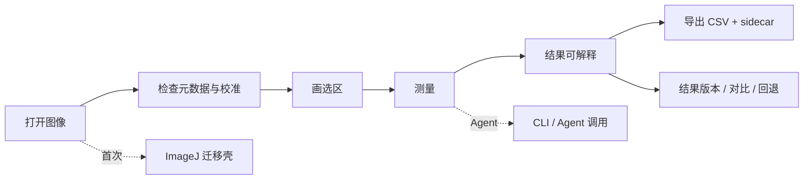

# ImageLyre 产品需求文档（PRD 4.3）

| 版本 | 日期 | 状态 | 作者 | 说明 |
| :--- | :--- | :--- | :--- | :--- |
| 4.0 | 2026-11-19 | 定稿 | lukan | Core 1.0 产品收口：83 条旧 P0 压成 15 个产品结果；技术内核与产品内核分开；功能全部插件化，官方基础套装保底；旧 PRD 3.4 归档 |
| 4.1 | 2026-11-19 | 定稿 | lukan | 补测量基线与容差的唯一真源指针（`measurement-baseline.md`），登记新增需求 MIG-001 与其对 VAL-007 的吸收；15 个产品结果与优先级不变 |
| 4.2 | 2026-11-20 | 定稿 | lukan | 技术内核改为七项（补首选项、用户习惯），与 ADR-0008、Core 1.0 边界对齐；CORE-12 收为本地包；CORE-15 写明应用内缩放，屏幕阅读器与色盲可辨配色移入首个更新；15 个产品结果与优先级不变 |
| 4.3 | 2026-11-20 | 定稿 | lukan | 按业主口径改判：屏幕阅读器与色盲可辨配色从首个更新移出，短期不做；CORE-15 仍验键盘、对比度与应用内缩放；15 个产品结果与优先级不变 |

> 本文件回答「为谁做、做什么、做到什么程度」。技术选型、分层与插件架构以 `../baseline/startup-requirements.md` 为准；CLI 命令与 Schema 见 `../cli/cli-contract.md`；测量选项、列序与 ImageJ 对照容差见 `measurement-baseline.md`。旧版需求档案：`archive/product-requirements-3.4.md`。

## 0 摘要

ImageLyre 是显微镜旁的第一块屏幕：面向科研显微图像的现代定量分析平台。它要做的不是把 ImageJ 换个皮，而是把「看图 → 校准 → 选区 → 测量 → 复核 → 导出」这条路重新设计，让研究者更快拿到可信数字，让老用户迁移得舒服，让 Agent 能当同事而不是外挂。

Core 1.0 只保证四件事：**打开图能测、测完敢信、老用户能迁、插件能长。** 其余能力全部让位，进官方更新或插件。

## 1 产品定位

### 1.1 一句话定义

面向生物显微、荧光、电镜与一般科学定量场景的开源分析平台：让 ImageJ 老用户舒服地迁移，让新用户三秒见图、十秒见数，让 Agent 能看见上下文、提出可审阅的下一步；桌面与 CLI 是两个入口，同一套结果。

### 1.2 目标与非目标

**目标**：

1. 打开软件三秒内看见图，十秒内得到第一个可信数字；新用户不看文档完成第一次测量。
2. 有 ImageJ 经验的研究者五分钟内完成第一次测量，二十个高频动作首次尝试成功率不低于 95%，所有改动都能查到新旧对照。
3. 同一图像、同一参数在 ImageLyre 与 ImageJ 上得到可对照的结果；每个导出都能被同事原样复现。
4. Agent 能看见用户当前的分析上下文，提出可审阅的下一步，并把一次分析变成可复用流程；人始终保留判断权。
5. 界面与交互达到现代仪器水准：画布优先、零模态、直接操作、克制动效，不是复古复刻，也不是 Web 仪表盘。
6. Windows、Linux 与 macOS 界面与结果一致，核心功能完全离线可用。
7. 简体中文与英文都是一等语言，界面、错误、帮助与导出不因语言产生歧义。

**非目标**：

- 不做显微镜采集控制与硬件联动，采集仍由厂商软件完成。
- 不做通用图像编辑与平面设计。
- 不做云端协作与在线项目库；商业授权可采用离线授权码，账号体系不属于首版。
- 不做医学影像诊断用途。
- 不兼容 Java 插件与 IJM 宏，不引入 Java 运行时。
- 主程序不做三维重建、反卷积与 AI 分割，这些能力通过插件提供。
- 不把 ImageJ 菜单原样搬过来；迁移要舒服，但不是复刻。

### 1.3 竞争格局与商业模式

| 产品 | 优势 | 相对 ImageLyre 的缺口 |
| :--- | :--- | :--- |
| ImageJ / Fiji | 生态最大、习惯成熟、免费 | 界面与交互停留在上个时代，批处理与协作弱，结果溯源靠人 |
| QuPath | 病理全切片与标注强 | 面向病理流程，通用显微定量与 ROI 兼容弱 |
| CellProfiler | 流水线化批量分析强 | 交互式探索弱，学习曲线陡 |
| 商业平台（Imaris、ZEN、NIS-Elements 等） | 采集与分析一体、售后完善 | 昂贵、绑定硬件、导出与脚本自由度低 |

差异化落在四点：

- **迁移舒适**：老用户不是「重新学」，是「顺手多了」；习惯有落点，升级有说法，回退有路径。
- **结果可信**：每个数字可解释、每次导出可复现；ImageJ 兼容是底线，不是卖点。
- **现代交互**：画布优先、零模态、直接操作、命令面板与克制动效，做出这个时代该有的仪器感。
- **Agent 协作**：Agent 看见上下文、提出可审阅的计划、把分析变成可复用流程，而不是外挂一个聊天框。

核心完全开源，企业插件以商业授权提供，两者共用同一插件市场与沙箱；免费用户不缺核心能力，商业用户为增强功能、批量规模与支持付费。

## 2 用户与场景

### 2.1 用户画像

| 画像 | 典型身份 | 核心诉求 | 主要痛点 |
| :--- | :--- | :--- | :--- |
| 课题负责人 | PI、教授 | 数据可复现、可发表、团队口径一致 | 学生各用一套脚本，结果不可比 |
| 日常分析者 | 博士后、研究生 | 快速完成测量、少写代码、批量处理 | ImageJ 操作繁琐、批处理要写宏 |
| 成像平台技术员 | 显微镜平台工程师 | 多格式读取、批量部署、稳定 | 厂商格式互不兼容、软件崩溃丢进度 |
| 方法开发者 | 算法、生信背景 | 插件与脚本扩展、接口清晰、可调试 | ImageJ 插件耦合全局状态、调试困难 |
| 教学用户 | 讲师、学生 | 免费、免管理员安装、机房可批量部署 | 机器受限、许可证复杂、无外网 |

Agent 是渠道，不是买家。真正的买家是需要可复现自动化的 PI、方法开发者与实验室自动化负责人。

### 2.2 核心任务（JTBD）

1. 拿到一批显微图像时，按熟悉的 ImageJ 流程完成校准、选区与测量，并导出可直接进论文的 CSV。
2. 同一实验需要重复分析几十上百张图时，用录制、批处理或 Agent 跑完，并给出进度与失败原因。
3. 厂商格式或新算法出现时，通过插件扩展能力，不必等主程序发版，也不担心插件把软件弄崩。
4. 复核他人结果时，能看到测量参数、校准来源与软件版本，并用同一份输入复现。
5. 课题组统一分析口径时，一套配置、一份工程与一份验证报告能在多台机器与多人之间传递。
6. 当 AI 或外部流水线需要调用时，用 CLI 与 JSON 结果完成分析，不需要模拟桌面操作。
7. 分析过程中断时，能恢复到最后一笔有效操作；结果改了，能对比、能回退。

### 2.3 核心工作流

## 3 产品宪法

1. **三秒见图，十秒见数**：打开软件到看见第一张图不超过三秒，从打开图到得到第一个可信数字不超过十秒；没有欢迎页、强制向导与「请先配置」。
2. **零模态**：九成操作不弹窗，校准、选区、测量、导出在画布边上完成；对话框只留给真正不可逆的事，并说清发生了什么、影响什么、怎么退回去。
3. **一切可逆、可解释、可复现**：任何一步都能撤销，包括校准、ROI 编辑、批量任务与 AI 建议；点任何一个数字都能看到它的来源；导出是另一个人能原样重跑的起点。
4. **AI 是同事，不是侧边栏**：Agent 能看见用户正在看的图、选中的 ROI、当前校准与结果，能提醒、能提议、能把一次分析变成可复用流程；人负责判断，Agent 负责跑腿，每一步都能退回人工操作。
5. **现代仪器感**：安静、精确、有光；不是医疗仪表盘，不是复古拟物，也不是塞满卡片的 Web 后台。图像是主角，数据有秩序，动效只解释空间关系。
6. **迁移要舒服**：ImageJ 老用户的第一反应应是「还是那套逻辑，但顺手多了」，而不是「我又要学一套软件」。习惯可以升级，但每次升级都要让人知道少了哪一步、快了多少、怎么回去。
7. **默认离线、结果可信**：核心路径零网络请求；没有静默默认值，缺校准、缺元数据、越界 ROI 必须当场说；每个结果都有可核对的身份证。
8. **语言不挡路**：中文与英文都是一等语言；术语统一、错误可读、导出不随语言变化。

## 4 体验规范

### 4.1 视觉语言

- **画布优先**：图像占据视觉中心，面板需要时出现、不需要时退场。
- **层级**：深色画布托住图像，中性面板承载数据，信号色只给选中、警告与关键状态。
- **字体**：界面无衬线，数字用等宽或表格数字；测量结果、坐标、缩放比例对齐、可扫读。
- **密度**：常用动作一只手够得着，低频参数渐进披露。
- **主题**：浅色、深色、跟随系统三种模式，可随时切换、不需重启；两套主题完整覆盖弹窗、图表与空状态，不是简单反色。
- **品牌**：克制、精确、有光；拒绝复古拟物、金属拉丝、纸张纹理与「科学仪器」刻板印象。

### 4.2 交互

- 直接操作：拖、拉、滚、框选、捏合，所见即所得。
- 零模态：校准、ROI、测量、导出在画布边缘完成，参数改动即时反映到结果。
- 命令面板：记不住快捷键就敲命令名；高频动作键盘可达。
- 渐进披露：新手看到三个按钮，老手展开全部能力。
- 连续感：缩放、切换切片、改 ROI 时画面不跳、不闪、不重排。
- 多工作区：图、ROI、结果、注释、对比、历史可同屏拼装。
- 可逆：所有会改变结果的动作可撤销；批量任务可取消。

### 4.3 动效与反馈

动效只解释空间关系与状态变化，时长克制，不做弹跳、旋转、粒子等表演性效果。超过两秒的任务必须有真实进度与取消；成功不喧哗，失败不吓人。

### 4.4 大图与多视图

超过视口四倍的图像分块渲染与缓存；缩放以光标为中心；拖拽平移不触发重新解码；多视图同步以主视图为基准；对比视图的缩放、通道与 ROI 可联动，也可独立。

### 4.5 迁移体验

- **首启选择**：第一次启动可以选择「我从 ImageJ 来」，直接进入熟悉布局与键位。
- **老锚点保留**：菜单名、工具分组、ROI 手势、Results 表、测量口径与常用快捷键保留；非改不可的，第一次触发时告诉用户「以前是 X，现在是 Y」。
- **升级有说法**：每一步交互升级都要回答「少了哪一步、快了多少、后悔了怎么回去」；争议改动保留「用旧方式」的等价路径，一键切换。
- **能带走**：ROI、校准、测量选项、常用流程、最近文件可迁移；带不走的要明说。
- **对照表**：应用内提供 ImageJ 对照表，写清老菜单在新界面哪里、旧快捷键对应什么、哪些行为故意改了、为什么改。
- **验收**：老用户不看文档五分钟完成第一次测量；二十个高频动作首次尝试成功率不低于 95%；所有改动的快捷键与菜单路径 100% 可查新旧对照；争议交互至少一条可一键回退。

### 4.6 可访问性与语言

键盘全路径、对比度、应用内缩放 100%–200% 从第一天就是验收项；屏幕阅读器与色盲可辨配色短期不做。简体中文与英文的界面、菜单、错误、引导、帮助、安装与更新文案完整；数字与日期可按 locale 显示，但 CSV、JSON、测量值与 sidecar 不随语言变化。

## 5 Core 1.0：15 个产品结果

Core 1.0 的 P0 按产品结果计数，不按旧需求 ID 计数。一个结果可以合并多条旧需求；旧 ID 的处置见附录 A。

| 编号 | 产品结果 | 优先级 |
| :--- | :--- | :--- |
| CORE-01 | 第一次打开就能开始：首启、示例、最近文件 | P0 |
| CORE-02 | 打开标准 TIFF/BigTIFF，保留位深、通道、Z/T 与校准元数据 | P0 |
| CORE-03 | 画布缩放、平移、适应、1:1 与像素探针 | P0 |
| CORE-04 | 矩形/多边形 ROI、顶点编辑、`.roi` 导入 | P0 |
| CORE-05 | 读取与手动设置比例尺 | P0 |
| CORE-06 | 六项测量与 Results 表 | P0 |
| CORE-07 | CSV 与 sidecar，结果可追溯、可复现 | P0 |
| CORE-08 | 撤销、自动保存、崩溃恢复 | P0 |
| CORE-09 | 结果版本、对比、回退与前进 | P0 |
| CORE-10 | 浅色/深色/跟随系统，两套主题完整 | P0 |
| CORE-11 | 中英双语，术语审校，切换不重启 | P0 |
| CORE-12 | 插件即插即用：安装/启停/卸载/权限/回滚 | P0 |
| CORE-13 | ImageJ 迁移壳：首启、键位、ROI/校准导入、新旧对照 | P0 |
| CORE-14 | CLI/Agent 基础闭环：发现、执行、重试、与桌面一致 | P0 |
| CORE-15 | 可访问性底线：键盘、对比度、应用内缩放 | P0 |

### 5.1 CORE-01 第一次打开就能开始

用户第一次打开，不需要读配置文档：可以选「从 ImageJ 来」或「我是新用户」，看到示例图与三步提示，最近文件与拖拽都能开始。没有强制向导，没有空窗。

验收：新用户不看文档一分钟内打开第一张图；老用户首启直接进入熟悉布局。

### 5.2 CORE-02 打开标准图像

打开标准 TIFF、ImageJ TIFF 与 BigTIFF，保留位深、通道、Z/T、物理尺寸与校准；损坏文件给出可读原因。首版不承诺厂商格式。

验收：打开后位深、尺寸、校准与文件一致；损坏文件不静默失败。

### 5.3 CORE-03 画布与像素探针

缩放、平移、适应窗口、1:1；滚轮以光标为中心；像素探针显示坐标、像素值、通道与 Z/T。缩放只改变显示，不重写像素。

验收：探针读数与 ImageJ 一致；缩放与平移不改变原始数据。

### 5.4 CORE-04 ROI

矩形与多边形 ROI 的绘制、顶点编辑、整体移动、删除、撤销；导入 ImageJ `.roi`/`.zip`。坐标固定为像素，几何不丢失。

验收：画、改、存、再打开，几何与面积不丢；`.roi` 往返与 ImageJ 互开。

### 5.5 CORE-05 校准

读取文件内校准，也支持用已知距离手动设置比例尺；物理单位进入测量与导出。缺校准必须当场说，不静默默认。

验收：同一已知距离，Lyre 与 ImageJ 校准一致；无校准测量明确提示。

### 5.6 CORE-06 测量与 Results

单 ROI 六项测量：面积、均值、标准差、最小、最大、周长；Results 表可读、可复制、可清空。测量口径与 ImageJ 基线一致。

验收：黄金数据集上六项指标与基线在容差内（容差分类与判定见 `measurement-baseline.md` §6）；Results 与 CSV 列一致。

### 5.7 CORE-07 导出与溯源

导出 CSV 与 sidecar；CSV 只含基线列，列序与数值格式见 `measurement-baseline.md` §5 与 §7；sidecar 记录软件版本、输入哈希、校准来源、ROI 来源、测量选项与时间。每个导出都能被同事原样复现。

验收：任取一次导出，按 sidecar 能在另一台机器复现；CSV 列与 ImageJ 对齐。

### 5.8 CORE-08 撤销、自动保存与崩溃恢复

所有会改变结果的动作可撤销；ROI、Results、校准、视图做秒级自动保存；强杀、崩溃或断电后恢复到最后一笔有效操作。自动保存不阻塞交互。

验收：强杀后恢复 ROI、结果、校准与视图；恢复后结果逐值一致。

### 5.9 CORE-09 结果版本、对比与回退

每次测量/导出生成不可变版本，记录输入、ROI、校准、选项与结果；任选两版逐项对比并解释差异来源；可回退到历史版本，回退留痕、可再前进，源图像不变。

验收：任选两版可对比；回退/前进留痕；源图像与旧版本不被修改。

### 5.10 CORE-10 主题

浅色、深色、跟随系统三种模式；首次跟随系统，随时切换且无需重启；两套主题完整覆盖界面、弹窗、图表、结果表与空状态；图像视口保持中性背景，对比度 AA。

验收：切换不重启；逐页无半套主题；对比度检查通过。

### 5.11 CORE-11 语言

简体中文与英文的界面、菜单、错误、引导、帮助、安装与更新文案完整；关键术语人工审校并与 ImageJ 对照；切换不重启，偏好按用户保存；导出不随语言变化。

验收：页面不混用两种语言；切语言后 CSV/JSON/测量值/sidecar 不变。

### 5.12 CORE-12 插件即插即用

从本地包一键安装、更新、卸载；不需要管理员、不需要重启；依赖自动解析；安装后立即出现在菜单、命令面板与 Agent 工具清单；安装前展示来源、权限与能力；失败回滚；卸载无残留；插件崩溃不波及其他插件与主程序。

验收：装完即用；卸载干净；不兼容或缺权限在安装前阻断。

### 5.13 CORE-13 ImageJ 迁移壳

首启选择「我从 ImageJ 来」；布局与键位可切换；ROI、校准、测量选项可导入；应用内提供 ImageJ 对照表；争议交互保留一键旧路径。

本结果以新增需求 `MIG-001`（ImageJ 迁移包）落号，并吸收旧 3.4 的 `VAL-007`（平台差异登记表，原 P1）：对照表就是该登记表的用户可见形态，因此 `VAL-007` 不再单列为首个更新条目，而作为本结果的验收载体，登记范围覆盖快捷键、菜单路径、文件对话框与路径行为四类差异。

验收：老用户五分钟完成第一次测量；二十个高频动作首次成功率 ≥95%；所有改动 100% 可查新旧对照。

### 5.14 CORE-14 CLI/Agent 基础闭环

不打开界面也能完成一次可信分析；Agent 能发现能力、知道一次调用会读什么写什么、失败时知道重试还是改输入；CLI 与桌面同源，结果可核对。

验收：CLI 在无显示环境完成打开→校准→ROI→测量→导出；结果与桌面一致。

### 5.15 CORE-15 可访问性底线

键盘全路径、对比度、应用内缩放 100%–200%；不用鼠标完成一次测量。

验收：键盘完成打开→校准→ROI→测量→导出；应用内缩放不截断。

## 6 技术边界与插件

### 6.1 技术内核：研发前提，不是 P0

主题、语言、插件宿主、宿主壳、共享契约、首选项、用户习惯。它们决定软件能不能长，由架构与研发负责，不写成产品需求，也不拿来数 P0。首选项是用户显式设置的项，用户习惯是软件默默记住的布局、最近文件与视图状态。

### 6.2 官方基础套装与第三方插件

- **官方基础套装**（预装、可替换）：标准 TIFF、画布/ROI、校准、测量、CSV、ImageJ 迁移包。
- **第三方插件**：厂商格式、滤镜、阈值、颗粒、3D、反卷积、AI、特殊视图、导出格式。
- 菜单、命令面板、Agent 工具清单，都是「已安装能力」的投影；装什么出现什么，卸载即消失。
- 插件不能改变核心交互与结果口径，只能扩展能力。

### 6.3 插件即插即用的边界

装完即用、卸载干净、坏了不拖累别人；安装前必须知道来源、权限与兼容性；不允许插件把核心界面改成另一个软件。

## 7 后续能力

### 7.1 首个更新

通道合成、伪彩、Z/T 播放、叠加层；ROI Manager、多 ROI 批量测量；Results 排序与单位切换；多页 TIFF、PNG/JPG、拖拽导入、大图流式；工程保存/打开、团队配置、复核模式；插件市场、企业授权、遥测；CLI 批处理、MCP、插件 CLI 扩展；Agent 评测集、更多语言、高对比主题。

### 7.2 进插件

图像处理（亮度/对比度、滤波、阈值、形态学、几何变换、栈投影）、颗粒分析、共定位、比例成像、3D、反卷积、AI 分割、厂商格式、特殊视图、导出格式、脚本运行时。

### 7.3 明确不做

第一版不做 3D、反卷积、AI 分割、厂商格式、团队协作、云端；不做功能大全式菜单；不把核心体验做成可选插件。屏幕阅读器与色盲可辨配色等无障碍专项短期不做，键盘、对比度与应用内缩放仍按 CORE-15 验收。

## 8 成功指标

| 指标 | 目标 | 说明 |
| :--- | :--- | :--- |
| 首次见图 | ≤ 3 秒 | 启动到第一张图可操作 |
| 首次得数 | ≤ 10 秒 | 打开图到第一个可信数字 |
| 老用户首次测量 | 5 分钟内完成，成功率 ≥ 95% | 有 ImageJ 经验，无培训 |
| 二十个高频动作 | 首次尝试成功率 ≥ 95% | 迁移体验核心回归 |
| 新旧对照可查率 | 100% | 所有改动的快捷键与菜单路径 |
| 零模态操作占比 | ≥ 90% | 常见分析操作不弹窗 |
| 结果可溯源率 | 100% | 每次导出都有输入、校准、ROI、选项、版本 |
| 可复现率 | 100% | 同事拿导出能原样重跑 |
| 崩溃恢复零丢失 | 100% | 强杀/断电后恢复最后一笔有效操作 |
| 结果版本可对比率 | 100% | 任一历史版本可与当前对比 |
| 版本回退成功率 | 100% | 回退留痕、可前进，源图像不变 |
| 插件即插即用率 | 100% | 安装后无需重启即可用 |
| 页面混用语言 | 0 | 中文/英文逐页检查 |
| 半套主题页面 | 0 | 弹窗、图表、结果表、空状态 |
| 可访问性 | 键盘全路径 100%，对比度 100% | 验证报告 ACC 检查项 |

## 9 发布门禁

- [ ] 15 个 CORE 结果全部达到验收语言。
- [ ] 新用户不看文档完成一次测量；老用户五分钟完成第一次测量，二十个高频动作 ≥95%。
- [ ] 任取一次导出，同事能按 sidecar 原样复现。
- [ ] 强杀/断电后恢复 ROI、结果、校准、视图；结果逐值一致。
- [ ] 任选两版结果可对比并解释差异；回退/前进留痕，源图像不变。
- [ ] 浅色/深色/跟随系统切换不重启、无半套主题；中英页面不混用。
- [ ] 插件安装无需管理员/重启，装完即用、卸载无残留、失败回滚。
- [ ] CLI 在无显示环境完成一次分析，结果与桌面一致。
- [ ] 键盘可完成一次测量；应用内缩放不截断。
- [ ] 可访问性、离线、安装与已知问题清单齐备。

## 10 风险与开放问题

| 风险 | 影响 | 应对 |
| :--- | :--- | :--- |
| 15 个结果仍偏多 | Core 1.0 延期 | 按 CORE-01~08 先形成最小闭环，CORE-09~15 可并行但不得砍验收 |
| ImageJ 迁移体验失真 | 老用户流失 | 8 位老用户实测，5 分钟/95%/对照表作为门禁 |
| 插件生态早期不足 | 首版能力显得薄 | 官方基础套装预装，保证开箱即用 |
| Agent 能力被高估 | 用户失望 | 首版只承诺可审阅的基础闭环，不承诺全自动科研 |
| 主题与语言细节漏网 | 半套主题/混用语言 | 逐页检查进 §9 指标与 §9 门禁 |

已拍板：Core 1.0 只做 15 个产品结果；技术内核七项不写 P0；功能全部插件化，官方基础套装保底。

## 附录 A 旧 P0 处置

旧 PRD 3.4 的 83 条 P0 逐条处置如下。`Core 1.0` 表示被 15 个产品结果吸收；`首个更新` 表示不进 Core 1.0；`插件` 表示由插件提供。

| 旧编号 | 旧需求摘要 | 处置 |
| :--- | :--- | :--- |
| IO-001 | 打开标准 TIFF、ImageJ TIFF 与 BigTIFF，保留位深、通道、Z/T 与校准；验收：ImageJ 读回… | Core 1.0 |
| IO-002 | 打开 PNG 与 JPG，8 位与 RGB 正确显示 | 插件 |
| IO-003 | 多页 TIFF 自动识别为栈，Z/T 维度可逐帧浏览 | 首个更新 |
| IO-004 | 大文件懒加载与取消；验收：首屏在 §8.1 时间内出现，取消后无锁残留 | 首个更新 |
| IO-006 | 厂商格式（CZI、LIF、ND2、OIB）随安装包内置 BioFormats.NET（ADR-0005），默认启用可禁用… | 插件 |
| IO-009 | 解码失败的可读提示与部分恢复；损坏帧在状态栏与 Results 标为 UNRELIABLE，CSV 不扩展列，质量标记写… | 首个更新 |
| IO-010 | 图像序列导入：按自然序把文件夹组成虚拟栈，200 个 1024×1024 TIFF 五秒内可浏览且内存不随帧数线性增长 | 首个更新 |
| IO-011 | 超出支持矩阵或内存不足时给出预计内存并允许降采样、仅加载选区或取消；不得崩溃 | 首个更新 |
| IO-012 | 厂商元数据字段矩阵：像素尺寸、Z 步距、时间间隔、通道名、物镜倍率、拼图坐标、位深逐项标注必读或可缺；必读缺失时阻断测量… | Core 1.0 |
| VIEW-001 | 缩放、平移、适应窗口、1:1；视图不修改原始像素 | Core 1.0 |
| VIEW-002 | 像素探针：坐标、像素值、通道、Z/T | Core 1.0 |
| VIEW-003 | 通道开关、合成、伪彩 LUT | 首个更新 |
| VIEW-004 | Z/T 滑块与播放控制 | 首个更新 |
| VIEW-005 | ROI、标尺、文本叠加层，可独立显隐 | 首个更新 |
| VIEW-007 | 高 DPI 与多显示器，200% 缩放下文字与控件清晰 | 首个更新 |
| VIEW-009 | 渲染回退：显卡不可用或远程桌面时自动回退软件渲染并在状态栏提示，核心路径仍可完成 | 首个更新 |
| PROC-001 | 亮度/对比度调整（线性与直方图），默认只影响显示，另有应用到数据入口 | 插件 |
| PROC-002 | 平滑、锐化、中值滤波，同参数与 ImageJ 可比 | 插件 |
| PROC-003 | 阈值：手动与自动方法（含 Otsu）；直方图桶数、等号归属与舍入规则写入验收 | 插件 |
| PROC-007 | 栈投影：最大值、均值、求和，结果作为新文档 | 插件 |
| PROC-008 | 撤销/重做：历史预算按图像字节数自适应，默认不超过缓存的 25%，超出时降级为命令式撤销并提示可用步数 | Core 1.0 |
| PROC-009 | 图像类型与几何变换：位深转换、裁剪、旋转、翻转、缩放；批量处理走流式 | 插件 |
| PROC-010 | 大栈流式处理：所有 P0/P1 栈算子按平面处理，2000 帧 16k×16k 投影峰值内存不超过缓存上限 | 插件 |
| ROI-001 | 矩形、椭圆、多边形、自由手绘、线、点六类选区 | Core 1.0 |
| ROI-002 | 顶点编辑与整体变换，手柄命中区域符合平台习惯 | Core 1.0 |
| ROI-003 | ROI Manager：列表、重命名、颜色、显隐、Multi Measure、Deselect、More（AND/OR/… | 首个更新 |
| ROI-004 | `.roi` 与 `.zip` 双向读写，ImageJ 互开不报错 | Core 1.0 |
| ROI-005 | 选区跨图像复制与转移，坐标随校准换算 | 首个更新 |
| ROI-009 | ROI 的 Z/T 归属与 Associate with slice 编辑 | 首个更新 |
| ROI-010 | 键盘与坐标方式创建/编辑 ROI，作为鼠标手势的等价路径 | 首个更新 |
| MEAS-001 | 区域统计：面积、均值、标准差、最小、最大、周长、积分密度、中位数、偏度、峰度、质心、圆度、N 像素 | Core 1.0 |
| MEAS-002 | 像素单位与物理单位切换，校准改变时结果同步 | 首个更新 |
| MEAS-003 | Results 表：多行多列、排序、复制，列定义随测量选项联动 | Core 1.0 |
| MEAS-004 | CSV 导出：只含基线列，表头、顺序、数值格式对齐 ImageJ；诊断与质量信息只写 VAL-001 sidecar，不… | Core 1.0 |
| MEAS-007 | 测量参数、阈值、校准来源、软件与插件版本写入 VAL-001 sidecar，CSV 保持基线列 | Core 1.0 |
| MEAS-009 | Set Measurements 选项集：逐项定义对 Results 与 CSV 的影响，基线选项随验证报告钉死 | 首个更新 |
| MEAS-010 | 跨平台一致性：在确定性模式（MEAS-011）下，同一输入在 Windows、macOS、Linux 上二值结果完全一致… | 首个更新 |
| MEAS-011 | 确定性计算：测量与导出默认走固定分块补偿求和与固定遍历序，提供固定线程数选项，线程数与算法写入溯源；不得以「可选模式」代… | 首个更新 |
| MEAS-012 | 各向异性像素与 Z 步长：面积、周长、Feret 的定义与单位在非方形像素下写明并验证 | 首个更新 |
| STACK-001 | Z/T 导航与帧切换：缓存命中 P95 ≤ 100 毫秒，未命中 ≤ 500 毫秒，内存不随栈深线性增长 | 首个更新 |
| STACK-002 | 多通道合成与拆分，拆分通道可独立处理 | 首个更新 |
| CAL-001 | 读取并显示空间校准、单位与 Z 步距 | Core 1.0 |
| CAL-002 | 手动设置比例尺（已知距离） | Core 1.0 |
| AUTO-004 | 无头执行 `lyre` 命令组合或批处理，复用同一 CLI 与 JSON/退出码契约，不依赖 Python；Python… | 首个更新 |
| PLUG-001 | 插件安装、卸载、启停，失败可回滚 | Core 1.0 |
| PLUG-002 | 六个槽位注册与调用（IO、View、Operator、Measure、Script、System），每槽位至少一个官方示… | 首个更新 |
| PLUG-003 | 沙箱执行、取消与崩溃隔离：每插件一进程，崩溃不波及主进程；最小权限验收：越权文件与网络调用被宿主 broker 与 OS… | 首个更新 |
| PLUG-004 | 依赖声明与版本检查，缺依赖安装前提示 | 首个更新 |
| PLUG-012 | 宿主 API 契约：SemVer、N-1 支持窗口、清单声明 `hostApiRange`，不兼容安装前阻断 | 首个更新 |
| PLUG-016 | 即插即用：从市场或本地包一键安装、更新、卸载，无需管理员、无需重启；依赖自动解析；安装后立即出现在菜单、命令面板与 Ag… | Core 1.0 |
| PLUG-017 | 安全与可逆：安装前展示来源、签名、权限与能力；默认最小权限；失败回滚；卸载清理干净，不破坏其他插件或工程；插件崩溃不波及… | Core 1.0 |
| PRJ-005 | 自动保存与崩溃恢复：对 ROI、Results、校准、视图做秒级增量快照，不阻塞交互；强杀、崩溃或断电后恢复到最后一笔有… | Core 1.0 |
| PRJ-010 | 结果版本：每次测量/导出生成不可变版本，记录输入哈希、ROI、校准、选项、插件版本与结果；可命名、备注，不覆盖旧版本 | Core 1.0 |
| PRJ-011 | 结果对比：任选两个版本逐项对比，标出新增、删除与变化，并解释变化来源（校准、ROI、选项、插件、输入）；图像、ROI 与… | Core 1.0 |
| PRJ-012 | 版本回退：可回退到任一历史版本，回退生成新版本并留痕，可再前进；源图像与旧版本不被修改 | Core 1.0 |
| VAL-001 | 溯源 sidecar：与导出同名，含软件与构建哈希、运行时版本、插件清单、ImageJ 基线版本、输入 SHA-256、… | Core 1.0 |
| VAL-002 | 黄金数据集：≥24 张图像覆盖位深/通道/校准组合、≥6×6 个 ROI、≥3 个栈；附 SHA-256、许可、保管人与… | Core 1.0 |
| VAL-003 | 每轮候选版本自动生成兼容性验证报告：基准环境、逐项通过率、差异清单、失败项与裁决结论，随版本归档并提供稳定链接 | Core 1.0 |
| VAL-008 | Agent 评测集：30 个任务（20 开发 + 10 holdout），固定 3 个模型版本与 seeds，留存 tr… | 首个更新 |
| ONB-001 | 首次启动引导，可跳过、可重放，十秒内出现 | Core 1.0 |
| ONB-002 | 内置示例数据：带校准的 16 位 TIFF、无校准的 8 位 TIFF、多通道图各一，随包分发并标注许可 | Core 1.0 |
| ONB-003 | 引导五步：打开示例 → 核对校准 → 画 ROI → Measure → 导出 CSV；每步给出预期结果与一次纠错 | Core 1.0 |
| LIC-002 | 无账号完整可用：断网、不登录、不输入授权码即可完成全部 P0 路径 | 首个更新 |
| SYS-001 | 设置：内存缓存、语言、主题、最近文件数，持久化并即时生效 | 首个更新 |
| SYS-002 | 简体中文与英文界面，文案外部化 | 首个更新 |
| SYS-005 | 诊断包：版本、插件、系统、最近失败任务、脱敏配置，一键生成 ≤20 MB 并可通过 U 盘取出 | 首个更新 |
| ACC-001 | 以 WCAG 2.2 AA 为目标，主要文本与控件对比度 ≥ 4.5:1，自动化检查加抽查记录 | Core 1.0 |
| ACC-002 | 键盘全路径：不用鼠标完成打开 → 输入校准 → 创建矩形 ROI → Measure → 导出 CSV | Core 1.0 |
| ACC-004 | 界面缩放 100%–200% 无文字截断与控件重叠 | Core 1.0 |
| CLI-001 | 不打开界面也能完成一次可信的「打开 → 校准 → 选区 → 测量 → 导出」，结果与桌面同源 | Core 1.0 |
| CLI-002 | 第一次使用的 agent 能通过自描述发现命令与参数，不需要读自然语言手册 | Core 1.0 |
| CLI-003 | 每次调用都有稳定、可解析的结果与失败原因，agent 能据此决定重试、改参数还是停下 | Core 1.0 |
| CLI-004 | 长任务可超时、可取消、可拿到部分结果；同一输入重复执行结果一致 | 首个更新 |
| CLI-005 | 一批图能一次交给 CLI 跑完，失败项可定位、可重跑、可核对输出 | 首个更新 |
| CLI-006 | CLI 与桌面在同一输入、同一参数下结果一致，差异可解释、可追溯 | 首个更新 |
| CLI-007 | agent 只能写到被允许的位置，不能覆盖输入，不能静默联网或读隐式配置 | Core 1.0 |
| CLI-008 | agent 能先知道「有哪些工具、各自会做什么、有什么副作用」，再决定调用 | 首个更新 |
| I18N-001 | 简体中文与英文的界面、菜单、错误、引导、帮助、安装与更新文案完整，页面不混用两种语言 | Core 1.0 |
| I18N-002 | 首次启动跟随系统语言，用户可随时切换且无需重启；语言偏好按用户保存，不改变工程数据 | Core 1.0 |
| I18N-003 | 统一术语表并与 ImageJ 术语对照；测量、校准、ROI 等关键术语人工审校，禁止机翻 | Core 1.0 |
| I18N-004 | 数字、日期、单位可按 locale 显示，但 CSV、JSON、测量值与 sidecar 不随语言变化；Agent 与 … | Core 1.0 |
| THEME-001 | 提供浅色、深色、跟随系统三种模式；首次跟随系统，随时切换且无需重启；偏好按用户保存 | Core 1.0 |
| THEME-002 | 两种主题完整覆盖界面、弹窗、图表、结果表与空状态，不出现半套主题；图像视口保持中性背景，对比度达到 AA | Core 1.0 |

合计：Core 1.0 40 条，首个更新 35 条，插件 8 条；另有新增 `MIG-001` 并入 CORE-13，旧 P0 的计数不因此变化。

## 附录 B 旧需求档案

旧 PRD 3.4 的完整需求、验收口径与历史决策保留在 [`archive/product-requirements-3.4.md`](archive/product-requirements-3.4.md)，仅作追溯，不再作为排期依据。
