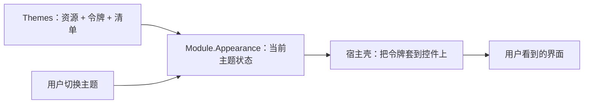

# ImageLyre.Themes：主题资源、令牌与清单

本工程只有资源与常量，一行 C# 逻辑都不放。主题是"长什么样"的静态答案，至于"现在用哪个主题"属于运行期状态，归 `ImageLyre.Module.Appearance` 管，两者分开是为了让主题资源可以被纯静态地引用、预览与替换。

## 装什么

| 内容 | 说明 |
| :--- | :--- |
| AtomUI 主题资源 | 浅色与深色两套，按 AtomUI 的资源字典组织 |
| 设计令牌 | 品牌色、字号阶、间距阶、圆角与阴影，是界面上唯一允许出现的数值来源 |
| 主题清单 | 主题标识到资源字典的映射，让 Appearance 模块按标识切换 |
| 图标字体 | 图标字形的字体资源，供菜单与状态栏使用 |

## 三条规矩

1. **不放逻辑**：不放判断当前主题、计算颜色、跟随系统主题一类的代码；这类计算属 Appearance 模块，算完只把令牌交出去。
2. **数值只有一份**：字号与间距不写在控件的 XAML 里，只引用令牌；同时存在字面量与令牌两处时，改一处另一处必然漂移。
3. **深浅两套必须同构**：同一个令牌在两套主题里都要有值，缺一个就说明这套主题不能交付，因为界面会在切换的瞬间露出一块默认样式。

## 与外观模块的分工

`IThemeManager` 只认主题标识与令牌，不认识资源字典的 URI 细节；具体加载哪一份资源由 Appearance 模块决定。这条分工的收益是主题资源可以整包替换（换一套品牌色）而不动任何逻辑代码。

## 现状

工程目前是空的，只有对 AtomUI 的包引用，令牌表尚未落笔。按 DESIGN-0003 的待办，先定颜色与字号两阶，其余等真实界面需要时再补，避免先写一套没人用的令牌。
