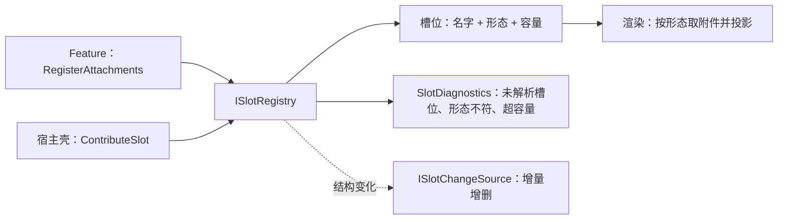
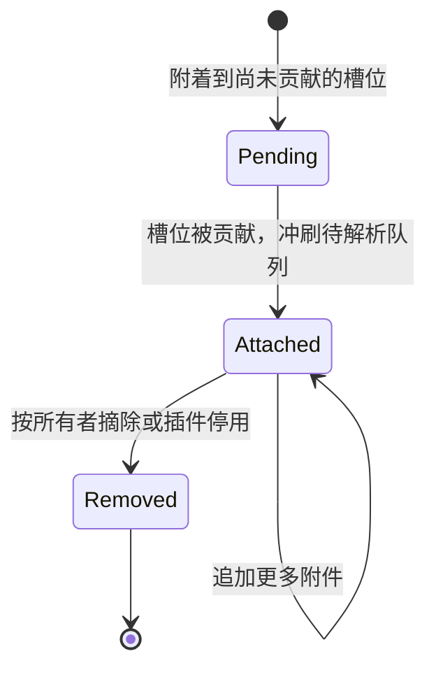

# ImageLyre.UI.Contracts：为界面交互而存在的契约

本工程装的是"只有让人看见或操作才有意义"的契约，包括宿主壳、区域与槽位、附件、命令、快捷键、通知、输出、忙状态、主题、语言、用户习惯、文件对话框与文档页。它允许引用 Avalonia，因为界面契约终究要落在控件类型上；但它仍然不放实现，除 `record` 的工厂方法与常量外不出现方法体。

## 分区

| 分区 | 契约 | 文件数 |
| :--- | :--- | :--- |
| `.Workbench` | 宿主壳与区域名总表 | 见下方说明 |
| `.Slots` | 槽位注册表、描述符、变更源、问题与快照、附件接口 | 5 |
| `.Attachments` | 菜单三类附件、状态栏、内容、文档、工具面板附件 | 4 |
| `.Icons` | 菜单图标描述 | 1 |
| `.Dialogs` | 对话框宿主 | 0，缺口 |
| `.Commands` | 命令注册、命令描述符、上下文键、内置命令名 | 7 |
| `.Keybinding` | 键位映射、键组合、键弦、快捷键管理器 | 4 |
| `.Busy` | 忙状态管理器与忙记录 | 5 |
| `.Notifications` | 通知中心、通知与通知动作记录 | 2 |
| `.Output` | 输出通道管理器与通道 | 1 |
| `.Theming` | 主题管理器与主题标识 | 1 |
| `.Localization` | 本地化服务 | 1 |
| `.UserState` | 用户习惯记忆 | 1 |
| `.Documents` | 文档管理器、文档视图模型、文档选项 | 3 |
| `.Files` | 文件对话框与筛选器 | 1 |
| `.Diagnostics` | 诊断聚合器，即问题面板的数据源 | 1 |

`.Workbench` 目前还没有独立目录，三个根目录文件是它的全部内容：`IWorkbenchShell`、`WorkbenchSlots` 与 `MenuAttachments`；根目录下不再放新类型，这三份在逐个过时归位到 `Workbench/`。

## 槽位与附件

槽位是"界面上的一块位置"，附件是"往这块位置里放的东西"，两者之间只靠字符串槽位名与附件形态匹配。宿主任命区域名，功能附着数据，渲染层做投影；功能被停用时它那一份附件整体消失，壳不需要为此写任何特判。

五种形态与容量决定了校验规则：菜单、工具栏、状态栏、任意内容、文档页与工具窗格各认自己那类附件，形态不符的附着不会静默消失，而是进 `SlotDiagnostics` 的诊断为 `KindMismatch`；单值槽上后来者被拒绝并记 `CapacityExceeded`。

附着到尚未贡献的槽位不抛异常，而是进入待解析状态等冲刷，因为插件加载顺序不保证"提供方先启动"；这条宽容换来的是必须有一份收口报告，否则写错槽位名会安静地不显示。

## 依赖

`Avalonia`（内容附件的控件工厂）、`Cangming.PicoPlugins`（`IFeatureAttachment` 与 `IAttachmentRegistry`）、`System.Reactive`（状态变化流），以及仓库内的 `ImageLyre.Contracts`（文档关闭结果一类的共享记录）。不引 AtomUI：控件长什么样由壳决定，契约只说有什么。

## 写一条新契约时要做到

1. 先问它是不是"只有界面才需要"：是，放这里；不是，放 `Contracts`，因为界面工程反过来依赖无界面工程是允许的，反方向不允许。
2. 附件的形态与槽位声明的形态必须一一对应，新增形态要同时想清楚渲染层怎么画、校验怎么判。
3. 一切可变状态都要有对应的只读快照，例如槽位有 `Snapshot()`，因为增量流只报告变化，初始化与诊断仍然需要一次拿全量。
4. 契约不描述像素：颜色、字号、间距属 `ImageLyre.Themes` 的令牌，壳负责把令牌套到控件上。
