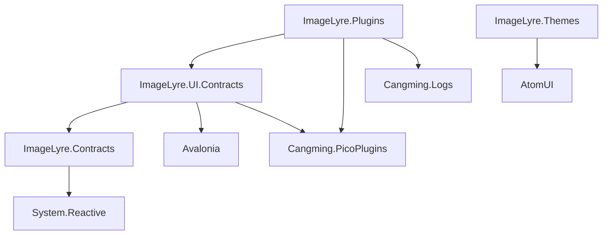
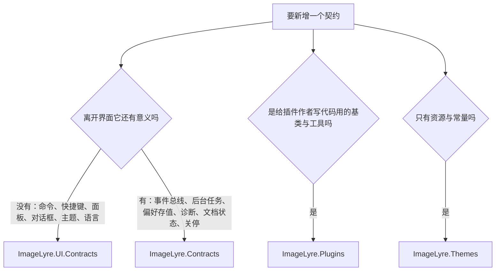

# Libs：基座的全部

`src/Libs` 装着整个基座的**声明**，也就是契约、插件 SDK 与主题资源；这里没有一行实现，任何接口的实现都落在 `src/Modules` 或 `src/Features`，因此删掉这两个目录之后 Libs 仍能独立编译。这条边界是刻意的：基座能力只有做成插件才能被启用、停用与替换，而锁在类库里的能力做不到这三件事。

## 四个工程

| 工程 | 是什么 | 谁消费 |
| :--- | :--- | :--- |
| `ImageLyre.Contracts` | 离开界面仍然成立的服务契约 | 纯服务模块、命令行、插件 |
| `ImageLyre.UI.Contracts` | 为界面交互而存在的契约 | 呈现模块、壳模块、界面功能 |
| `ImageLyre.Plugins` | 官方插件作者写代码时用的基座类与工具 | 所有官方插件 |
| `ImageLyre.Themes` | AtomUI 主题资源、设计令牌与主题清单 | 宿主壳 |

## 依赖方向

依赖只有一条向下的链：`Plugins → UI.Contracts → Contracts`，`Themes` 是独立资源包，不在这条链上。反向引用一律禁止，包括"契约引用实现以便拿到默认实例"这种看起来省事的写法，它会让升级与替换同时变难。

## 契约该进哪一本

判据是**这个契约离开界面还有没有意义**，而不是看它的类型面上有没有控件，因为有些契约一个控件也不出现却完全是为界面服务的。

拿不准时的检验办法是想一个具体场景：命令行要打开一个文档、加载一个插件、写一条诊断，中间用到的东西留在 `Contracts`；只有点菜单、开面板、弹对话框才会碰到的进 `UI.Contracts`。

## 三条硬边界

1. **Libs 无实现**：除 record 工厂方法与常量声明外不出现方法体，`Contracts` 与 `UI.Contracts` 里出现 `class` 带逻辑即判违规。
2. **`Contracts` 不引界面**：不引 Avalonia、不引 AtomUI、不引 AtomUI 的适配包，也不引插件内核；它唯一的外部包依赖是 `System.Reactive`。
3. **工程恒为四个**：新增能力加在既有分区里，不为它新开工程，因为每多一个工程就多一套版本与打包边界。

## 新增一条契约的步骤

1. 先确定分区：分区对应将来的实现模块，一个分区只归一个模块，跨两个模块的契约说明分区切错了。
2. 在对应工程的分区目录下建文件，同一个分区内一个类型一个文件，文件名即类型名。
3. 写清线程、回放与失败语义；涉及状态变化的流必须写明触发线程、是否回放、是否热流三项，涉及注册与订阅的 API 必须能撤销。
4. 改 `docs/design/lukan/DESIGN-0003-libs-layering.md` 的分区表与规模账，然后才动实现。

## 相关文档

- `docs/design/lukan/DESIGN-0003-libs-layering.md`：四个工程的分区、取用与自建清单、硬规则与边界情况。
- `docs/adr/lukan/ADR-0008-self-built-base.md`：基座自建、不直接依赖沧溟 Shell 与 Platform 的决策。
- `docs/design/lukan/DESIGN-0002-cangming-engineering-base.md`：基座与沧溟的装配关系。
